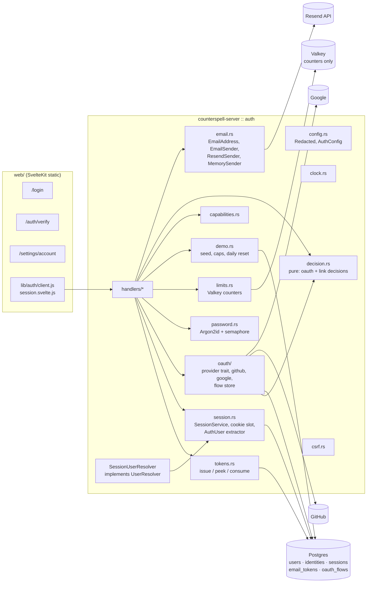
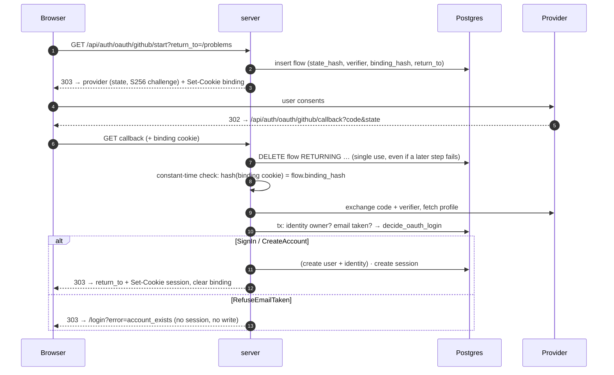

# Design: auth

## Design approach

This is a Requirements-First feature spec. `requirements.md` is approved input; this document decides the data contract, the order of operations on each path, the failure behaviour, and how every security rule is proven by a test. The architecture is fixed by `docs/system-design.md` §2, §4, §9 and §10. This design adds **no** crate, no package and no service. Rust and SQL sketches show intent and shape. They are not final code.

No task in `tasks.md` is run by this spec-generation step.

## The idea in plain English

1. **Three ways in.** A visitor can use GitHub, Google, or email. Email means a one-time link, or an email and password.
2. **Proof becomes a session.** Once the visitor has proved who they are, the server creates a random 256-bit value and gives it to the browser as a cookie. The database keeps only a hash of it. Every later request is checked against that table.
3. **Accounts are never merged.** If you sign in with Google and Google's email happens to match another account, nothing happens except an explanation. Only a signed-in person can add a second way in, and only after proving the new way is theirs: a Google round trip tied to their session, or a link emailed to the new address that must be opened while signed in as the same account.
4. **Links die fast.** Email links live 15 minutes, work once, and are consumed by a database statement that cannot succeed twice.
5. **Judges get a front door.** One seeded demo account signs in with a password. It cannot link, change credentials, delete itself or sign everyone out, and its data is wiped every day.
6. **Everything is checked on the server.** The browser pages are convenience only.

## Scope and seams

### Built here

- `crates/server/src/auth/`: configuration, clock, tokens, email, OAuth providers and flows, pure decision functions, sessions, passwords, rate limits, CSRF middleware, demo account, handlers.
- Migrations for the five auth tables, privileges, demo guards, the demo-reset function and the `submissions.user_id` foreign key.
- Web: `/login`, `/auth/verify`, `/settings/account`, and a small client in `web/src/lib/auth/`.
- Tests: pure properties, database tests, hostile tests, and a manual smoke checklist.

### Seams

| Seam | Owner | How this spec connects |
|---|---|---|
| `UserResolver` → `UserId`, extractor `CurrentUser` | `run-lifecycle` (`crates/server/src/seams.rs`, its T21) | `SessionUserResolver` is the production implementation. The trait takes `&HeaderMap`; the implementation reads the session cookie from it. If the trait's signature turns out to be too narrow (it needs a database call), T11 makes the small edit in `seams.rs`. |
| `UserId` type | `run-lifecycle` T02 in `counterspell-common` | Reused. If it is not merged yet when this spec is built, T02 creates it identically. |
| Client IP rule and Valkey limiter | `run-lifecycle` R5 (`limits` module) | Reused for `ClientIp` and the fixed-window counter. If absent, T15 creates them in `crates/server/src/net.rs` and `limits.rs` and `run-lifecycle` imports them. |
| Database roles `counterspell_server` / `counterspell_judge` | `run-lifecycle` role migration | This spec grants the server role its auth privileges and grants the judge role nothing. |
| `submissions.user_id` foreign key | `run-lifecycle` (deferred to this spec) | Added by a guarded migration (T08). The tests of `run-lifecycle` then need real users; T34 gives them a fixture. |
| `/api` middleware stack | `repo-skeleton` router | The CSRF middleware wraps the whole `/api` router, so it also covers the run endpoints. |

## Threat model in one table

| Threat | Control |
|---|---|
| Stolen database copy | Only hashes of tokens, session values and `state` are stored (R3.2, R10.2). Passwords are Argon2id. The PKCE verifier is stored in clear for at most 10 minutes and is useless without the authorization code. |
| Email-match account takeover ("sign in with Google, take over the account with the same email") | Identity-first decision; email collision refuses (R7). Pure function plus model test. |
| Pre-hijacking (attacker registers the victim's email first) | No account row without mailbox proof (R15.7); stored emails are always verified (R18.2). |
| Login CSRF through OAuth | `state` is single-use and tied to a binding cookie (R6.3). |
| Link CSRF (attacker links their GitHub to the victim, or the reverse) | Link `state` is bound to the victim's session and user (R8.2). |
| Mail scanner burns the magic link | Verification is a `POST` after a click; `GET` never consumes (R5.3). |
| Token guessing / replay | 256-bit tokens, single-use atomic consume, 15-minute window (R3). |
| Session fixation | A new session value on every sign-in; client values are never adopted (R10.6). |
| Cross-site request forgery | `SameSite=Lax`, Origin / Fetch-Metadata check, JSON only (R13). |
| Open redirect via `return_to` | Same-origin path sanitiser, stored server-side (R6.8). |
| Account enumeration | Uniform answers for magic link, register, reset, login (R5.1, R15.2). Residual: OAuth `account_exists` is shown only to someone who just proved control of that address at a provider. |
| Email quota exhaustion (Resend free plan) | Per-email, per-IP and global daily caps (R4.8, R14). |
| Password guessing | Per-(email, IP) and per-IP limits, Argon2id, bounded hashing concurrency (R14, R15). |
| Compromised judge or sandbox reads accounts | Judge role has no privilege on auth tables (R1.3, R18.8). |
| Shared demo account abused | Capability restrictions, database guards, daily reset (R16). |
| Secrets in logs | Redacting types, path-only trace for callbacks, log-capture test (R19). |
| Residual, accepted | A magic link is not bound to the requesting browser (opening it on a phone must work). An attacker can therefore send a victim a link for the attacker's own address; the victim would then be signed in to the attacker's account (login CSRF). Impact is low on a practice site. Open question 11. |

## Where the code lives



### Module tree (all inside `crates/server/src/auth/`)

```text
auth/
├── mod.rs            # pub fn router(state) -> Router; AuthState
├── config.rs         # AuthConfig::from_env / from_map (pure, testable); Redacted<T>
├── clock.rs          # trait Clock; SystemClock; ManualClock (testkit)
├── errors.rs         # AuthError → (status, code, message); callback error codes
├── email.rs          # EmailAddress; EmailSender; ResendSender; MemorySender; LogSender; templates
├── tokens.rs         # RawToken, TokenHash, Purpose, TokenStore (issue, peek, consume)
├── return_to.rs      # sanitize_return_to
├── decision.rs       # decide_oauth_login, decide_link, ProfileEmail (all pure)
├── capabilities.rs   # Capabilities::for_user, require()
├── session.rs        # SessionService, AuthSession, CookieSlot, AuthUser/MaybeAuthUser extractors
├── resolver.rs       # SessionUserResolver (run-lifecycle seam)
├── password.rs       # hash/verify/rehash, dummy verify, HashGate (semaphore)
├── limits.rs         # AuthLimiter over the shared Valkey window counter
├── csrf.rs           # origin_guard middleware, no_store layer
├── oauth/
│   ├── mod.rs        # ProviderId, ProviderProfile, OAuthProvider trait
│   ├── flow.rs       # FlowStore (create, consume) over oauth_flows
│   ├── github.rs     # real adapter
│   ├── google.rs     # real adapter
│   └── fake.rs       # FakeProvider (testkit)
├── demo.rs           # seed_demo, reset scheduler, DemoConfig
├── cleanup.rs        # periodic delete of expired rows
└── handlers/         # config, magic, verify, oauth, link, login, register, reset, session, me, delete
```

## Configuration

| Variable | Required | Notes |
|---|---|---|
| `PUBLIC_BASE_URL` | yes | `https://…` in production. Source of every emitted URL and of the CSRF origin. |
| `DATABASE_URL` | yes | The `counterspell_server` login role. |
| `VALKEY_URL` | yes | Counters only. |
| `SESSION_SECRET` | yes | At least 32 bytes (base64 accepted). Keys the HMAC for limiter and log identifiers only. |
| `APP_ENV` | no | `production` (default) or `development`. Controls the guards in R2.5 and R2.6. |
| `GITHUB_OAUTH_CLIENT_ID` / `_SECRET` | per provider | Both or the provider is off. |
| `GOOGLE_OAUTH_CLIENT_ID` / `_SECRET` | per provider | Both or the provider is off. |
| `RESEND_API_KEY`, `MAIL_FROM` | for email sign-in | `MAIL_FROM` like `Counterspell <login@your-domain>`; the domain must be verified in Resend. |
| `MAIL_TRANSPORT` | no | `resend` (default in production) or `log` (development only). |
| `EMAIL_DAILY_CAP` | no | Default 80. |
| `DEMO_ACCOUNT_EMAIL`, `DEMO_ACCOUNT_PASSWORD` | for the demo | Password at least 16 characters. Supplied by the operator at deploy time; never in the repo. |
| `DEMO_RESET_HOUR_UTC` | no | Default 0. |

`AuthConfig::from_map(&HashMap<String,String>)` holds all parsing and validation so tests never touch the process environment. `from_env()` only collects the map. Secrets are wrapped in `Redacted<String>`, whose `Debug`/`Display` print `[redacted]`.

Compose passes these through as `${NAME}` pass-throughs in a later task. No task reads or writes `.env`.

## Data contract

Migration files sort after the `run-lifecycle` migrations. Proposed names (the timestamps are placeholders chosen when the tasks run):

| File | Content |
|---|---|
| `…_auth_core.sql` | extension `citext`, five tables, constraints, indexes, triggers |
| `…_auth_privileges.sql` | grants and revokes for the two roles |
| `…_auth_demo.sql` | demo guard trigger, `cs_reset_demo_account()` |
| `…_auth_submissions_fk.sql` | guarded foreign key `submissions.user_id → users(id)` |

### `users`

```sql
CREATE EXTENSION IF NOT EXISTS citext;     -- trusted extension; the migrate role is the database owner

CREATE TABLE users (
  id              uuid PRIMARY KEY DEFAULT gen_random_uuid(),
  email           citext UNIQUE,                       -- only ever a VERIFIED address (see check)
  email_verified_at timestamptz,
  password_hash   text,                                -- Argon2id PHC string
  handle          citext NOT NULL UNIQUE
                  CHECK (handle ~ '^[a-z0-9][a-z0-9_-]{2,31}$'),
  display_name    text NOT NULL CHECK (char_length(display_name) BETWEEN 1 AND 80),
  country         text CHECK (country IS NULL OR country ~ '^[A-Z]{2}$'),
  xp              int  NOT NULL DEFAULT 0 CHECK (xp >= 0),
  streak_days     int  NOT NULL DEFAULT 0 CHECK (streak_days >= 0),
  last_active     date,
  familiar_prefs  jsonb NOT NULL DEFAULT '{}'::jsonb,
  is_demo         boolean NOT NULL DEFAULT false,
  demo_reset_at   timestamptz,                         -- meaningful only on the demo row; written by cs_reset_demo_account()
  created_at      timestamptz NOT NULL DEFAULT now(),
  updated_at      timestamptz NOT NULL DEFAULT now(),
  CONSTRAINT users_email_is_verified     CHECK (email IS NULL OR email_verified_at IS NOT NULL),
  CONSTRAINT users_password_needs_email  CHECK (password_hash IS NULL OR email IS NOT NULL),
  CONSTRAINT users_email_shape           CHECK (email IS NULL OR (char_length(email) <= 254
                                                  AND email !~ '[[:space:][:cntrl:]<>,;"]'))
);
CREATE UNIQUE INDEX users_one_demo ON users ((true)) WHERE is_demo;
```

The columns after `handle` come from `docs/system-design.md` §4 so later specs (dashboard, familiar) need no change. `is_demo`, `demo_reset_at` and `updated_at` are added here.

Handles: generated, never user input in this spec. `handle_from(label, rng)` lower-cases the provider label, replaces runs of invalid characters with `-`, trims to 24 characters, pads to the 3-character minimum, and appends a 4-digit random suffix on collision (up to 5 tries, then a fully random handle). A reserved list (`demo`, `admin`, `api`, `root`, `system`, `support`, `counterspell`) is never produced; `demo` is used only by the seed.

### `identities`

```sql
CREATE TABLE identities (
  user_id          uuid NOT NULL REFERENCES users(id) ON DELETE CASCADE,
  provider         text NOT NULL CHECK (provider IN ('github','google')),
  provider_user_id text NOT NULL CHECK (char_length(provider_user_id) BETWEEN 1 AND 128),
  provider_label   text CHECK (provider_label IS NULL OR char_length(provider_label) <= 100),
  linked_at        timestamptz NOT NULL DEFAULT now(),
  PRIMARY KEY (provider, provider_user_id),
  UNIQUE (user_id, provider)
);
```

No email column exists. `provider_label` (GitHub login or Google name) is display text only and is never queried to find an account.

### `email_tokens`

```sql
CREATE TABLE email_tokens (
  token_hash  bytea PRIMARY KEY CHECK (octet_length(token_hash) = 32),
  purpose     text  NOT NULL CHECK (purpose IN ('magic_link','verify','reset','link_email')),
  email       citext NOT NULL CHECK (char_length(email) <= 254),
  user_id     uuid REFERENCES users(id) ON DELETE CASCADE,
  payload     jsonb NOT NULL DEFAULT '{}'::jsonb,    -- {"return_to": "...", "password_hash": "..."}
  created_at  timestamptz NOT NULL,                  -- from the Clock, no default
  expires_at  timestamptz NOT NULL,
  used_at     timestamptz,
  CONSTRAINT email_tokens_ttl CHECK (expires_at > created_at
                                 AND expires_at <= created_at + interval '15 minutes'),
  CONSTRAINT email_tokens_link_has_user CHECK (purpose <> 'link_email' OR user_id IS NOT NULL)
);
CREATE INDEX email_tokens_live   ON email_tokens (email, purpose) WHERE used_at IS NULL;
CREATE INDEX email_tokens_expiry ON email_tokens (expires_at);
```

`created_at` has no default on purpose: the application writes the Clock's time, so a manual clock in tests and the 15-minute check agree.

### `sessions`

```sql
CREATE TABLE sessions (
  id                  text PRIMARY KEY CHECK (id ~ '^[0-9a-f]{64}$'),   -- SHA-256 hex of the cookie value
  user_id             uuid NOT NULL REFERENCES users(id) ON DELETE CASCADE,
  auth_method         text NOT NULL CHECK (auth_method IN
                        ('magic_link','oauth_github','oauth_google','password','register')),
  data                jsonb NOT NULL DEFAULT '{}'::jsonb,               -- reserved (system-design §4); stays empty
  created_at          timestamptz NOT NULL,
  last_renewed_at     timestamptz NOT NULL,
  expires_at          timestamptz NOT NULL,
  absolute_expires_at timestamptz NOT NULL,
  CHECK (expires_at <= absolute_expires_at),
  CHECK (absolute_expires_at <= created_at + interval '90 days')
);
CREATE INDEX sessions_user   ON sessions (user_id);
CREATE INDEX sessions_expiry ON sessions (expires_at);
```

A `BEFORE UPDATE` trigger raises if `user_id`, `created_at` or `absolute_expires_at` change, or if `expires_at` decreases.

### `oauth_flows`

```sql
CREATE TABLE oauth_flows (
  state_hash    bytea PRIMARY KEY CHECK (octet_length(state_hash) = 32),
  provider      text NOT NULL CHECK (provider IN ('github','google')),
  purpose       text NOT NULL CHECK (purpose IN ('login','link')),
  pkce_verifier text NOT NULL CHECK (char_length(pkce_verifier) BETWEEN 43 AND 128),
  binding_hash  bytea CHECK (binding_hash IS NULL OR octet_length(binding_hash) = 32),
  session_id    text REFERENCES sessions(id) ON DELETE CASCADE,
  user_id       uuid REFERENCES users(id)    ON DELETE CASCADE,
  return_to     text NOT NULL DEFAULT '/' CHECK (char_length(return_to) <= 200),
  created_at    timestamptz NOT NULL,
  expires_at    timestamptz NOT NULL,
  CHECK (expires_at > created_at AND expires_at <= created_at + interval '10 minutes'),
  CHECK ( (purpose = 'login' AND binding_hash IS NOT NULL AND session_id IS NULL AND user_id IS NULL)
       OR (purpose = 'link'  AND binding_hash IS NULL AND session_id IS NOT NULL AND user_id IS NOT NULL) )
);
```

`ON DELETE CASCADE` on `session_id` is how "logging out kills pending link flows" (R8.7) is guaranteed by the database.

### Privilege matrix (R1.3, R18.8)

`REVOKE ALL ON the five tables FROM PUBLIC` first. Then:

| Table | `counterspell_server` | `counterspell_judge` |
|---|---|---|
| `users` | `SELECT`, `INSERT`, `UPDATE (email, email_verified_at, password_hash, display_name, country, xp, streak_days, last_active, familiar_prefs, updated_at)`, `DELETE` | none |
| `identities` | `SELECT`, `INSERT` | none |
| `email_tokens` | `SELECT`, `INSERT`, `UPDATE (used_at)`, `DELETE` | none |
| `sessions` | `SELECT`, `INSERT`, `UPDATE (last_renewed_at, expires_at)`, `DELETE` | none |
| `oauth_flows` | `SELECT`, `INSERT`, `DELETE` | none |
| `cs_reset_demo_account()`, `cs_seed_demo_user(text, text)` | `EXECUTE` | none |

`handle`, `is_demo` and `demo_reset_at` are not updatable by the server role after insert. The demo seed needs to create or update the demo user's credentials, so it uses a `SECURITY DEFINER` helper `cs_seed_demo_user(email, password_hash)` that sets `counterspell.demo_seed = 'on'` locally and upserts the single demo row. That helper is the only code that can create the demo user or change its credentials. (Open question 9.) Plain `INSERT` by the server role cannot create a demo user either, because the guard trigger below also fires on `INSERT`.

Cascading deletes through foreign keys are performed by the database with the table owner's rights, so they need no grant.

### Demo guards and daily reset (R16.6, R16.7)

```sql
-- Barrier 2 for the demo account. The application checks capabilities first (barrier 1).
CREATE FUNCTION cs_guard_demo_user() RETURNS trigger LANGUAGE plpgsql AS $$
BEGIN
  IF TG_OP = 'DELETE' THEN
    IF OLD.is_demo THEN RAISE EXCEPTION 'the demo account cannot be deleted'; END IF;
    RETURN OLD;
  END IF;
  IF TG_OP = 'INSERT' AND NEW.is_demo
     AND coalesce(current_setting('counterspell.demo_seed', true), '') <> 'on' THEN
    RAISE EXCEPTION 'the demo account can only be created during seeding';
  END IF;
  IF TG_OP = 'UPDATE' AND NEW.is_demo AND NOT OLD.is_demo THEN
    RAISE EXCEPTION 'an existing account cannot become the demo account';
  END IF;
  IF TG_OP = 'UPDATE' AND OLD.is_demo THEN
    IF NEW.is_demo IS DISTINCT FROM true OR NEW.id <> OLD.id THEN
      RAISE EXCEPTION 'the demo account cannot lose its demo flag or id';
    END IF;
    IF (NEW.email IS DISTINCT FROM OLD.email OR NEW.password_hash IS DISTINCT FROM OLD.password_hash
        OR NEW.handle <> OLD.handle)
       AND coalesce(current_setting('counterspell.demo_seed', true), '') <> 'on' THEN
      RAISE EXCEPTION 'the demo account credentials can only change during seeding';
    END IF;
  END IF;
  RETURN NEW;
END $$;
-- BEFORE INSERT OR UPDATE OR DELETE ON users FOR EACH ROW

-- identities: BEFORE INSERT trigger raises when the user is the demo user.
```

`cs_reset_demo_account()` (sketch):

```sql
CREATE FUNCTION cs_reset_demo_account() RETURNS bigint
LANGUAGE plpgsql SECURITY DEFINER SET search_path = pg_catalog, public AS $$
DECLARE demo uuid; fk record; removed bigint := 0; n bigint;
BEGIN
  SELECT id INTO demo FROM users WHERE is_demo;
  IF demo IS NULL THEN RETURN 0; END IF;
  IF NOT pg_try_advisory_xact_lock(hashtextextended('cs_demo_reset', 0)) THEN RETURN 0; END IF;

  -- 1. finished runs (and, by cascade, jobs, events, results, ghosts, hints …)
  IF to_regclass('public.submissions') IS NOT NULL THEN
    EXECUTE 'DELETE FROM public.submissions WHERE user_id = $1 AND finished_at IS NOT NULL' USING demo;
    GET DIAGNOSTICS n = ROW_COUNT; removed := removed + n;
  END IF;

  -- 2. other per-user tables of later specs (concept_cards, game_scores, …):
  --    every single-column foreign key to users(id), except auth tables and submissions
  FOR fk IN
    SELECT c.conrelid::regclass AS tbl, a.attname AS col
      FROM pg_constraint c JOIN pg_attribute a ON a.attrelid = c.conrelid AND a.attnum = c.conkey[1]
     WHERE c.contype = 'f' AND c.confrelid = 'public.users'::regclass AND array_length(c.conkey, 1) = 1
       AND c.conrelid::regclass::text NOT IN ('sessions','identities','email_tokens','oauth_flows','submissions')
  LOOP
    EXECUTE format('DELETE FROM %s WHERE %I = $1', fk.tbl, fk.col) USING demo;
  END LOOP;

  UPDATE users SET xp = 0, streak_days = 0, last_active = NULL, familiar_prefs = '{}'::jsonb,
                   demo_reset_at = now(), updated_at = now() WHERE id = demo;
  RETURN removed;
END $$;
REVOKE ALL ON FUNCTION cs_reset_demo_account() FROM PUBLIC;
GRANT EXECUTE ON FUNCTION cs_reset_demo_account() TO counterspell_server;
```

`format('%s')` receives a `regclass` cast to text (already quoted by the database); `%I` quotes the column. No user input reaches the SQL text. Running submissions are skipped (`finished_at IS NOT NULL`), so the judge never loses a row mid-run. The reset is serialised by the advisory lock and is safe to call twice.

### Foreign key from submissions (R18.7)

```sql
DO $$ BEGIN
  IF to_regclass('public.submissions') IS NOT NULL
     AND NOT EXISTS (SELECT 1 FROM pg_constraint WHERE conname = 'submissions_user_fk') THEN
    ALTER TABLE submissions
      ADD CONSTRAINT submissions_user_fk FOREIGN KEY (user_id) REFERENCES users(id) ON DELETE CASCADE;
  END IF;
END $$;
```

### Cascade rule test (R18.6)

`pg_all_fks_to_users_and_submissions_cascade` queries `pg_constraint` for every foreign key whose target is `users` or `submissions` and asserts `confdeltype = 'c'`. A later spec that forgets `ON DELETE CASCADE` fails CI, which keeps account deletion and the demo reset correct.

## Core mechanisms

### Clock

```rust
pub trait Clock: Send + Sync { fn now(&self) -> OffsetDateTime; }
```

`SystemClock` in production; `ManualClock` (settable, in the `testkit` feature) in tests. Every SQL statement that decides expiry takes `$now` as a parameter from the Clock. This differs from the judge, which uses the database clock because many workers share a lease. Here one server process issues and checks, so a single application clock is consistent, and tests can move time.

### Tokens

```rust
pub struct RawToken(String);              // 43 chars base64url, never Debug-printed
pub struct TokenHash([u8; 32]);

impl RawToken { pub fn generate() -> Self }            // 32 bytes from OsRng
impl TokenHash { pub fn of(raw: &str) -> Self }        // SHA-256

pub enum Purpose { MagicLink, Verify, Reset, LinkEmail }

pub struct TokenStore { pool: PgPool, clock: Arc<dyn Clock> }
impl TokenStore {
    pub async fn issue(&self, p: Purpose, email: &EmailAddress, user: Option<UserId>, payload: Value)
        -> Result<RawToken, AuthError>;
    pub async fn peek(&self, raw: &str) -> Result<Option<Peeked>, AuthError>;      // purpose + user_id only; no state change
    pub async fn consume(&self, raw: &str, p: Purpose, bound_user: Option<UserId>)
        -> Result<Consumed, AuthError>;                                             // InvalidOrExpired on any failure
}
```

`issue` runs in one transaction: supersede, then insert.

```sql
UPDATE email_tokens SET used_at = $now
 WHERE email = $1 AND purpose = $2 AND used_at IS NULL;                   -- R3.7
INSERT INTO email_tokens (token_hash, purpose, email, user_id, payload, created_at, expires_at)
VALUES ($3, $2, $1, $4, $5, $now, $now + interval '15 minutes');
```

`consume` is one statement, so single-use needs no application lock:

```sql
UPDATE email_tokens SET used_at = $now
 WHERE token_hash = $1 AND purpose = $2
   AND used_at IS NULL AND expires_at > $now
   AND ($3::uuid IS NULL OR user_id = $3)       -- link_email: the session user only
RETURNING email, user_id, payload;
```

Under Postgres's default isolation, a second concurrent `UPDATE` waits for the first to commit, re-evaluates `used_at IS NULL`, and matches no row. That is the whole proof of P1, and the test hammers it with many tasks.

`peek` exists only so the verify handler knows which purpose and bound user to demand before consuming. For a `link_email` token it lets the handler answer `401` or `invalid_or_expired_token` without burning the token.

### OAuth flows

```rust
pub struct FlowStore { pool: PgPool, clock: Arc<dyn Clock> }
impl FlowStore {
    pub async fn create_login(&self, provider: ProviderId, return_to: &str)
        -> Result<NewFlow /* state, challenge, binding */, AuthError>;
    pub async fn create_link(&self, provider: ProviderId, session: &SessionKey, user: UserId, return_to: &str)
        -> Result<NewFlow, AuthError>;
    pub async fn consume(&self, state: &str, provider: ProviderId) -> Result<Option<Flow>, AuthError>;
}
```

`consume` is `DELETE FROM oauth_flows WHERE state_hash = $1 AND provider = $2 AND expires_at > $now RETURNING …`. A flow is gone after the first callback, successful or not (R6.3). The PKCE pair comes from `oauth2::PkceCodeChallenge::new_random_sha256()`; the verifier is stored, the challenge goes to the provider.

### Pure decisions

The two decisions that carry the "no automatic linking" rule are plain functions with no database and no I/O. That makes them cheap to test with thousands of random inputs.

```rust
pub enum ProfileEmail { Absent, Free(EmailAddress), Taken }     // computed by the caller; no invalid mixes

pub enum OAuthDecision {
    SignIn(UserId),                          // identity already known
    CreateAccount { email: Option<EmailAddress> },
    RefuseEmailTaken,                        // no session, no write
}

pub fn decide_oauth_login(identity_owner: Option<UserId>, email: ProfileEmail) -> OAuthDecision {
    match identity_owner {
        Some(user) => OAuthDecision::SignIn(user),               // email is ignored
        None => match email {
            ProfileEmail::Taken => OAuthDecision::RefuseEmailTaken,
            ProfileEmail::Free(e) => OAuthDecision::CreateAccount { email: Some(e) },
            ProfileEmail::Absent => OAuthDecision::CreateAccount { email: None },
        },
    }
}
```

There is no way to express "sign in to the owner of this email" in `OAuthDecision`, because `SignIn` can only carry the identity owner. The type makes the forbidden outcome unrepresentable.

```rust
pub enum LinkDecision {
    Link, AlreadyLinkedHere, RefuseLinkedElsewhere, RefuseProviderAlreadyLinked, RefuseDemo,
}
pub fn decide_link(actor: &Actor /* id, is_demo */, identity_owner: Option<UserId>,
                   actor_has_provider: bool) -> LinkDecision { … }
```

Order inside `decide_link`: demo first, then `identity_owner == Some(actor)` (idempotent), then `Some(other)`, then `actor_has_provider`, else `Link`.

Rust lesson for the tasks that build these: an `enum` lets the compiler list every case; `match` without a wildcard forces every new case to be handled.

### Email address

```rust
pub struct EmailAddress(String);                       // always normalised, always valid
impl EmailAddress { pub fn parse(input: &str) -> Result<Self, EmailError> }
```

`parse` trims, lower-cases, checks length (≤254), ASCII only, exactly one `@`, local part and domain non-empty, domain has a dot and no empty label, and none of whitespace, control characters, `<>,;"`. It is idempotent: `parse(parse(x).as_str()) == parse(x)` (P15). Mail is addressed with `to: [address]`, a single-element array, so a crafted value cannot add recipients or headers.

### `return_to` sanitiser

```rust
pub fn sanitize_return_to(input: Option<&str>) -> String   // "/" when not acceptable
```

Accepts only: starts with `/`; second character is not `/` or `\`; length ≤ 200; no control characters; and the percent-decoded form also does not start with `//` or `/\`. Result is always a path relative to the site. P16 joins the result to the base URL with `url::Url::join` and asserts the origin is unchanged.

### Sessions

```rust
pub struct SessionService { pool: PgPool, clock: Arc<dyn Clock>, cfg: SessionConfig }

pub struct AuthSession { pub user_id: UserId, pub key: SessionKey, pub is_demo: bool }

impl SessionService {
    pub async fn create(&self, user: UserId, method: AuthMethod) -> Result<NewSession /* raw cookie value */, AuthError>;
    pub async fn authenticate(&self, raw: &str) -> Result<Option<Authenticated>, AuthError>;   // may renew
    pub async fn revoke(&self, key: &SessionKey) -> Result<(), AuthError>;
    pub async fn revoke_all(&self, user: UserId) -> Result<u64, AuthError>;
    pub async fn is_valid(&self, key: &SessionKey) -> Result<bool, AuthError>;                // for SSE heartbeats (R11.6)
}
```

Authenticate (one query, then maybe one update):

```sql
SELECT s.id, s.user_id, s.last_renewed_at, u.is_demo
  FROM sessions s JOIN users u ON u.id = s.user_id
 WHERE s.id = $1 AND s.expires_at > $now AND s.absolute_expires_at > $now;

UPDATE sessions SET last_renewed_at = $now,
       expires_at = LEAST($now + interval '30 days', absolute_expires_at)
 WHERE id = $1 AND last_renewed_at <= $now - interval '1 hour'
RETURNING expires_at;                                           -- a row back means: re-issue the cookie
```

Why not `tower-sessions`: `docs/system-design.md` §3 lists it, but its store keeps opaque serialized records keyed by the raw session id, and "log out everywhere" needs an index on `user_id`. Adapting it needs a custom store anyway, and `run-lifecycle`'s `UserResolver` receives only headers, so we would end up parsing the cookie twice. A single `SessionService` over one table is smaller, directly testable with the Clock, and hashes the key. Open question 5 records the deviation.

**Cookie renewal.** A middleware `session_cookie` puts a `CookieSlot` (an `Arc<Mutex<Option<Cookie>>>`) into the request extensions. The `AuthUser` extractor fills it when `authenticate` renewed the session or found the cookie unusable (a clearing cookie). After the handler returns, the middleware appends the `Set-Cookie`. The `SessionUserResolver` used by run-lifecycle goes through the same `authenticate`, so renewals also happen there.

**Cookie facts.**

| Cookie | Name (https / dev) | Attributes | Life |
|---|---|---|---|
| Session | `__Host-cs_session` / `cs_session` | `HttpOnly; Secure; SameSite=Lax; Path=/`, no `Domain` (dev: no `Secure`) | 30 days, re-issued on renewal |
| OAuth binding | `__Host-cs_oauth` / `cs_oauth` | same | 10 minutes, cleared at callback |

`SameSite=Lax` is required, not `Strict`: the provider's redirect back to the callback is a cross-site top-level navigation, and Lax cookies are sent on it. `__Host-` forces `Secure`, `Path=/` and no `Domain`, so a sibling subdomain cannot plant a cookie.

**Extractors.** `AuthUser` (rejects with `401 unauthenticated`) and `MaybeAuthUser` (optional). Neither takes an id from the request. The only way to get a `UserId` in a handler is through them. `GET /api/me`, `logout-all`, link starts and delete all take `AuthUser`.

### Capabilities

```rust
pub struct Capabilities { pub link_provider: bool, pub link_email: bool,
                          pub change_credentials: bool, pub delete_account: bool,
                          pub logout_everywhere: bool }
impl Capabilities {
    pub fn for_user(is_demo: bool) -> Self { /* demo: all false; else all true */ }
    pub fn require(&self, c: Capability) -> Result<(), AuthError>;      // → DemoRestricted (403)
}
```

Every mutating handler calls `require` first; there is no other place that knows about the demo account's limits. `/api/me` sends the struct to the UI.

### Passwords

`argon2` crate, `Argon2id`, `Params::new(19_456 /*KiB*/, 2, 1, None)`. The PHC string is stored. `verify` returns `Verified | NeedsRehash | Rejected`. For an unknown email, `verify_dummy` checks the supplied password against a constant, pre-computed PHC string of the same parameters, so success and failure cost the same time. All hashing runs in `tokio::task::spawn_blocking` behind a `HashGate` (`tokio::sync::Semaphore`, 4 permits **[E]**); waiting more than 2 s gives `503 busy`.

### CSRF and response headers

```rust
pub async fn origin_guard(State(cfg): State<Arc<WebOrigin>>, req: Request, next: Next) -> Response
```

For `POST|PUT|PATCH|DELETE`: allow if `Origin` is present and equals the base origin; else if `Sec-Fetch-Site` is present, allow only `same-origin` or `none`; else allow only if the request has no `Cookie` header. Anything else is `403 csrf_origin_mismatch`. A second layer sets `Cache-Control: no-store` on auth routes and `Referrer-Policy: no-referrer` on redirects. The `Content-Type` and 16 KiB checks are one more small layer on the auth router.

### Rate limits

| Action | Key scope | Limit **[E]** | Valkey outage |
|---|---|---|---|
| `magic`, `register`, `reset`, `link/email` | email HMAC; IP HMAC | 3 / hour per email; 10 / hour per IP | closed (`503 email_unavailable`) |
| global daily email cap | `rl:auth:mail:day:<yyyymmdd>` | `EMAIL_DAILY_CAP` (80) | closed |
| `verify` | IP | 30 / 10 min | open, log |
| `login` failures | (email HMAC, IP HMAC); IP | 5 / 15 min; 20 / 15 min | open, log |
| `oauth start` | IP | 20 / 10 min | open, log |
| `link start` | user id | 10 / hour | open, log |

Keys are `rl:auth:<action>:<scope>:<hmac_hex>`, hold a counter, and expire with the window. The limiter checks before any side effect, so a limited request sends no mail and hashes nothing (R14.2). The login failure counter increments only on failure and is read before verification.

### Email sending

```rust
#[async_trait]
pub trait EmailSender: Send + Sync {
    async fn send(&self, msg: OutgoingMail) -> Result<(), MailError>;
}
pub struct OutgoingMail { pub to: EmailAddress, pub subject: String, pub text: String, pub html: String,
                          pub idempotency_key: String }
```

- `ResendSender`: `POST https://api.resend.com/emails`, `Authorization: Bearer <key>`, JSON `{from, to: [to], subject, html, text}`, header `Idempotency-Key` (Resend supports it and keeps keys 24 hours), `reqwest` with rustls, timeouts 3 s / 10 s, one retry on connect error or `5xx`. Plain `reqwest` instead of `resend-rs` keeps one fewer dependency and one trait seam.
- `MemorySender` (tests): records messages so tests can extract the raw token from the link.
- `LogSender` (development): prints the link to the log. Refused when `APP_ENV=production`.
- A `GuardedSender` wrapper refuses to send to the demo address and enforces the global cap.
- **Delivery is detached.** After the token row commits, the handler spawns the send and returns `202`. That keeps response time the same for known and unknown addresses. A lost send only means an unusable-but-expiring token.

Templates are fixed Rust strings: a subject per purpose, a text body and a small HTML body with the escaped values. Each says the link works once, for 15 minutes, and to ignore the mail if the reader did not ask. The link is `{PUBLIC_BASE_URL}/auth/verify#token={raw}`.

### OAuth providers

```rust
#[async_trait]
pub trait OAuthProvider: Send + Sync {
    fn id(&self) -> ProviderId;
    fn authorize_url(&self, state: &str, code_challenge: &str, redirect_uri: &Url) -> Url;
    async fn fetch_profile(&self, code: &str, pkce_verifier: &str, redirect_uri: &Url)
        -> Result<ProviderProfile, ProviderError>;
}
pub struct ProviderProfile { pub provider_user_id: String, pub label: Option<String>,
                             pub verified_email: Option<EmailAddress> }
```

| | GitHub | Google |
|---|---|---|
| Authorize | `https://github.com/login/oauth/authorize` | `https://accounts.google.com/o/oauth2/v2/auth` |
| Token | `https://github.com/login/oauth/access_token` | `https://oauth2.googleapis.com/token` |
| Profile | `GET https://api.github.com/user` (numeric `id`, `login`) and `GET /user/emails` (primary and verified) | `GET https://openidconnect.googleapis.com/v1/userinfo` (`sub`, `name`, `email`, `email_verified`) |
| Headers | `Accept: application/vnd.github+json`, `User-Agent: counterspell` | bearer token |
| Scopes | `read:user user:email` | `openid email profile` |

- Token exchange uses the `oauth2` crate (authorization code with the stored PKCE verifier). The profile uses plain `reqwest` with the access token and the limits of R6.9. Google's `userinfo` over TLS is used instead of validating an ID token, which avoids a JWT dependency; the `sub` is the same stable key. **[U]** The `oauth2` crate's API differs between major versions: T19 pins the version and adapts the sketch.
- GitHub added PKCE support for OAuth apps on 14 July 2025 and does not enforce it **[V, secondary source]**. We always send `S256` and always store and use the verifier, so our side is correct whether or not GitHub enforces it.
- Real adapters are tested against a local mock HTTP server (`wiremock`) that checks the request shape: `code_verifier` present, bearer header, `User-Agent`, and that only a verified primary email is used.
- `FakeProvider` implements the same trait for property tests: it returns a configured `ProviderProfile` per `code`.

## Flows in detail

### Magic link

```mermaid
sequenceDiagram
  autonumber
  participant B as Browser
  participant S as server
  participant V as Valkey
  participant P as Postgres
  participant M as Resend
  B->>S: POST /api/auth/email/magic {email, return_to}
  S->>S: origin_guard · parse email · sanitize return_to
  S->>V: limits (email, IP) and daily cap
  S->>P: supersede old tokens, insert token (hash, 15 min)
  S-->>B: 202 {"status":"sent"}   (same for every address)
  S-)M: send link .../auth/verify#token=RAW   (detached; not for the demo address)
  Note over B: user opens the link
  B->>B: /auth/verify reads the fragment, clears it, shows "Confirm sign-in"
  B->>S: POST /api/auth/email/verify {token}
  S->>P: peek (purpose) then consume (single UPDATE)
  S->>P: tx: find user by email, or create user; create session
  S-->>B: 200 {user, return_to} + Set-Cookie
```

### OAuth sign-in



Callback error codes (all redirect to `/login?error=` or, for link flows, `/settings/account?error=`): `oauth_denied`, `oauth_failed` (exchange or profile failed), `state_invalid` (unknown, expired, reused, wrong binding or wrong session), `account_exists`, `identity_already_linked`, `provider_already_linked`, `provider_disabled`. The page maps each to a fixed sentence; no provider text is shown.

Transaction detail for `CreateAccount`: `INSERT users …`, `INSERT identities …` in one transaction. A unique violation on `identities` (a double click raced) re-runs the decision once and signs in to the winner; a unique violation on `users.email` (someone took the address a moment ago) is treated as `RefuseEmailTaken`.

### Linking a provider

`POST /api/auth/link/github/start` → `AuthUser` → `Capabilities::require(LinkProvider)` → limiter → `create_link(provider, session.key, user.id)` → `200 {authorize_url}`. The web page sets `location` to it. The callback is the same URL as for sign-in. After `consume`, a `link` flow requires `authenticate(cookie)` to return the same session key and user. Then `fetch_profile`, then `decide_link` against the current identity rows, then `INSERT identities`. Result: `303 → /settings/account?linked=github` or `?error=<code>`.

### Linking an email

`POST /api/auth/link/email {email}` → `AuthUser` → capability → account has no email? (else `409 email_already_set`) → limiter → if the address belongs to anyone, skip the mail, else issue a `link_email` token bound to `user_id` and send. Always `202`. The verify handler, for purpose `link_email`, calls `MaybeAuthUser`: no session → `401`; session user ≠ token user → `invalid_or_expired_token` (nothing consumed); same user → `consume(…, bound_user)` and `UPDATE users SET email = …, email_verified_at = $now WHERE id = $u AND email IS NULL`. Unique violation → `409 email_in_use`.

### Password login, register, reset

- **Login:** `origin_guard` → parse → limiter (read failures) → find user by email → `verify` (or `verify_dummy`) inside `HashGate` → success: `create` session, `NeedsRehash` → update hash; failure: increment the failure counters, answer `401 invalid_credentials`.
- **Register (Should):** parse → password policy → limiter → hash (gate) → `issue(Verify, email, None, {"password_hash": …, "return_to": …})` → `202` always. On verify: consume → if no user with the email, `INSERT users (email, email_verified_at, password_hash, …)` and create a session (`auth_method = 'register'`); if a user exists, answer `409 account_exists` and change nothing.
- **Reset (Should):** request answers `202` always, sends mail only if the user exists, has a hash, and is not the demo user. Confirm: policy → consume `Reset` → hash → `UPDATE users SET password_hash` → `revoke_all(user)` → `204`.

### Logout, logout everywhere, `/api/me`

`logout`: `revoke(key)` if a session exists; always clear the cookie; `204`. `logout-all`: `AuthUser` → capability (`logout_everywhere`) → `revoke_all(user)` → clear → `204`. `GET /api/me`: `AuthUser` → select the caller's row and identities by `user_id` → build the response with `Capabilities::for_user(is_demo)`.

### Long-lived streams (R11.6)

`AuthUser` exposes `AuthSession::key`. The run-lifecycle SSE loop calls `SessionService::is_valid(&key)` on each 15 s heartbeat and closes the stream when it returns `false`. T34 wires this into the SSE handler. Until then `logout-all` takes effect on every new request but not on an open stream.

## Demo account

- **Seed (`demo::seed`)** runs after migrations when both env vars are set: it computes an Argon2id hash only if the stored hash does not already verify the configured password, then calls `cs_seed_demo_user(email, hash)` (the `SECURITY DEFINER` helper that sets `counterspell.demo_seed = 'on'` locally, upserts the single demo user with handle `demo`, `display_name 'Demo Judge'`, `email_verified_at = now()`). With the variables unset, nothing is seeded and `GET /api/auth/config` reports `demo.enabled = false`.
- **Sign-in:** `GET /api/auth/config` returns `{"providers":{"github":bool,"google":bool},"email":{"magic_link":bool,"password":bool},"demo":{"enabled":bool,"email":"…"}}`. The login page's "Judging? Use the demo account" link opens the demo form (`/login?demo=1`), pre-filled with the demo email, and the judge types the password from the Devpost private field. It posts to `POST /api/auth/login`. The password is never in a response, a page or the repository.
- **Restrictions:** `Capabilities::for_user(true)` is all false. Besides the handler-level `require`, the magic-link request handler skips mail for the demo address, the verify handler refuses tokens whose email is the demo address, the OAuth decision's email check treats the demo address as taken (it is, by `users.email`), and reset never sends for it.
- **Daily reset:** a task in `demo.rs` wakes every 5 minutes, computes the most recent scheduled reset time (`DEMO_RESET_HOUR_UTC` today or yesterday), and calls `cs_reset_demo_account()` when `users.demo_reset_at` (written by the function itself, null before the first reset) is older than that time. Because the timestamp lives in the database, a restart does not repeat a reset and a missed one runs on start-up. The advisory lock inside the function makes duplicates harmless. The function returns the number of runs removed, which is logged.
- **Judges share limits:** the demo user's run limits (`run-lifecycle` R5, per user) are shared by every judge at the same time. This spec does not change them. Open question 8.

## API summary

| Method and path | Auth | Purpose | Notes |
|---|---|---|---|
| `GET /api/auth/config` | none | enabled providers, email modes, demo flag | public, no secrets |
| `GET /api/auth/oauth/{provider}/start?return_to=` | none | begin sign-in | `303`; sets binding cookie |
| `GET /api/auth/oauth/{provider}/callback` | cookie | finish sign-in or link | `303` only; never JSON |
| `POST /api/auth/link/{provider}/start` | session | begin link | `200 {authorize_url}` |
| `POST /api/auth/link/email` | session | add email | `202` |
| `POST /api/auth/email/magic` | none | request link | `202` |
| `POST /api/auth/email/verify` | none or session | consume any email token | purpose decides |
| `POST /api/auth/register` | none | start password registration (Should) | `202` |
| `POST /api/auth/login` | none | password sign-in | `200 {user}` |
| `POST /api/auth/password/reset` | none | request reset (Should) | `202` |
| `POST /api/auth/password/reset/confirm` | none | set new password (Should) | `204` |
| `POST /api/auth/logout` | optional | end this session | `204` |
| `POST /api/auth/logout-all` | session | end all sessions | `204` |
| `GET /api/me` | session | the caller's data | `no-store` |
| `DELETE /api/me` | session | delete account (Could) | `204` |

Differences from `docs/system-design.md` §9: verify is `POST` (was `GET`); one shared OAuth callback per provider (was a separate link callback); `logout-all`, `auth/config` and `reset/confirm` are new. The system design should be updated to match; this run may not edit it. See Open questions 1, 2 and 12.

### Error codes

All JSON errors are `{"code": "...", "message": "..."}` with a fixed, safe message.

| HTTP | `code` | When |
|---|---|---|
| 400 | `invalid_email`, `weak_password`, `invalid_json`, `confirmation_mismatch` | input |
| 400 | `invalid_or_expired_token` | any token problem (R3.5) |
| 401 | `unauthenticated` | no or bad session |
| 401 | `invalid_credentials` | password login failed (identical for every cause) |
| 403 | `csrf_origin_mismatch`, `demo_account_restricted` | policy |
| 404 | `provider_disabled` | provider has no credentials |
| 409 | `email_already_set`, `email_in_use`, `account_exists`, `runs_active` | state conflicts |
| 413 | `body_too_large` | over 16 KiB |
| 415 | `unsupported_media_type` | not JSON |
| 429 | `rate_limited` | with `Retry-After` and `retry_after_seconds` |
| 503 | `email_unavailable`, `busy` | cap reached, Valkey down for mail, hashing queue full |

## Web design

Files: `web/src/routes/login/+page.svelte`, `web/src/routes/auth/verify/+page.svelte`, `web/src/routes/settings/account/+page.svelte`, `web/src/lib/auth/client.js` (fetch wrapper: JSON, `credentials: 'same-origin'`, maps error codes), `web/src/lib/auth/session.svelte.js` (a Svelte 5 rune store holding `user | null`, loaded from `GET /api/me`). JavaScript with JSDoc types, matching the existing `jsconfig.json`.

- **Login:** provider buttons are plain links to `/api/auth/oauth/<p>/start?return_to=…`. The email form has two tabs (magic link, password) built with Bits UI primitives. The demo link toggles the demo form. The error banner is an `aria-live="polite"` region with fixed sentences keyed by `error`.
- **Verify:** reads `location.hash`, calls `history.replaceState` at once to drop the token from the address bar and history, holds the token in memory only, and posts it on click. It shows "link used or expired" with a button to request a new one.
- **Settings:** renders from `GET /api/me`. Buttons are driven by `capabilities`; when false they are disabled with visible text saying why ("The demo account can't be changed").
- Semantic tokens only, no GSAP, no colour-only status, output rendered as text nodes. These are working screens, not the cinematic landing; visual polish is a separate task for another tool (playbook Part F).
- The client-side redirect to `/login` on `401` is a convenience; the server enforces everything.

## Correctness properties

Property-based tests use `proptest`. Properties marked **DB** need Postgres (`pg_*` tests); the others are pure or use fakes.

| ID | Property | Requirements | Technique |
|---|---|---|---|
| P1 | **Token single-use.** For any issued token and any number of attempts to consume it (sequential or concurrent, 2 to 32 tasks), exactly one succeeds. | R3.4 | DB. Many tasks race `consume`; count successes. |
| P2 | **Token expiry.** Consuming at time `t` succeeds iff the token is unused and `issued_at <= t < issued_at + 15 min`. The stored lifetime is never longer than 15 minutes. | R3.3, R3.5, R3.8 | DB with `ManualClock`; a pure `token_status` model is compared with the SQL result for random times. |
| P3 | **Purpose and supersede.** A token never validates for another purpose. After issuing a second token for (email, purpose), the first never validates, and at most one token per (email, purpose) is live. | R3.6, R3.7 | DB. Random sequences of issue and consume. |
| P4 | **Secrets at rest.** After any sequence of operations, no raw token, session value, `state` or password appears in any table or dump; stored password hashes are Argon2id PHC with parameters at or above the minimum, `verify(hash(p), p)` holds and `verify(hash(p), p')` fails for `p != p'`. | R3.2, R10.2, R15.3 | DB. Scan all rows for known raw values. Pure for the hash round trip. |
| P5 | **OAuth decision.** `decide_oauth_login(Some(u), any)` is `SignIn(u)`. With `None`, a taken email is `RefuseEmailTaken`. `SignIn` never carries any user other than the identity owner. | R7.1–R7.3, R7.5 | Pure, all combinations. |
| P6 | **No merge by email (model).** Start from random accounts and identities with random emails. Apply random OAuth callbacks from a `FakeProvider` with random profiles. At every step: no existing account's set of identities grows; a session is created only for the identity's owner or for a brand-new account; an email collision creates no session and no row; every user row is either unchanged or new. | R7.5, R7.7, R6.6 | DB, stateful model test. |
| P7 | **Flow single-use and binding.** A flow works once; a wrong or missing binding cookie, a wrong provider, a modified `state`, an expired flow, or (for link flows) a different session fails and still consumes the flow. The `code_challenge` sent equals S256 of the stored verifier. | R6.1, R6.3, R8.2, R8.7 | DB with `FakeProvider`; pure check for the challenge. |
| P8 | **Link conflicts.** Linking never moves an identity. An identity owned by another user, or a second identity for the same provider, is refused with no change; relinking the same identity is a no-op. | R8.4, R8.5 | `decide_link` pure; DB model for the full flow. |
| P9 | **Session isolation.** For random users and random operations (sign-ins, link attempts, logouts, `/api/me`, resolver calls), a request authenticated with user A's session only ever returns A's data, and a forged or foreign session value or id never authenticates. No handler reads a user id from the request. | R12.1, R12.4, R12.5 | DB stateful model, plus a test that inspects every route's extractor list. |
| P10 | **Logout.** After `logout`, exactly that session is dead. After `logout-all`, every session of that user is dead on the next request and every other user's sessions are unchanged; pending link flows of the dead sessions are gone. | R11.1–R11.4, R8.7 | DB model. |
| P11 | **Session lifetime.** With a manual clock and random request times: a session authenticates iff `now < min(last_renewed + 30 d (rolling), created + 90 d)`; renewal happens at most once per hour; the stored expiry never decreases and never passes the absolute limit. | R10.3–R10.5 | DB + `ManualClock`, compared with a pure model. |
| P12 | **No fixation.** Every sign-in method yields a session value different from any value the client sent; a client-supplied unknown value never becomes valid. | R10.6 | Handler test over all sign-in paths. |
| P13 | **Cookie attributes.** Every `Set-Cookie` the auth code emits (session, binding, clearing cookies) has `HttpOnly`, `Secure` (non-dev), `SameSite=Lax`, `Path=/`, no `Domain`, and the `__Host-` prefix on https. | R10.1, R6.1 | Router test that collects `Set-Cookie` from every route. |
| P14 | **Uniform answers.** For random known and unknown addresses, the status, body and headers (minus `Date`) of `magic`, `register`, `reset` and `link/email` are identical; failed password logins are identical for unknown email, wrong password and no password. | R5.1, R9.1, R15.2, R15.7, R15.8 | Handler test with `MemorySender`; response comparison. |
| P15 | **Email normalisation.** `parse` is idempotent; accepted addresses are lower-case ASCII, at most 254 characters and contain no whitespace, control or `<>,;"`; alias forms (dots, `+tag`) are never merged; a rendered Resend payload has exactly one recipient. | R4.3, R4.4 | Pure, random strings plus a targeted corpus. |
| P16 | **`return_to` stays on the site.** For random strings including `//x`, `/\x`, `/%2f%2fx`, `https://x`, control characters: the result is `/` or a path whose join with the base URL has the same origin. | R6.8, R5.9 | Pure; `url::Url::join`. |
| P17 | **Demo restrictions.** For every mutating endpoint and a demo session: `403 demo_account_restricted` (or the endpoint's refusal) and no database change; `logout` works; magic link, tokens and OAuth never reach the demo user; the database triggers refuse identity insert, delete and credential change outside seeding. | R16.4–R16.6 | Handler matrix + DB trigger tests. |
| P18 | **Demo reset.** After reset, the demo user has no finished submissions or dependent rows and zero counters; every other user's rows are byte-identical; a second reset changes nothing; running submissions survive; a concurrent second call does nothing. | R16.7, R16.8 | DB; compare snapshots of other users. |
| P19 | **Limits.** Within one window, request `limit + 1` is refused with `Retry-After >= 1` and causes no mail and no password hash; a refused request does not consume another unit; counters are keyed per scope; with Valkey down, mail endpoints send nothing. | R14.1–R14.4 | Limiter against fake store and real Valkey in CI. |
| P20 | **Privileges and cascade.** The judge role has no privilege on the five tables or the reset function; the server role has no `TRUNCATE`, no `UPDATE` on `handle` or `is_demo`; every foreign key to `users` or `submissions` is `ON DELETE CASCADE`. | R1.3, R18.6, R18.8 | DB, `has_table_privilege` and `pg_constraint`. |
| P21 | **No secrets in logs.** During a full run through every flow, captured log output contains none of: raw tokens, session values, passwords, `code`, `state`, verifier, access tokens, client secrets, the Resend key, email addresses. | R19.1–R19.3 | Capturing `tracing` subscriber; canary values. |
| P22 | **CSRF rule.** For random methods, `Origin`, `Sec-Fetch-Site` and `Cookie` combinations, the guard allows exactly the combinations in R13.1, and a refused request changes nothing. | R13.1 | Pure on the predicate; handler test for no side effect. |

Properties P1, P2, P3, P6, P9, P10, P11 and P18 are the ones that justify PBT. If time is short, they are the last to cut.

## Test strategy

- **Layers:** pure unit and property tests (no I/O); DB tests with `#[sqlx::test]` named `pg_*` and `#[ignore]` unless `DATABASE_URL` is set (the convention of `run-lifecycle`); handler tests through `axum::Router` with `tower::ServiceExt::oneshot`; provider adapters against `wiremock`.
- **Fakes:** `FakeProvider`, `MemorySender`, `ManualClock`, an in-memory limiter store, all behind the `testkit` feature of the server crate (the feature `run-lifecycle` introduces). A CI step guards that release builds do not enable `testkit`.
- **Shrinking:** model tests print the shrunk operation sequence on failure; regression files are committed.
- **Hostile list (R21.3):** replay, concurrent consume, tampered state, foreign binding, link flow with another user's session, expired everything, cross-origin POST, open-redirect corpus, enumeration probe, log capture.
- **CI:** Postgres and Valkey services (as in `run-lifecycle`); `cargo test --workspace -- --include-ignored` in the database job.
- **Manual (not automated):** a real GitHub OAuth app and Google OAuth client (callback URL `${PUBLIC_BASE_URL}/api/auth/oauth/<provider>/callback`) and a verified Resend domain, on the VPS. The checklist is in the final task.

## Failure behaviour

| Failure | Behaviour |
|---|---|
| Postgres unavailable | Auth routes answer `500 internal_error` with a safe message; no session is granted; protected routes answer `401`/`500`, never allow. |
| Valkey unavailable | Mail endpoints `503 email_unavailable`; other limits fail open and log. |
| Resend fails or is slow | Detached send; request already answered `202`; failure logged without token. |
| Provider token or profile call fails or times out | Redirect with `oauth_failed`; flow already consumed; no session. |
| Provider returns an unverified email | Treated as absent; the account is created without an email. |
| Unique-violation race on user or identity creation | One retry of the decision (identity) or `account_exists` (email); never two users for one identity. |
| Session cookie for a deleted user or expired session | Treated as signed out; clearing cookie sent. |
| Config invalid at start | Process exits with the variable name (R2.2). |
| Demo reset throws | Logged; retried at the next 5-minute tick; nothing partial because it runs in one transaction. |
| Clock jumps backwards | Tokens and sessions that were valid stay valid slightly longer; `absolute_expires_at` limits the damage. |

## Security and architecture invariants

- No `.env`, key or credential file is created or read by this spec's tasks. Secrets reach the process only as environment variables.
- The judge, MCP and sandbox have no access to auth tables or secrets.
- Valkey never holds a session, token or flow.
- No code path merges accounts or looks up an account by a provider email, except the single "is this email taken" check.
- Every state-changing route is behind the Origin guard; `GET` never consumes an email token.
- Production Rust code avoids `unwrap()` and `expect()`; errors keep context and map to the stable codes above.

## Open questions

Each has the choice assumed in this spec. Change a choice and the affected requirement and task change with it.

1. **Verify is `POST`, not `GET`.** `docs/system-design.md` §9 lists `GET /api/auth/email/verify?token=`. Mail scanners pre-fetch links and would burn a single-use token. **Assumed:** `POST /api/auth/email/verify` behind a confirm button, token in the URL fragment. The system design needs the same edit.
2. **One OAuth callback per provider.** §9 shows `/callback` after both sign-in start and link start. GitHub OAuth apps accept one callback URL. **Assumed:** a single callback `/api/auth/oauth/{provider}/callback`; the flow row says whether it is sign-in or link.
3. **Demo reset needs a privileged function.** The server role cannot `DELETE` from `submissions` (run-lifecycle role matrix). **Assumed:** a `SECURITY DEFINER` function `cs_reset_demo_account()` that can only act on the demo user, executable by the server role. Alternative: a third role used by a one-shot job. Rejected as more moving parts for a hackathon.
4. **Absolute session limit.** ACC-2.1 says 30 days rolling. **Assumed:** add a 90-day absolute limit so an active session still ends.
5. **Own sessions instead of `tower-sessions`.** §3 lists `tower-sessions`. **Assumed:** a small `SessionService` over the §4 `sessions` table with `axum-extra` cookies, because logout-everywhere needs a `user_id` index, session keys must be hashed, and `UserResolver` only sees headers. If you want `tower-sessions`, T10 and T11 change, the requirements do not.
6. **Password sign-in scope.** The brief says "keep all three sign-ins" and §9 includes register and reset; the demo account needs password login. **Assumed:** login is *Must*; register and reset are *Should* and sit in a late wave so they can be cut.
7. **One email per account, no change-email.** `users.email` is a single column. **Assumed:** adding an email works only when the account has none; changing or removing is out of scope.
8. **Shared limits for the demo account.** All judges share one user's run limits (30 runs per 10 minutes). **Assumed:** unchanged here; if judges collide, raise the limit for `is_demo` in the run-lifecycle limiter.
9. **Demo credential changes use a `SECURITY DEFINER` helper.** Instead of granting the server role `UPDATE (handle, is_demo)`. **Assumed:** `cs_seed_demo_user(email, hash)` is the only path. Simpler alternative: grant the columns and rely on the trigger plus the `counterspell.demo_seed` setting.
10. **Demo reset hour.** **Assumed:** 00:00 UTC (02:00 SAST, 16:00 Pacific). Set `DEMO_RESET_HOUR_UTC` to a quieter hour for the judging window.
11. **Magic links are not bound to the requesting browser.** Binding would block opening the mail on a phone. **Assumed:** accept the residual login-CSRF risk described in the threat model.
12. **Extra endpoints not in §9.** `logout-all`, `auth/config`, `password/reset/confirm`. **Assumed:** they are fine; update §9.
13. **Account deletion scope.** ACC-5 is *Could*. **Assumed:** `DELETE /api/me` is in the last wave and may be cut; the demo guard is not optional.
14. **Generic demo reset SQL.** The function deletes from every table that has a single-column foreign key to `users`, except the auth tables and `submissions`. **Assumed:** later specs' per-user tables (concept cards, game scores, hints) are then reset without editing the function. Alternative: an explicit table list that each spec must extend.
15. **Fake `to` addresses in development.** The `log` mail transport prints the link, including the raw token, to the server log. **Assumed:** acceptable in development only; refused in production.
16. **Caddy access logs.** Caddy logs the full URL by default, which would include `code` and `state` on the OAuth callback. **Assumed:** T33 adds a Caddy log filter that drops the query string for `/api/auth/oauth/*/callback`. This touches `Caddyfile`, which belongs to the skeleton, and needs your approval when the task runs.
