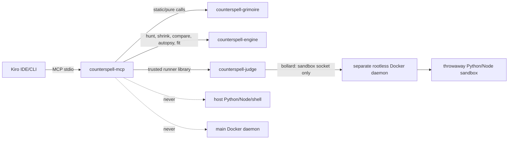

# Low-level design: counterspell-mcp-power

## Design approach

This is a Design-First feature. It adds a thin `rmcp` protocol adapter, a reusable library surface from the existing judge package, a Power manifest and skills, workspace MCP registration, and a private dogfood workflow. It does not add a new architecture or a new crate.

The critical design rule is that MCP is a control-plane client, not an execution boundary. Kiro talks to `counterspell-mcp` over stdio. Pure tools call the engine or Grimoire libraries. Code-running tools call a judge-owned runner, which uses only the separate rootless sandbox Docker daemon and applies the same production image, driver, comparator, deadline, output, and cleanup rules. No MCP tool invokes Python, Node, a shell, or a Docker CLI on the developer machine.

## Scope and non-goals

### Included

- `crates/mcp/` package `counterspell-mcp`, using official `rmcp` and stdio.
- Six tools: `validate_pack`, `find_ghost_input`, `shrink_input`, `run_reference`, `explain_verdict`, and `fit_complexity`.
- A library target in the existing `counterspell-judge` package if required to expose the trusted sandbox runner to MCP.
- Reuse of `counterspell-engine` and `counterspell-grimoire` public APIs.
- `kiro-power/plugin.json`, Power `mcp.json`, and the two requested skills.
- `.kiro/settings/mcp.json` with only pure/static tools auto-approved.
- A private underscore-prefixed dogfood pack and an evidence-producing scripted session.

### Deferred

- Public server/API integration, authentication, Postgres, Valkey, SSE, web UI, AI hints, and Familiar presentation.
- A sandbox-validation mode on the auto-approved `validate_pack` tool. If a later feature needs sandbox pack validation, it must be an explicit approved operation.
- Running benchmarks from `fit_complexity`; the tool fits supplied timing samples only.
- Power marketplace publication, unless Kiro's Power Builder and the user explicitly add that work after import testing.

## Architecture and data flow



The call paths are:

- `validate_pack`: MCP → Grimoire static validator → bounded JSON report.
- `explain_verdict`: MCP → engine autopsy/difference helpers and pack known-ghost data → bounded explanation.
- `fit_complexity`: MCP → engine pure timing-fit function → fit report.
- `run_reference`: MCP → judge runner → sandbox reference driver → raw `ProgramResult`.
- `find_ghost_input`: MCP → judge-backed `Oracle` → engine `hunt` → judge runner for each evaluation.
- `shrink_input`: MCP → judge-backed probe → engine `shrink` → judge runner for each proposal.

The judge runner owns the trusted side of every code-running operation. It loads the selected language and image from the canonical language catalog, keeps expected values out of the sandbox, compares raw answers with the engine comparator, enforces per-test deadlines from outside, bounds output, and cleans the container. MCP does not reinterpret a runner infrastructure error as a user failure.

## Cargo package boundaries and dependency direction

The workspace remains the six-package layout:

```text
crates/
├── mcp/
│   ├── Cargo.toml
│   └── src/
│       ├── main.rs          # rmcp stdio startup only
│       ├── server.rs        # service registration and lifecycle
│       ├── tools.rs         # six thin handlers
│       ├── schemas.rs       # request/response types
│       ├── errors.rs        # bounded protocol-safe error mapping
│       ├── config.rs        # workspace and sandbox configuration
│       ├── paths.rs         # root-relative path validation
│       └── judge_adapter.rs # MCP-to-judge/Oracle adapter
└── judge/
    ├── Cargo.toml
    └── src/
        ├── main.rs          # existing worker entry point
        ├── lib.rs           # reusable trusted runner library target
        └── runner/           # production sandbox implementation
```

The dependency direction is:

| Package/module | May use | Must not use |
|---|---|---|
| `mcp::server`, `mcp::tools` | rmcp, Tokio stdio, engine, Grimoire, judge library, serde | direct process execution, Docker CLI, main Docker socket, duplicate engine logic |
| `mcp::schemas`, `mcp::errors`, `mcp::paths` | serde, serde_json, standard path/string validation | code execution, network, secret files |
| `judge::runner` | bollard, language config, engine/Grimoire runner contracts, Tokio | main Docker socket, public listener, host interpreter fallback |
| `engine` | its existing pure dependencies | MCP, Docker, filesystem, process, network |
| `grimoire` static validation | its existing pure/file-read validation APIs and engine types | host code execution, MCP transport, direct Docker |

The judge library target is part of the `counterspell-judge` package, not a seventh package. `main.rs` and `lib.rs` share runner modules. The production judge binary and the local MCP process can both use the same runner implementation, while MCP is still required to connect only to a sandbox-only rootless endpoint.

## Trusted runner seam

The implementation should expose a small judge library boundary rather than make MCP know Docker details. The exact Rust names can follow the existing judge-sandbox implementation, but the contract has this shape:

```rust
pub struct TrustedRunner {
    // Docker client connected only to the configured sandbox endpoint.
    // Language catalog and fixed production limits are held here.
}

pub struct ExecutionRequest {
    pub pack: ProblemRecord,
    pub target: Target,
    pub input: serde_json::Value,
    pub deadline: Duration,
}

pub enum Target {
    Reference,
    PackProgram { relative_path: String },
}

pub struct ExecutionResult {
    pub outcome: counterspell_engine::ProgramResult,
    pub elapsed: Duration,
    pub bounded_stderr: Option<String>,
}

pub enum RunnerFailure {
    Configuration(String),
    Infrastructure(String),
    InvalidRequest(String),
}

impl TrustedRunner {
    pub async fn execute(
        &mut self,
        request: ExecutionRequest,
    ) -> Result<ExecutionResult, RunnerFailure>;
}
```

The production `PackRunner` and engine `Oracle` adapters should be built from this boundary, not reimplemented in MCP. A `JudgeOracle` owns a mutable runner reference and implements the engine's synchronous contract at the boundary chosen by the judge implementation. If the judge runner is asynchronous internally, the MCP tool handler awaits one bounded execution at a time and passes the resulting observation into the synchronous engine orchestration without adding async code to `counterspell-engine`.

The runner must reject a missing or unapproved sandbox endpoint. It must not silently interpret `DOCKER_HOST` as permission to use an arbitrary socket. Deployment configuration supplies the separate rootless endpoint; production must not mount `/var/run/docker.sock` into MCP or the server. Images are pre-pulled and pinned by the language configuration; runtime pulls are disabled.

## MCP configuration and lifecycle

`config.rs` loads non-secret values from environment or an explicit workspace configuration:

- workspace root;
- pack root, defaulting to `packs/`;
- language catalog path, defaulting to `languages/languages.toml`;
- sandbox-only Docker endpoint supplied by deployment configuration;
- production-compatible request and response caps.

No `.env`, key, credential, or token file is read. The MCP process validates paths at the boundary. A path must be workspace-relative, resolve inside the configured root, contain no symlink component, and refer to an allowed pack file or pack directory. Tool arguments cannot select an arbitrary host path.

`main.rs` should:

1. load and validate non-secret configuration;
2. construct the engine/Grimoire adapters and, when configured, the trusted runner;
3. register the six tools with `rmcp` descriptions and schemas;
4. connect the stdio transport;
5. keep protocol output on stdout and bounded logs on stderr;
6. shut down cleanly on EOF or cancellation.

Pure tools may serve when the sandbox endpoint is absent. Code-running handlers return a clear `sandbox_not_configured` or `sandbox_unavailable` error and never try another execution path.

## Tool contracts

The exact `rmcp` attribute and schema syntax must follow the verified SDK version, but the semantic contracts are fixed below.

### `validate_pack`

Request:

```json
{
  "pack_path": "packs/_demo/mcp-dogfood",
  "deny_warnings": false
}
```

The path is workspace-relative and is read by the Grimoire library. The validator runs static layout, UTF-8/control-character, metadata, schema, statement, samples, generator, hints, known-ghost, and reference-text checks. It does not interpret Python. The response reuses the Grimoire JSON report, with bounded diagnostic text and no hidden generated values.

This tool is safe to auto-approve because this feature gives it no execution mode and it never writes the pack.

### `find_ghost_input`

Request shape:

```json
{
  "pack_path": "packs/_demo/mcp-dogfood",
  "program": "incorrect/buggy.py",
  "seed_override": null,
  "budget": {
    "max_candidates": 500,
    "search_ms": 4000,
    "max_shrink_evals": 300,
    "shrink_ms": 3000,
    "total_ms": 8000
  }
}
```

The program path must resolve inside the pack and must be accepted by Grimoire's pack model. The handler builds the same `HuntRequest` used by production, including problem version, image digest, language, engine version, comparator, schema, known ghosts, and deterministic identity. The judge-backed Oracle runs the reference and implementation in sandbox containers. The handler returns the engine's full report, including `Found`, `NotFound`, or `Aborted`, provenance, budget status, failure predicate, trace, and autopsy data allowed for the selected pack.

The result wording must say “minimized counterexample” and “smallest failing input found within the budget” where applicable. It must never say “smallest possible,” “global minimum,” or “optimal.”

### `shrink_input`

Request shape:

```json
{
  "pack_path": "packs/_demo/mcp-dogfood",
  "program": "incorrect/buggy.py",
  "input": [[1, 1], 2],
  "target": {"kind": "wrong"},
  "max_evals": 300,
  "wall_ms": 3000
}
```

The handler validates the input against the pack schema before any execution. It creates a judge-backed probe that evaluates the implementation and reference through the same production runner and accepts only the target failure predicate. It calls `counterspell_engine::shrink`; it does not contain proposal generation, size comparison, or trace logic. It verifies the returned input through the judge before returning it.

Timeout inputs follow the engine contract. If this feature does not support shrinking timeout predicates through the MCP schema, the handler returns a clear unsupported-target error instead of pretending a timeout ghost is minimized.

### `run_reference`

Request shape:

```json
{
  "pack_path": "packs/_demo/mcp-dogfood",
  "input": [[1, 1], 2]
}
```

The handler validates the input and invokes only `Target::Reference` through the judge. It returns a bounded raw outcome (`returned`, `crashed`, `timed_out`, or `garbled`) and safe timing/diagnostic metadata. The trusted runner remains the authority for the result. It never exposes hidden test data and never runs `reference/solution.py` on the host.

### `explain_verdict`

Request shape:

```json
{
  "pack_path": "packs/_demo/mcp-dogfood",
  "input": [[1, 1], 2],
  "expected": 2,
  "actual": 3,
  "kind": "wrong"
}
```

The handler uses engine difference/autopsy helpers and the pack's authored known ghosts. It returns the observed kind, structural difference, concepts, one-line explanation, and authored explanation metadata when the input matches a known ghost. If no authored explanation matches, it returns observed facts and says that no authored mistake was found; it does not call an LLM or invent one. This tool is pure and auto-approvable.

### `fit_complexity`

Request shape:

```json
{
  "samples": [
    {"n": 256, "median_ns": 1200},
    {"n": 512, "median_ns": 2600},
    {"n": 1024, "median_ns": 5500}
  ],
  "reference_complexity": "n"
}
```

The engine fit function computes the slope, size ratios, normalized residuals, best-fitting model from the declared model set, confidence, and relation to the reference class. It receives no source code and performs no execution. It rejects non-increasing sizes, zero/negative durations, oversized sample lists, and insufficient points. This is pure and auto-approvable.

## Result and error mapping

All responses are bounded. A tool handler maps errors into stable categories:

| Category | Examples | MCP behavior |
|---|---|---|
| `invalid_request` | malformed schema, path escape, bad budget, input outside schema | structured `isError` result with safe message |
| `not_found` | pack/program/known ghost does not exist | structured error, no host path disclosure |
| `engine_not_found` | hunt budget exhausted without a matching ghost | successful tool result containing the engine `NotFound` outcome |
| `sandbox_not_configured` | no approved rootless endpoint | structured infrastructure error |
| `sandbox_infrastructure` | Docker API, image, cgroup, cleanup, or runner failure | structured infrastructure error; never a user verdict |
| `engine_aborted` | reference unreliable, Oracle failure, invalid engine request | structured error preserving the abort reason |
| `internal` | unexpected adapter failure | bounded error plus correlation id if logging provides one |

A found ghost, a no-ghost-within-budget result, and a successful pure fit are normal tool results. Infrastructure and invalid requests are errors. Error messages do not include absolute host paths, secrets, hidden tests, or unbounded program output.

## Security controls and tests

The implementation must enforce these controls at the code boundary:

- no direct `Command`, interpreter, shell, Docker CLI, or arbitrary socket access from MCP;
- workspace-relative path resolution with symlink and traversal rejection;
- shared production language/image/limit configuration;
- separate sandbox-only Docker endpoint and no main daemon mount;
- no network, read-only root, non-root UID, dropped capabilities, no-new-privileges, default seccomp, CPU/memory/PID/wall/output controls, and cleanup in the judge runner;
- bounded tool arguments and results;
- engine and Grimoire error distinctions preserved;
- no secrets or `.env` reads;
- static checks that scan MCP sources for host execution APIs and test missing-sandbox behavior;
- fake runner tests for protocol behavior and deterministic outcomes, plus a real rootless smoke test in an environment that explicitly provides the sandbox daemon.

The fake runner must implement the same typed boundary but must not be used by production configuration. The real smoke test must prove that a deliberately hostile or buggy program is executed in the sandbox and that a missing sandbox endpoint fails closed.

## Power package design

```text
kiro-power/
├── plugin.json
├── mcp.json
└── skills/
    ├── author-problem/
    │   └── SKILL.md
    └── hunt-ghost/
        └── SKILL.md
```

`plugin.json` contains the Power identity, description, keywords (`ghost input`, `grimoire`, `problem pack`, `shrink`), and references to the bundled MCP/skills according to the verified Agent Plugins schema. `mcp.json` points at the repository-relative command:

```json
{
  "mcpServers": {
    "counterspell-mcp": {
      "command": "cargo",
      "args": ["run", "-q", "--release", "-p", "counterspell-mcp"],
      "cwd": "${workspaceFolder}",
      "disabled": false,
      "autoApprove": ["validate_pack", "explain_verdict", "fit_complexity"]
    }
  }
}
```

The final field names must be adjusted to the verified Agent Plugins schema if the Power Builder requires a different wrapper, but the semantic allow-list must remain exactly the three non-executing tools. The Power must not embed an absolute developer path.

`author-problem/SKILL.md` should instruct Kiro to:

1. create original problem text and metadata under a pack directory;
2. declare the engine schema, samples, generator, reference, four hints, and optional known ghosts;
3. run `validate_pack` first;
4. ask for explicit approval before any code-running MCP tool;
5. use `run_reference`/`find_ghost_input` only through the sandbox;
6. keep hidden data out of prompts, logs, and results.

`hunt-ghost/SKILL.md` should instruct Kiro to:

1. identify a reproducible failing implementation;
2. call `find_ghost_input` and inspect its predicate/provenance/trace;
3. call `explain_verdict` for observed or authored explanation;
4. fix the implementation rather than editing the ghost to hide the failure;
5. call `validate_pack`, then re-run `find_ghost_input`;
6. report a verified minimized counterexample honestly and never claim a global minimum.

## Workspace settings design

`.kiro/settings/mcp.json` registers the same server name, command, working-directory strategy, and tool names as the Power. It contains no credentials. Its `autoApprove` list is exactly:

```json
["validate_pack", "explain_verdict", "fit_complexity"]
```

`run_reference`, `find_ghost_input`, and `shrink_input` are deliberately absent. Configuration tests should parse the file and fail if an execution tool appears in `autoApprove` or a required pure tool is missing.

## Dogfood pack and evidence design

Use an underscore-prefixed path such as:

```text
packs/_demo/mcp-dogfood/
├── problem.md
├── meta.toml                 # dogfood = true, origin = "original"
├── hints.toml
├── reference/solution.py
├── incorrect/buggy.py
└── known_ghosts.toml         # optional authored match for the expected bug
```

The problem should be small, original, deterministic, and easy to explain in under three minutes. The buggy implementation should have one intentional, observable wrong-answer or crash bug that shrinks to a compact input. The reference and incorrect files are repository data and are never executed by a local Python command.

The scripted session should be captured as a scrubbed chat export and should show:

1. Kiro asks Counterspell MCP to find a ghost for `incorrect/buggy.py`.
2. Kiro receives a sandbox-backed minimized counterexample and recorded shrink steps.
3. Kiro identifies and fixes the bug in the implementation.
4. Kiro calls `validate_pack` and receives a passing static report.
5. Kiro calls `find_ghost_input` again and receives no counterexample within the configured budget, or the implementation's successful re-verification outcome defined by the engine contract.
6. Kiro installs/imports the Power or shows the installed Power.

Store the scrubbed export under `docs/kiro-log/chats/` and screenshots under `docs/media/kiro/`. The implementation task must update `docs/KIRO_USAGE.md` with links and factual claims only after the evidence exists. Screenshots must show the tool call, shrink result, fix, re-verification, and Power installation without secrets, hidden tests, or private credentials.

## Verification plan

The implementation is verified in layers:

1. `cargo fmt --all -- --check`.
2. `cargo clippy --workspace --all-targets --all-features -- -D warnings`.
3. `cargo test -p counterspell-engine -p counterspell-grimoire -p counterspell-judge -p counterspell-mcp`.
4. MCP protocol/schema tests for all six tools.
5. static host-execution and path-boundary tests.
6. Power JSON/skill path/keyword/config validation.
7. a real sandbox smoke test using the configured rootless daemon, with no host fallback.
8. dogfood scripted session and evidence review.

Rust changes must not use production `unwrap()` or `expect()`. Errors crossing the MCP, filesystem, and sandbox boundaries must retain context. Each implementation task touching Rust adds a 3–5 line plain-English Rust lesson to the repository lesson log.

## Open questions

1. **Which exact `rmcp` release and feature flags should be pinned?** **Assumed choice:** use the current workspace-compatible official `rmcp` release with stdio/server features only, verify its API and Apache-2.0-compatible licensing before implementation, and record the selected version in `Cargo.toml` and `THIRD-PARTY-NOTICES.md`.
2. **What exact Agent Plugins manifest keys does Kiro currently require?** **Assumed choice:** use the documented `plugin.json`/`mcp.json`/`skills/**/SKILL.md` layout, validate it with the Power Builder/import flow, and adjust only schema spelling or wrapper metadata without changing the required files, keywords, tools, or security policy.
3. **How does the Power runtime resolve `${workspaceFolder}` and `cwd`?** **Assumed choice:** use a repository-relative `cargo run -q --release -p counterspell-mcp` command with the workspace root as the working directory; if the importer does not support the variable, document the importer-supported equivalent rather than committing an absolute path.
4. **Should `validate_pack` expose sandbox validation?** **Assumed choice:** no. This feature keeps `validate_pack` static-only so it can be auto-approved. A later explicit approved tool or mode may call the judge-backed Grimoire sandbox validator.
5. **Should `fit_complexity` execute code?** **Assumed choice:** no. It fits caller-supplied timing samples through a pure engine function and is auto-approved. A later benchmark tool would be code-running and require explicit approval.
6. **Where should the judge runner library boundary live?** **Assumed choice:** add `lib.rs` and runner modules to the existing `crates/judge/` package, preserving the six-package workspace. MCP depends on the judge package's library target; it does not create a seventh `judge-sandbox` package.
7. **Can MCP call an async judge runner while the engine Oracle is synchronous?** **Assumed choice:** the judge provides a small adapter that awaits bounded sandbox execution at the tool boundary and supplies the engine's existing observation contract without adding Tokio or Docker dependencies to `counterspell-engine`.
8. **What exact sandbox endpoint identifies the separate rootless daemon?** **Assumed choice:** deployment supplies a dedicated configuration value for the sandbox-only endpoint; the runner rejects missing/unapproved endpoints and never falls back to `/var/run/docker.sock`, `DOCKER_HOST`, Docker CLI, or a host interpreter. Target-host rootless/cgroup behavior remains a deployment verification item.
9. **Where should the dogfood pack live without conflicting with the three engine fixtures?** **Assumed choice:** use `packs/_demo/mcp-dogfood/`, keep `packs/_test/` fixtures unchanged, set `dogfood = true`, and ensure public import skips the underscore-prefixed directory.
10. **What counts as successful re-verification?** **Assumed choice:** static validation passes and a second `find_ghost_input` returns the engine's no-counterexample-within-budget result for the fixed implementation. If the engine later adds a stronger verified-pass outcome, the scripted evidence may show that outcome instead.
11. **Are screenshots and chat exports implementation artifacts or spec artifacts?** **Assumed choice:** implementation tasks create them outside this spec directory under the documented `docs/` paths. This spec-generation run creates none because the user explicitly restricted changes to `.kiro/specs/counterspell-mcp-power/`.
