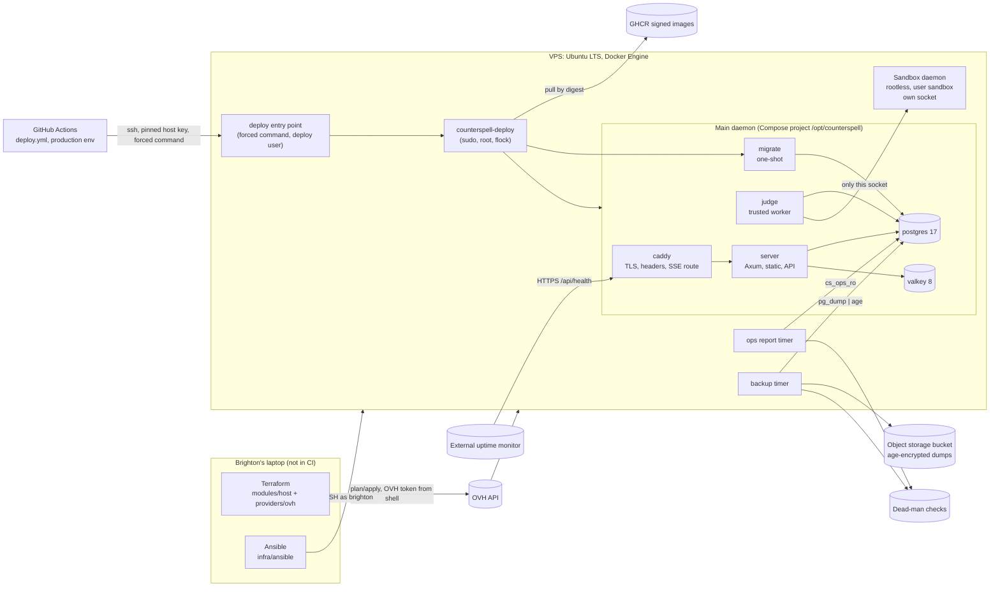
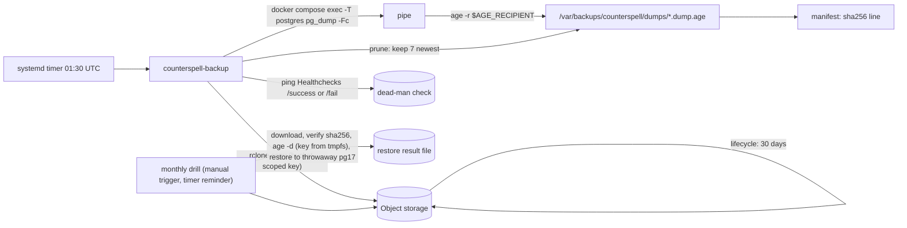

# Low-level design: deploy-ops

## Design approach

The application architecture is fixed in `docs/system-design.md`. This design fixes how that architecture runs on one host, how it is provisioned, released, backed up and watched. It works from the deploy files that already exist. It keeps the forced-command deploy, the digest pinning and the signed images. It changes existing files only where a review found a defect or a gap.

Three rules shape every choice:

1. **Two daemons, two trust levels.** The main daemon runs the web stack. The sandbox daemon runs only user code. Nothing on the main daemon may hold a sandbox credential, and the judge may hold only the sandbox socket.
2. **Secrets never travel through automation.** Ansible, Terraform, CI and the repository carry no secret values. Brighton writes each secret on the host by hand into a root-owned file.
3. **Every change is a digest, and every digest has a previous one.** A release is a pair of records (current and previous). Rollback is a swap, not a rebuild.

The provider is a boundary, not a choice made in code. OVH VPS-2 is the first provider. Nothing outside `providers/ovh/` names OVH.

## Scope and non-goals

Included: `infra/terraform/`, `infra/ansible/`, `deploy/vps/` (scripts, Compose, Caddy, backups, drills, ops report, runbooks), the three deploy-file fixes (`counterspell-deploy`, `Caddyfile`, `docker-compose.yml`), the two small health routes (server `/api/ready`, judge `healthcheck`), `.gitignore` rules, a deploy checks workflow, and the Renovate extension.

Not included: sandbox code (judge-sandbox), auth code (auth; this spec only takes T33's Caddy log filter as a dependency), application migrations, the publish workflow (already written), and any paid service.

## Gap analysis of the existing deploy files

The review read every file in `deploy/`, `.github/workflows/`, `docker-compose.yml`, `Caddyfile` and `Dockerfile`. These are the defects and gaps that the tasks fix.

| # | File | Finding | Effect | Fix (task) |
|---|---|---|---|---|
| G1 | `deploy/vps/counterspell-deploy` | `set -e` is ignored inside `if up … && healthy`. A failed `migrate run` does not stop `up -d` | The new server can start on a schema that did not migrate | Explicit `|| return 1` on each step (T04); bats test first (T03) |
| G2 | same | Health check is `http://127.0.0.1/api/health` through Caddy on `:80`. After the TLS change, plain HTTP redirects | Every deploy would fail the check, then roll back | Readiness through `docker compose exec caddy`, public check over HTTPS (T04) |
| G3 | same | No rollback command. The only rollback is the automatic one | Brighton cannot roll back by hand from a laptop | `rollback` verb through the same entry point (T04) |
| G4 | same | No migration rule. A rollback leaves the new schema in place | Old code may fail on a new schema | Expand/contract rule (R7.10, RELEASE.md, T21) |
| G5 | same | No preflight call. The judge starts without the sandbox checks | Sandbox drift goes unnoticed | `judge preflight` before judge start (T04, R3.9) |
| G6 | same | Compose files are copied by hand, with no drift check | A release can run a compose file that is not in the repo | Checksums recorded by Ansible, checked by deploy (T04, T12, Q19) |
| G7 | `deploy/vps/README.md` | Step 1 puts `deploy` in the `docker` group, which is root-equivalent. The forced command is then the only control | A leaked CI key with shell access on the host is root | `sudo` rule for the deploy script only; the deploy user leaves `docker` (T05, Q10) |
| G8 | `deploy/vps/README.md` | Environment branches list `brighton/kiro-setup`. The publish workflow runs only on `main` and `v*`, so no signed image exists for `brighton/kiro-setup` | Deploys from that branch would fail at signature verification | Branches `main` and `v*` (T05, Q8) |
| G9 | `docker-compose.yml` | `POSTGRES_HOST_AUTH_METHOD: trust` | Any container on the data network can connect without a password | Remove in production; SCRAM only (T15, R4.6) |
| G10 | same | One network named `internal`, and `server` is also on it | Server outbound traffic is not needed on the data network; the name is unclear | Rename to `data` (`internal: true`); `server` also on `edge` (T15) |
| G11 | same | `migrate` has no password in its URL and relies on G9 | Works only with trust | Owner URL from `migrate.env` (T15) |
| G12 | same | `valkey` runs with no memory limit and no `maxmemory` | Valkey can grow past the budget | `maxmemory 100mb`, `allkeys-lru`, mem limit (T15, R4.5) |
| G13 | same | No `read_only`, `cap_drop`, `pids_limit`, `mem_limit`, log limits | Weaker than R4.4 and R4.8 | Production overrides (T15) |
| G14 | `compose.prod.yml` | No env files; `DATABASE_URL: ${SERVER_DATABASE_URL}` interpolation depends on the operator's shell | Secrets must be exported in the shell, or the service starts with an empty URL | `env_file` per service and `!reset` on interpolated entries (T15, R5, R4.10) |
| G15 | same | `server` does not wait for `migrate` | Compose can start the server before the schema is ready | `depends_on: migrate: service_completed_successfully` (T15, R4.7) |
| G16 | `Caddyfile` | Site is `:80`; no headers; no `-Server`; no `/api/ready` block | No HTTPS, no HSTS, and readiness is public | Site address from env; headers; 404 for `/api/ready` (T08, R6) |
| G17 | `Dockerfile` | Runtime images run as UID 10001 and are read-only-friendly | Compatible | No change |
| G18 | `.gitignore` | No rules for Terraform state, `*.tfvars`, Ansible inventory, `age` identities, rclone config | Risk of committing state or keys | Add rules (T02, R1.5) |
| G19 | `deploy/vps/README.md` | "Ansible will own this later" | The host is set up by hand, which is not repeatable | Ansible roles (T11 to T13) |
| G20 | `docs/system-design.md` §10 | Secrets live in a `.env` on the server | The repository rules forbid reading or writing `.env` for agents, and Compose would read it implicitly | Named env files under `/etc/counterspell/` (R5, Deviations D1) |
| G21 | `server` routes | Only `/api/health` exists. The design names `/healthz` and `/readyz` | No readiness check for the deploy | `/api/ready` (T06, Q16) |
| G22 | `judge` | No health check | Compose cannot show a stuck judge | `counterspell-judge healthcheck` (T07) |

Findings G1 to G4 and G7 are defects in the current design. The others are gaps.

## Architecture



## Host layout

| Path | Owner and mode | Contents | Written by |
|---|---|---|---|
| `/opt/counterspell/` | `root:root 0750` | `docker-compose.yml`, `compose.prod.yml`, `Caddyfile`, `compose.sha256` | Ansible (`app` role) |
| `/opt/counterspell/deploy.env` | `root:root 0640` | current release: SHA, three digests, copy of `host.env` | deploy script |
| `/opt/counterspell/deploy.env.previous` | `root:root 0640` | previous release, same shape | deploy script |
| `/opt/counterspell/.deploy.lock` | `root:root 0600` | `flock` target | deploy script |
| `/etc/counterspell/` | `root:root 0700` | directory for env files | Ansible creates it, Brighton fills it |
| `/etc/counterspell/host.env` | `root:root 0644` | non-secret host values (below) | Ansible |
| `/etc/counterspell/{postgres,migrate,server,judge}.env` | `root:root 0600` | secrets, one file per service | Brighton, by hand |
| `/etc/counterspell/backup.env` | `root:root 0644` | `AGE_RECIPIENT` (public key), bucket name, Healthchecks URLs | Brighton (values), Ansible (file mode) |
| `/etc/counterspell/rclone.conf` | `root:root 0600` | object-storage key, one bucket scope | Brighton, by hand |
| `/var/backups/counterspell/` | `root:root 0700` | `dumps/` (encrypted), `manifests/` (SHA-256) | backup script |
| `/var/backups/counterspell/evidence/` | `root:root 0700` | incident evidence archives | runbook |
| `/usr/local/sbin/counterspell-deploy` | `root:root 0755` | deploy script | Ansible |
| `/usr/local/sbin/counterspell-deploy-entry` | `root:root 0755` | forced-command entry (validation, then sudo) | Ansible |
| `/usr/local/sbin/counterspell-backup`, `counterspell-ops-report`, `counterspell-restore-drill` | `root:root 0755` | ops scripts | Ansible |
| `/home/deploy/.ssh/authorized_keys` | `deploy:deploy 0600` | one restricted line for the CI key | Ansible from public key |
| `/home/sandbox/` | `sandbox:sandbox 0700` | rootless daemon data (`~/.local/share/docker`), user units | Ansible (`sandbox` role) |

`host.env` keys (non-secret): `CADDY_SITE_ADDRESS` (for example `counterspell.example`, set by Q1), `TRUSTED_PROXIES` (edge subnet), `GHCR_OWNER` (lowercase), `SANDBOX_SOCKET_HOST_PATH` (`/run/user/<sandbox-uid>/docker.sock`), `JUDGE_UID` (10001), `LOG_FORMAT` (`json`).

## Provisioning: Terraform

The module is the contract. Environments call the module and never name a provider resource.

```hcl
# infra/terraform/modules/host/variables.tf (contract, provider-neutral)
variable "name" {
  type        = string
  description = "Host name, for example counterspell-prod-1."
}
variable "datacentre" {
  type        = string
  description = "Provider region or datacentre code, EU only (system-design §11)."
}
variable "plan" {
  type        = string
  description = "Provider plan name. The provider maps it to its own catalogue entry."
}
variable "image" {
  type        = string
  description = "Operating-system image name. Ubuntu LTS preferred (Q2)."
}
variable "ssh_public_keys" {
  type        = list(string)
  description = "Public keys for the first login. Public values only."
}

# infra/terraform/modules/host/outputs.tf
output "public_ipv4" { value = null } # filled by the provider module
output "ssh_port"    { value = 22 }
```

- `providers/ovh/` implements the contract with the OVH provider's VPS resources (`ovh_vps` and its `plan` and `plan_configuration` blocks, pinned in `versions.tf`). The exact plan code and OS configuration key come from the OVH order catalogue, which Brighton reads at T23 [U].
- `envs/prod/` calls `module "host"` with `source = "../../providers/ovh"`. Switching provider means changing that one `source` line and writing a sibling provider directory.
- Credentials come from the shell (OVH application key, secret and consumer key). Nothing is written to disk.
- State lives outside the repository (`TF_DATA_DIR` and a local state path under the user's home, Q3). The state contains the host IP and the SSH key identifier; it is backed up with `age` like any other secret file.
- Plan and apply run on Brighton's machine only (R1.6). CI runs fmt, validate and TFLint.

## Provisioning and configuration: Ansible

Ansible is chosen over a script (Q9) because its modules are idempotent for the work that matters: users, `sshd_config`, UFW rules, unattended upgrades, sysctl and systemd user units. A script would re-implement each of those with weaker re-run guarantees.

| Role | Does | Idempotence check |
|---|---|---|
| `base` | `brighton`, `deploy`, `sandbox` users; sudoers rule for `deploy` (script only); `sshd_config` hardening; UFW (`limit` SSH, allow 80/443, default deny in); unattended-upgrades; timesyncd; reboot-required report; restricted `authorized_keys` for `deploy` | second run `changed=0` |
| `docker` | Docker Engine and Compose plugin from Docker's apt repository, pinned; `daemon.json` with `log-driver` json-file limits; `brighton` in `docker` group | second run `changed=0` |
| `app` | `/opt/counterspell`, `/etc/counterspell` (0700), `host.env` from variables, copies compose files and Caddyfile from `counterspell_src` and writes `compose.sha256` (Q19), installs `counterspell-*` scripts | second run `changed=0` |
| `sandbox` | `sandbox` linger; subuid/subgid ranges; rootless install (`dockerd-rootless-setuptool.sh install`); `delegate.conf` drop-in; `user@<uid>.service` and `user-<uid>.slice` limits; `docker.service` drop-in that reapplies the socket ACL; `prepull.sh`; AppArmor check that stops with a message (R3.8) | second run `changed=0`, `prepull` skips images already present |

Secrets: none. Brighton fills `/etc/counterspell/*.env` by hand (T27). Ansible only checks that the files exist with mode 0600 (`stat`), and fails if they do not.

Variables that are not secret live in `infra/ansible/inventory/group_vars/`. The real inventory (`hosts.yml`, with the host IP) is gitignored. `hosts.example.yml` is committed.

Ansible connects as `brighton` with his SSH key and `become`. The `deploy` account is never used for configuration.

### The sandbox daemon details

- **Install:** `sandbox` is a normal user with UID 1001 (the role asserts this), shell `/bin/bash`, locked password, no authorized keys. `uidmap` provides `newuidmap` and `newgidmap`. `loginctl enable-linger sandbox` makes `user@1001.service` run without a session.
- **Delegation:** `/etc/systemd/system/user@1001.service.d/delegate.conf` contains `[Service]` and `Delegate=cpu cpuset io memory pids`. The role checks `/sys/fs/cgroup/user.slice/user-1001.slice/user@1001.service/cgroup.controllers` before pulling images. (The judge-sandbox sandbox-verification notes found that `cpuset io` was not delegated on the WSL host, so the drop-in is required, not optional.)
- **Aggregate limits:** `user@1001.service` gets `MemoryMax=4G`, `TasksMax=512`, `CPUQuota=300%` (Q13). This is the sandbox pool. The main daemon, Postgres and Caddy run outside it.
- **Socket and ACL:** the rootless socket is `/run/user/1001/docker.sock`, owned by `sandbox`. The judge container runs as UID 10001 on the host kernel (the main daemon does not remap user namespaces). The role grants `u:10001:rw` on the socket and `u:10001:x` on `/run/user/1001`. A drop-in `~sandbox/.config/systemd/user/docker.service.d/acl.conf` runs `setfacl` after each daemon start, after the socket exists. The judge's preflight confirms the ACL is present.
- **Images:** `prepull.sh` reads `languages/languages.toml`, takes each enabled language's `image = "...@sha256:..."`, runs `docker pull` on the sandbox socket, then `docker image inspect` and compares digests. It fails on any mismatch. It never reads a tag.
- **No other access:** no other UID or group gets the socket. `/home/sandbox` holds no secret. Application secrets are never placed in `sandbox`'s home.

## Production Compose topology

Project directory `/opt/counterspell`. The base file is `docker-compose.yml`. The production override is `deploy/vps/compose.prod.yml`, copied to the host by Ansible.

| Service | Image (digest pinned) | Networks | Published | Mounts | Env file | Limits and hardening |
|---|---|---|---|---|---|---|
| `caddy` | `caddy:2.10.2-alpine@sha256:…` | `edge` | 80, 443 | `caddy_data`, `caddy_config`, `Caddyfile` (ro) | none | 64m; `cap_drop: ALL`, `cap_add: NET_BIND_SERVICE` (T14 checks the bind works) |
| `server` | `ghcr…counterspell-server@sha256:…` | `edge`, `data` | none | none | `server.env` | 256m; read-only root; `/tmp` tmpfs; `cap_drop: ALL`; `no-new-privileges`; `pids_limit: 128` |
| `judge` | `ghcr…counterspell-judge@sha256:…` | `data` only | none | sandbox socket to `/run/sandbox/docker.sock` | `judge.env` | 256m; read-only root; `/tmp` tmpfs; `pids_limit: 64`; `SANDBOX_DOCKER_SOCKET=/run/sandbox/docker.sock` |
| `postgres` | `postgres:17-alpine@sha256:…` | `data` | none | `pgdata` volume | `postgres.env` (initdb only) | 1024m; `command: postgres -c shared_buffers=256MB`; `cap_add` as needed by the image (T15 checks) |
| `valkey` | `valkey/valkey:8-alpine@sha256:…` | `data` | none | none | none | 160m; `valkey-server --maxmemory 100mb --maxmemory-policy allkeys-lru --appendonly yes --appendfsync everysec` (Q15) |
| `migrate` | `ghcr…counterspell-migrate@sha256:…` | `data` | none | none | `migrate.env` | 256m; `restart: "no"`; read-only root |

Networks:

- `edge`: `driver: bridge`, `ipam` with subnet `172.30.10.0/24`. The subnet is fixed so that `TRUSTED_PROXIES` can name it. Members: `caddy`, `server`.
- `data`: `driver: bridge`, `internal: true`. Members: `server`, `judge`, `postgres`, `valkey`, `migrate`.

Judge service, production override (the only service with the socket):

```yaml
# deploy/vps/compose.prod.yml (excerpt)
services:
  judge:
    image: ${COUNTERSPELL_JUDGE_IMAGE:?set by deploy script}
    build: !reset null
    env_file: [/etc/counterspell/judge.env]
    environment: !reset {}            # base file's interpolated entries are dropped
    volumes:
      - type: bind
        source: ${SANDBOX_SOCKET_HOST_PATH:?set in host.env}
        target: /run/sandbox/docker.sock
    networks: [data]
    read_only: true
    tmpfs: ["/tmp:rw,noexec,nosuid,size=16m"]
    cap_drop: [ALL]
    security_opt: ["no-new-privileges:true"]
    user: "10001:10001"
    pids_limit: 64
    mem_limit: 256m
    cpus: 0.5
    logging: *json-logs
    healthcheck:
      test: ["CMD", "/usr/local/bin/counterspell-judge", "healthcheck"]
      interval: 30s
      timeout: 5s
      retries: 3
    restart: unless-stopped
```

Notes:

- `!reset` is supported in Compose 2.24 and later. The Ansible `docker` role pins a Compose plugin that is at least that version.
- The base file's host-variable entries (`DATABASE_URL: ${…}`) are reset in production, so a service's environment comes only from its env file. The base file keeps working for local development.
- The `judge` has no published port and no path to the Valkey URL. T14 asserts both.

Edge and data networks are created by Compose. The `pgdata` and `caddy_*` volumes are named and backed up as described below (the database only; Caddy's certificate store is re-issued if lost, within Let's Encrypt limits).

## Secrets and env files

| File | Services | Keys (names only) | Owner |
|---|---|---|---|
| `host.env` | all | `CADDY_SITE_ADDRESS`, `TRUSTED_PROXIES`, `GHCR_OWNER`, `SANDBOX_SOCKET_HOST_PATH`, `JUDGE_UID`, `LOG_FORMAT` | Ansible (not secret) |
| `postgres.env` | postgres | `POSTGRES_USER=counterspell`, `POSTGRES_DB=counterspell`, `POSTGRES_PASSWORD` | Brighton |
| `migrate.env` | migrate | `DATABASE_URL` (owner login) | Brighton |
| `server.env` | server | `DATABASE_URL` (`counterspell_server` member), `VALKEY_URL`, `PUBLIC_BASE_URL`, `SESSION_SECRET`, OAuth client IDs and secrets, `RESEND_API_KEY`, `MAIL_FROM`, `DEMO_ACCOUNT_*`, `HINT_*` provider keys, `TRUSTED_PROXIES` (from host.env) | Brighton |
| `judge.env` | judge | `DATABASE_URL` (`counterspell_judge` member), `JUDGE_CONCURRENCY=2`, `LEASE_SECS=30`, `RENEW_SECS=10`, `LOG_FORMAT` | Brighton |

Rules:

- Brighton creates each file with `umask 077` and an editor on the host, or with `install -m 0600 /dev/null` followed by a typed write. Values never appear in shell history: use `read -rs` for the secret and pass it through a here-document into the file, never on a command line.
- `server.env` is the only file that contains OAuth, Resend, LLM or session values.
- Rotation (R11) changes one file and restarts only the affected service (`up -d --force-recreate <service>`).
- Compose reads these files as root, so the `deploy` user never needs to read them.

## Release and rollback

### Deploy sequence

```mermaid
sequenceDiagram
  autonumber
  participant G as GitHub (production env, reviewer)
  participant E as deploy entry (forced command)
  participant S as counterspell-deploy (sudo, root)
  participant R as GHCR
  participant M as migrate
  participant J as judge
  participant V as server + caddy
  G->>G: verify cosign signatures, pin digests (existing step)
  G->>E: ssh deploy@host "deploy <sha> <d-server> <d-judge> <d-migrate>"
  E->>E: validate regex, then sudo -n script (no wildcards)
  E->>S: deploy <args>
  S->>S: flock (refuse if busy), compare compose.sha256 (refuse if drift)
  S->>R: docker compose pull by digest
  S->>S: write candidate deploy.env (+ host.env copy)
  S->>J: run --rm judge preflight (refuse on failure, nothing changed)
  S->>M: run --rm migrate (refuse on failure, nothing changed)
  S->>J: up -d judge (after postgres healthy)
  S->>V: up -d server caddy
  S->>V: exec caddy: wget /api/ready on server (retry 30 × 2 s)
  S->>S: curl https://<site>/api/health
  alt both pass
    S->>S: deploy.env.previous = old current; deploy.env = candidate
    S-->>G: "deployed <sha>" (exit 0)
  else a check fails after the stack changed
    S->>V: up -d with old deploy.env (automatic rollback)
    S->>S: candidate removed, migrations NOT reverted
    S-->>G: "rolled back" (exit 1)
  end
```

### Rollback

`rollback` swaps the two release records. It pulls the previous digests (cached), starts them with `up -d --no-build`, runs the same readiness and health checks, and never runs `migrate`. It refuses when there is no previous record. The swap means a second `rollback` returns to the release it replaced, so a rollback can itself be undone.

### Why migrations are not reversed

Migrations are expand-only (R7.10). Each release works with the schema of the release before it. Contract steps (dropping an old column) ship in a later release, after no running digest reads it. A rollback therefore needs no database change. The rule is checked by reading the migration files in review (RELEASE.md checklist) and by the `migrate` dry run on a copy of the database (manual, T31).

### Checks

| Check | Where | Pass condition | Failure |
|---|---|---|---|
| Signature and digest | GitHub, before SSH | `cosign verify` and `imagetools inspect` succeed | Deploy stops before SSH |
| Compose drift | script, before pull | three SHA-256 values match `compose.sha256` | Refuse: "run the app role" |
| Preflight | judge container, before judge starts | `counterspell-judge preflight` exits 0 | Refuse, nothing changed |
| Migration | migrate container | exit 0 | Refuse, nothing changed |
| Readiness | caddy container → `server:8080/api/ready` | HTTP 200 within 60 s | Automatic rollback |
| Public health | host → `https://<site>/api/health` | HTTP 200, body has `"ok"` | Automatic rollback |

## Health and readiness

- `GET /api/health`: liveness, public, no database access (repo-skeleton R6). Used by the external monitor.
- `GET /api/ready`: readiness, internal only (Caddy returns 404). Pings Postgres and Valkey with a 2-second timeout each. Returns `503` with `{"status":"unavailable"}` on failure, with no detail (T06).
- `counterspell-judge healthcheck`: exits 0 when the heartbeat written by the run-lifecycle worker loop (T17) is newer than 60 s (T07, Q26).
- Compose healthchecks: `postgres` (`pg_isready`), `valkey` (`valkey-cli ping`), `judge` (`healthcheck`). `server` has no Compose healthcheck: its image has no shell tools, and readiness is checked by the deploy and the monitor.

## Backups and restore



- **Dump:** `pg_dump --format=custom --no-owner --no-privileges counterspell`, piped straight into `age` so no plaintext dump is written to disk.
- **Local retention:** keep the 7 newest encrypted files. Delete only after the new file and its manifest line are written (R8.3).
- **Off-box:** `rclone copy` to one bucket with an application key that has access to that bucket only. Lifecycle: 30 days (Q5). Provider choice in Q4.
- **Keys:** the `age` recipient (public) is in `backup.env`. The identity (private) is generated on Brighton's laptop, kept in his password manager, with an offline printout kept separately. The server never holds it.
- **Drill (monthly):** the drill downloads the newest off-box file, checks its SHA-256 against the manifest, decrypts it with the identity read from a `tmpfs` file (`/dev/shm`) that is removed afterwards, restores into a throwaway `postgres:17-alpine` container on the `data` network with no other service, then compares `count(*)` of `users`, `submissions`, `jobs` and `run_events` with the counts in the manifest, and checks `_sqlx_migrations` (or the migration table name the repo uses) for the latest version. It writes `deploy/vps/restore-drills/<YYYY-MM>.md` from `TEMPLATE.md`. The drill runs on the host, so the identity must reach the host for a few minutes. The laptop variant (Q23) avoids that.
- **Recovery order:** rebuild the host (Terraform, Ansible), restore the newest passing dump, then deploy the release recorded in `deploy.env`.

## Observability

### Logs

| Source | Destination | Limit | Rule |
|---|---|---|---|
| Containers (`server`, `judge`, `caddy`, `postgres`, `valkey`) | Docker json-file | 10 MB × 5 per service (R4.8) | `LOG_FORMAT=json`; no user code, output or secrets (R9.2) |
| Caddy access log | stdout, as above | same | query string dropped for OAuth callback and verify paths (auth T33) |
| systemd units (deploy, backup, ops, drill) | journald | `SystemMaxUse=500M` | scripts print status and counts only |

Canary test (T31): submit a Python program that contains a unique marker in its source, in its printed output, and in a hidden-input echo. The test then greps the server and judge logs for the marker. The marker must not appear. The same test covers the auth callback URL (a fake `code` value).

### Ops report

A systemd timer runs `counterspell-ops-report` every 5 minutes. It runs these queries as `cs_ops_ro` with column-level SELECT only:

- `SELECT count(*) FROM jobs WHERE state = 'queued'` (queue depth);
- `SELECT coalesce(extract(epoch FROM now() - min(run_after)), 0) FROM jobs WHERE state = 'queued'` (oldest queued age);
- `SELECT count(*) FROM jobs WHERE state = 'claimed' AND lease_expires_at < now()` (expired leases);
- `SELECT count(*) FROM jobs WHERE state = 'dead' AND updated_at > now() - interval '24 hours'`;
- `SELECT status, count(*) FROM submissions WHERE finished_at > now() - interval '1 hour' AND status IN ('output_limit','time_limit','memory_limit','internal_error') GROUP BY status` (kills and infrastructure failures);
- `SELECT percentile_cont(0.95) WITHIN GROUP (ORDER BY extract(epoch FROM finished_at - created_at)) FROM submissions WHERE finished_at > now() - interval '1 hour'` (p95 latency).

It prints one JSON line to journald and pings Healthchecks. If the queue age, the internal-error count or dead jobs cross the thresholds in R9.6, it pings the `/fail` URL, which sends an email. The ops report never reads `payload`, `code`, `stdout` or any column not listed. The grants are in `deploy/vps/ops/sql/ops-role.sql` (run once by Brighton, T27). Table and column names match `docs/system-design.md` §4 and run-lifecycle migrations. T17 verifies them against the real migration.

### External monitors and alert routing

| Signal | Tool (free) | Interval | Alert to |
|---|---|---|---|
| Site up and healthy | UptimeRobot HTTPS keyword monitor on `https://<site>/api/health`, keyword `"ok"` (Q6) | 5 min | Brighton's email (Q7) |
| Backup ran | Healthchecks check, period 1 day, grace 2 h | daily | email |
| Ops report alive | Healthchecks check, period 5 min, grace 10 min | 5 min | email |
| Ops thresholds | ops report pings `/fail` | per run | email |
| Certificate expiry | daily check script, pings Healthchecks `/fail` below 14 days | daily | email |
| Restore drill done | Healthchecks check, period 35 days, grace 3 days | monthly | email |
| Deploy result | GitHub Actions run status (default emails) | per deploy | GitHub account email |

No paid pager, SMS or incident service is used. The monitor tools are third-party services. Their plan limits and terms are checked before use (Q6).

## Security operations

### Deploy key rotation (R11.1)

1. On the laptop, generate a new ed25519 key with a new comment. Keep the private half in the password manager.
2. On the host (as `brighton`), add the new public key as a second restricted line in `/home/deploy/.ssh/authorized_keys`. The Ansible role templates the line from a variable, so the playbook must be updated too.
3. Test with the new key from the laptop: `ssh -i <new> deploy@<host>` must print the forced-command refusal for an unexpected command, and `status` must print the release record.
4. Update the `DEPLOY_SSH_KEY` secret in the `production` environment.
5. Run a deploy of the current SHA (or a no-op redeploy) to confirm.
6. Remove the old line, and rerun the Ansible `base` role so the file matches the playbook.
7. Record the date in `OPERATIONS-LOG.md`.

Cadence: every 6 months (Q22), and at once if the key or a runner log may have leaked.

### Patch cadence (R11.2)

| What | How | When |
|---|---|---|
| OS security updates | unattended-upgrades | daily, automatic |
| Kernel and reboot | `needrestart` or the reboot-required file; reboot in a planned window (04:00 UTC) | within 7 days of the flag |
| Docker Engine, Compose | pinned in Ansible; review advisories | monthly |
| Caddy, Postgres, Valkey images | Renovate digest pull requests (T20), reviewed and merged by Brighton | weekly bot, monthly review |
| Server and judge images | CI on each `main` push (publish workflow) | each release |
| Sandbox language images | Renovate digest pull request (judge-sandbox A3), then `prepull` | weekly bot |
| Postgres major version | not in the window; a separate plan is needed | no change before 29 Jan 2027 |

### Incident: suspected sandbox escape (R11.3)

```mermaid
flowchart TD
  A[Signal: odd process, host file change, unexpected socket use, judge log anomaly] --> B[Stop the judge only: docker compose stop judge]
  B --> C[Preserve evidence before any clean-up]
  C --> C1[journalctl for user docker unit and sshd, *no* deletion]
  C --> C2[docker inspect and docker ps -a on the sandbox socket, saved to file]
  C --> C3[copy runs and events for affected submissions (SQL, read-only)]
  C --> C4[archive, age-encrypt, SHA-256 manifest, copy off-host]
  C4 --> D{Host root possible?}
  D -- no --> E[Contain: keep server up or stop it; cut the sandbox user's socket ACL; block the user (ADM-3); fix the cause; redeploy a passing release]
  D -- yes or unknown --> F[Contain: firewall to SSH from Brighton's IP only; stop the stack]
  F --> G[Rotate every credential the host could read: all env files, DB passwords, deploy key, backup keys, bucket key, provider keys, session secret]
  G --> H[Rebuild from Terraform and Ansible on a new host; restore newest passing dump; redeploy]
  E --> I[Post-incident: write findings in OPERATIONS-LOG.md; add a test for the cause]
  H --> I
  I --> J{User data exposed?}
  J -- yes --> K[Brighton decides on notice under the privacy text]
```

The runbook lives in `deploy/vps/RUNBOOK.md` (T21). It names the exact commands. It is written before the first deploy, and T31 rehearses the first two steps on the host (stop and evidence capture) without an actual incident.

### Availability and freeze (R11.5, R11.6)

- The window runs until 23:00 SAST on 29 Jan 2027, which is 21:00 UTC. Monitors run for the whole window.
- The OVH plan is month-to-month. Brighton must cancel it to stop billing. The domain renewal date must be after 29 Jan 2027 (Q1, Q25).
- The feature freeze is Wed 2 Dec 2026. After it, only security and data-safety fixes deploy, each with a record (R11.6).
- The final checkpoint (T34) checks the monitors, the backups, the drill result and the release record on 29 Jan 2027.

## Verification strategy (no server needed unless marked)

| Tool | What it checks | Where it runs | Task |
|---|---|---|---|
| `terraform fmt -check -recursive` | formatting | CI (`terraform.yml`) and local | T09, T10 |
| `terraform init -backend=false` and `validate` | module contract, provider | CI and local | T10 |
| TFLint `--recursive` | provider and style rules | CI | T10 |
| `ansible-lint` | role and task quality | local and deploy-checks workflow | T11 to T13 |
| `ansible-playbook --syntax-check` | playbook parse | local and workflow | T11 to T13 |
| Molecule with an Ubuntu container (optional) | idempotence for roles without systemd | Brighton's laptop | T11 (Q9) |
| ShellCheck | deploy and ops scripts | local and workflow | T03, T04, T13, T16 to T18 |
| bats with stubs | script behaviour (refusals, rollback, lock, prune, drill rules) | local and workflow | T03, T04, T13, T16 to T18 |
| `docker compose config` and `compose_shape.sh` | Compose topology and hardening rules | local and workflow | T14, T15 |
| `caddy validate` in the pinned image | Caddyfile syntax | local and workflow | T08 |
| Rust tests (`cargo test -p counterspell-server`, `-p counterspell-judge`) | `/api/ready`, `healthcheck` | CI (ci.yml) | T06, T07 |
| Host runs | Ansible idempotence, delegation, ACL, prepull, deploy, rollback, canary, drill, monitors | Brighton, on the VPS | T23 to T32 |

## Correctness properties

Each property is checked by a named test or by a `[HUMAN]` evidence line. A property not checked on the host is reported as `MODEL ONLY` or `NOT TESTED` (R12.8).

| ID | Property | Verified by |
|---|---|---|
| P1 | No container except the judge mounts a sandbox socket; no container mounts `/var/run/docker.sock` or the main daemon socket. | `compose_shape.sh` (T14); host check `docker inspect` (T31) |
| P2 | Only `caddy` publishes ports, and only 80 and 443. `postgres`, `valkey`, `judge` and `migrate` are not on `edge`. `data` is internal. | `compose_shape.sh` (T14); host `ss -tlnp` and `ufw status` (T24) |
| P3 | `server` cannot start before a successful `migrate` in the same deploy. | bats (T03): migrate failure leaves the old release running; compose `depends_on` (T14) |
| P4 | Rollback never runs `migrate`, and fails clearly when no previous record exists. | bats (T03) |
| P5 | At most one deploy or rollback runs at a time. | bats (T03): second run refused while the lock is held |
| P6 | A failed readiness or health check restores the previous release, and records the candidate as failed. | bats (T03) with stubs |
| P7 | Compose drift (checksum mismatch) refuses the deploy before any pull. | bats (T03) |
| P8 | The judge env file holds only the judge's database URL. | `compose_shape.sh` checks env file names and an allow-list of keys in fixture files (T14) |
| P9 | No secret file is readable by a non-root user, and none is in git. | ansible `stat` checks (T11, T24); `git ls-files` check in deploy-checks (T19) |
| P10 | Every dump is encrypted before it is written to disk, and at most 7 local dumps remain. | bats (T16) with fake `pg_dump` and ephemeral `age` key |
| P11 | The ops role can read only the listed columns. | SQL grant test against a throwaway Postgres 17 container (T17, `[HUMAN]` if no container) |
| P12 | `/api/ready` never includes a connection string or error detail, and returns 503 when a dependency is down. | Rust tests in `counterspell-server` (T06) |
| P13 | A canary marker in code, output or the auth callback never appears in container logs. | canary run on the host (T31) |
| P14 | Ansible's second run changes nothing. | Molecule (optional) and host run (T24, T25) |

## Deviations from the docs (⚠ = changes a stated rule)

| ID | Doc says | This design does | Why | Status |
|---|---|---|---|---|
| D1 | `system-design.md` §10: `.env` on the server | `/etc/counterspell/*.env` files, one per service | The repository rules forbid reading or writing `.env`; per-service files give judge a smaller secret set | ⚠ Brighton confirms; §10 needs the same wording change |
| D2 | §10 memory budget: server 0.1 GB, judge 0.1 GB | 256 MB each | Axum with sqlx, 1 MiB buffers per stream and a Tokio runtime do not fit 100 MB safely; total stays under 8 GB (see arithmetic below) | Q14 |
| D3 | §10 sandbox pool about 5.5 GB | `MemoryMax=4G` for the sandbox user | Two concurrent 512 MB runs and compiles need about 1.5 GB. A larger cap leaves less room for Postgres during bursts | Q13 |
| D4 | §9 names `/healthz` and `/readyz` | `/api/health` (liveness) and `/api/ready` (readiness) | repo-skeleton R6 already ships `/api/health`; the names match the existing routes | Q16 |
| D5 | `deploy/vps/README.md` puts `deploy` in `docker` | `sudo` rule for the script, deploy user outside `docker` | Docker group membership is root-equivalent | Q10 ⚠ (changes an existing setup step) |
| D6 | `deploy/vps/README.md` branch `brighton/kiro-setup` | `main` and `v*` | Images are published only from `main` and tags (`publish-images.yml`) | Q8 ⚠ (corrects the README) |
| D7 | `docker-compose.yml` network `internal` | network `data` (internal) and `server` also on `edge` | `server` needs outbound access for OAuth, Resend and LLM APIs | ⚠ rename; behaviour corrected |
| D8 | `docker-compose.yml` Postgres `trust` | SCRAM only | Trust authentication lets any container on the network connect as the owner | ⚠ removed in production only; dev file keeps its local behaviour |
| D9 | §10 "Deploys are manual (`ssh` + `docker compose pull && up -d`)" | Signed, digest-pinned deploys through the forced command, from the `production` environment | `ci-cd.md` and the existing `deploy.yml` already describe this, and it is safer than manual pulls | Kept; §10 wording to be updated |
| D10 | `docs/ci-cd.md` lists `deploy.yml` as disabled until setup | unchanged; this spec enables it at T30 | Setup is this spec | Consistent |

Arithmetic for D2 and D3 (host of 8 GB):

| Item | Limit |
|---|---|
| postgres | 1024 MB |
| valkey | 160 MB |
| server | 256 MB |
| judge | 256 MB |
| caddy | 64 MB |
| **Fixed services** | **1760 MB** |
| OS, Docker Engine, journald | about 600 MB (budget §10) |
| Sandbox user slice (rootless daemon and containers, D3) | 4096 MB |
| **Total at the cap** | **6456 MB** |
| migrate during a deploy | 256 MB, so 6712 MB at peak |
| Headroom for page cache and kernel | about 1.4 GB of 8 GB |

## Open questions

Each question lists the choice this design assumed, so work can proceed. Brighton answers them at T00. Every cost, provider, domain and DNS choice is listed here.

**Q1. Domain and DNS.** Assumed: a domain Brighton owns or buys, with DNS at its registrar. The site is `counterspell.<domain>`, with A and AAAA records to the VPS. Resend's sender domain is verified in Resend's dashboard with the DNS records it gives. Cost: about €1 per month amortised (`system-design.md` §11, unverified). Alternative: a free subdomain, only if Resend can verify DNS on it (unverified; not assumed). Brighton decides the domain, the registrar and the renewal date (it must be after 29 Jan 2027).

**Q2. VPS plan and billing.** Assumed: OVH VPS-2 2027 (4 vCore, 8 GB, 75 GB NVMe), month-to-month, EU datacentre, €8.49 per month excluding VAT. Brighton confirms the VAT line at checkout (system-design §11 marks it unverified). Alternative: VPS-1 (€4.49, 4 GB) with concurrency 1 to 2, which the memory arithmetic does not fit comfortably. Cancelling the plan is a Brighton action.

**Q3. Terraform licence and state.** Assumed: Terraform, as `terraform.yml` already uses. Terraform has been under the Business Source License since 2023. Using it for one's own infrastructure is allowed, but it is not open source. Local state lives outside the repository and is backed up encrypted. Alternatives: OpenTofu (MPL-2.0, the same HCL), or HCP Terraform's free remote state (its current limits are unverified). Brighton decides.

**Q4. Off-box backup provider.** Assumed: Backblaze B2. Its free allowance is the first 10 GB of storage, and egress is free up to three times the stored data, with the excess charged per GB (free-tier comparison sites, unverified against the provider's own pricing page). Expected use is well under 10 GB. Alternative: Cloudflare R2, which charges no egress fees (provider pricing page), with a free storage allowance that is unverified here. Either provider may ask for a payment card at sign-up (unverified). Any paid tier needs Brighton's approval.

**Q5. Off-box retention.** Assumed: 7 dumps kept on the host, and a 30-day lifecycle rule in the bucket. Brighton confirms, or asks for a longer period (storage cost would still be within the free allowance for small dumps).

**Q6. External uptime monitor.** Assumed: UptimeRobot's free plan (50 monitors at 5-minute checks, per its own help pages). Third-party write-ups say the free plan's terms rule out commercial use, so Brighton checks the current terms for a non-revenue personal project before relying on it. Alternative: Healthchecks.io for dead-man checks, plus another free HTTP monitor (plan limits unverified here).

**Q7. Alert destination.** Assumed: Brighton's personal email, entered in each monitor's settings and never stored in the repository. No paid pager or SMS.

**Q8. Deploy environment branches.** Assumed: `main` and `v*`, as `docs/ci-cd.md` states. The README's `brighton/kiro-setup` is wrong because no image is published from that branch. Brighton confirms.

**Q9. Ansible instead of a script.** Assumed: Ansible (ansible-core and its `ansible.posix` and `community.general` collections, GPL-3.0). It runs only on Brighton's laptop, so the GPL licence is for tooling that the repository does not ship. Alternative: a documented shell script. Ansible is chosen because its modules are idempotent for UFW, `sshd_config`, users and unattended upgrades.

**Q10. Deploy privilege.** Assumed: a `sudo` rule that allows `deploy` to run exactly `/usr/local/sbin/counterspell-deploy` with no argument wildcard. The forced-command entry point validates the request before it calls `sudo`. The `deploy` user leaves the `docker` group. The change alters step 1 of the existing `deploy/vps/README.md`. Alternative: keep the current `docker` group setup, accepting that a key with shell access becomes root. Brighton decides.

**Q11. SSH port and brute force.** Assumed: port 22, with UFW `limit` for rate limiting, and no fail2ban. Alternative: fail2ban (GPL-2.0) for more controls, at the cost of another moving part. Brighton decides if he wants a non-default port.

**Q12. Rootless Docker and Ubuntu's user-namespace restriction.** Ubuntu's AppArmor can block unprivileged user namespaces, which rootless Docker needs (unverified on the target image). Assumed: an AppArmor profile that allows the rootless daemon's helper binary. Alternative: the host sysctl `kernel.apparmor_restrict_unprivileged_userns=0`, which weakens every user on the host. The role stops and asks if the profile route fails (R3.8). Brighton decides.

**Q13. Sandbox aggregate cap.** Assumed: `MemoryMax=4G`, `TasksMax=512`, `CPUQuota=300%` for the sandbox user. The §10 pool of about 5.5 GB is larger than the two concurrent 512 MB runs need, and a larger pool leaves less room for Postgres. Brighton can raise it after the 20-submit load test.

**Q14. Container memory limits.** Assumed: 256 MB each for `server` and `judge` (system-design §10 says 0.1 GB). The arithmetic in the Deviations section keeps the total under 7 GB at the cap. Brighton confirms, or asks for the smaller figure and accepts the risk of OOM kills.

**Q15. Valkey persistence.** Assumed: AOF with `everysec`, so the hint spend counter survives a restart (`hints/design.md`, open question 6). Cost is small (a few MB on the volume). Alternative: no persistence, which allows extra AI spend after a restart in the same day, as the hints spec warns.

**Q16. Health route names.** Assumed: `/api/health` (liveness, public) and `/api/ready` (readiness, internal). `/healthz` and `/readyz` from `system-design.md` are not added, to keep one naming scheme. Brighton confirms.

**Q17. Content-Security-Policy owner.** Assumed: Caddy sets the baseline CSP at T08, which allows `worker-src blob:` for Monaco and the self-hosted fonts, and is tested against the real web build. Alternative: the server sets the CSP, in the `server` spec. The two must not both set a CSP. Brighton confirms the owner.

**Q18. Postgres login names.** Assumed: owner `counterspell` (existing), NOLOGIN roles `counterspell_server` and `counterspell_judge` (run-lifecycle), login roles `cs_server` and `cs_judge` as members of them, and the operations role `cs_ops_ro`. Brighton confirms the names before T27.

**Q19. Compose and Caddy file transport.** Assumed: Ansible copies `docker-compose.yml`, `deploy/vps/compose.prod.yml` and `Caddyfile` to the host whenever they change, and records their SHA-256 values in `compose.sha256`. The deploy script refuses on mismatch. Alternative: ship the three files inside the signed release artifact. That is more work, and it changes the publish workflow. Brighton decides.

**Q20. Third-party image pinning.** Assumed: `caddy`, `postgres` and `valkey` pinned by digest in the production file, updated by Renovate pull requests. `judge-sandbox` T38 creates `renovate.json`, and T20 here adds the Compose images to it. Renovate's free GitHub app must be installed (judge-sandbox A3).

**Q21. Evidence snapshot.** Assumed: no paid VPS snapshot. Evidence is copied off the host as an encrypted archive. Brighton decides whether to pay for OVH's snapshot option (price unverified).

**Q22. Deploy key rotation cadence.** Assumed: every 6 months, and at once on suspicion.

**Q23. Restore drill schedule.** Assumed: monthly, on the first Sunday, about 60 minutes. The drill runs on the host, so the age identity briefly reaches the host (tmpfs, then removed). Alternative: run the drill on Brighton's laptop with a restore container, which keeps the identity off the host. Brighton picks one.

**Q24. Log retention.** Assumed: Docker json-file limits (about 50 MB per service), journald capped at 500 MB, and no external log service. Alternative: a free-tier hosted log service (not chosen; its limits are unverified).

**Q25. After 29 Jan 2027.** Assumed: the site stays online until Brighton decides, and the VPS keeps billing monthly unless cancelled. Brighton records the decision date in `OPERATIONS-LOG.md` before T34.

**Q26. Judge health source.** Assumed: the run-lifecycle worker's heartbeat is stored in Postgres and readable by `counterspell-judge healthcheck`. If run-lifecycle T17 keeps it in memory only, the subcommand needs a small file heartbeat instead. Confirmed when T07 starts.

**Q27. OAuth callback URLs.** Assumed: `https://<site>/api/auth/oauth/github/callback` and `https://<site>/api/auth/oauth/google/callback`, registered in the GitHub and Google OAuth consoles (one callback per provider, per `auth` R6). Both consoles also need the site's HTTPS origin. Brighton registers them at T26.

## Review decisions

*(Empty until Brighton signs off T00. He appends each answer to the Open questions above, and marks any answer that changes a control.)*
