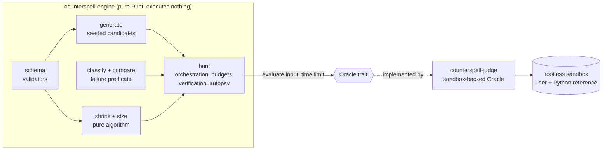
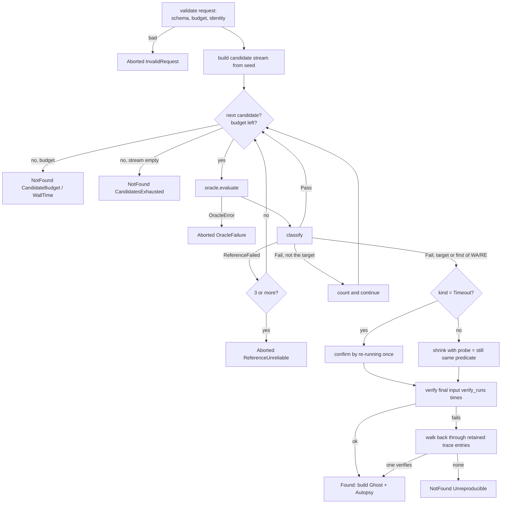

# Design: ghost-engine

## Design approach

This is a Requirements-First, low-level design. The architecture is fixed by `docs/system-design.md` §8 and §5. This document decides how the library is built, how it is tested, and which fixtures prove it works. It adds no crate, no service and no dependency beyond `serde`, `serde_json` and (for tests) `proptest`.

No task in `tasks.md` is run by this spec-generation step. Sketches of Rust code below show intent and shape. They are not final code.

## The idea in plain English

A learner's solution fails a hidden test. We want a small input that fails the same way, so the learner can see the bug.

1. **Generate.** Produce valid inputs in a deterministic order, starting with the likely troublemakers (empty, one item, zeros, bounds, duplicates).
2. **Ask.** For each input, ask the Oracle: "what did the user's program return, and what did the trusted reference return?". The engine never runs anything. The judge answers, using the sandbox.
3. **Classify.** Compare the two answers with a trusted comparator and name the failure: wrong answer, crash (with exception class), or timeout.
4. **Shrink.** Once one input fails, try smaller inputs. Keep a smaller input only if it fails *in the same way*. Repeat until nothing smaller works, or a budget runs out.
5. **Double-check.** Re-run the final input a couple of times. If it does not fail again, step back to an earlier shrink step that does.
6. **Report.** Return the minimized counterexample, the recorded shrink steps, the data for the Bug Autopsy card, and the provenance (seed, versions, image digest).

Each numbered step lives in its own module. The shrinker in step 4 does not know that programs exist. It only knows a yes/no callback.



## Crate layout and dependency rules

All code is in `crates/engine/` (package `counterspell-engine`). The existing `src/lib.rs` keeps `ENGINE_VERSION`. No other crate changes.

```text
crates/engine/
├── Cargo.toml                 # serde (derive), serde_json; dev: proptest
├── src/
│   ├── lib.rs                 # docs, constants, re-exports (the small public surface)
│   ├── schema.rs              # Schema, Violation, definition checks, contains()
│   ├── rng.rs                 # SplitMix64, derive_seed (FNV-1a 64)
│   ├── generate.rs            # PART 1: edge-biased values, tiny enumeration, CandidateStream
│   ├── compare.rs             # Comparator::{Exact, Unordered}
│   ├── classify.rs            # PART 2: ProgramResult, Observation, FailurePredicate, classify
│   ├── size.rs                # SizeMetric, size_of, compare_size
│   ├── shrink.rs              # PART 3: proposals, shrink loop, ShrinkTrace
│   ├── oracle.rs              # Oracle, OracleError, Clock, SystemClock, ManualClock
│   ├── budget.rs              # Budget and its checks
│   ├── hunt.rs                # glue: HuntRequest, hunt, verify_ghost, Ghost, HuntReport
│   └── autopsy.rs             # diff_values, explanation line, known-ghost matching
└── tests/
    ├── support/mod.rs         # pack loader, model oracles, proptest strategies
    ├── properties.rs          # hunt-level properties with synthetic oracles
    ├── packs.rs               # definition-of-done tests
    └── purity.rs              # "executes nothing" guard
```

**Dependency direction (enforced by review and by the module docs):**

| Module | May use | Must not use |
|---|---|---|
| `schema`, `rng`, `size`, `compare` | `serde`, `serde_json`, std | everything else in the crate |
| `generate` | `schema`, `rng` | `oracle`, `classify`, `shrink`, `hunt` |
| `classify` | `compare` | `oracle`, `generate`, `shrink`, `hunt` |
| `shrink` | `schema`, `size` | `oracle`, `classify`, `compare`, `generate`, `hunt`, `Clock` |
| `oracle`, `budget` | std, `serde_json` | the three parts |
| `hunt` | all of the above | nothing else (no I/O) |
| `autopsy` | `classify`, `size`, `serde_json` | `oracle`, `shrink` internals |

The point of the table is the `shrink` row. A reader can open `shrink.rs`, see that it imports only `schema` and `size`, and know the algorithm cannot touch a program.

Clippy pedantic is on in this workspace and CI uses `-D warnings`. Prefer `u64::try_from` over `as` casts. Where a cast is provably safe, allow the single lint on that line with a comment saying why.

## Public surface (kept small)

`lib.rs` re-exports these and nothing else. The three parts are also public modules (`generate`, `classify`, `shrink`) so their code is easy to find.

| Group | Items |
|---|---|
| Constants | `ENGINE_VERSION`, `GENERATOR_VERSION`, `GHOST_LABEL` ("minimized counterexample") |
| Describing inputs | `Schema`, `Violation`, `Comparator` |
| Talking to programs | `Oracle`, `OracleError`, `Observation`, `ProgramResult`, `Clock`, `SystemClock`, `ManualClock` |
| Running a hunt | `Budget`, `HuntRequest`, `HuntIdentity`, `KnownGhost`, `FailureKind`, `FailurePredicate`, `hunt`, `verify_ghost`, `derive_seed` |
| Reading results | `HuntReport`, `HuntOutcome`, `NotFoundReason`, `AbortReason`, `Ghost`, `Origin`, `Provenance`, `HuntStats`, `ShrinkReport`, `ShrinkStep`, `ShrinkStop`, `SizeMetric`, `Autopsy`, `Difference`, `AuthoredMistake` |
| Pure helpers (in their modules) | `shrink::{shrink, Probe, ShrinkOutcome}`, `size_of`, `compare_size`, `classify::{classify, Classification}`, `autopsy::diff_values`, `generate::{CandidateStream, Candidate, GeneratorConfig}` |

The judge only needs `hunt`, `Oracle`, `Clock` and the result types. MCP tools later wrap the same functions: `find_ghost_input` is `hunt`, `shrink_input` is `shrink::shrink` behind a probe, and `explain_ghost` is `Autopsy`.

## Part 0: schema and validators (`schema.rs`)

A `Schema` is a Rust `enum` with five kinds. Its JSON form is tagged and strict (`deny_unknown_fields`).

```rust
#[derive(Clone, Debug, PartialEq, Serialize, Deserialize)]
#[serde(tag = "type", rename_all = "snake_case", deny_unknown_fields)]
pub enum Schema {
    Int { min: i64, max: i64 },
    #[serde(rename = "string")]
    Str { alphabet: String, min_len: usize, max_len: usize },
    IntArray { min_len: usize, max_len: usize, min: i64, max: i64,
               #[serde(default)] sorted: bool, #[serde(default)] unique: bool },
    Matrix { min_rows: usize, max_rows: usize, min_cols: usize, max_cols: usize,
             min: i64, max: i64 },
    Tuple { items: Vec<Schema> },
}
```

Values are plain `serde_json::Value`: an integer is a JSON integer, a string is a JSON string, an array is an array of integers, a matrix is an array of equal-length arrays, a tuple is an array of its items. A problem with several parameters uses a `Tuple` as its root, so "the input" is the argument list (see Open question 5).

**Definition checks** (`Schema::check_definition`): `min <= max`; integer bounds inside ±(2^53 − 1) so JavaScript can hold them; alphabet non-empty, distinct, printable ASCII (0x20–0x7E); lengths at most 1,000,000; `unique` arrays must be able to reach `min_len` from their element range; a `Tuple` may not contain a `Tuple` and may not be empty. Depth is therefore at most 3.

**Validator** (`Schema::contains(&self, &Value) -> Result<(), Violation>`) walks the value and the schema together. `Violation` holds a JSON pointer such as `/0/3` and a short reason. It checks integers with `Value::as_i64` (so floats and numbers above `i64::MAX` are rejected), string characters against the alphabet, lengths, matrix rectangularity, `sorted` (non-decreasing) and `unique` (strictly distinct).

**Why the validator is separate from the generator.** If one function both built and checked values, a bug in the shared code would pass its own test. Writing `contains` as a plain walk, and building values in `generate.rs` by a different route, means the property "every generated candidate passes `contains`" can actually fail.

## Part 1: generation (`rng.rs`, `generate.rs`)

### Seeds and the random generator

- **PRNG:** SplitMix64. It is about ten lines, has 64 bits of state, accepts any seed including 0, and its output is fixed by its definition, so it is identical on every platform. (System design §3 names "PCG/xorshift" as examples of a small own-code PRNG. SplitMix64 is the same family. See Open question 7.)
- **Range sampling:** `gen_range(lo, hi)` works in `u128`, so the full ±(2^53 − 1) span cannot overflow, and uses rejection sampling so there is no modulo bias.
- **Seed derivation:** `derive_seed(problem_slug, code_sha256, language) -> u64` is FNV-1a 64 over length-prefixed fields: slug, code hash, language, `ENGINE_VERSION`. Length prefixes stop `("ab","c")` colliding with `("a","bc")`. We do not use `std`'s `DefaultHasher` because its output may change between Rust releases. FNV-1a is not a security hash. The seed only needs to be stable and well spread.
- **Storage:** the `ghosts.seed` column is a signed `bigint`. The judge stores `seed as i64` (a bit-for-bit cast) and reads it back with `as u64`. A unit test pins that this round trip is lossless.
- Unit tests pin the first outputs of SplitMix64 for a few seeds and the value of `derive_seed` for a sample identity. If these change, `GENERATOR_VERSION` must change too.

### The candidate stream

`generate::CandidateStream` is an `Iterator<Item = Candidate>`. It is lazy, so a budget can stop it at any point and nothing is built that is never used.

```rust
pub struct Candidate { pub value: Value, pub origin: Origin }
pub enum Origin { KnownGhost, Sample, Enumerated, Generated }
```

Stages, in order:

1. **Known-ghost seeds** from the pack, in file order.
2. **Samples** from the pack, in file order.
3. **Tiny enumeration.** Each leaf kind offers a small ordered pool of "tiny values", simplest first:
   - `Int`: the in-range value nearest 0, then its neighbours ±1, then `min`, `max` (at most 4, in range).
   - `Str`: the empty string if allowed, then strings up to length 2 over the first two alphabet characters.
   - `IntArray`: lengths `min_len..=min(max_len, 2)` with elements from the integer pool (at most 3 values), filtered through `contains` for `sorted` and `unique`.
   - `Matrix`: dimensions up to 2 × 2 with elements from a pool of at most 2 values.
   - `Tuple`: a lazy odometer (nested-loop) product of its items' pools, stopping at `enumeration_cap` (150 candidates).
4. **Edge-biased random.** Each candidate draws a size cap that grows with the candidate number (`cap = min(schema_max, 2 + index / 8)`, bounded by 256 scalar units). Inside the cap:
   - lengths are picked from edge lengths (`min_len`, `min_len + 1`, `2`, the cap) about 35% of the time and uniformly otherwise;
   - each integer is drawn from an edge pool (`min`, `max`, nearest-to-zero, ±1, a value copied from earlier in the same collection to force duplicates) about 40% of the time and uniformly otherwise;
   - `sorted` arrays are generated then sorted; `unique` arrays are drawn without repeats up to what the range allows; sorted-and-unique does both;
   - occasionally the whole collection is "all equal", "ascending run" or "descending run" when the schema allows it.

The numbers in stage 3 and 4 are tunable defaults in one `GeneratorConfig`. Tests do not depend on the exact numbers, only on the properties (valid, deterministic, no duplicates, terminates).

**De-duplication:** the stream keeps a `HashSet` of canonical JSON text. It is bounded by the candidate budget (500), so memory is small.

**Invalid seeds:** a sample or known-ghost input that fails `contains` is skipped and counted in `stats.invalid_seeds_skipped`. This keeps a user's hunt alive if a pack has a typo. The future pack validator rejects such packs outright.

**Timeout targets:** the 256-unit cap is lifted and the cap grows toward the schema maximum, up to 100,000 units (R13.5).

## Part 2: classification (`compare.rs`, `classify.rs`)

```rust
pub enum ProgramResult {
    Returned(Value),
    Crashed { exception_class: String, message: String },
    TimedOut,
    Garbled { snippet: String },
}
pub struct Observation { pub user: ProgramResult, pub reference: ProgramResult }

pub enum FailureKind { WrongAnswer, RuntimeError, Timeout }   // serde: "wrong", "crash", "timeout"
pub struct FailurePredicate { pub kind: FailureKind, pub exception_class: Option<String> }
pub enum Classification { Pass, Fail(FailurePredicate), ReferenceFailed }
pub fn classify(obs: &Observation, comparator: &Comparator) -> Classification
```

| Reference | User | Result |
|---|---|---|
| `Returned(e)` | `Returned(g)`, comparator says equal | `Pass` |
| `Returned(e)` | `Returned(g)`, comparator says different | `Fail(WrongAnswer)` |
| `Returned(e)` | `Garbled` | `Fail(WrongAnswer)` |
| `Returned(e)` | `Crashed { c, .. }` | `Fail(RuntimeError, class = sanitise(c))` |
| `Returned(e)` | `TimedOut` | `Fail(Timeout)` |
| anything else | anything | `ReferenceFailed` |

The sandbox's memory-limit and output-limit kills are mapped by the judge to `Crashed` with the reserved classes `MemoryLimitExceeded` and `OutputLimitExceeded`. That keeps the engine's enum small. (Open question 10.)

**Comparators.** `Exact` is `serde_json::Value` equality, which is strict about type: `1` and `1.0` differ, `true` and `1` differ. `Unordered` sorts both top-level arrays by canonical text and compares, so it treats them as multisets. Floats with tolerance are not needed because no input or output in this spec is a float (Open question 6).

**The predicate keeps wrong answers coarse on purpose.** The system design says "same verdict kind and same exception class". So all wrong answers are one predicate. While shrinking, the input can drift from one wrong-answer bug to another. We accept that for simplicity and note it in the trade-offs. A stricter predicate (for example, also requiring the same output type) can be added later without changing the API shape.

**Untrusted text.** `sanitise_class` accepts `[A-Za-z_][A-Za-z0-9_.]{0,63}` and otherwise yields `UnknownError`. Messages and snippets are cut to 200 bytes on a character boundary and control characters (except newline and tab) become spaces. A hostile program printing a fake class can only make its own hunt fail to reproduce. It gets no verdict power.

**Targets.** A request may carry `target: Option<FailurePredicate>`, normally the failure the judge saw on the original submission. If present, only a candidate that classifies as exactly that predicate counts as a find (R5.6). If absent, the first `WrongAnswer` or `RuntimeError` found fixes the predicate. A `Timeout` is only a find when the target says `Timeout`.

## Part 3: size metric and shrinking (`size.rs`, `shrink.rs`)

### The size metric

"Smaller" is defined once, in `size.rs`, as three numbers compared in order:

1. **`nodes`**: a number is 1; a string is 1 + its character count; an array or tuple is 1 + the sum of its children.
   Examples: `0` → 1, `[]` → 1, `[0]` → 2, `[[]]` → 2, `"ab"` → 3, `([0], 0)` → 4.
2. **`magnitude`** (`u128`): the sum of `|n|` for every integer, plus the Unicode code point of every string character.
3. **Canonical text**: the compact `serde_json` text, compared byte by byte. This only breaks ties.

```rust
pub struct SizeMetric { pub nodes: u64, #[serde(with = "u128_as_string")] pub magnitude: u128 }
pub fn size_of(value: &Value) -> SizeMetric;
pub fn compare_size(a: &Value, b: &Value) -> Ordering;   // nodes, then magnitude, then canonical text
```

Why this works:

- **Total.** Two different JSON values have different canonical text, so no two different values tie.
- **Well-founded.** For a fixed `nodes` and a fixed `magnitude` there are only finitely many values, so the third comparison cannot descend forever. Any strictly decreasing run of valid values is finite, which is why shrinking must terminate.
- **Human-sensible.** Fewer elements always wins, then smaller numbers, matching "element count, then sum of absolute values, then lexicographic" from the brief.

`u128` is used for `magnitude` because 1,000 integers of size 2^53 overflow a `u64`. JSON numbers cannot safely carry a `u128`, so it is stored as a decimal string.

### The shrink loop

`shrink` is a pure function. It receives a yes/no callback and nothing about programs:

```rust
pub enum Probe { Keep, Reject, Stop }

pub fn shrink(
    schema: &Schema,
    start: Value,
    max_evals: u32,
    probe: &mut dyn FnMut(&Value) -> Probe,
) -> ShrinkOutcome;   // { value, trace, evaluations, stop: ShrinkStop }
```

`Keep` means "this candidate still fails the same way". `Reject` means it does not. `Stop` means "stop now" (the hunt returns it when wall time is up or the Oracle failed; the hunt remembers why in its own state). `ShrinkStop` is `LocalMinimum`, `EvalBudget`, `WallTime` or `NotAttempted` (timeout ghosts).

```text
current = start; record step 0
tried = { canonical(start) }
loop:
    for proposal in proposals(schema, current):        # lazy, in priority order
        if !schema.contains(proposal)                  continue
        if compare_size(proposal, current) != Less     continue
        if !tried.insert(canonical(proposal))          continue    # never test a value twice
        if evaluations == max_evals                    return EvalBudget
        evaluations += 1
        match probe(proposal):
            Keep   => current = proposal; record step; restart the for-loop
            Reject => (nothing)
            Stop   => return WallTime
    return LocalMinimum                                # a full pass found nothing
```

This is "first improvement, then restart". It is easy to read and to test. The cost is that after every accepted step it rescans from the top. That is fine here because the budget is 300 evaluations, and the big moves are tried first, so most inputs collapse in a handful of steps.

**Proposals, in priority order** (all produced from the current value; invalid or non-smaller ones are discarded before any evaluation):

1. **Whole-value moves.** (a) Set every integer to its *target* (the in-range value nearest 0). (b) Halve every integer's distance to its target. These exist because of coupled failures. Take the failure "some element `x` has `2x == target`". From `([5], 10)` no single change works: `([0], 10)` and `([5], 0)` both pass. Only moving both numbers together reaches `([0], 0)`. Without whole-value moves the shrinker would get stuck at `([5], 10)`.
2. **Structural removal** (ddmin-style, a simplified delta-debugging). For each collection (array, string, matrix rows, matrix columns) of length `n` and not already at its minimum length, try removing chunks of size `⌈n/2⌉`, `⌈n/4⌉`, … down to 1. Respect `min_len`, `min_rows`, `min_cols`. Removing a matrix column removes the same index from every row. Tuples keep their arity, so only their items shrink.
3. **Scalar simplification.** For each integer, in document order: jump to target; move halfway to target; step by 1 toward target. For each string character: replace with the first alphabet character, then with the previous alphabet character.

Each pass is built on demand, so memory stays proportional to one pass.

**What the result means.** `LocalMinimum` says: from this value, none of these moves gives a smaller value that still fails the same way. It does not say no smaller failing input exists. This is why the product wording is "minimized counterexample". Sorted and unique schemas can reject many proposals (a smaller number may break the order). Those rejected proposals cost nothing, since they fail the cheap validator before the Oracle sees them.

### Shrink trace

A `ShrinkRecorder` inside `shrink.rs` stores the trace:

```rust
pub struct ShrinkStep { pub index: u32, pub input: Value, pub size: SizeMetric, pub evaluations: u32 }
pub struct ShrinkReport { pub steps: Vec<ShrinkStep>, pub total_steps: u32, pub omitted_steps: u32,
                          pub evaluations: u32, pub stop: ShrinkStop }
```

`index` is the step's position in the full sequence (0 is the first failing input). The recorder keeps the first 10 entries in a `Vec` and the most recent 10 in a `VecDeque` (a double-ended queue), so at most 20 entries are held and the last entry is always the ghost. `omitted_steps` says how many sit between the two halves. The UI shows the head, a "… N steps …" marker, then the tail. Reduced-motion users get the same data as a static list.

## Orchestration (`hunt.rs`)

### Request and report

```rust
pub struct HuntRequest {
    pub schema: Schema,
    pub comparator: Comparator,
    pub identity: HuntIdentity,           // slug, code_sha256, language, problem_version, image_digest
    pub seed_override: Option<u64>,
    pub target: Option<FailurePredicate>,
    pub samples: Vec<Value>,
    pub known_ghosts: Vec<KnownGhost>,
    pub concept_tags: Vec<String>,
    pub budget: Budget,
}
pub fn hunt(req: &HuntRequest, oracle: &mut dyn Oracle, clock: &dyn Clock) -> HuntReport;

pub struct HuntReport { pub outcome: HuntOutcome, pub provenance: Provenance, pub budget: Budget, pub stats: HuntStats }
pub enum HuntOutcome { Found(Box<Ghost>), NotFound(NotFoundReason), Aborted(AbortReason) }
```

`Found` is boxed because `Ghost` is large and Clippy warns about uneven enum sizes. Plain `HuntRequest::new(schema, comparator, identity)` fills sensible defaults, and callers set the rest with struct-update syntax.

`Ghost` holds: `predicate`, `input`, `expected`, `got: ProgramResult`, `found_via: Origin`, `size`, `shrink: ShrinkReport`, `budget_exhausted`, `verification_runs`, `autopsy`. Its JSON field names match the `ghosts` table in system design §4 (`kind` comes from `predicate.kind`, and `got` is the "actual" the UI shows).

### Oracle, clock and budget

```rust
pub trait Oracle { fn evaluate(&mut self, input: &Value, limit: Duration) -> Result<Observation, OracleError>; }
pub trait Clock  { fn now(&self) -> Duration; }          // monotonic; any starting point
pub struct Budget { pub max_candidates: u32, pub search_wall: Duration, pub max_shrink_evals: u32,
                    pub shrink_wall: Duration, pub total_wall: Duration, pub eval_limit: Duration,
                    pub verify_runs: u32, pub verify_reserve: Duration }
```

**Oracle contract (for the judge spec):**

- Run the user's program and the Python reference on `input` in the sandbox, each with at most `limit`, and return raw results. The worker, not the user's code, decides what `TimedOut` means, and it kills the container from outside.
- Never return the user's program's text as anything other than `Returned`, `Crashed`, `Garbled` or `TimedOut`. Extract the exception class from stderr and treat the rest as untrusted.
- Return `Err(OracleError)` for any infrastructure fault. Never turn one into a user failure.
- Return within `limit` plus a small slack. The 8 s guarantee depends on this and cannot be enforced by the engine, which has no way to interrupt a running call. The judge spec tests it with hostile programs.

**Clock:** `SystemClock` wraps `std::time::Instant`. `ManualClock` is a counter that tests (and anyone replaying a hunt) advance by hand. The engine takes `t0 = clock.now()` at the start and works with differences, so it does not matter when the clock was created.

**Why a clock trait at all:** a wall-time budget normally makes results depend on machine speed. With `ManualClock` and an Oracle that advances it by a fixed cost, a hunt becomes fully deterministic, which is what lets the "equal seeds give equal results" property be tested. In production, a hunt that was cut off by the wall clock may differ run to run, and the report records that (`stop`, `NotFound(WallTime)`).

### Time plan with the default budget

| Phase | Ends at (from hunt start) | Limit |
|---|---|---|
| Search | 4 s (or `total − reserve`, whichever is earlier) | 500 candidates |
| Shrink | `shrink_start + 3 s`, never later than 7 s | 300 evaluations |
| Verify | 8 s | 2 runs of the final input |

Each Oracle call gets `limit = min(eval_limit, time left in the phase)`. If no time is left, the engine stops the phase instead of calling. 4 + 3 + 1 = 8 s, so the stated cap holds when the Oracle honours its limit.

### Hunt flow



The shrink probe is a small closure inside `hunt`: it checks the clock (returning `Stop` when the shrink deadline has passed), calls the Oracle (on error: remember the error and return `Stop`), classifies, and returns `Keep` only if the result equals the fixed predicate. After `shrink` returns, `hunt` checks whether it was told to stop for an Oracle error (then `Aborted`) or for time (then `ShrinkStop::WallTime`).

### Verification and the "independent" re-check

`verify_ghost(req, ghost, oracle)` re-checks a ghost in four steps: (1) its input satisfies the schema; (2) the Oracle is asked for it `verify_runs` times; (3) every time the classification equals the ghost's predicate; (4) the expected value and the actual result equal the ghost's. `hunt` calls it before returning. The judge calls it again with a fresh Oracle before persisting.

What "independent" means at each level:

- **In production:** the reference is run by the trusted worker in the sandbox, never by user code, and the comparison uses the same comparator code the judge uses for test verdicts. Nothing the user's program prints can change the expected value or the comparison.
- **In this spec's tests:** a second, test-only check recomputes the ghost by calling the model functions directly and comparing with plain Rust `==`, without `classify` or `Comparator`. A bug shared by the engine's classifier and its own verifier would not slip past it.

## Timeouts, handled separately

- In a wrong-answer or crash hunt, a timeout is neither a find nor a shrink step. It increments `stats.timeouts_seen` and the loop continues. During shrinking a timing-out candidate is a `Reject`.
- In a timeout hunt (`target.kind == Timeout`), the generator uses the larger size cap, the per-call limit is the problem's real time limit (the caller sets `budget.eval_limit`), and the first timing-out candidate is re-run once. Only if it times out again does it become the ghost.
- A timeout ghost is **not shrunk**. Timing is noisy, and every probe would cost up to the full time limit, which would burn the 3 s shrink budget on one or two evaluations. Its `shrink.stop` is `NotAttempted`, `Ghost::is_minimized()` returns `false`, and the UI heading should read "slow input found", not "minimized counterexample".
- The autopsy for a timeout ghost shows the input size and the time limit. It has no expected-versus-actual difference.

## Bug Autopsy data (`autopsy.rs`)

```rust
pub struct Autopsy {
    pub explanation: String,               // one line, at most 240 bytes
    pub differences: Vec<Difference>,      // at most 20
    pub differences_truncated: bool,
    pub concept_tags: Vec<String>,
    pub authored_mistake: Option<AuthoredMistake>,    // { known_ghost_id, text }
}
pub struct Difference { pub path: String, pub expected: Option<Value>, pub got: Option<Value> }
pub struct KnownGhost { pub id: String, pub input: Value, pub kind: FailureKind,
                        pub exception_class: Option<String>, pub got: Option<Value>,
                        pub explanation: String, pub concept_tags: Vec<String> }
```

- `diff_values(expected, got)` walks both values. Equal subtrees are skipped. Arrays differ per index, and extra or missing items are reported with `None` on the short side. A differing scalar, or a type change, is reported as a single `Difference` at that path. Output is capped at 20.
- `explanation` is built from templates, for example: `Your solution returned 1; expected 0 for input [[0], 0].`, `Your solution crashed with IndexError for input [[]].`, `Your solution did not finish within 2000 ms for an input with 30 elements.` Inputs are shown as compact JSON, cut with "…" when long. No template says "smallest", "minimum" or "optimal".
- **Known-ghost matching:** a known ghost matches when the canonical inputs are equal, the kinds are equal, `exception_class` matches (if the known ghost has one), and `got` is equal (if the known ghost has one). Authors should therefore write known ghosts in their already-minimal form and fill in `got` so a different bug that fails the same input cannot borrow the explanation.
- If nothing matches, `authored_mistake` is `None`, and the server later fills in the labelled AI explanation (a different spec).
- The engine never reads a hidden test. Samples are public by definition, and known ghosts are authored for display.

## Result and wording rules

`NotFoundReason` display strings, kept in one place so wording is uniform:

| Reason | Text |
|---|---|
| `CandidateBudget` | "No failing input found within the search budget (500 candidates)." |
| `WallTime` | "No failing input found before the time budget ran out." |
| `CandidatesExhausted` | "No failing input found among the inputs the generator could produce." |
| `Unreproducible` | "A failing input was seen but did not fail again when re-run." |

None of these says the solution is correct. The engine also never claims no counterexample exists, for the same reason it never claims a global minimum.

A constant `GHOST_LABEL = "minimized counterexample"` and a unit test scan every engine-produced string template for the forbidden phrases in R9.6.

## Test packs and fixtures

### Where they live and what they contain

```text
packs/_test/
├── README.md                    # purpose, limits (R16.8), conformance hand-off
├── pair-count/
│   ├── problem.md               # original statement
│   ├── ghost.json               # engine data: version, schema, comparator, concepts,
│   │                            #   samples, known ghosts, incorrect-program index
│   ├── golden.json              # hand-verified (input, expected) vectors
│   ├── reference/solution.py    # trusted reference
│   └── incorrect/{same-index.py, empty-min.py}
├── longest-run/   (… forgot-last-run.py, empty-first-char.py)
└── diagonal-sum/  (… abs-diagonal.py, assumes-square.py)
```

`ghost.json` and `golden.json` are provisional engine-facing files. The `grimoire-packs` spec owns the final pack format and may fold them into `meta.toml`. The move is a rename. The leading underscore in `_test` tells future importers to skip the directory (Open question 1).

### The three problems

| Pack | Statement (original) | Input schema (root is the argument tuple) | Output |
|---|---|---|---|
| `pair-count` | Count the index pairs `i < j` in a list of integers whose values add up to a target. | `Tuple[IntArray{len 0..30, -50..50}, Int{-100..100}]` | int |
| `longest-run` | Length of the longest stretch of identical neighbouring characters in a string. | `Tuple[Str{alphabet "abc", len 0..40}]` | int |
| `diagonal-sum` | Sum the cells where row index equals column index in a rectangular grid (empty grid allowed). | `Tuple[Matrix{rows 0..6, cols 0..6, -9..9}]` | int |

Comparator is `exact` for all three. Concept tags: `["arrays", "pairs", "nested-loops"]`, `["strings", "run-length"]`, `["matrices", "indexing"]`.

### References (trusted)

```python
def pair_count(bones, target):                      # pair-count
    count = 0
    for i in range(len(bones)):
        for j in range(i + 1, len(bones)):
            if bones[i] + bones[j] == target:
                count += 1
    return count

def longest_run(s):                                 # longest-run
    best, cur, prev = 0, 0, None
    for ch in s:
        cur = cur + 1 if ch == prev else 1
        best = max(best, cur)
        prev = ch
    return best

def diagonal_sum(grid):                             # diagonal-sum
    rows = len(grid)
    cols = len(grid[0]) if rows else 0
    return sum(grid[i][i] for i in range(min(rows, cols)))
```

### Incorrect implementations

| Id | Pack | Mistake | Kind / class | Unique smallest failing input (by the size metric) | Size (`nodes`, `magnitude`) |
|---|---|---|---|---|---|
| `same-index` **(dogfood candidate)** | pair-count | inner loop starts at `i`, so an item pairs with itself | wrong | `[[0], 0]` (actual 1, expected 0) | (4, 0) |
| `empty-min` | pair-count | "skip if `target < 2 * min(bones)`" is a valid shortcut but crashes on an empty list | crash `ValueError` | `[[], 0]` | (3, 0) |
| `forgot-last-run` | longest-run | updates `best` only when a run ends, so a final run is never counted | wrong | `["a"]` (actual 0, expected 1) | (3, 97) |
| `empty-first-char` | longest-run | starts with `s[0]` | crash `IndexError` | `[""]` | (2, 0) |
| `abs-diagonal` | diagonal-sum | sums `abs()` of the cells | wrong | `[[[-1]]]` (actual 1, expected -1) | (4, 1) |
| `assumes-square` | diagonal-sum | loops `range(len(grid))`, so more rows than columns crashes | crash `IndexError` | `[[[]]]` | (3, 0) |

How the "unique smallest" column was derived, by hand: for each bug, list the smallest node count at which the bug can show, then the smallest magnitude at that count. `same-index` needs one element `x` with `2x == target`, so 4 nodes and magnitude 0 give `([0], 0)`. `forgot-last-run` fails whenever the last run is strictly longest, and the shortest such string is one character, `"a"` (code point 97). `abs-diagonal` needs a negative diagonal cell, so the smallest is `-1`. The crash bugs fail on the shortest legal input of the stated shape. Tests assert these exact results as **regression expectations for the current shrinker**. They are not claims that the shrinker is guaranteed to find global minima. If a run lands elsewhere, the correct response is to investigate the shrinker (or the hand analysis), not to loosen the assertion silently.

Source of the buggy code, in short:

```python
# same-index:        for j in range(i, len(bones)):            (instead of i + 1)
# empty-min:         if target < 2 * min(bones): return 0      (then the reference loops)
# forgot-last-run:   if ch == prev: cur += 1
#                    else: best = max(best, cur); cur = 1      (and never a final max)
# empty-first-char:  prev = s[0]; cur = best = 1; for ch in s[1:]: (reference body)
# abs-diagonal:      sum(abs(grid[i][i]) for i in range(min(rows, cols)))
# assumes-square:    sum(grid[i][i] for i in range(len(grid)))
```

### Known ghosts (authored, one per bug)

Each known ghost lists the minimal input from the table, the exact `got` (or exception class), and a one or two sentence explanation in the pack author's own words, for example for `same-index`: "A bone can't pair with itself. Your inner loop starts at `i`, so `0 + 0` counts once for the single bone." Brighton reviews all text.

### Model oracles: how this spec tests without running Python

The steering rules forbid running reference or user code on the host. The sandbox does not exist yet. So the tests use **model oracles**: plain Rust functions in `tests/support/` that mirror each Python file, one reference model and six buggy models. A `ModelOracle` implements `Oracle` by running the reference model and one buggy model and returning an `Observation`. Crashes are modelled as `Crashed { exception_class: "IndexError", .. }`.

The risk is **drift**: a Rust model may not match its Python file. Three controls:

1. **Hand-traced vectors.** `golden.json` holds reference vectors. Each incorrect program also lists hand-traced `vectors` (input and the result or crash class) in `ghost.json`. A test requires every model to reproduce its vectors exactly. Brighton reviews the vectors against the Python source.
2. **Static pack checks.** A test confirms that each incorrect file is listed, exists, and defines the same function name as the reference (a text scan, no execution).
3. **Conformance hand-off.** `packs/_test/README.md` states that the `judge-sandbox` and `run-lifecycle` specs must re-run the same vectors and expected minimized inputs through the real Python files in the sandbox. Until that passes, this spec's definition of done is "proven against faithful models", and the README says so plainly.

### Dogfooding

`pair-count/incorrect/same-index.py` is flagged `"dogfood": true` in `ghost.json`. It mirrors the Two Sum story in the product walkthrough (using the same element twice). The later MCP spec can point `find_ghost_input` at it. System design F11a speaks of a buggy "reference or implementation". This spec assumes an incorrect *implementation* is the demo target (Open question 3).

## Correctness properties (PBT enabled)

All properties use `proptest`. "Synthetic oracle" means a test double that works for any schema: the reference returns `node_count(input)`, and the user program returns the same value except where a *bug predicate* holds, where it returns `reference + 1` (wrong answer) or crashes with `ValueError`. Bug predicates include: node count at least `k`; contains a given integer; has two equal neighbours; integer sum below zero; contains a given character. Some of these are monotone (bigger inputs keep failing) and some are not, so the shrinker is exercised on both kinds.

Proptest strategies: `arb_schema()` builds only schemas that pass `check_definition` (small bounds so unique arrays stay feasible); `arb_value(schema)` builds valid values by a route independent of `generate.rs`; `arb_json()` builds arbitrary JSON for no-panic tests. Heavy hunt-level properties use `ProptestConfig::with_cases(64)`; cheap ones keep the default 256. Regression files are committed.

| # | Property | Validates |
|---|---|---|
| P1 | **Generated candidates are valid.** For any valid schema, seed, samples and known ghosts, every yielded candidate satisfies `contains`, and no value repeats. | R2.4, R3.4, R3.7 |
| P2 | **The validator is not vacuous.** Take a valid value and break it one controlled way (out-of-range integer, extra element, wrong character, duplicate in a unique array, unsorted, ragged row, wrong arity, a float). `contains` returns `Err`. | R2.6 |
| P3 | **Size order is a strict total order.** For random valid values `a`, `b`, `c`: not `a < a`; exactly one of `a < b`, `a = b` (identical), `b < a`; and `a < b ∧ b < c ⇒ a < c`. `size_of` is a pure function of the value. | R6.1–R6.5 |
| P4 | **Shrink proposals are legal.** Every value the probe is asked about satisfies `contains` and is strictly smaller than the value it came from. | R7.3 |
| P5 | **Accepted steps strictly decrease size.** For random starts and random deterministic predicates, each recorded step is strictly smaller than the previous one, and the first step equals the start. | R6, R7, R11.6 |
| P6 | **Every kept candidate reproduces the predicate.** In a hunt, re-evaluating every trace entry with a fresh oracle gives the same predicate. | R7.4, R5 |
| P7 | **Local minimum is real.** If `stop == LocalMinimum` and the predicate is a pure function, then no valid, strictly smaller proposal of the final value satisfies it. | R7.6 |
| P8 | **Returned ghosts reproduce.** For any schema, seed and synthetic oracle, if the outcome is `Found`, a fresh oracle gives the same predicate, expected value and actual result on `ghost.input`, `ghost.input` satisfies the schema, and `verify_ghost` succeeds. | R5, R9 |
| P9 | **Determinism.** Two hunts with equal requests, equal seeds, fresh equal oracles and a manual clock give equal `outcome` and equal `provenance`. | R3, R10.4 |
| P10 | **Termination within budget.** For oracles that always fail, never fail, fail only on large inputs, charge clock time per call, or fail on the reference, the hunt returns, the Oracle-call count is within R8.7, and manual-clock elapsed time is at most `total_wall`. | R8 |
| P11 | **Trace cap.** `steps.len() ≤ 20`; the first step is the first failing input; the last equals the ghost input; `total_steps + 1 = steps.len() + omitted_steps`; indices increase. | R11 |
| P12 | **Comparator laws.** `Exact` and `Unordered` are reflexive and symmetric; `Unordered` ignores permutation of top-level arrays and still detects a changed element. | R4.7 |
| P13 | **No panics.** `contains`, `classify`, `diff_values` and `compare_size` accept arbitrary JSON and arbitrary `ProgramResult` strings (including very long, non-ASCII and control-character text) without panicking, and the bounds in R17.2 hold. | R2.7, R4.8, R17 |
| P14 | **Serialisation round trip.** `HuntReport`, `Ghost`, `Schema` and `Budget` survive `to_string` then `from_str` unchanged. | R9.8 |
| P15 | **Wording.** No string the engine builds for a ghost, autopsy or not-found reason contains a forbidden phrase (R9.6), over random inputs and crash texts. | R9.6 |

Example-based unit tests cover the rest: pinned PRNG and seed vectors, the `u64`/`i64` seed bit-cast, the classification table, budget validation, definition errors, and the exact explanation strings.

## Test plan by file

| File | Content |
|---|---|
| `src/*.rs` (`#[cfg(test)]`) | unit tests and the properties that need private functions (P1–P7, P12, P13) |
| `tests/properties.rs` | hunt-level properties with synthetic oracles and `ManualClock` (P6, P8–P11, P14, P15) |
| `tests/packs.rs` | static pack checks, model-versus-vector checks, and the definition-of-done tests for all six incorrect programs, plus the "reference versus itself gives NotFound" tests |
| `tests/purity.rs` | scans `src/` for process, filesystem and network APIs and checks the manifest's dependency list |
| `tests/support/mod.rs` | pack loader (reads files with `env!("CARGO_MANIFEST_DIR")`), model oracles, strategies, independent re-check |

The definition-of-done test, per incorrect program: load the pack; build a `ModelOracle` with a manual clock charging 5 ms per call; run `hunt` with the identity from the pack; assert `Found`; assert the ghost's kind and exception class; assert provenance is complete; assert `contains`; build a **second** oracle and call `verify_ghost`; run the **independent re-check** (call the two model functions directly, compare with `==`, never use `classify`); assert the exact expected input from the table; run `hunt` again and assert equality; assert `ghost.shrink` respects the cap and strictly decreases.

## Trade-offs in plain English

- **A tiny sync Oracle instead of async.** The judge talks to Docker asynchronously, but the hunt is a strict one-at-a-time conversation (ask, wait, decide). A plain function call is easier to read, easy to fake in tests, and keeps Tokio out of this crate. The judge wraps the whole hunt in `spawn_blocking` and uses the runtime handle to await each sandbox call. The cost: that wrapper lives in the judge, and the engine cannot overlap calls. The 300-evaluation budget makes overlap unnecessary.
- **The engine classifies; the judge runs.** Putting the comparator and classifier in the engine means one definition of "wrong answer" for test verdicts, ghost hunts and MCP tools. The judge, which is trusted, links the engine. The user's program still can only print an answer.
- **First-improvement shrinking with restarts.** Simple, predictable and cheap to test. Fancier strategies (full ddmin with complements, best-of-pass) can find smaller results at the cost of more evaluations. With 300 evaluations the simple loop is enough for the ten launch problems, and the move list can grow later without changing the API. Changing it means bumping `GENERATOR_VERSION`.
- **Coarse wrong-answer predicate.** All wrong answers are one failure. Shrinking can drift from one wrong behaviour to another, and the final ghost is still a real wrong answer for the same code. It is a fair price for a rule that is easy to state and verify.
- **A memo of tried values.** The shrinker never tests the same value twice. If a program were non-deterministic, a candidate rejected once stays rejected. The final verification pass is what catches non-determinism.
- **Verification costs two extra evaluations.** It buys the guarantee that a ghost reproduces. When it fails, stepping back to an earlier trace entry is better than showing a phantom.
- **Timeouts are reported, not shrunk.** Honest and cheap. A shrunk timeout would cost many full-length waits and would be flaky on a shared VPS.
- **No streaming of progress.** `hunt` returns when done. The judge writes `ghost_hunting` first, then the `shrink_step` and `ghost` events from the finished trace. The browser animates from the stored trace anyway. Live per-step events would need a callback in the API (Open question 8).
- **Model oracles instead of real Python.** We cannot run the Python on the host, and the sandbox is not built yet. The models plus hand-checked vectors are the best honest substitute, and the README names the gap.

## Rust vocabulary used here (for Brighton)

- **`trait`**: a list of methods a type promises to have. `Oracle` is a trait. The judge has one type that implements it with Docker, the tests have another that uses plain functions. The engine only sees `&mut dyn Oracle`, "something that implements Oracle".
- **`enum`**: a value that is exactly one of several named shapes. `ProgramResult` is `Returned`, `Crashed`, `TimedOut` or `Garbled`. The compiler forces every `match` to handle all of them.
- **`Result<T, E>` and `?`**: a function that can fail returns `Ok(value)` or `Err(error)`. `?` means "if it is an error, return it now".
- **Borrowing (`&`, `&mut`)**: lending a value without giving it away. `contains(&self, &Value)` only looks. `shrink(..., probe: &mut dyn FnMut(&Value) -> Probe)` lends a callback it is allowed to change (the callback counts evaluations).
- **Closures**: small unnamed functions that can capture variables, such as the shrink probe.
- **`Option<T>`**: "a value or nothing". It replaces null.
- **`Box<T>`**: a value stored on the heap, used so a big `Ghost` does not make the whole `HuntOutcome` big.

## Judge and MCP integration notes (not built here)

- `judge-sandbox` implements `Oracle` for Python first. It owns the exception-class extraction, the memory and output-limit mapping, kill-from-outside timeouts, and the "return within `limit` plus slack" guarantee, and it must run the six incorrect programs and the references from `packs/_test/` through the real sandbox against the vectors in the pack files.
- `run-lifecycle` calls `hunt` inside `spawn_blocking`, then writes `run_events` (`ghost_hunting`, `shrink_step` for each retained step, `ghost`) and the `ghosts` row. It converts `ReferenceUnreliable`, `OracleFailure` and `InvalidRequest` into an `internal_error` for the run, never a wrong answer. It re-runs `verify_ghost` with a fresh oracle before persisting.
- `grimoire-packs` reads `ghost.json`'s successor, rejects packs with invalid samples or known ghosts, and skips `_`-prefixed directories.
- `counterspell-mcp` wraps `hunt`, `shrink::shrink` and `Autopsy`. Its code-running tools use the judge's sandbox-backed Oracle, never a local interpreter.

## Error handling and security

- Production code has no `unwrap()` or `expect()` and no `unsafe`. Hunts never panic. Bad requests become `Aborted(InvalidRequest(message))`.
- Oracle output is data. Strings are sanitised and bounded at the point they enter the engine (classes 64 bytes, messages and snippets 200, explanation 240, identity strings 256).
- Memory is bounded by the candidate budget (de-dup set), the trace cap (20 entries), the generator's 256-unit cap, and the difference cap (20).
- The crate has no I/O. The `purity` test makes that a failing test rather than a promise.
- Hidden tests never enter the engine. If a future caller put a hidden input into `samples` or `known_ghosts`, it would be shown to the learner, so the judge spec must pass only public data. That rule is in the Oracle and request docs.

## Verification

After implementation, all of these must pass: `cargo fmt --all -- --check`; `cargo clippy --workspace --all-targets --all-features -- -D warnings`; `cargo test -p counterspell-engine` and `cargo test --workspace`; `cargo deny check licenses`. The engine tests should finish in under 60 seconds on a laptop (the manual clock keeps the wall-time tests fast). New dependencies need entries in `THIRD-PARTY-NOTICES.md`. If `cargo deny` rejects a licence that `proptest` or `serde` pulls in, stop and ask Brighton before editing `deny.toml`.

## Open questions

Each question lists the choice this spec assumed, so work can proceed. Please confirm or change.

1. **Where do the test packs live?** The system design says `packs/` holds Grimoire packs, and MCP-3 wants a demo pack "used only for the demo". **Assumed:** `packs/_test/<slug>/`, with the leading underscore meaning "never imported into the catalogue". The `grimoire-packs` importer and validator must skip `_` directories.
2. **How do we prove the incorrect programs without running Python?** The steering rules say never to run reference or user code on the host, and the sandbox does not exist yet. **Assumed:** Rust model oracles that mirror each Python file, hand-traced vectors that tie the models to the Python source, a static pack check, and a documented hand-off. The `judge-sandbox` and `run-lifecycle` specs must re-run the same vectors through the real sandbox. Until then "done" means "proven against faithful models". If you want a stricter bar here, this spec would have to wait for the sandbox.
3. **Which bug is the Kiro dogfooding demo?** F11a says "a deliberately buggy reference or implementation". **Assumed:** the incorrect implementation `pair-count/incorrect/same-index.py`, because it mirrors the Two Sum story in the product walkthrough. A buggy *reference* would be a different pack. Tell me if you prefer that.
4. **Is `ghost.json` an acceptable temporary pack file?** The `grimoire-packs` prompt names `meta.toml`. **Assumed:** engine data lives in `ghost.json` and `golden.json` (JSON needs no extra dependency), and the Grimoire spec converts them. The format is marked provisional in the README.
5. **What is the root of an input?** **Assumed:** the engine accepts any schema as root, and packs always use a `Tuple` of the function's arguments (even for one parameter), because the driver converts a JSON argument list using the problem signature. The `language-drivers` spec must use the same convention.
6. **Float comparator?** System design §8 lists exact, unordered and float `1e-6`. No input or output in this spec is a float. **Assumed:** only `exact` and `unordered` now; float tolerance arrives with the first problem that needs it.
7. **PRNG choice.** §3 names "PCG/xorshift". **Assumed:** SplitMix64 (same size and family, any seed valid, simplest to pin in tests).
8. **Live progress events?** **Assumed:** `hunt` returns only at the end, and the judge writes the shrink events after it. If you want events while shrinking, the engine needs an optional observer callback.
9. **ASCII-only strings and JavaScript-safe integers.** **Assumed:** alphabets are printable ASCII, and integers stay within ±(2^53 − 1), so Python and JavaScript agree on lengths and values. Unicode and 64-bit integers need a driver convention first.
10. **Memory and output kills.** **Assumed:** the judge reports them as `Crashed` with the reserved classes `MemoryLimitExceeded` and `OutputLimitExceeded`, rather than adding enum variants.
11. **Timeout hunts.** **Assumed:** timeouts are found and confirmed once but never shrunk, and the per-call limit equals the problem's real time limit. The default 1 s `eval_limit` applies to wrong-answer and crash hunts. All numbers (500 / 4 s / 300 / 3 s / 8 s / 1 s / 2 verify runs / 1 s reserve) are estimates to tune on the VPS.
12. **Wrong-answer predicate granularity.** **Assumed:** kind only, as the system design says, so a shrink can drift between two different wrong behaviours. A stricter predicate can be added later.
13. **Known-ghost matching rule.** **Assumed:** equal input and kind, plus equal exception class and equal `got` when the known ghost provides them. Authors write known ghosts in minimal form.
14. **Seed storage.** **Assumed:** `u64` in the engine, stored as `i64` by bit-cast in Postgres, with a test that the round trip is lossless.
15. **Who owns the ghost JSON types?** **Assumed:** `counterspell-engine` defines them (`Ghost`, `ShrinkStep`, `Autopsy` and so on) and the judge maps them into `RunEvent` payloads. `counterspell-common` does not depend on the engine. Say so if you prefer the types in `common`.
16. **`proptest` licences.** `proptest` and its default features pull in several small crates. **Assumed:** their licences fit `deny.toml`. If `cargo deny check licenses` fails, the task stops and asks before touching `deny.toml`, and tries `default-features = false` first.
