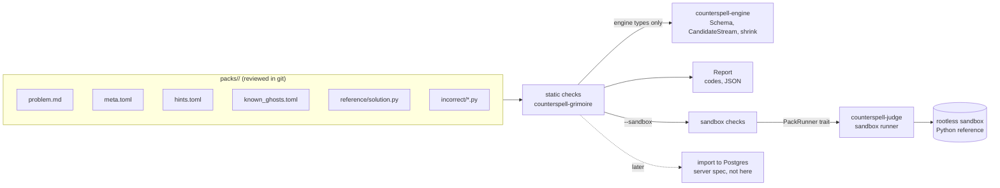
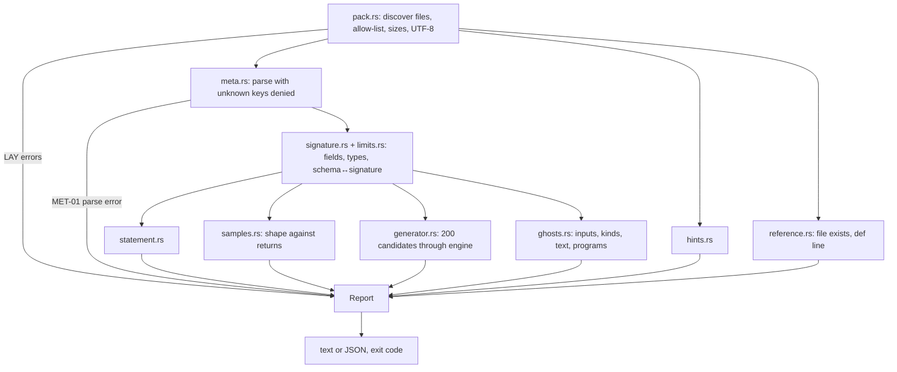

# Design: grimoire-packs

## Design approach

This is the system-design stage. No task in `tasks.md` is run by this spec. The architecture is fixed by `docs/system-design.md`. This document decides the pack file format, how the `counterspell-grimoire` crate validates packs, where the sandbox boundary sits, and what the first three starter packs contain.

Code sketches show intent. They are not final code.

## The idea in plain English

A pack is a folder with one problem in it. A reviewer reads the files in git. The validator reads the same files and says whether they are safe and consistent. Nothing in the pack is executed by the validator. Execution happens only through the judge's sandbox, when someone asks for a sandbox check.

Three layers of checking, each stricter than the last:

1. **Static (default, always runs, no execution).** Files, metadata, types, schema, hint and ghost text, and the engine's seeded candidate stream.
2. **Sandbox (`--sandbox`, needs the judge).** The reference runs the samples and hidden inputs. Known ghosts are reproduced. A known ghost is tested for minimality. Bench timing is checked when a complexity is declared.
3. **Import (later spec).** The server reads a pack that passed both layers and stores a `problems` row. Hidden expected outputs are created at import and stored server-side only.



## Pack format on disk

```text
packs/
├── README.md                 # the format, for reviewers (written by task T02)
├── count-pairs/              # starter, status = draft until reviewed
│   ├── problem.md
│   ├── meta.toml
│   ├── hints.toml
│   ├── known_ghosts.toml
│   ├── reference/solution.py
│   └── incorrect/{same-index.py, empty-min.py}
├── longest-run-length/       # starter
└── diagonal-total/           # starter
packs/_test/                  # ghost-engine fixtures, unchanged (GRM-50)
```

### problem.md (statement)

```markdown
# Count the Pairs

## Task
Given a list of whole numbers and a target, count the pairs of positions i < j
whose values add up to the target.

## Input
...

## Output
...

## Examples
...

## Constraints
...
```

Rules: the title line equals `meta.toml` `title`; the five headings appear in order; markdown is rendered with HTML off (GRM-19, GRM-20).

### meta.toml (metadata, signature, schema, generator, samples)

```toml
slug = "count-pairs"
title = "Count the Pairs"
status = "draft"                  # draft | published
difficulty = "easy"               # easy | medium | hard
track = "arrays"
concepts = ["arrays", "pairs", "nested-loops"]
origin = "original"
author = "Brighton"               # confirm the byline (open question 9)
licence = "MIT"
pack_version = 1
function = "count_pairs"
returns = "int"
comparator = "exact"

[[params]]
name = "values"
type = "list[int]"

[[params]]
name = "target"
type = "int"

[limits]
time_ms = 2000
mem_mb = 256

[input_schema]                    # root is always the argument tuple
type = "tuple"
items = [
  { type = "int_array", min_len = 0, max_len = 30, min = -50, max = 50 },
  { type = "int", min = -100, max = 100 },
]

[generator]
seed = 1729                       # fixed per pack, so hidden tests are reproducible
hidden_count = 12

[[samples]]                       # public; expected is hand-checked, reference must agree
input = [[1, 2, 3, 2], 4]
expected = 2
```

Field notes:
- `input` in a sample is the argument list in parameter order. This is the driver convention (system design §6).
- Schema `type` names come from the engine: `int`, `string`, `int_array`, `matrix`, `tuple`.
- `[bench]` and `reference_complexity` are optional. Starter packs leave them out until the efficiency-familiar fit exists (open question 8).

### hints.toml (authored ladder)

```toml
[[hint]]
rung = 1
text = "Ask what a pair of positions needs before you count it."

[[hint]]
rung = 2
text = "Think about the two positions as a loop over each first item, then a loop over the items after it."

[[hint]]
rung = 3
text = "Start the second loop one place after the first, so an item never pairs with itself."

[[hint]]
rung = 4
text = "Your inner loop may start at the same index as the outer loop. Change where it starts."
```

Rule: exactly four entries, rung 1 to 4 in order. Each text is 1–600 characters. Code fences inside a hint are 3 lines at most (system design §9). The sketch above is an example of tone, and Brighton reviews all wording.

### known_ghosts.toml (authored Bug Autopsy text)

```toml
[[ghost]]
id = "same-index"
program = "incorrect/same-index.py"
kind = "wrong"
input = [[0], 0]
got = 1
concepts = ["pairs", "nested-loops"]
explanation = "A value cannot pair with itself. The inner loop starts at the outer index, so the single item pairs with itself and is counted."

[[ghost]]
id = "empty-min"
program = "incorrect/empty-min.py"
kind = "crash"
input = [[], 0]
exception_class = "ValueError"
concepts = ["arrays"]
explanation = "The early exit calls min() on an empty list, which raises an error. Check for an empty list before you use min()."
```

Fields mirror the engine's `KnownGhost` (`id`, `input`, `kind`, `exception_class`, `got`, `explanation`, `concept_tags`). The TOML key is `concepts`, and the loader maps it to `concept_tags`. `dogfood = true` is allowed only in `_` packs (GRM-33).

### reference/solution.py (the authority)

```python
def count_pairs(values, target):
    count = 0
    for i in range(len(values)):
        for j in range(i + 1, len(values)):
            if values[i] + values[j] == target:
                count += 1
    return count
```

One file per pack, Python only. Its expected outputs are authoritative (system design §5, point 5). A `Solution` class, imports of other modules, and I/O are not part of the format. The static check looks only for `def <function>(` at column 0. The sandbox check proves the behaviour.

### incorrect/*.py

Each file defines the same function name. Each is referenced by one or more known ghosts through `program`. These files are deliberately wrong, so they are reviewed like any other code.

## Mapping: pack file → engine → Postgres

| Pack source | Engine type or check | `problems` / other column (system design §4) |
|---|---|---|
| `slug`, `title`, `difficulty`, `track`, `concepts` | `ProblemRecord` fields | `slug`, `title`, `difficulty`, `problem_concepts` |
| `problem.md` | markdown, length and HTML checks | `statement_md` |
| `function`, `params`, `returns` | `Signature` (own type in grimoire) | `signature jsonb` |
| `input_schema` | `counterspell_engine::Schema` (tagged serde), `check_definition`, `contains` | `input_schema jsonb` |
| `comparator` | `counterspell_engine::Comparator` (`Exact`, `Unordered`) | `comparator text` |
| `[limits]` | `Limits` (own type) | `limits jsonb` |
| `reference_complexity`, `[bench]`, `complexity_note` | `Bench` (own type; fit is later) | `reference_complexity`, `bench jsonb`, `complexity_note` |
| `pack_version` | `version` | `version int` (and `ghosts.problem_version`) |
| `licence`, `origin`, `author` | not stored in `problems` | `packs.license`; `origin` stays in the repo |
| `[[samples]]` | public examples | `test_cases` with `is_sample = true` |
| `[generator]` seed and hidden count | engine `CandidateStream`, origin `Generated` | `test_cases` with `is_sample = false`, **server only** |
| `reference/solution.py` | the authority | `reference_solutions (problem_slug, lang='python', code)`, **server only** |
| `hints.toml` | authored ladder | `hints` rows created when shown (rung and source `ladder`) |
| `known_ghosts.toml` | `KnownGhost` | matched by `AuthoredMistake` in `ghosts.autopsy` |

Columns in the right-hand column that the server fills at import are outside this crate (GRM-54). The `ProblemRecord` type is the handoff.

## Crate layout and dependency rules

Everything lives in `crates/grimoire/` (package `counterspell-grimoire`). `src/lib.rs` keeps `GRIMOIRE_VERSION`. The `validate` subcommand lives in `src/main.rs`. The package does not gain a second binary or a second crate.

```text
crates/grimoire/
├── Cargo.toml                 # serde (derive), serde_json, toml, counterspell-engine (path)
├── src/
│   ├── lib.rs                 # pub fns: validate_static, validate_sandbox; re-exports
│   ├── main.rs                # CLI: parse args (std only), print report, exit code
│   ├── codes.rs               # every diagnostic code as a const, with its severity
│   ├── report.rs              # Diagnostic, Severity, Report, JSON and text output
│   ├── pack.rs                # discovery, file allow-list, sizes, symlinks, UTF-8 (LAY-*)
│   ├── meta.rs                # serde model of meta.toml, unknown keys denied (MET-01..03)
│   ├── signature.rs           # Signature, ParamType, schema↔signature mapping (MET-04, MET-05)
│   ├── limits.rs              # Limits, Bench, reference_complexity checks (MET-08, MET-09)
│   ├── statement.rs           # problem.md headings, title, HTML (STM-*)
│   ├── samples.rs             # sample shape and duplicates (SMP-*)
│   ├── generator.rs           # seed, hidden_count, 200-candidate stream check (GEN-*)
│   ├── hints.rs               # hints.toml (HNT-*)
│   ├── ghosts.rs              # known_ghosts.toml, static part (KNG-*)
│   ├── reference.rs           # reference file exists, def line (REF-*)
│   ├── runner.rs              # PackRunner trait, Target, RunnerError, ProgramOracle adapter
│   ├── sandbox.rs             # sandbox checks, uses runner and engine shrink (SBX-*)
│   └── record.rs              # ProblemRecord (typed handoff for the importer, GRM-54)
└── tests/
    ├── starter_packs.rs       # GRM-52: every packs/<slug> validates statically
    ├── mutations.rs           # one mutation per code on a copy of a starter pack (GRM-51)
    ├── layout.rs              # symlink, escape, size, UTF-8 cases built in a temp dir
    ├── sandbox_fake.rs        # sandbox checks with a model runner (not the real sandbox)
    └── purity.rs              # scans src/ for process, network and fs-write APIs (GRM-35)
```

**Dependency direction:**

| Module | May use | Must not use |
|---|---|---|
| `pack`, `meta`, `signature`, `limits`, `statement`, `samples`, `hints`, `reference`, `report`, `codes` | std, serde, serde_json, toml, engine **types** | `runner`, `sandbox`, process or network APIs |
| `generator`, `ghosts` (static part) | engine `Schema`, `CandidateStream`, `contains` | `runner`, `sandbox` |
| `runner` | std `Duration`, `serde_json`, engine `Oracle`/`ProgramResult` | any file I/O |
| `sandbox` | `runner`, engine `shrink`, `classify`, `Comparator` | direct spawn (there is no spawn in this crate) |
| `record` | `meta`, `signature`, engine types | any I/O |
| `main` | `lib` only | logic of its own beyond argument parsing and exit codes |

The `purity` test is the enforcement. It fails if `src/` contains `std::process`, `std::net`, `Command::`, `TcpStream`, `File::create`, `fs::write` or similar, outside the one module that reads files (`pack.rs`), which may only read.

Rust rules for this crate: no `unwrap()`, `expect()` or `unsafe` in production code. Clippy pedantic is on, with `-D warnings`. Prefer `u64::try_from` to `as` casts.

## Validation pipeline (static)



Stages run in this order, and each stage that can run on partial data still runs. Stages that need a parsed `meta.toml` (C and onward) are skipped when MET-01 fires. The report lists the skipped stages in its `checked` field, so an empty error list never looks like a full pass.

### Diagnostic codes

Each code appears in `codes.rs` and has a negative fixture (GRM-51).

| Code | Severity | Meaning |
|---|---|---|
| LAY-01 | error | required file missing |
| LAY-02 | error | file outside the allow-list, or dot-prefixed |
| LAY-03 | error | symlink, path escape, or non-UTF-8 name |
| LAY-04 | error | size cap exceeded (file or pack) |
| LAY-05 | error | text is not UTF-8, or has a forbidden control character |
| LAY-06 | error | directory name is not a valid slug, or differs from `meta.slug` |
| MET-01 | error | TOML syntax error or unknown key (file, line, column) |
| MET-02 | error | required field missing, wrong type, or out of range |
| MET-03 | error | `origin` is not `original`, `licence` is not `MIT`, or a third-party field exists |
| MET-04 | error | parameter or return type not in the launch set |
| MET-05 | error | `input_schema` does not match `params` (arity or kind) |
| MET-06 | error | engine `check_definition` rejects the schema |
| MET-07 | error | comparator not allowed for this return type |
| MET-08 | error | limits outside the launch caps |
| MET-09 | error | `reference_complexity` or `[bench]` invalid, or one without the other |
| STM-01 | error | title line or heading order wrong |
| STM-02 | error | statement too long, or contains raw HTML |
| SMP-01 | error | sample count outside 2–5 |
| SMP-02 | error | sample input rejected by schema, or expected does not match `returns` |
| SMP-03 | error | duplicate sample input |
| GEN-01 | error | seed or hidden count out of range |
| GEN-02 | error | engine stream produced an invalid or repeated candidate (engine bug or bad schema) |
| HNT-01 | error | hints not exactly four, or rungs out of order |
| HNT-02 | error | hint too long, or a code fence over 3 lines |
| KNG-01 | error | more than 10 ghosts, or duplicate or non-kebab `id` |
| KNG-02 | error | ghost input rejected by schema, or `program` missing or not defining the function |
| KNG-03 | error | `kind` fields inconsistent (`got` / `exception_class` rules) |
| KNG-04 | error | explanation empty, too long, or contains a forbidden phrase |
| KNG-05 | error | ghost concept not in the pack's concepts |
| KNG-06 | error | `dogfood = true` in a catalogue (non-`_`) pack |
| REF-01 | error | reference missing, or does not define `def <function>(` |
| SBX-01 | error | reference disagrees with an authored sample |
| SBX-02 | error | reference crashes, times out, or returns the wrong shape on a hidden input |
| SBX-03 | error | a known ghost does not reproduce on its program |
| SBX-04 | warning | a known ghost input is not minimal (smaller failing input given) |
| SBX-05 | warning | measured complexity differs from `reference_complexity` |
| SBX-06 | error | infrastructure failure (exit 2, not a pack failure) |
| SBX-07 | error | no sandbox runner configured (exit 2) |
| SBX-08 | warning | complexity not checked yet (fit not available) |

## Static check details

**Layout (`pack.rs`).** Walk the pack root without following symlinks. Build the allowed set: the four required files, optional `known_ghosts.toml`, and `incorrect/*.py` only when the ghosts file exists. Read each file once into memory, with the size cap applied before reading the whole file (`metadata().len()`). Check UTF-8 and control characters on the bytes. Canonicalise each path and confirm it starts with the pack root.

**Meta (`meta.rs`, `signature.rs`, `limits.rs`).** Deserialise into plain structs with `#[serde(deny_unknown_fields)]`. The `input_schema` field deserialises into the engine's `Schema`, so the engine's own tag names and bounds apply. `signature.rs` then checks that `params` and the root tuple agree, one for one, using this table:

| Param type | Schema kind |
|---|---|
| `int` | `int` |
| `str` | `string` |
| `list[int]` | `int_array` |
| `list[list[int]]` | `matrix` |

Return type shapes are used by the sample and ghost checks:

| Returns | Expected JSON shape |
|---|---|
| `int` | integer (no float, no bool) |
| `str` | string |
| `list[int]` | array of integers |
| `list[list[int]]` | array of equal-length integer arrays |

**Generator (`generator.rs`).** Use the engine's `CandidateStream` with `seed` and the schema. Draw 200 candidates, check that each passes `Schema::contains`, and check that none repeats. This is PCK-1.2 without running any code. It also guards the engine: a GEN-02 failure is an engine or schema bug, and the report says so.

**Ghosts (`ghosts.rs`, static).** Check the `input` against the schema, the `program` path against the pack's `incorrect/` files, and that each file contains `def <function>(` at column 0. Check the kind rules, exception-class pattern, explanation length, and forbidden phrases. The forbidden list comes from the engine's R9.6 constant if the engine exports it. Otherwise the crate keeps a copy and a test asserts the two lists are equal (open question 6).

## Sandbox checks (`runner.rs`, `sandbox.rs`)

### The runner trait

```rust
/// Implemented by counterspell-judge through its sandbox. Never implemented on the host.
pub trait PackRunner {
    /// Runs the reference or one incorrect program on one input.
    /// `program` is a path already checked to lie inside the pack.
    fn run(&mut self, target: Target<'_>, input: &serde_json::Value, limit: Duration)
        -> Result<ProgramResult, RunnerError>;

    /// Times the reference on inputs of growing size. Returns (n, median_ns) pairs.
    /// Not implemented until the efficiency-familiar spec (SBX-08 until then).
    fn bench(&mut self, sized_inputs: &[(u64, serde_json::Value)], limit: Duration)
        -> Result<Vec<(u64, u64)>, RunnerError>;
}

pub enum Target<'a> { Reference, Program(&'a str) }

/// Infrastructure only. A user or program failure is a ProgramResult, never a RunnerError.
pub enum RunnerError { Infrastructure(String) }
```

`ProgramResult` is the engine's enum (`Returned`, `Crashed`, `TimedOut`, `Garbled`). The engine's `Oracle` is implemented by a small adapter, `ProgramOracle { runner, target }`, so `shrink` and `hunt` can be reused without new logic.

Why the trait lives in grimoire and the judge implements it: the validator must not depend on the judge (the judge is a large trusted binary). The judge depends on grimoire and provides the runner (open question 7).

### What the sandbox checks do

1. **SBX-01.** Run the reference on each sample. Compare with the engine comparator. A mismatch is an error. The authored value stays as written, and the author fixes it.
2. **SBX-02.** Generate the hidden inputs from `[generator]` (in memory). Run the reference on each one with `limits.time_ms`. Check the shape of every result. Hidden expected values are kept in memory, never written out.
3. **SBX-03.** For each known ghost, run its `program` on its `input` and classify. The result must match `kind` (and `exception_class` or `got`).
4. **SBX-04.** For each known ghost, call the engine's `shrink` with a probe that keeps a candidate only if the program fails the same way. Any smaller accepted input is a warning. This keeps authored ghosts honest. The probe budget is the engine's default.
5. **SBX-05 / SBX-08.** If `[bench]` is declared, the runner's `bench` is called. Until it is implemented, SBX-08 is emitted and nothing is claimed about complexity.
6. **SBX-06 / SBX-07.** Runner errors are infrastructure errors. Exit 2. No pack failure is reported.

The sandbox checks never run before the static checks pass. A static error stops the run before any code executes, so broken packs never reach the sandbox.

## Starter packs

Three starter packs, derived from the three ghost-engine fixture ideas but **re-titled, re-slugged and re-worded** so they are new catalogue entries. The `_test` fixtures stay unchanged (GRM-50). The statements are drafts. Brighton reviews each one before `status` becomes `published` (GRM-47).

| Slug | Function and types | Schema | Known ghosts (kind, input, got/class) | Incorrect programs |
|---|---|---|---|---|
| `count-pairs` | `count_pairs(values: list[int], target: int) -> int` | tuple(int_array 0..30, −50..50; int −100..100) | `same-index` (wrong, `[[0], 0]`, got 1); `empty-min` (crash ValueError, `[[], 0]`) | `same-index.py`, `empty-min.py` |
| `longest-run-length` | `longest_run(text: str) -> int` | tuple(string alphabet `abc`, len 0..40) | `forgot-last-run` (wrong, `["a"]`, got 0); `empty-first-char` (crash IndexError, `[""]`) | `forgot-last-run.py`, `empty-first-char.py` |
| `diagonal-total` | `diagonal_total(grid: list[list[int]]) -> int` | tuple(matrix rows 0..6, cols 0..6, −9..9) | `abs-diagonal` (wrong, `[[[-1]]]`, got 1); `assumes-square` (crash IndexError, `[[[]]]`) | `abs-diagonal.py`, `assumes-square.py` |

Each pack also has: a four-rung hint ladder, 2–5 hand-checked samples, `hidden_count = 12`, `time_ms = 2000`, `mem_mb = 256`, `concepts` (as in the ghost-engine table), and no `[bench]` yet.

The known-ghost inputs and the crash classes come from `ghost.json` in the ghost-engine fixtures (the hand analysis in its design). Those are the unique smallest failing inputs under the size metric. They are used as **regression expectations**: if sandbox SBX-04 finds a smaller failure, the warning is correct and the authored ghost is updated. Authored text is written fresh.

`same-index`, `forgot-last-run` and `abs-diagonal` are wrong-answer programs. Each `got` value comes from the hand trace. Those values are checked in the sandbox (SBX-03), not trusted.

### Why only three now

The milestone plan (system design §14) puts `grimoire-packs` in Tue 17 – Sun 22 Nov, with the first packs. Ten polished problems are due by Sun 29 Nov. Three packs prove the format, the validator and the sandbox path end to end. The next seven follow the same pattern once the format is stable.

## CLI and report

```text
counterspell-grimoire validate <pack-dir> [--json] [--deny-warnings] [--sandbox]
counterspell-grimoire validate --all <packs-root> [--include-underscore] [--json] [--sandbox]
```

- Text output groups diagnostics by file, one line each: `ERROR MET-02 meta.toml /limits/time_ms: time_ms must be 100–2000`. Plain text only.
- JSON (`--json`): `{ "pack": "...", "checked": ["layout","meta",...], "skipped": [...], "diagnostics": [{ "code","severity","file","pointer","message" }], "summary": {"errors":n,"warnings":n} }`. The MCP tool returns the same object.
- Exit codes: 0 pass; 1 errors; 2 usage, I/O or infrastructure. `--deny-warnings` turns warnings into a 1.
- `--sandbox` without a configured runner exits 2 with `SBX-07`. `lib.rs` does not pick a runner. The judge passes one in.

`validate_static` and `validate_sandbox(runner)` in `lib.rs` are the library entry points the MCP server calls later.

## ProblemRecord (handoff)

```rust
pub struct ProblemRecord {
    pub slug: String,
    pub title: String,
    pub track: String,
    pub difficulty: Difficulty,
    pub statement_md: String,
    pub signature: Signature,
    pub input_schema: counterspell_engine::Schema,
    pub comparator: counterspell_engine::Comparator,
    pub limits: Limits,
    pub reference_complexity: Option<String>,
    pub bench: Option<Bench>,
    pub complexity_note: Option<String>,
    pub version: u32,                 // pack_version
    pub concepts: Vec<String>,
}
```

Built only from a pack that passed static validation. The server's import spec serialises it into the `problems` row. This crate has no database types (GRM-54).

## Testing strategy

| Test file | What it proves |
|---|---|
| unit tests in each module | parse rules, mapping table, length caps, forbidden phrases, the exact diagnostic code per rule |
| `starter_packs.rs` | every `packs/<slug>` passes static validation with zero errors (GRM-52) |
| `mutations.rs` | for each code, copy a starter pack into a temp dir, apply one textual mutation, and assert the report contains that code and no other error (GRM-51) |
| `layout.rs` | symlink, path escape, non-UTF-8 name, oversize file, and NUL byte, built in a temp dir (not committed, because symlinks and some byte cases are not portable in git) |
| `sandbox_fake.rs` | sandbox logic with a **model runner**: plain Rust functions mirroring each starter reference and incorrect program, with hand-checked vectors. This proves the sandbox checks' logic, not the sandbox. The real sandbox run is the judge spec's job |
| `purity.rs` | `src/` contains no process, network or write APIs outside allowed modules (GRM-35) |

Properties (`proptest`, optional, in unit tests): random schemas that pass `check_definition` produce candidates that pass `contains`. This repeats a check the engine already makes, so it is only added if time allows.

Wording check: a test scans every diagnostic message template for the engine's forbidden phrases, so the validator never describes a ghost as minimal without evidence.

The model-runner tests are labelled in their file header as **not evidence that the sandbox works**. The `judge-sandbox` spec must re-run the same vectors through the real Python files (same convention as ghost-engine `packs/_test/README.md`).

## Security

- Pack files are untrusted: they are reviewed, but the validator treats them as hostile. The allow-list, symlink ban, path check, size caps and UTF-8 rules run before any parsing.
- Static mode executes nothing, so a malicious `reference/solution.py` cannot run on the developer's machine or on the server during validation.
- The sandbox runner is the only execution path. The validator never falls back to the host (GRM-40).
- Hidden data is never printed (GRM-25). Reports cite pointers and counts only.
- Diagnostics show file names and pointers, never program output. Program output from the sandbox is treated as plain text (VAL-5) and is truncated before it reaches a report.
- No keyword blocklist is used to decide if pack code is safe. The sandbox is the boundary (security.md).

## Trade-offs

- **Markdown statement plus TOML metadata, not all TOML.** Long prose is easier to review as markdown. The cost is two places to check (the title and the headings, GRM-19). The validator covers the link.
- **TOML, not JSON, for metadata.** Comments are allowed, which suits reviewed files. The engine's JSON-shaped schema is written inside TOML inline tables. The cost is one extra parser (`toml`, MIT or Apache-2.0, to be added to `THIRD-PARTY-NOTICES.md`).
- **Static first, sandbox later.** The validator can ship before the judge exists, which keeps the Wed 25 Nov checkpoint reachable. The cost is that a pack can pass static checks and still be wrong until `--sandbox` runs. The report says which checks ran.
- **Authored samples plus a reference, not reference-only expected values.** A human-written sample is a second opinion on the reference. The cost is that authors must write expected values by hand. Disagreement is an error, never silently fixed.
- **Hidden tests generated from a seed.** Reproducible and small in the repo. The cost is that the hidden inputs are only as secret as the seed and the reference (see open question 1).
- **Three starter packs, not ten.** Keeps the format and the sandbox path proven before the content push. The cost is a larger content load later.
- **Known ghosts checked for minimality with a warning, not an error.** Honest without blocking authors. The cost is that a warning can be ignored unless `--deny-warnings` is used in CI.

## Blocked-by and dependencies

| Need | From | Until it lands |
|---|---|---|
| `Schema`, `check_definition`, `contains`, `CandidateStream`, `shrink`, `KnownGhost`, `Comparator`, `ProgramResult` public | `ghost-engine` spec tasks | static checks GEN-*, SMP-02, KNG-02 cannot compile |
| `PackRunner` implementation (sandbox) | `judge-sandbox` spec | `--sandbox` exits 2 with SBX-07 |
| Bench fit and `PackRunner::bench` | `efficiency-familiar` spec | SBX-08 warning only |
| `languages/languages.toml` caps | `language-drivers` / `repo-skeleton` | launch caps are constants in `limits.rs`, with a test that compares them to the TOML if the file exists (open question 10) |
| CI step `validate --all packs` | `.github/workflows/ci.yml` (CI spec) | `starter_packs.rs` covers the same in `cargo test` |

## Open questions

Each question lists the choice this spec assumed. Please confirm or change any of them before tasks run.

1. **Are reference and hidden data public?** The repository must be public and MIT (system design §0). Requirements PCK-1 says problems live in git, so the reference solution is public too. The hidden-test seed is also in git, so anyone can regenerate the hidden inputs and their expected outputs. **Assumed:** keep packs in git, and accept that the hidden tests are not secret from a determined reader. Alternative: keep `reference/` and `[generator]` in a private store outside the repo, read by the importer via a path in the environment (not committed). That would need a second pack location and a change to GRM-6 and GRM-34. This is the most important decision, and it affects the anti-cheating story.
2. **Starter slugs differ from the ghost-engine fixture names.** **Assumed:** `count-pairs`, `longest-run-length`, `diagonal-total`, so the catalogue and `_test` never share a slug.
3. **Format: markdown statement plus TOML metadata.** Matches the request. **Assumed:** yes.
4. **Seed range.** TOML integers are signed 64-bit. **Assumed:** 0 to 2^63−1, and the engine's `u64` seed is derived from it.
5. **Concept registry.** **Assumed:** free kebab-case tags per pack (1–5), with ghost concepts a subset. A shared list in `packs/concepts.toml` can come later if the catalogue needs filters.
6. **Forbidden phrase list.** **Assumed:** reuse the engine's R9.6 constant if exported. Otherwise keep a copy and test equality.
7. **Who owns `PackRunner`.** **Assumed:** the trait lives in grimoire, the judge implements it, and the judge depends on grimoire. This adds one edge (judge → grimoire). The alternative is moving the trait into `counterspell-common`, which keeps the dependency graph flatter but puts a validator concept in the shared crate.
8. **Bench and reference complexity in starter packs.** **Assumed:** starter packs have no `[bench]` yet, so they do not claim a complexity. The efficiency-familiar spec adds `[bench]` after the fit exists. This means the Familiar has no reference curve for these three packs until then.
9. **Author byline.** `author = "Brighton"` is a placeholder. **Assumed:** Brighton's name, to be confirmed.
10. **Launch caps.** **Assumed:** constants (`time_ms` 100–2000, `mem_mb` 64–256) in `limits.rs`, checked against `languages/languages.toml` by a test when that file exists.
11. **Migrating `packs/_test/`.** **Assumed:** unchanged. A separate task converts them to this format after ghost-engine ships and its tests are updated. That is a change in the ghost-engine spec, so it is not done here.
12. **CLI parsing.** **Assumed:** std-only argument parsing, no `clap`, to keep the dependency list small for licence review.
13. **Non-ASCII statements.** **Assumed:** allowed in `problem.md` (UTF-8 is the rule). Alphabets stay ASCII (engine open question 9).
14. **Timeout known ghosts in catalogue packs.** **Assumed:** allowed when `kind = "timeout"`, with no `got` and no shrink (the engine's rule), and the validator shows the time limit in the message.
15. **Hidden test count.** **Assumed:** 12, matching the Two Sum walkthrough in `docs/requirements.md` (3 samples, 12 hidden). The range 5–50 is a guard, not a target.
