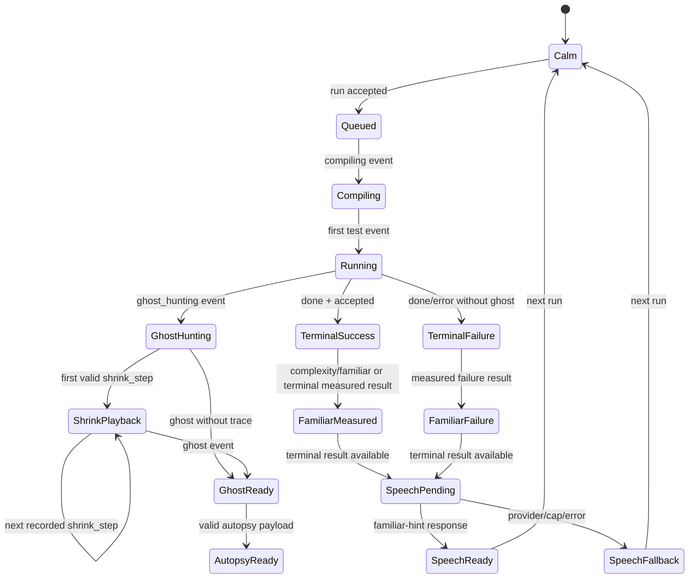

# Design: ide-workspace

## Design approach

This is a Requirements-First, high-level design for the Counterspell learner workspace. The repository architecture is fixed by `docs/system-design.md` and `.kiro/specs/repo-skeleton/`. The design separates three concerns:

1. **Trusted data seams.** Axum and the judge provide problem, run, ghost, hint, and measured Familiar data. The browser validates response shapes, reduces persisted run events, and never becomes an execution authority.
2. **Calm workspace composition.** Svelte 5 components present the problem, Monaco, tests, ghost trace, autopsy, hints, and Familiar without hiding the editor or introducing an alternative frontend architecture.
3. **Evidence-led transitions.** The UI changes state from API responses and persisted SSE events only. It never simulates a successful run, fabricates progress, infers a ghost, or invents shrink steps.

The work is split between UI and API/integration tasks because part of the UI will be implemented outside Kiro. `[UI]` tasks are browser-only tasks. `[P]` marks tasks that can run in parallel after their listed dependencies. No task in `tasks.md` is executed by this design-generation run.

## Scope and non-goals

### Included

- The production problem workspace route and its responsive shell.
- Problem detail loading, safe statement rendering, language selection, Monaco `Crypt` theme, per-problem/language drafts, and autosave.
- Run and Submit controls wired to the real Axum API and run-lifecycle SSE client.
- Sample detail display, hidden-test-safe submit display, reconnect/replay handling, and terminal result display.
- Ghost Hunting state, recorded shrink playback, minimized-counterexample wording, Bug Autopsy, authored hints, and custom ghost rerun.
- Measured Familiar state, preferences, explanation popover, and one labelled AI speech request per finished run.
- Prototype-only fixture route for visual work, permanently labelled and isolated from production routes.
- Browser unit/component tests, accessibility acceptance tests, and an end-to-end path against the built app and actual API/judge stack.

### Deferred or provided by other specs

- Authentication, OAuth, sessions, catalogue authoring/import, sandboxing, language drivers, the pure ghost engine, the Postgres queue/lease worker, and the hint/Familiar server implementations.
- Java and C++ support until enabled by `GET /api/languages`.
- Live typing complexity guesses, AST workers, FSRS, dashboard screens, timed trials, break room, payments, and light mode.
- Global visual landing-page scenes. The workspace may reuse shared Steel Night tokens but does not add landing animation.

## Dependencies and integration contracts

### Existing dependencies

The implementation consumes these existing contracts rather than redefining them:

| Dependency | Workspace seam | Contract used here |
|---|---|---|
| `run-lifecycle` | `web/src/lib/runs/` and Axum runs API | `POST /api/runs`, `GET /api/runs/{id}`, `GET /api/runs/{id}/events`, `Last-Event-ID`, event sequence reducer, terminal fetch |
| `ghost-engine` | judge result JSON and public run events | ghost input, expected, got, failure kind, autopsy, recorded shrink trace and provenance |
| `grimoire-packs` / catalogue | Axum problem routes | published problem detail, samples, starter code, signature, constraints, hints, concepts |
| `language-drivers` | Axum language catalogue | enabled language ids, display names, starter compatibility and byte limits |
| `auth` | cookie session | authenticated API requests and ownership checks |
| `efficiency-familiar` | run result and hint endpoints | measured mood/complexity events, preferences, templated or AI speech bubble |

The browser uses `fetch` with same-origin cookies. It does not connect to Postgres, Valkey, Docker, the judge, or an MCP process.

### Problem detail response

The catalogue adapter exposes a typed public response. Exact field names may be shared from `counterspell-common` through generated JSON documentation later; the browser must tolerate additive fields but reject missing required fields.

```text
ProblemDetail {
  slug: string,
  title: string,
  track: { slug: string, name: string },
  concepts: [{ slug: string, name: string }],
  difficulty: "intro" | "standard" | "hard",
  statement_markdown: string,
  constraints: string[] | structured constraint objects,
  signature: { function_name, parameters, return_type },
  samples: [{ input: unknown, expected: unknown }],
  starters: { [language: string]: string },
  enabled_languages: string[]
}
```

Problem text is trusted catalogue content but still goes through a safe markdown renderer with HTML disabled or allowlisted. Sample values are displayed as data, not inserted as markup.

### Language response

```text
LanguageSummary {
  id: "python" | "javascript" | string,
  display_name: string,
  enabled: boolean,
  file_name: string,
  max_source_bytes: number,
  supports_run: boolean,
  supports_submit: boolean
}
```

The UI uses the intersection of the problem's supported languages and the server's enabled languages. It does not infer support from a hard-coded list.

### Run and event response

The run-lifecycle spec owns the exact event envelope and security rules. The workspace expects:

```text
SseMessage {
  id: string,                         // persisted seq
  event: "compiling" | "test" | "ghost_hunting" | "shrink_step" |
         "ghost" | "bench_point" | "complexity" | "familiar" |
         "restarted" | "done" | "error",
  data: { seq: number, attempt: number, payload: object }
}
```

The browser maps only typed public payloads into its local view model:

- `test`: hidden rows contain ordinal/verdict/time only; sample rows may contain input/expected/got.
- `shrink_step`: one actual recorded step, including its input and any public size/evaluation metadata.
- `ghost`: the final ghost and autopsy-safe public fields.
- `complexity`: measured class, confidence, reference, and public baseline ratio.
- `familiar`: measured mood, reason, and `layer: "measured"`.
- `done`: terminal summary and public test results.
- `error`: stable code and safe message.

No raw executor JSON is accepted by the UI adapter. A schema decoder returns an unavailable state for malformed payloads.

### Custom ghost run contract

The fixed run endpoint accepts the standard `{problem, lang, code, mode}` body. To keep that contract strict while supporting the product journey, this design assumes a dedicated endpoint:

```text
POST /api/runs/ghost
Body: {
  problem: string,
  lang: string,
  code: string,
  ghost: { submission_id: string, input: unknown }
}
Response: 202 { run_id: string, status: "queued", mode: "run", custom: true }
```

The server must verify ownership of the source submission, revalidate the problem schema and language/source constraints, and enqueue a one-input custom run through the same trusted judge/comparator path. The response and events must not expose unrelated hidden tests. If Brighton chooses to fold this into the standard run API, the browser adapter changes in one place (`web/src/lib/api/runs.ts`) and the security requirements remain unchanged.

### Hints and Familiar contracts

- `POST /api/hints` reveals one authored rung at a time. The browser sends the submission id and requested rung and displays the returned text as plain text.
- `POST /api/runs/{id}/familiar-hint` is called once after a terminal result. It returns a labelled AI response or a safe/template fallback. The browser stores an in-memory per-run request guard so reconnects and component remounts cannot call it twice.
- `PATCH /api/me/familiar` persists `muted` and `hidden` preferences. If it fails, the UI keeps the local preference and marks sync pending; it does not block coding.

## Architecture and module boundaries

```text
web/src/
├── routes/
│   ├── problems/[slug]/+page.svelte          # production workspace route
│   └── prototype/ide-workspace/+page.svelte  # explicit fixture-only visual route
├── lib/
│   ├── api/
│   │   ├── client.ts                         # same-origin fetch, JSON errors, aborts
│   │   ├── problems.ts                        # ProblemDetail decoder and loader
│   │   ├── languages.ts                       # language response decoder
│   │   ├── runs.ts                            # start/get/custom run request adapters
│   │   ├── hints.ts                           # authored hint and Familiar speech calls
│   │   └── familiar.ts                        # preference API adapter
│   ├── editor/
│   │   ├── MonacoEditor.svelte               # lazy Monaco lifecycle boundary
│   │   ├── crypt-theme.ts                     # palette-driven Monaco theme
│   │   ├── draft-store.ts                     # problem/language keyed draft persistence
│   │   └── source-validation.ts               # byte count and UX-only checks
│   ├── runs/
│   │   ├── types.ts                           # browser-safe run/event view types
│   │   ├── reducer.ts                         # pure seq/gap/restart reducer
│   │   └── stream.ts                          # SSE connect/replay/terminal fetch
│   ├── ghost/
│   │   ├── shrink-playback.ts                 # recorded-step ordering and playback timing
│   │   └── autopsy.ts                         # public ghost/autopsy view model
│   ├── familiar/
│   │   ├── Familiar.svelte                    # measured mood and controls
│   │   ├── familiar-state.ts                  # measured-only reducer
│   │   └── how-it-judges.svelte               # honest measurement explanation
│   ├── workspace/
│   │   ├── WorkspaceShell.svelte              # responsive regions and focus landmarks
│   │   ├── ProblemPanel.svelte                # statement, constraints and examples
│   │   ├── EditorPanel.svelte                 # editor and language controls
│   │   ├── RunControls.svelte                 # Run/Submit/custom actions
│   │   ├── TestPanel.svelte                   # sample/hidden/test status rows
│   │   ├── GhostPanel.svelte                  # Ghost Hunting and trace
│   │   ├── AutopsyCard.svelte                 # expected/actual/differences
│   │   ├── HintPanel.svelte                   # authored ladder and AI label
│   │   ├── StatusAnnouncer.svelte             # throttled aria-live text
│   │   └── keyboard.ts                        # shortcuts and focus return
│   └── ui/                                    # small shared Bits UI wrappers only
```

### Boundary rules

- `WorkspaceShell` owns composition, active run identity, abort controllers, focus landmarks, and responsive panel state. It does not decode raw API payloads.
- API modules own HTTP methods, JSON envelopes, aborts, stable error mapping, and response validation. They do not render.
- `runs/reducer.ts` is pure and owns sequence/gap/deduplication/restart rules. It does not call fetch, EventSource, or Svelte stores.
- `stream.ts` owns EventSource lifecycle and terminal fetch. It never mutates UI state directly; it emits typed reducer actions.
- `MonacoEditor.svelte` owns Monaco creation/disposal and editor events. It emits source changes and commands; it does not submit runs.
- `draft-store.ts` stores only source text and metadata needed to restore it. It does not store run events, hidden tests, AI prompts, or secrets.
- Ghost and Familiar components receive trusted public view models. They do not invent fields when a value is missing.
- All components use semantic CSS tokens. Raw palette hex values are limited to the Monaco theme file where the documented Monaco API requires them.

## Interaction flow

### 1. Entering a problem

1. The route identifies the slug and creates an `AbortController` for the load.
2. Problem and language requests run in parallel where possible.
3. The shell shows problem skeleton, editor placeholder, and disabled controls. It does not show sample results.
4. Once the required response validates, the shell selects the last valid language draft or the default launch language, then lazy-loads Monaco.
5. If the route changes, the old controller is aborted and its result cannot update the new slug.

### 2. Editing and drafts

1. The editor receives starter text or a restored local draft.
2. Every change updates in-memory source immediately and schedules a debounced local save.
3. A byte counter and parse/size advisory are shown without pretending to replace server validation.
4. Switching language snapshots the current source under the old language key before loading the new key.
5. Before Run/Submit, the shell reads the current Monaco model, not a stale Svelte value.

### 3. Run samples

1. Run is disabled until problem, language and source are ready, and while the same action is in flight.
2. The client creates one idempotency key per user action and calls the real API.
3. It sets `activeRunId`, resets only the current transient panel, and starts the SSE stream.
4. Sample rows update from `test` events. The status announcer summarises meaningful phase changes, not every animation frame.
5. On `done`, the client fetches the terminal run read model and keeps the result visible until the learner starts another action.

### 4. Submit hidden tests

The flow is the same as Run, but hidden rows never receive details. The test panel makes the distinction explicit: `Sample detail` versus `Hidden test — verdict and time only`. A failed Submit can enter Ghost Hunting only after the server emits `ghost_hunting`; a failed sample Run cannot cause the UI to invent that phase.

### 5. Ghost reveal and shrink

1. The `ghost_hunting` event changes the panel heading and shows an honest indeterminate “searching” status.
2. Each ordered `shrink_step` is appended by the reducer. Duplicate or out-of-order events wait for replay.
3. When the final `ghost` arrives, the UI validates that its final input agrees with the last recorded step when both are present.
4. A playback controller plays the received trace once. It uses a fixed crossfade per actual step and stops at the final input.
5. Reduced motion bypasses the timeline and renders the same trace as an ordered list.
6. The Bug Autopsy card becomes available only when the ghost/autopsy payload validates.

### 6. Hints and custom ghost run

1. The hints panel starts collapsed or shows the next rung label without revealing future text.
2. Requesting the next rung calls Axum and reveals exactly that returned rung. The browser does not generate nudge or fix text.
3. Rerun ghost submits the current source to the dedicated custom endpoint. It creates a new run id and does not overwrite the failed submission.
4. The custom result is labelled and rendered like any other server-judged result.

### 7. Correct and resubmit

1. Editing after failure leaves the prior run in a compact history section and keeps its autopsy available.
2. Submit creates a new active run and clears only the active result rows.
3. Accepted is displayed only from the terminal server result.
4. The Familiar consumes measured `complexity`/`familiar` data if present. If no bench data exists, it uses only the measured correctness state supplied by the server.
5. After the terminal event, one Familiar speech request is attempted. The verdict and mood are already fixed before the request begins.

## Responsive layout

Use CSS grid/flex and semantic tokens; do not hard-code a desktop-only pixel canvas.

### Wide desktop (≥ 1200px)

```text
┌────────────────────────────────────────────────────────────────────────────┐
│ breadcrumb · problem title · language · save state · Run · Submit          │
├───────────────────────┬───────────────────────────────┬────────────────────┤
│ PROBLEM                 │ EDITOR                         │ TESTS / GHOST       │
│ statement               │ Monaco                         │ queue + per-test    │
│ constraints             │                                │ ghost hunting       │
│ examples                │                                │ autopsy + hints     │
│ signature               │                                │ Familiar dock       │
└───────────────────────┴───────────────────────────────┴────────────────────┘
```

The left and right columns have collapse controls and do not cover Monaco content. The Familiar is docked inside the right region on desktop, with a hide-to-dot affordance that remains keyboard reachable.

### Tablet (768–1199px)

The editor and controls remain visible. Problem and results become accessible tabs or drawers, with a persistent status strip showing the active phase and terminal verdict. Opening a drawer moves focus into it and closing returns focus to its trigger. The user never needs horizontal scrolling for Run, Submit, or the editor.

### Narrow/tablet portrait (< 768px)

Use one column in this order: problem summary, language/editor, controls/status, tests, ghost/autopsy, hints, Familiar. Keep the statement collapsible but make the title, constraints summary, editor, and primary controls visible. Avoid placing the Familiar over editor text. Use 44px minimum control targets and allow vertical scrolling.

### Zoom, touch, and slow connections

At 200% zoom, layout regions stack rather than clipping. Monaco remains usable with horizontal code scrolling inside the editor only. Images and heavy scripts are lazy-loaded. The shell's loading state is useful on its own and does not require animation assets.

## Animation state machine

The animation state is a pure presentation state derived from run state plus `prefers-reduced-motion`. It cannot create data.



### Animation rules

- **Ghost reveal:** one 400ms calm fade/blur-in for the card. This is optional and disabled entirely under reduced motion.
- **Shrink playback:** each actual recorded replacement crossfades for 150–250ms, with removed fragments fading to ash. The controller caps total playback near 3 seconds by shortening step delays, never by dropping or fabricating data. If the server trace is head/tail summarised, the UI shows the omission marker rather than animating missing values.
- **Familiar failure:** the normal Familiar may crack/burst once after a measured failure or timeout; reduced motion shows a static badge. No loop.
- **Familiar success:** the Laughing burst occurs only when the server reports the measured top condition; it is never triggered by code editing or a guessed complexity.
- **Speech bubble:** appears with a calm 120–200ms fade after the terminal result and AI response. It is labelled AI hint and has a text-only fallback.
- **Animation loading:** ghost reveal and shrink playback use CSS transitions only. Import GSAP only when the Familiar mood animation is reached, and dispose Familiar timelines on route change, reduced-motion change, or component unmount.

## Loading, empty, and error states

| Surface | Loading | Empty / not found | Error / recovery |
|---|---|---|---|
| Problem | skeleton title/statement/editor placeholder | problem unavailable/not found | retry; no editor submission |
| Languages | disabled selector | no enabled language | safe configuration error; no submit |
| Monaco | editor placeholder and “Loading editor” status | never blank silently | retry load; preserve source in memory |
| Draft | “Restoring draft” | starter code | storage warning; copy source |
| Run queue | queued/claimed text and cancel where supported | no tests only if server says so | stable API error and retry; preserve draft |
| Tests | phase/status row | no public rows, with explanation | terminal error with icon/text |
| SSE | connecting/reconnecting status | terminal fetch if stream closes | reconnect from last seq; fetch terminal read model |
| Ghost | Ghost Hunting indeterminate status | “No failing input found within the budget” | infrastructure/reference error; no ghost card |
| Shrink trace | “Recorded steps arriving” | ghost without trace shows final data only | malformed trace becomes unavailable, not guessed |
| Autopsy | reserved card skeleton | no ghost means no autopsy | unavailable explanation if payload incomplete |
| Hints | next rung disabled while loading | no hints configured | retry; preserve previous hints |
| Familiar | calm placeholder/no measured state | no bench data: measured correctness only | template/unavailable speech; mood unchanged |
| Custom run | queued custom ghost test | no ghost to rerun | ownership/schema/API error; preserve prior result |

All error messages are safe API messages. The browser does not show stack traces, SQL, worker ids, hidden data, or credentials.

## Accessibility and keyboard design

### Landmarks and focus

- `header`: breadcrumb, problem title, language selector, save state, Run, Submit.
- `nav` or `aside`: problem statement and panel navigation.
- `main`: editor and result workspace.
- `section[aria-labelledby]`: tests, Ghost Hunting, Bug Autopsy, hints, Familiar.
- Monaco has a visible label such as “Python solution editor”.
- Every drawer has a labelled trigger, a close button, focus return, and an escape path.

### Shortcuts

- `Ctrl/Cmd+Enter`: Run.
- `Ctrl/Cmd+Shift+Enter`: Submit.
- `Alt/Option+1`: problem panel; `Alt/Option+2`: editor; `Alt/Option+3`: results.
- `H`: reveal the next hint when focus is not in Monaco or a text input.
- `G`: focus Ghost Hunting/Autopsy when a ghost exists.
- `Escape`: close a drawer/popover and return focus to its trigger.

The shortcut help surface documents these keys and the platform equivalents. Monaco's own command handling wins while the editor has focus unless the command is explicitly wired to the editor action.

### Live announcements

Use one polite live region with debounced phase announcements:

- “Run queued.”
- “Tests running. Two of five complete.”
- “Ghost hunting.”
- “A minimized counterexample is ready.”
- “Accepted. Five of five tests passed.”
- “Familiar: pleased, looks linear, medium confidence.”

Do not announce every shrink frame. The ordered static trace remains available to assistive technology.

## Test strategy and acceptance tests

### Pure browser tests

- Reducer tests prove duplicate/stale sequence events are ignored, gaps cause replay, `restarted` clears attempt-local state, terminal events stop the stream, and hidden payloads cannot be rendered with sample details.
- Draft-store tests prove `(problem, language)` isolation, debounce/restore, byte counting with multibyte UTF-8, storage failure retention, and no secret/run-event persistence.
- Ghost playback tests prove the output list equals the received trace exactly, the final frame equals the ghost input, omitted steps remain omitted, and reduced motion produces a static list.
- Familiar-state tests prove code edits do not change mood, only measured events do, low-confidence copy is observational, and one hint request is made per terminal run.
- API decoder tests reject missing/extra unsafe fields, malformed ghost trace data, hidden test detail, unbounded text, and unsafe API error shapes.

### Component and accessibility tests

- Render workspace loading, error, sample, hidden, ghost, autopsy, hints, Familiar and reduced-motion states with deterministic data labels. Fixture tests must use the prototype banner and never the production route.
- Keyboard acceptance test: from the route, tab to the editor and controls; run/submit shortcuts work; focus survives a drawer open/close, SSE update, reconnect, terminal result, hint reveal, and custom rerun.
- Accessibility acceptance test: all buttons/selects/drawers have names; focus indicators are visible; headings/landmarks are ordered; status uses text/icon plus colour; ghost trace is an ordered list; Familiar has an `aria-live` equivalent; no output uses unsafe HTML.
- Contrast test uses the semantic token values in `docs/palette.md` and checks normal text, controls, focus, success, danger and info states at WCAG AA targets.

### Real API browser acceptance tests

The browser test harness starts or connects to the built SvelteKit output served by Axum, an authenticated test user, Postgres, the trusted judge, the rootless sandbox daemon, and a small original test pack. It does not intercept successful run responses.

1. Open a published problem and assert title, constraints, signature and starter code come from the API.
2. Edit Python or JavaScript, reload, and assert the correct per-language draft returns.
3. Run samples and assert real sample input/expected/got rows arrive through persisted SSE.
4. Submit a deliberately wrong implementation and assert real queued/running events, a real `ghost_hunting` event, real recorded shrink steps, a real minimized counterexample, and the Bug Autopsy appear without reload.
5. Assert hidden test events contain no hidden input, expected output, stdout, or stderr marker.
6. Click Rerun ghost and assert a real custom run is queued and judged in the sandbox.
7. Reveal authored hints in order and assert the browser displays returned text only.
8. Fix the draft, resubmit, and assert real Accepted plus measured Familiar state and at most one labelled AI/template speech request.
9. Drop the SSE connection at several sequence positions and assert replay/de-duplication completes the same run without a page reload.
10. Reload after terminal completion and assert `GET /api/runs/{id}` reconstructs the result.

### Security and fixture tests

- A hostile output string containing `<script>` is rendered as text and never executes.
- A canary in hidden input/expected output never appears in public event payloads, result responses, or visible hidden-test rows.
- A foreign run id is indistinguishable from a missing run in the browser.
- The production route cannot load or submit prototype fixture ids.
- A fake verdict printed by user code is displayed/compared as an answer only; it cannot turn a run Accepted.

## Performance and observability

Record browser marks without source or user identifiers:

- `workspace-shell-interactive`
- `problem-detail-loaded`
- `monaco-ready`
- `run-first-event`
- `run-terminal`
- `ghost-playback-start` and `ghost-playback-end`

Targets are measured rather than assumed: the shell remains responsive on a mid-range laptop/tablet; the editor is lazy-loaded; the IDE does not block on GSAP/Familiar art; and the real judge path remains subject to the server targets in `docs/requirements.md`.

## Security and architecture invariants

- No server, browser, or test helper in this spec runs user or reference code directly on the host.
- The server has no Docker socket and the browser has no judge/database/cache connection.
- Public event payloads are typed and do not contain hidden values.
- Production output is text-only; no `{@html}` or equivalent is used for untrusted output.
- Prototype fixtures are visibly labelled and isolated from production routes.
- No task adds a crate or changes the six-package workspace.
- Every Rust task follows the existing `run-lifecycle` conventions: no `unwrap()`/`expect()` in production, useful contextual errors, `cargo fmt`, Clippy with warnings denied, and a 3–5 line Rust lesson in the existing log when Rust changes are implemented.

## Open questions

1. **Custom ghost endpoint shape.** The current run API intentionally accepts only `{problem, lang, code, mode}`. **Assumed choice:** add `POST /api/runs/ghost` with the stored submission id and ghost input, while keeping standard run validation and the judge comparator. If Brighton prefers a `custom_input` extension to `POST /api/runs`, change only the adapter and endpoint task; keep ownership, schema validation, sandbox execution, and public-detail rules identical.
2. **Problem statement rendering dependency.** The product uses Markdown statements, but no renderer is fixed in the workspace skeleton. **Assumed choice:** use a small allowlisted Markdown renderer with raw HTML disabled, selected only after a licence check. If no acceptable dependency is available, render the statement as escaped paragraphs/code blocks rather than enabling raw HTML.
3. **Draft persistence scope.** The requirements ask for drafts without losing work but do not define a server draft table. **Assumed choice:** local browser storage is the MVP source of truth, keyed by problem and language, with a future authenticated server draft endpoint compatible with the same adapter.
4. **Custom ghost expected output.** A generated ghost is public after the judge verifies it. **Assumed choice:** the custom ghost run may return expected/actual for that one stored ghost input, while all unrelated hidden tests remain redacted.
5. **Familiar request timing.** The API outline exposes a Familiar hint endpoint, while the browser should never block the terminal result on an LLM. **Assumed choice:** request it once in the background after the terminal read model is available; use the measured/template result immediately and keep the verdict/mood immutable.
6. **Prototype delivery.** UI work may precede the full backend. **Assumed choice:** a `/prototype/ide-workspace` route may use clearly labelled static fixtures, but production route tests and the definition-of-done browser path must use the actual Axum API and judge.
7. **Browser test runner.** Existing specs define unit tests but not a browser runner. **Assumed choice:** add a licence-clean Playwright-based smoke/acceptance harness only if the current CI environment supports browsers; otherwise keep the same scenarios as a documented manual gate against the built Axum app and do not weaken the real-API requirement.
8. **Language selector timing.** A problem may list a starter before a stretch driver is deployed. **Assumed choice:** server `enabled` and capability flags are authoritative; the UI hides disabled languages and never renders a nonfunctional selector option.
