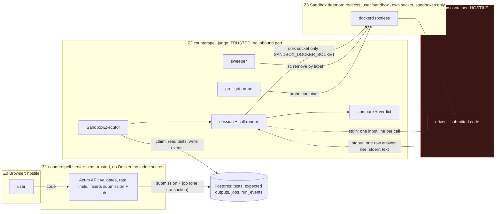
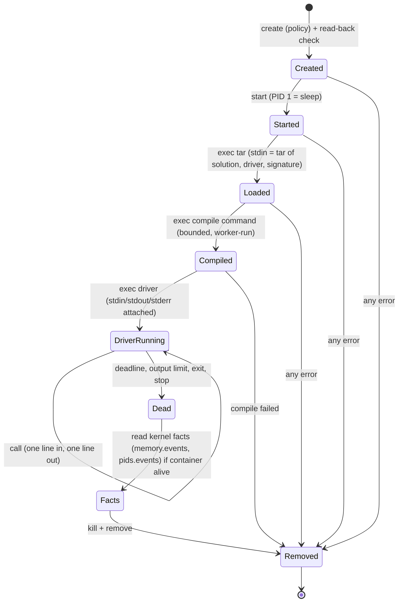

# Low-level design: judge-sandbox

## Design approach

This is a Design-First, low-level feature. It adds a Python-only execution service to `crates/judge` (package `counterspell-judge`). The architecture is fixed by `docs/system-design.md`; this document turns §2, §5, §6, §7 and §7.1 into something that can be built, and records every place where it differs from the docs.

**Review gate.** Brighton asked to review the trusted/untrusted boundary before anything is implemented. Sections 1 to 4 are the part to review. A checklist is in "Boundary review checklist". Task T00 blocks all implementation tasks until it is signed off.

**What this design changes in the isolation story.** It removes no control that the brief lists. It adds controls (a kernel-fact probe, a policy read-back, self-expiring containers). It also changes or omits five things from the docs. Each is marked ⚠ in "Deviations from the docs" and in "Open questions", so you can veto it before implementation.

## 1. Trust zones and the boundary



| Zone | Trust | May do | Must never do |
|---|---|---|---|
| Z0 browser | none | send code | anything unvalidated |
| Z1 server | semi | validate, rate limit, enqueue, read results | touch any Docker daemon, hold the sandbox socket, depend on `bollard`, write a verdict |
| Z2 judge | **full** | hold tests and expected outputs, create containers on Z3, decide verdicts | run submitted code itself, mount the main Docker socket, spawn host processes |
| Z3 daemon | control plane | run containers as the unprivileged `sandbox` user | hold app data, secrets or the main daemon's data root |
| Z4 container | **none** | read stdin, write stdout/stderr, use its CPU/memory/PID quota | learn an expected output, reach a network, write outside scratch, declare a verdict |

Everything that crosses from Z4 back to Z2 is untrusted bytes. The judge reads it with a size-bounded reader, treats it as a candidate answer or as text to sanitise, and never as an instruction.

### Information flow (what each side may know)

| Datum | Judge | Container | Server |
|---|---|---|---|
| Submitted source | reads it | yes (it is their code) | stores it |
| Visible (sample) test input and expected value | holds | input only; the expected value never | serves to the owner |
| Hidden test input | holds | one input at a time, when it is that test's turn | never |
| Expected outputs, comparator, limits | **holds** | **never** | never |
| Python reference solution | holds | only in its **own** container during a ghost hunt, never in the same container as the user's code | never |
| Database credentials | holds (judge role) | never | holds (server role) |
| Sandbox socket | **holds** | never | never |
| Verdict | **decides** | cannot influence beyond the answer bytes | reads |

## 2. Threat model

### Assets

1. Integrity of verdicts (an `accepted` must mean the code was right).
2. Confidentiality of hidden tests and expected outputs.
3. The host (VPS), its secrets, and the application data (Postgres, Valkey, Caddy, `.env`).
4. Availability for other users and for the judges until 29 Jan 2027.
5. Isolation between users' runs.

### Adversaries

| ID | Who | Capability |
|---|---|---|
| A1 | A learner (or an attacker with a free account) | Submits arbitrary Python. Can read stdin, write stdout/stderr, use CPU/memory/PIDs inside the quota. |
| A2 | The same person after a partial escape | Code execution as an unprivileged user inside the container's namespaces. |
| A3 | A different concurrent user's run | Shares the kernel and the sandbox daemon. |
| A4 | An agent calling `counterspell-mcp` | May pass any code to `run_reference` or `find_ghost_input`, including injected instructions. Treated exactly like A1. |
| A5 | A pack author | Writes tests and references. Semi-trusted (packs are reviewed), so packs are validated but not sandboxed against themselves. A reference runs in the sandbox anyway. |

Out of scope as adversaries: a compromised judge host, a compromised Postgres, an attacker with root on the VPS, and a malicious Docker or kernel maintainer. Residual risk is listed in section 18.

### Assumptions

1. The kernel enforces cgroup v2 limits, namespaces and seccomp correctly. A kernel or `runc` escape is possible in principle; rootless operation limits what it yields.
2. The sandbox daemon runs as the unprivileged `sandbox` user with cgroup v2 delegation of `cpu`, `memory` and `pids`. Without delegation, Docker silently ignores the limit flags. The preflight therefore checks behaviour, not configuration. (Docker's rootless documentation confirms the silent-ignore behaviour and that only `memory` and `pids` are delegated to users by default. [V])
3. The base image is authentic once pinned by digest. Registry trust applies only at pull time, which is a deployment step.
4. Test cases and reference solutions in Postgres are written by the pack importer and are trusted. The `code` column is hostile.
5. The judge process and its host are not compromised.
6. `JUDGE_CONCURRENCY=2` and the VPS sizes in the system design hold.

### Attack scenarios, controls, and the test that proves each

| # | Attack | Primary control | Backstop | Evidence |
|---|---|---|---|---|
| T1 | Print a fake verdict or a forged answer line | Verdict is computed from facts and expected outputs inside `compare`; `pass` can only be minted there | Strict one-line protocol; wrong id, extra line or junk is a protocol violation | P2, S14 |
| T2 | Infinite loop, sleep, or loop at import | Worker deadline and kill from outside | Run cap, `sleep` PID 1 expires the container | P6, S05, S06 |
| T3 | Memory exhaustion | cgroup `memory.max`, swap 0 | Kernel `oom_kill` counter read by the worker | S07 |
| T4 | Fork or thread bomb | cgroup `pids.max` 64 | CPU quota; no shared `nproc` | S08, S18 |
| T5 | Output flood on stdout, stderr or one endless line | Bounded reader kills the container | Log driver `none` | P5, S09 to S11 |
| T6 | Network access to anything | Network `none` | Out-of-band host listener; probe sees only `lo` | S12, S20 |
| T7 | Write to the root filesystem, `/proc`, `/sys`, other mounts | Read-only rootfs, masked paths, `nosuid,nodev` scratch, all caps dropped | Daemon-reported filesystem changes must be empty | S13, S26 |
| T8 | Fill scratch space | `tmpfs` size caps, `fsize` ulimit | Counts against the memory limit | S13 |
| T9 | Dangerous syscalls (`mount`, `unshare`, `ptrace`, `keyctl`) | Default seccomp, no capabilities, no-new-privileges | Rootless daemon | S26, S20 |
| T10 | Steal hidden tests or expected outputs | They never enter the container; hidden results carry no text | Redaction canary property | P12, S02 |
| T11 | Leak data to the next run | Fresh container per run; never reused or pooled | Scratch is `tmpfs` and disappears with the container | P8, S17 |
| T12 | Starve the other slot | Per-container quotas, no shared `nproc`, container cap | Aggregate user-slice limits in deployment | S18, S19 |
| T13 | Orphan containers after a crash | PID 1 expires itself; sweeper removes by label | Start-up sweep | S16 |
| T14 | Make infrastructure faults look like wrong answers (or the reverse) | `InfraError` is a separate type that cannot become a test verdict | Fault-injection property | P9, S21, S22 |
| T15 | Trick the judge into running the code on the host | No process spawning; typed requests; clippy ban | MCP shares the same path | T36 |
| T16 | Injection through names or arguments | File names validated and fixed; source is only stdin data | Request independence property | P4 |
| T17 | Escape via the daemon API | Judge builds only typed requests; socket path pinned; daemon is rootless | Policy read-back, probe | P14, S20 |
| T18 | Compromised judge or daemon misuse | Out of scope as an adversary, but the blast radius is limited to the `sandbox` OS user | Systemd user-slice limits | Residual risk 2 |
| T19 | Keyword evasion (`getattr(__builtins__, ...)`) | No blocklist exists to evade; the sandbox is the boundary | S27 | S27 |
| T20 | Compile-time abuse (huge or deeply nested source) | Size limit, compile budget, compile runs inside the sandbox | `compile_error` verdict | S03 |

## 3. Deviations from the docs

Everything here is a place where this design is not word-for-word `docs/system-design.md` §6 and §7. ⚠ means it changes or omits a security or cleanup control and needs your explicit yes. The matching open questions are 1 to 7 and 16.

| # | Docs say | This design | Why | ⚠ |
|---|---|---|---|---|
| D1 | `ulimit nproc` as belt and braces | **Not set** | The limit is per namespaced UID. Concurrent containers share the UID, so one fork bomb could stop the other slot from forking. The PID cgroup limit is the control. S18 proves isolation. | ⚠ |
| D2 | `AutoRemove` | `AutoRemove` **off**; the worker removes explicitly; PID 1 expires itself; the sweeper removes by label | The exit state (exit code, OOM flag) is needed to classify an abnormal end. Without it a user killing their own container looks like a daemon fault. | ⚠ |
| D3 | Python `compile = []` | Python has a worker-run syntax check (`py_compile`) | Keeps `compile_error` a worker-observed fact instead of something the program can claim | ⚠ |
| D4 | Image tags allowed "as local defaults" (language-drivers) | Digest required, no override | The brief requires digest-pinned images | ⚠ |
| D5 | `/box` `exec` allowed | `noexec` for Python; per-language flag for compiled languages | Python needs no executable scratch | |
| D6 | `/box` mode `1777` | Owned by the sandbox UID, mode `0700` | One user only; no need for world-writable | |
| D7 | Files copied into the container | Delivered as a tar stream on stdin of a fixed `tar` command (fallback decided by spike T02) | `docker cp` into a read-only container is unreliable, and files copied before start would be hidden by the `tmpfs` | |
| D8 | "Reads at most 1 MB stdout and 64 KB stderr" | 1 MiB stdout **per call**, 64 KiB stderr **per session** | Defines the unit the docs left open | |
| D9 | `--memory-swap 256m` | Same: swap equals memory, so no swap. `tmpfs` use counts against the memory limit, so scratch plus heap share 256 MiB | Documented, not hidden | ⚠ |
| D10 | Reaper removes containers older than 60 s | Sweeper every 10 s removes those older than 40 s; containers also expire themselves at the run cap plus 5 s | Makes "no container outlives about 50 s" true, not only "older than 60 s" | |
| D11 | A fresh container per run "where possible" | Always a fresh container per run and per restart; **never pooled** | Cross-user contamination is worse than cold-start cost | ⚠ |

## 4. Boundary review checklist (for T00)

Tick each before implementation starts.

1. The judge reaches the sandbox only through one Unix socket path taken from `SANDBOX_DOCKER_SOCKET`, with no default and no `DOCKER_HOST`.
2. `bollard` appears in two files only, and `counterspell-server` cannot depend on it.
3. The container never receives expected outputs, the comparator, the reference (in the user's container), a secret, a bind mount or a socket.
4. A passing test can be created in one function (`compare`) and an `accepted` run in one function (`verdict`), both from worker-held facts.
5. The driver is untrusted. Its exit code and stderr only choose among non-passing verdicts.
6. Every Docker request is built from typed values and independent of the submitted source.
7. A failed preflight stops all execution. There is no skip flag.
8. An infrastructure error is a different Rust type from a test verdict.
9. Containers are fresh per run, removed explicitly, expire themselves, and are swept by label.
10. The deviations D1 to D4, D9 and D11 above are acceptable, or you have answered the matching open questions (1, 16, 3, 4, 6, 5) differently. Also answer open questions 2 and 7.

## 5. Architecture inside `counterspell-judge`

### Module map

```text
crates/judge/
├── Cargo.toml                     # features: sandbox (bollard, default for the binary), testkit
├── clippy.toml                    # disallowed-methods: std::process::Command::new, tokio::process::Command::new
├── src/
│   ├── lib.rs / main.rs           # (run-lifecycle) main gains: preflight CLI, SandboxExecutor wiring
│   ├── languages.rs               # catalogue loader and validation (language-drivers extends it)
│   └── sandbox/
│       ├── mod.rs                 # public API: SandboxConfig, SandboxExecutor, SandboxOracle, preflight
│       ├── config.rs              # environment variables, range checks
│       ├── policy.rs              # ContainerPolicy, Limits, PolicyViolation, hardening_violations()      PURE
│       ├── spec.rs                # SessionSpec, ExecSpec, labels, names, tar builder                    PURE
│       ├── backend.rs             # trait Backend / BackendSession / DriverChannel, InfraError
│       ├── bollard_backend.rs     # feature sandbox. ONE of the two files that import bollard
│       ├── daemon.rs              # feature sandbox. connect (unix only), identity checks, info
│       ├── preflight.rs           # probe execution, KernelReport parsing, PreflightState
│       ├── session.rs             # lifecycle + cleanup guard
│       ├── stream.rs              # bounded line reader, stderr cap                                      PURE
│       ├── driver_protocol.rs     # call line builder, answer parser                                     PURE
│       ├── call.rs                # one call with deadline, kill, output limit → CallFacts
│       ├── run.rs                 # compile → calls → restarts → run facts
│       ├── compare.rs             # trusted comparator, the only mint of TestVerdict::Pass               PURE
│       ├── verdict.rs             # final verdict from per-test results and run facts                    PURE
│       ├── sanitize.rs            # display text sanitiser                                               PURE
│       ├── precheck.rs            # judge-side source re-check                                           PURE
│       ├── records.rs             # TestRecord and public event builders with redaction                  PURE
│       ├── problem.rs             # ProblemTests trait, ProblemSpec, TestCase, EmptyProblemTests
│       ├── reaper.rs              # sweeper by label
│       ├── sandbox_executor.rs    # implements RunExecutor (run-lifecycle)
│       ├── oracle.rs              # implements counterspell_engine::Oracle
│       └── testkit.rs             # feature testkit: FakeBackend, scripted programs, ledger
├── tests/
│   ├── data/source_vectors.json   # shared validation vectors (R14.8)
│   ├── fixtures/problems/<slug>/  # small test problems: statement-free tests + expected + good/bad solutions
│   ├── hostile/*.py               # the hostile corpus: DATA, never executed on the host
│   ├── model_*.rs                 # properties P1 to P14, no Docker
│   └── sbx/…                      # scenarios S01 to S27, need a sandbox daemon, names start with sbx_
languages/
├── languages.toml                 # python enabled; javascript, java, cpp present with enabled = false
└── drivers/python/driver.py       # owned by language-drivers; this spec only needs the protocol
```

The **PURE** modules do not import Tokio, bollard or the filesystem, so their tests run anywhere. Only two files import `bollard`.

### Dependencies (all must pass `cargo deny check licenses`)

`counterspell-judge` gains: `bollard` (Apache-2.0, behind feature `sandbox`), `tokio` (`rt-multi-thread`, `macros`, `time`, `sync`, `io-util`), `futures-util`, `bytes`, `tar`, `toml`, `serde`, `serde_json`, `thiserror`, `tracing`, `uuid`, `sha2` (digest comparison helper if needed), `counterspell-common`, `counterspell-engine` (comparator). Dev: `proptest`, `tempfile`, a YAML reader for the compose check (chosen at implementation, licence permitting). `unsafe_code` stays `forbid`. If `cargo deny` rejects a licence, stop and ask Brighton before editing `deny.toml`.

## 6. Configuration

### `languages/languages.toml` (Python enabled; the rest present and disabled)

```toml
[python]
enabled = true
image = "python:3.13-slim@sha256:<recorded by T03>"     # digest required; a tag is a start-up error
file = "solution.py"
driver = "drivers/python/driver.py"
compile = ["python3", "-I", "-S", "-m", "py_compile", "/box/solution.py"]   # D3: worker-run syntax check
run = ["python3", "-I", "-S", "driver.py"]
bench_args = ["--mode", "bench"]                         # parsed and validated, unused here
mem_mb = 256
time_ms_per_test = 2000
max_time_ms_per_test = 10000
compile_budget_ms = 5000
max_source_bytes = 65536
exec_scratch = false                                     # /box is noexec for Python
protocol_version = 1

[javascript]
enabled = false   # language-drivers
# …same fields…

[java]
enabled = false   # stretch
[cpp]
enabled = false   # stretch
```

`PinnedImage` is a Rust type that can only be built from a string ending in `@sha256:` plus 64 hex digits. A tag cannot be represented, so a tag cannot reach the daemon. `LanguageDefinition` also holds validated file names (`[A-Za-z0-9_.-]{1,64}`, not `.` or `..`) for the solution and driver, and the argv arrays as `Vec<String>` that are used as given and never joined into a shell string. `enabled = false` entries are parsed (so authors see them) but the executor refuses them.

The loader rejects: missing fields, unknown fields, duplicate names, unsupported `protocol_version`, zero or negative limits, empty `run`, `time_ms_per_test` above `max_time_ms_per_test`, an enabled language with a missing driver file, an unpinned image on an enabled language.

### Environment (judge)

| Variable | Default | Meaning |
|---|---|---|
| `SANDBOX_DOCKER_SOCKET` | **required** | Absolute path of the sandbox daemon's Unix socket |
| `SANDBOX_RUNTIME` | `runc` | OCI runtime; `runsc` only if registered and the probe passes (untested, see R12) |
| `JUDGE_CONCURRENCY` | 2 | From run-lifecycle |
| `SANDBOX_MAX_CONTAINERS` | `2 × JUDGE_CONCURRENCY` | Hard cap on live containers |
| `RUN_WALL_CAP_SECS` | 20 | Absolute run cap |
| `SANDBOX_KILL_SLACK_MS` | 1000 | Allowed time from a missed deadline to a recorded verdict |
| `SANDBOX_MAX_CONSECUTIVE_ABNORMAL` | 3 | Fail-fast threshold |
| `SANDBOX_CLEANUP_BUDGET_SECS` | 5 | Time `execute` waits for removal before leaving it to the sweeper |
| `SANDBOX_REAPER_INTERVAL_SECS` | 10 | Sweep period |
| `SANDBOX_ORPHAN_AGE_SECS` | 40 | Age after which a labelled container is removed (must exceed run cap + 15 s) |
| `SANDBOX_API_TIMEOUT_SECS` | 10 | Timeout of a single daemon call |
| `LANGUAGES_FILE` | `languages/languages.toml` | Catalogue path |

No file such as `.env` is read by this code. Values come from the process environment only.

## 7. The container policy

One function, `ContainerPolicy::for_language(lang, run_cap, runtime)`, builds the policy. Nothing else creates a container, including the probe. The result is plain data (no `bollard` types) so it can be unit-tested and mutation-tested. `bollard_backend.rs` converts it to the daemon request.

| Control | Value | Notes |
|---|---|---|
| Image | `PinnedImage` from the catalogue | Inspected for the digest before use; never pulled |
| Entrypoint / Cmd | `[]` / `["sleep", "<run cap remaining + 5>"]` | PID 1 is a fixed idle process. User code never runs as PID 1 |
| User | `65534:65534` for the container and for every exec | Same user everywhere; see open question 2 |
| Working dir | `/box` | |
| Network | mode `none`, networking disabled | |
| Root filesystem | read-only | |
| Tmpfs | `/box` 64 MiB `rw,nosuid,nodev,noexec(py),uid=65534,gid=65534,mode=0700`; `/tmp` 16 MiB `rw,noexec,nosuid,nodev` | Counts against memory (D9) |
| `/dev/shm` | 16 MiB | |
| Capabilities | drop `ALL`; add none | |
| Security options | `no-new-privileges:true` only | No `seccomp` entry, so Docker's default profile applies. A custom or `unconfined` value is a violation |
| Privileged / devices / binds / volumes / extra hosts / links | none | |
| Namespaces | private PID, IPC, cgroup | |
| CPU | `NanoCpus = 1_000_000_000` | A quota, not pinning |
| Memory | `mem_mb` MiB; memory-plus-swap the same | No swap |
| PIDs | 64 | |
| Ulimits | `nofile` 64, `fsize` 16 MiB, `core` 0; **no `nproc`** | D1 |
| Log driver | `none` | Output arrives over the exec stream, not logs |
| Restart / auto-remove | `no` / off | D2 |
| Environment | `PATH=/usr/local/bin:/usr/bin:/bin`, `LANG=C.UTF-8`, `HOME=/box` | Nothing else |
| Labels | `counterspell.managed=true`, `counterspell.run=<uuid>`, `counterspell.worker=<id>`, `counterspell.expires=<unix>` | Generated by the judge, never from user text |
| Name | `cs-sbx-<run uuid>-<n>` | Contains no user text |
| Runtime | `runc` by default | |

### Hardening checker and read-back

`ContainerPolicy::hardening_violations(&self) -> Vec<PolicyViolation>` lists every control that is missing or weakened. It runs twice:

1. **Before** sending the request (a bug in the builder fails closed).
2. **After** `create`, on the configuration the daemon reports back (`inspect`). The judge converts the daemon's answer into the same pure type and runs the same checker. Any difference removes the container and returns `InfraError::PolicyReadbackMismatch`.

Property P3 is a mutation test: for each control, a policy with only that control weakened must be reported. It guards against a checker that passes everything.

## 8. A session, step by step

The design runs the driver as an **exec** inside a container whose PID 1 is an idle process. That choice gives the worker three things: a trusted PID 1 that never touched user code, a place to run a compile command and a kernel-facts command with the same limits, and a container that still exists after the driver dies (so exit state and `memory.events` can be read).



1. **Create.** Build the policy, check it, create the container, read the configuration back, check again. Image digest was verified just before.
2. **Start.** PID 1 is `sleep <seconds>`.
3. **Load files.** Exec `tar -x -f - -C /box --no-same-owner` as the sandbox user with a tar stream the worker builds in memory. The archive contains exactly three entries with validated, fixed names: the submitted source (the catalogue's `file`), the driver template (from `languages/drivers`, read-only on the judge side) and `signature.json` (public signature metadata only). Source bytes are file content, never part of a command line. If the spike (T02) shows `tar` over exec stdin does not work on the target image, the fallback is the Docker archive upload API, also with fixed names.
4. **Compile.** Exec the configured compile argv with a deadline of `compile_budget_ms`. Stdout and stderr are bounded (64 KiB). Exit code 0 means success. Anything else, or a missed deadline, is `compile_error`, decided by the worker from the exit code it saw. For Python this is `python3 -I -S -m py_compile /box/solution.py`, which parses but does not run the code.
5. **Start the driver.** Exec the configured run argv with stdin, stdout and stderr attached.
6. **Calls.** For each test the worker builds `{"t":<n>,"args":<args>}\n` with `serde_json` (never string concatenation), writes it to the driver's stdin, and reads one line from stdout. The deadline covers the write as well as the read, so a program that never reads stdin cannot stall the worker.
7. **Abnormal end.** On a missed deadline, an output-limit breach, a driver exit or a protocol error, the session is finished: kernel facts are read if the container is alive, then the container is killed and removed. The next test gets a fresh session.
8. **Close.** Kill (SIGKILL through the API), remove with force, confirm absence. An RAII guard does this on every path, including panic (see "Cleanup").

PID 1 runs as the same non-root user. A program can therefore try to end its own container (for example by killing PID 1). The result is an exited container with a recorded exit state, which maps to `runtime_error`. It cannot harm anything else.

## 9. Calls, deadlines and bounded output

### Call algorithm (the heart of the time and size guarantees)

```text
call(t, args, limit):
    line  = encode_call(t, args)                          // serde_json, newline-terminated
    start = now()
    deadline = min(start + limit, run_deadline)
    select (biased: deadline first, then stop signal, then I/O):
        deadline reached               → kill session           → CallFacts::Deadline
        stop signal                    → kill session           → CallFacts::Stopped
        write line, then read one line → within bounds          → CallFacts::Answer(bytes, elapsed)
        stdout > 1 MiB in this call    → kill session           → CallFacts::OutputLimit(Stdout)
        stderr total > 64 KiB          → kill session           → CallFacts::OutputLimit(Stderr)
        driver stream ended            → read exit state        → CallFacts::DriverExited(...)
    after any kill: confirm the container is gone within KILL_SLACK, else InfraError::KillFailed
```

- **Biased select.** If the deadline and an answer are ready in the same poll, the deadline wins. A test can therefore never exceed its limit by luck.
- **Elapsed time** is `now() - start` on the worker's monotonic clock. The driver prints no time and the worker would ignore it.
- **Unsolicited output.** Bytes that arrive while no call is outstanding are counted against the 1 MiB budget and kept for the next call, where an answer line with the wrong id makes it a protocol violation.
- **Bounded reader.** `stream.rs` has a pure state machine: feed it chunks, it yields complete lines, or `Overflow` the moment the cap is crossed. P5 proves the result does not depend on how the bytes were chunked.
- **Stderr** is kept (first 64 KiB) for exception-class extraction and sample details; crossing the cap is `output_limit`.
- **Timeouts for daemon calls** (`SANDBOX_API_TIMEOUT_SECS`) apply to every API call. A timeout is an `InfraError`, not a verdict.

### Time bounds

| Bound | Definition | Where tested |
|---|---|---|
| Call limit | problem `limits.time_ms`, else language `time_ms_per_test`, clamped to 100 ms … `max_time_ms_per_test` | P6 |
| Call bound | Time from call start to a recorded verdict ≤ limit + `KILL_SLACK` | P6, S05 |
| Run cap | `min(RUN_WALL_CAP, tests × limit + compile_budget + 2 s)` | P7 |
| Run bound | Verdict decided ≤ run cap + `KILL_SLACK`; `execute` returns after cleanup or `CLEANUP_BUDGET` | P7, S17 |
| Fail-fast | After `SANDBOX_MAX_CONSECUTIVE_ABNORMAL` abnormal tests in a row the rest are not run | P7 |

### Verdict decision table (facts → per-test verdict)

| Facts | Per-test verdict | Notes |
|---|---|---|
| Answer line parses, `t` matches, nothing else, comparator equal | `pass` | Only `compare` can produce this |
| Same, comparator not equal | `wrong_answer` | |
| Line is not JSON, not an object, wrong `t`, extra or missing fields, blank | `wrong_answer` | Reason `protocol` |
| Driver exited before answering, exit code 0 | `runtime_error` | "exited without answering" |
| Driver exited abnormally, `oom_kill` > 0 | `memory_limit` | Kernel counter |
| Driver exited abnormally, no OOM evidence | `runtime_error` | Class taken from the last stderr line, then sanitised |
| Deadline missed | `time_limit` | |
| Stdout > 1 MiB in a call, or stderr > 64 KiB | `output_limit` | |
| Stop signal | none: `ExecError::Stopped` | |
| Any `InfraError` | none: `ExecError::Infrastructure` | Never a verdict |

**Final verdict:** `compile_error` if the compile step failed; else the verdict of the first non-passing executed test in ordinal order; else `time_limit` if the run cap cut the run short; else `accepted`. Tests that were not executed (fail-fast or cap) are omitted from events and from `test_results`; `passed` and `total` show the gap.

### Exception class extraction

If the driver exits abnormally the executor looks at the last non-empty stderr line. A line of the form `Name: message` or `Name` where `Name` matches `[A-Za-z_][A-Za-z0-9_.]{0,63}` gives a candidate class. It is untrusted text: `counterspell-engine` sanitises it again (ghost-engine R4.8). The contract with `language-drivers` is that on a user exception the Python driver writes the traceback to stderr and exits with a non-zero code. Nothing else about the exception is trusted.

## 10. Verdict authority in code

```rust
// compare.rs: the only place a passing test can be made
pub struct Verified(()); // private constructor

pub enum TestVerdict { Pass(Verified), WrongAnswer, RuntimeError, TimeLimit, MemoryLimit, OutputLimit }

pub fn judge_answer(expected: &Expected, call_id: u32, line: &[u8], cmp: Comparator) -> TestVerdict { … }
```

- `Verified` has a private field and is not `Clone` or `Default`. Code outside `compare.rs` cannot build `TestVerdict::Pass`.
- `verdict.rs` accepts a `Vec<ExecutedTest>` plus `RunFacts { compiled: bool, planned: u32, cut_by_cap: bool, stopped: bool }`. `Verdict::Accepted` is built in exactly one branch that requires `compiled && !stopped && executed == planned && all pass`.
- `ExecutedTest` is created only by the run code from a `TestVerdict`. An infrastructure error returns early with `Err(InfraError)` and never reaches `verdict.rs`.
- `expected` is a value of a type (`Expected`) that exists only in `compare.rs` and `problem.rs`. The container-facing code (`call.rs`, `session.rs`, `spec.rs`) does not import it. A source-level test (T36) checks the imports.

P2 states the property: for any bytes the program prints, if the parsed value differs from `expected` (or the id differs) the result is not `Pass`. P1 states the run-level property.

## 11. Cleanup and crash recovery

Layers, from fastest to last resort:

1. **Normal path.** `Session::close().await` kills and removes, and confirms the container is gone.
2. **Guard on every other path.** `SessionGuard` holds the container id. Its `Drop` cannot await, so it spawns a best-effort `kill + remove` on the Tokio runtime handle. This covers early returns with `?`, task cancellation and panics (a panic in an executor task unwinds and drops the guard). `execute` also waits for the guard's cleanup, bounded by `SANDBOX_CLEANUP_BUDGET`.
3. **Self-expiry.** PID 1 is `sleep <remaining run cap + 5>`. If the worker dies, every process in the container ends by itself within about 25 s of container start. The exited container remains until the sweeper removes it (no `AutoRemove`, D2).
4. **Sweeper.** At start-up and every `SANDBOX_REAPER_INTERVAL` it lists containers with label `counterspell.managed=true` in any state and force-removes those older than `SANDBOX_ORPHAN_AGE`. The configuration check requires `orphan age > run cap + 15 s`, so a live run's container is never removed. Bound: no container outlives about `orphan age + interval` = 50 s from creation.
5. **Run-lifecycle.** The worker's lease and reaper return the job to the queue; the next attempt starts fresh containers.

The sweeper only deletes by label and age; it takes no decision about verdicts. S16 kills the judge process with SIGKILL during a run and checks that nothing labelled remains after 60 s. It runs twice. The first run uses the normal policy, so self-expiry and the sweeper both act. The second run uses a test-only policy whose PID 1 sleeps longer than the orphan age, so only the sweeper can remove the container. That proves the sweeper on its own.

## 12. Concurrency and run isolation

- The worker's semaphore (`JUDGE_CONCURRENCY`) limits runs. A second `Semaphore` in `SandboxExecutor` limits live containers (`SANDBOX_MAX_CONTAINERS`, default 4 so a ghost hunt can hold a user and a reference container). A permit is released only after the container is confirmed gone.
- One run never shares a container with another run, and never reuses one after an abnormal end. Tests of one run do share a container (the user's own driver process persists between calls). This is the same model the ghost hunt uses ("interactive mode") and it means a program can keep state between tests of its own run. Open question 17.
- No `nproc` ulimit (D1). S18 runs a fork bomb in one slot while a correct solution runs in the other.
- No `--cpuset-cpus`. CPU limits are a quota. The deployment note adds an aggregate limit on the `sandbox` user's systemd slice (CPU, memory, tasks) as a backstop for the whole VPS.

## 13. Preflight and the kernel-facts probe

The judge refuses to run user code on a host where the limits might be silently ignored. `preflight()`:

1. **Daemon identity** (`info`): security options include `rootless`; data root is not `/var/lib/docker`; cgroup version is 2; cgroup driver is not `none`; the configured runtime is registered; the daemon reports no warnings about missing cpu, memory or pids limit support.
2. **Image** present locally with the pinned digest.
3. **Probe container** created by `ContainerPolicy::for_language` (so the probe tests the real policy), with trusted fixed commands:

   | Command (fixed argv) | What it proves |
   |---|---|
   | `cat /proc/self/status` | `NoNewPrivs: 1`, `Seccomp: 2`, `CapInh/Prm/Eff/Bnd/Amb` all zero, `Uid` is the sandbox UID |
   | `cat /proc/self/net/dev` | only `lo` |
   | `cat /sys/fs/cgroup/memory.max /memory.swap.max /pids.max /cpu.max` | limits applied: memory, no swap, 64 PIDs, one CPU of quota |
   | `cat /proc/mounts` | root is `ro`; `/box` and `/tmp` are `tmpfs` with `nosuid,nodev` and the expected size; no other writable or bind mounts |
   | `touch /usr/cs-probe` | exit non-zero (read-only root) |

4. The result is a JSON report, one entry per check with `expected`, `observed`, `ok`.

`PreflightState` holds the latest report. `SandboxExecutor::execute` checks it first and returns `ExecError::Infrastructure("sandbox_preflight_failed")` while the last report is failing. The check runs at start-up, every 60 s, and through `counterspell-judge preflight` (exit code non-zero on failure; used on day 1 on the VPS). There is no flag to skip or downgrade it. While it fails, runs end as `internal_error` after the retries of run-lifecycle, which is honest but burns attempts (open question 7).

S20 is not vacuous: it runs the probe against a policy with one control deliberately removed (no memory limit, network on, writable root) and expects the probe to fail. That test uses a test-only policy constructor that exists only under `testkit` and is not reachable from the production binary.

**What the probe does not prove.** It proves the policy was applied to *its own* container. It does not prove the kernel is bug-free or that gVisor works. The report states which checks ran and on which host and date.

## 14. Integration with the other specs

### `RunExecutor` (run-lifecycle, unchanged)

```rust
pub struct SandboxExecutor<P: ProblemTests, B: Backend> { /* languages, problems, backend, config, semaphore, preflight */ }
impl<P: ProblemTests, B: Backend> RunExecutor for SandboxExecutor<P, B> { … }
```

Flow of `execute(run, ctx)`:

1. Language lookup. Not found or `enabled = false` → `RunOutcome::Failed(language_unavailable)`.
2. `problems.load(slug, mode)` (samples only for `Run`, all tests for `Submit`). `None` → `Failed(problem_unavailable)`.
3. Check the preflight state. A failing preflight returns `ExecError::Infrastructure("sandbox_preflight_failed")`. Acquire a container permit.
4. `ctx.emit(Compiling)`. This is always the first event of any run that can return `Completed`.
5. `precheck` the source (size, UTF-8, control characters). Failure → `Completed` with verdict `compile_error` and a fixed public message, no container (see open question 13). `Compiling` has already been emitted, which satisfies the run-lifecycle contract.
6. Run the plan (`run.rs`): compile, calls, restarts, fail-fast. After each executed test, build a `PublicTest` (`Hidden` or `Sample` with sanitised detail) and `ctx.emit(Test(..))`.
7. `verdict::decide(...)` → `FinalResult`. Return `Completed`.
8. On `InfraError` → `ExecError::Infrastructure(fixed code)`. On the stop signal → kill, clean up, `ExecError::Stopped`. Cleanup always runs.

The executor never writes `status`, `verdict` or job state. It cannot, because `RunContext` has no such method.

`FinalResult` and `TestRecord` follow the shape in run-lifecycle T14: `time_ms` per test, `memory_kb` empty (open question 12), hidden tests with no snippets, samples with `public_detail` and bounded `stdout_snip`/`stderr_snip`.

### `ProblemTests` seam

```rust
pub struct ProblemSpec {
    pub slug: String, pub version: u32,
    pub signature: serde_json::Value,           // public metadata, written to signature.json
    pub comparator: Comparator,                 // from counterspell-engine: exact | unordered
    pub time_limit_ms: Option<u32>,
    pub tests: Vec<TestCase>,                   // ordinal, is_sample, args, expected
    pub reference_python: Option<String>,       // only used by SandboxOracle, never sent to the user's container
}
pub trait ProblemTests: Send + Sync + 'static {
    fn load(&self, slug: &str, mode: RunMode) -> impl Future<Output = Result<Option<ProblemSpec>, ProblemError>> + Send;
}
```

Implementations: `EmptyProblemTests` (production until the catalogue exists: always `None`), `DirProblemTests` and `StaticProblemTests` (`testkit`, for the fixtures in `tests/fixtures/problems/`). `ProblemError` is an infrastructure error. An unsupported comparator is `None` with a log line, never a guess.

### `SandboxOracle` (ghost-engine)

ghost-engine's `Oracle::evaluate(&mut self, input: &Value, limit: Duration) -> Result<Observation, OracleError>` is **synchronous** and runs inside `spawn_blocking`. `SandboxOracle` holds a Tokio `Handle` and two long-lived sessions (user program and reference, in separate containers) and uses `handle.block_on` per call. Mapping to `ProgramResult`: answer parsed → `Returned(value)`; unparsable → `Garbled`; abnormal exit → `Crashed { exception_class, message }`; deadline → `TimedOut`; infrastructure → `Err(OracleError)`. It returns within `limit + KILL_SLACK` because every call uses `call.rs`. It accepts only public inputs.

### `counterspell-mcp`

MCP code-running tools build a `SandboxOracle` or `SandboxExecutor` from the same `SandboxConfig`. If `SANDBOX_DOCKER_SOCKET` is missing or preflight fails, the tool returns `sandbox_unavailable`. There is no local fallback and the crate has no process-spawning code (Clippy ban plus a source test).

## 15. Pre-sandbox validation (VAL-1 to VAL-5)

The server's checks are the first filter. The sandbox is the boundary. This section fixes what each side owns so there is one implementation of each rule.

| Rule | Enforced by | Where | This spec adds |
|---|---|---|---|
| VAL-1 size in bytes (default 65 536, per language) | Server before queuing; judge re-checks | run-lifecycle `validate.rs` (T22); `precheck.rs` here | `max_source_bytes` per language from the catalogue; shared vectors |
| VAL-2 tree-sitter parse | Server before queuing | run-lifecycle T22 | Nothing in the judge: CPython's own compile step in the sandbox is the second line |
| VAL-3 plain text: UTF-8, no NUL or controls except tab, LF, CR; one field; no upload | Server; judge re-checks | run-lifecycle T22; `precheck.rs` | Shared vectors |
| VAL-4 rate limits per user and IP in Valkey; queued-job cap in Postgres | Server | run-lifecycle T23 | Nothing (the judge has no Valkey access) |
| VAL-5 output as plain text, never HTML, with a display cap | Judge sanitises; UI renders text nodes | `sanitize.rs`; ide-workspace | Sanitiser, caps, property P11 |

- **No blocklists.** Nothing in the server or judge scans for `os`, `subprocess`, `socket`, `ctypes` or similar. S27 submits a program that imports all of them, passes validation, runs, and is contained.
- **Shared vectors.** `crates/judge/tests/data/source_vectors.json` lists cases (oversize by one byte, exactly at limit, multi-byte UTF-8 straddling the limit, invalid UTF-8, NUL, BEL, ESC, tab/LF/CR allowed, empty, BOM, very long line, many lines). Both `precheck.rs` and the server's `validate.rs` tests can run them.
- **Judge re-check** (`precheck`): size in bytes, UTF-8 validity, forbidden control characters. It exists because the judge must not trust the database content. It is not a parser.
- **Sanitiser** (`sanitize.rs`): `sanitize_display(bytes, cap) -> Sanitized { text, truncated }`: lossy UTF-8, remove NUL, replace other C0 controls (except tab and newline) and DEL with U+FFFD, bound by bytes on a char boundary, never longer than `cap`. Caps: 64 KiB for stored snippets, 4 KiB per detail field in events.
- **Logs.** `tracing` fields are ids, phases, verdict kinds and durations. A test (T35) runs a hostile program that prints a canary and checks the canary is absent from captured log output.

## 16. Test plan

### Model properties (no Docker, run everywhere)

Written with `proptest`. A `FakeBackend` (testkit) simulates Docker with a ledger of created and removed containers, injectable faults at the n-th call, and scripted program behaviours driven by Tokio's paused clock (`start_paused`), so deadline tests are fast and exact.

| ID | Property | Requirement |
|---|---|---|
| P1 | **Accepted soundness.** For any generated run facts, `Accepted` is returned only if the compile step succeeded, every planned test was executed, every test passed, no stop and no infrastructure error occurred. | R8.3, R9.6 |
| P2 | **Forgery resistance.** For any byte string the program prints (arbitrary bytes, JSON that looks like a verdict, a correct-looking answer with the wrong id, extra lines), `judge_answer` returns `Pass` only if the parsed `out` equals `expected` and the id matches. | R8.2, R8.4 |
| P3 | **Policy completeness and non-vacuity.** For any language definition, the built policy has no violations. Weakening any single control (network, rootfs, caps, seccomp, privileged, memory, swap, pids, user, binds, log driver, tmpfs flags) is reported. | R3.16 |
| P4 | **Request independence.** For any two sources and inputs, the commands, environment, labels, names and archive entry names of every request are equal. Only archive content and stdin lines differ. | R2.3, R2.4 |
| P5 | **Stream bounds.** For any byte stream and any chunking, the line reader never holds more than cap + one chunk, signals overflow exactly when the cap is crossed, and yields the same lines. | R6 |
| P6 | **Call deadline.** For any scripted program timing, `call` returns within limit + slack of virtual time; the verdict is `time_limit` iff the complete answer did not arrive before the limit. | R5.1 to R5.5 |
| P7 | **Run cap and fail-fast.** For any scripted behaviour (including every call hanging), the run is decided within the run cap + slack, restarts happen after timeouts only while the cap allows, and execution stops after the abnormal-streak limit. | R5.4 to R5.8 |
| P8 | **Cleanup ledger.** For any script, fault point, cancel or panic, after `execute` returns (or its task is dropped and cleanup completes) the ledger shows every created container removed. No container is shared between runs. | R10.1, R10.7, R11.3 |
| P9 | **Infrastructure never becomes a verdict.** A fault injected at any Docker call in any phase gives `Err(Infrastructure)` and no test verdict derived from the fault. | R9.4, R9.5 |
| P10 | **Determinism and precedence.** The same facts give the same verdict; the final verdict is the first non-pass by ordinal; adding a failing test never turns a non-accepted run into accepted. | R9.1, R9.6 |
| P11 | **Sanitiser.** Output is valid UTF-8, within the cap, free of forbidden controls, idempotent, and marks truncation exactly when bytes were dropped. | R13.3, R13.4 |
| P12 | **Redaction.** With canary strings in hidden inputs and expected values and in everything the fake program prints, no serialised event or record for a hidden test contains a canary. Sample records contain only the allowed fields. | R13.1, R8.5 |
| P13 | **Configuration validation.** Generated invalid language files and environment values (tag instead of digest, bad file names, zero limits, orphan age too small, unknown fields, duplicate names) are rejected; a valid file round-trips. | R2.1, R2.5, R10.4, R12, R17 |
| P14 | **Daemon guard and read-back.** Socket paths for the main daemon, TCP addresses and empty values are refused. A daemon report that differs from the policy in any one field fails the read-back. | R1.1, R1.2, R3.15 |

### Real-sandbox scenarios (need a rootless sandbox daemon; `#[ignore]`, names start with `sbx_`)

Run with `SANDBOX_DOCKER_SOCKET=… cargo test -p counterspell-judge --features sandbox -- --ignored sbx_`. The harness first runs the daemon-identity checks and refuses to run on anything that is not rootless. No hostile source is ever executed on the host: the corpus files are read as data and sent over the socket.

| ID | Scenario | Pass condition |
|---|---|---|
| S01 | Correct Python solution on a fixture problem (samples and hidden) | `accepted`, all tests pass; events: `compiling` first, then one `test` per test |
| S02 | Wrong solution | `wrong_answer`; sample detail present; hidden tests have verdict and time only |
| S03 | Syntax error; disabled language; judge-side source re-check failure | `compile_error` with no tests; `language_unavailable`; `compile_error` with fixed message and no container |
| S04 | Exception in user code (`ZeroDivisionError`) | `runtime_error`; sanitised class `ZeroDivisionError` |
| S05 | `while True: pass` | `time_limit`; decided within limit + 1 s; container gone |
| S06 | Infinite loop at import time; `time.sleep(1e9)`; `SIGSTOP` to self | `time_limit` within bounds |
| S07 | Memory bomb (list growth and one huge allocation) | `memory_limit` (kernel `oom_kill` > 0) or `runtime_error` for a `MemoryError`; never `accepted`; other slot unaffected |
| S08 | Fork bomb and thread bomb | Contained by the PID limit; verdict not `accepted`; host and other slot unaffected; wall bound holds |
| S09 | Endless stdout via `print` and via `os.write(1, …)` | `output_limit`; worker memory bounded |
| S10 | Endless stderr | `output_limit` |
| S11 | One 2 MiB line without a newline | `output_limit` |
| S12 | Network: TCP, UDP, DNS, IPv6, raw socket, link-local and metadata addresses, the bridge gateway, loopback of the host | A listener on the host and on the usual gateway addresses sees **zero** connections. A control run with networking enabled shows the listener *can* see a connection; if the control is inconclusive on this host the report says so |
| S13 | Write outside scratch: `/`, `/usr`, `/etc`, `/proc/sys`, `/sys`; fill `/box`; huge single file | The daemon's filesystem-changes report for the container is empty; fills stop at the tmpfs size; verdict not `accepted` |
| S14 | Program prints verdict-looking JSON, forged answer lines for other ids, answers early, via `print` and raw `os.write` | Not `accepted`; `wrong_answer` for the test |
| S15 | `sys.exit(0)` before answering; kills itself; closes stdout | `runtime_error`, never `accepted` |
| S16 | SIGKILL the judge process mid-run | No labelled container remains 60 s after its creation; shown with self-expiry and with the sweeper alone |
| S17 | Timeout and cancel cleanup | After `execute` returns, the daemon lists no container for the run |
| S18 | Two concurrent runs: a fork bomb in one, a correct solution in the other | The good run is `accepted` within its limits |
| S19 | More runs than slots | Observed live containers never exceed `SANDBOX_MAX_CONTAINERS` (sampled from the daemon) |
| S20 | Preflight passes on the target host; preflight **fails** against a deliberately weakened policy | Report written; negative control fails as expected |
| S21 | Daemon unreachable (wrong socket path, stopped daemon) | `Infrastructure`, never a test verdict |
| S22 | Image missing or digest mismatch | `Infrastructure`, no pull attempted |
| S23 | `SANDBOX_RUNTIME=runsc` | Only when configured. Result recorded as TESTED or NOT TESTED; never assumed |
| S24 | Stop signal during a call | Container killed and removed; `Stopped` |
| S25 | Probe report | Report JSON saved to the verification report |
| S26 | Host visibility: mounts, `/var/run/docker.sock` absent, no secrets, blocked syscalls (`mount`, `unshare`, `ptrace`) | No other mounts; operations fail; not `accepted` |
| S27 | A harmless-looking solution that imports `os`, `subprocess`, `socket`, `ctypes` | Passes validation, runs, correct answer is `accepted` (no blocklist exists) |

### Hostile corpus rules

- Files are in `crates/judge/tests/hostile/`, one per behaviour, each with a header comment stating the attack and the allowed verdict set.
- Every file is written so it **cannot** return a correct answer (finding A8). The only exceptions are the good-solution fixtures and S27, which is a deliberate positive control.
- Containment is judged from out-of-band evidence: the host listener (S12), the daemon's filesystem-changes report (S13), the kernel `oom_kill` counter (S07), the daemon's container list (S16, S17, S19). What the hostile program prints about its own success is never used as proof.

### Definition of done (reported, not assumed)

`verification-report.md` (T37) contains, from a run on the VPS: the preflight report; pass/fail for S01 to S27 with the date and host; timings; and the status word for every guarantee (`TESTED on VPS`, `TESTED in CI`, `MODEL ONLY`, `NOT TESTED`).

Measurements reported separately: container create+start, file delivery, compile, per-call overhead (empty function), Run end-to-end p50/p95 over 50 runs, hostile-run wall times against their limits, kill latency, and peak live containers under concurrency. The target is Run under 1.5 s p95 on a warm image [E, unmeasured until T37].

## 17. Failure matrix

| What fails | What happens | Recovery |
|---|---|---|
| Sandbox daemon down or socket missing | `InfraError`; preflight fails; runs end `internal_error` after retries | Fix the daemon; the next preflight passes |
| cgroup delegation missing (limits ignored) | Preflight fails (probe reads `memory.max` etc.) | Apply the delegation drop-in; re-run `preflight` |
| Image absent or digest changed | `InfraError`; no pull | Pull by digest during deploy |
| Policy read-back differs | Container removed; `InfraError` | Investigate the daemon |
| Create succeeds but start fails | Guard removes the container; `InfraError` | Retry via run-lifecycle |
| Judge process killed mid-run | Lease expires; PID 1 expires at ≤ 25 s; sweeper removes by 50 s | Next attempt starts fresh containers |
| Container removal fails | `execute` returns after the cleanup budget; sweeper retries every 10 s | Automatic |
| Event write fails (lease lost) | `ctx.emit` error → `Stopped` (lease lost) or `Infrastructure` | run-lifecycle rules apply |
| Executor task panics | Guard `Drop` removes the container; run-lifecycle releases for retry | Automatic |
| Hostile output floods | Reader kills the container at the cap | Verdict `output_limit` |
| `tar` over exec stdin unsupported on an image | Spike T02 detects it; fallback is the archive upload API | Decided before implementation |
| Probe passes but a real run's read-back differs | Run fails as `InfraError` | Investigate |

## 18. Residual risk (what this design does not protect against)

1. **Kernel or `runc` escape.** All sandboxes share the host kernel. Rootless operation limits the result to the `sandbox` OS user, which is not root. gVisor would add a layer but is untested here.
2. **A compromised judge** can create containers with any options on the sandbox daemon and so act as the `sandbox` user (for example mount world-readable host paths read-only). Deployment mitigations: the `sandbox` user's home holds nothing sensitive; application secrets are mode 0600 and owned by another user; the sandbox user slice has CPU, memory and task limits. A socket-filtering proxy was considered and rejected as unable to inspect request bodies.
3. **Side channels** (CPU timing, cache) between concurrent runs. Not mitigated.
4. **Hash randomisation**: `python -I` ignores `PYTHONHASHSEED`, so set-order-dependent code can behave differently between runs. The ghost engine's double-check handles this (ghost-engine); open question 18.
5. **Stateful programs**: a program can keep state between the tests of its own run (open question 17).
6. **Pack authors** are trusted not to write hostile references; references still run in the sandbox.
7. **Timing noise** on a shared VPS can move a borderline test across its limit.
8. **Preflight is a point-in-time check** (re-run every 60 s). A change in the daemon between checks is not detected until the next one. The per-container read-back narrows that window.

## 19. Rust vocabulary used here (for Brighton)

- **Newtype with a private field** (`Verified`, `PinnedImage`): a type that cannot be built outside its module. It turns a rule into something the compiler enforces.
- **`Result<T, E>` and `?`**: two error types (`InfraError` and test verdicts) keep "the machine failed" separate from "the code failed".
- **`Drop` and RAII**: a guard value cleans up when it goes out of scope. `Drop` cannot be async, so it spawns a cleanup task.
- **`tokio::select!` (biased)**: wait on several things, take the first that is ready, and in a fixed order if several are ready.
- **Paused time in tests** (`start_paused`): Tokio advances a virtual clock instantly, so a 20 s timeout test runs in milliseconds.
- **`proptest`**: generates many inputs and shrinks failures; each property above is one statement it tries to break.
- **Traits with async methods** (`Backend`, `ProblemTests`): generics, not `dyn`, as in run-lifecycle.
- **Cargo features** (`sandbox`, `testkit`): compile-time switches. `testkit` code must never reach the release binary (CI guard from run-lifecycle T37).

## 20. Verification (after implementation)

1. `cargo fmt --all -- --check`
2. `cargo clippy --workspace --all-targets --all-features -- -D warnings`
3. `cargo test --workspace` (properties P1 to P14, no Docker needed)
4. `cargo deny check licenses`
5. `cargo test -p counterspell-judge --features sandbox -- --ignored sbx_` on the VPS (S01 to S27)
6. `counterspell-judge preflight` on the VPS, report saved
7. Boundary tests (T36): server dependency closure, `bollard` imports, compose mounts, no host process spawning
8. `verification-report.md` written and honest about what was and was not tested

## Open questions

Each lists the choice this spec assumed so work can proceed. ⚠ means it changes or removes an isolation control, so **please answer before implementation starts**.

1. ⚠ **No `nproc` ulimit.** The limit is per namespaced UID and all concurrent containers share it, so a fork bomb could break the other slot. **Assumed:** rely on the PID cgroup limit (64) and prove isolation with S18. **Alternative:** one UID per slot (for example 20000 + slot), which makes `nproc` valid again at the cost of per-slot ownership details.
2. ⚠ **One UID (65534) for PID 1, the driver and all execs.** **Assumed:** yes, and a program may end its own container. **Alternative:** PID 1 as a different UID (more moving parts, same outcome).
3. ⚠ **Python gets a worker-run syntax check** (`py_compile`) so `compile_error` is a worker-observed fact. This changes `compile = []` in the system design and `language-drivers`. **Assumed:** yes; whichever spec lands second updates the other.
4. ⚠ **Digest pinning is strict.** No override for local development; developers pull by digest into their sandbox daemon. **Assumed:** strict, per the brief. The committed digest comes from T03.
5. ⚠ **A fresh container per run, never pooled.** Slower (one container start per run) but no cross-user contamination. **Assumed:** yes. A pool would need a separate threat analysis.
6. ⚠ **`tmpfs` counts against the 256 MiB memory limit.** Up to 96 MiB of scratch, `/tmp` and `/dev/shm` could be used by a program and reduce its heap. **Assumed:** accept; sizes are in the policy and easy to lower.
7. ⚠ **Preflight failure stops all execution with no skip flag.** Runs then end as `internal_error` after three attempts. WSL2 development machines without delegation cannot run the `sbx_` tests. **Assumed:** fail closed, use the VPS or CI for sandbox tests. A worker "not ready" gate in run-lifecycle would avoid burning attempts; not requested.
8. **Fail-fast after 3 abnormal tests in a row.** Users see results for the first failures only. **Assumed:** 3, configurable. It cuts the cost of one hostile submission from up to 20 s to about 7 s.
9. **Stderr over 64 KiB is `output_limit`.** A noisy but correct program is judged `output_limit`. **Assumed:** as the system design says.
10. **Tests that were not run are omitted** from events and `test_results` (no "not run" verdict exists in run-lifecycle). **Assumed:** omit; `passed` and `total` show the gap. A `not_run` value would need a run-lifecycle change.
11. **Server-side VAL-1 to VAL-4 stay in run-lifecycle.** This spec only adds the contract, the judge re-check, the loader's `max_source_bytes` and shared vectors. **Assumed:** one implementation each. **Alternative:** move those tasks here.
12. **`memory_kb` stays empty.** The worker cannot read a peak from the host cgroup. **Assumed:** null in `test_results`. `memory.peak` read from inside the container is possible later.
13. **Judge-side source re-check failure** maps to a `compile_error` verdict with a fixed message, because run-lifecycle's `FailureReason` has no `invalid_source`. **Assumed:** this mapping. It should never happen for requests that passed the API.
14. **CI for the sandbox daemon.** Installing a rootless daemon with cgroup delegation on a GitHub-hosted runner is uncertain. **Assumed:** the `sbx_` job starts as non-blocking; the VPS run is the authoritative evidence.
15. **No socket-filtering proxy** between the judge and the sandbox daemon. **Assumed:** none; the daemon is rootless and the blast radius is the `sandbox` OS user. Aggregate limits go on that user's systemd slice.
16. ⚠ **`AutoRemove` is off** (D2). Cleanup is explicit removal, plus self-expiry, plus the sweeper. The exit state of an exited container is needed to tell "the user ended their own container" from "the daemon failed". **Assumed:** accepted. **Alternative:** `AutoRemove` on, treating any vanished container as `runtime_error` when the daemon is healthy.
17. **A driver process persists between the tests of one run**, so a program can keep global state across tests. **Assumed:** accepted; it matches the interactive protocol the ghost hunt needs.
18. **Python hash randomisation** under `-I`. **Assumed:** documented only; the ghost double-check absorbs it.
19. **`SandboxOracle` needs a multi-threaded Tokio runtime** and is called from `spawn_blocking`. **Assumed:** as ghost-engine specifies. Calling it from an async context would deadlock, so it checks and returns `OracleError`.
20. **gVisor** is selectable with `SANDBOX_RUNTIME=runsc` but untested. **Assumed:** nothing claims it works until S23 passes on the VPS.
21. **Tar-over-exec versus the archive API** for file delivery. **Assumed:** tar over exec, confirmed or replaced by T02.
22. **Per-call limit clamp** of 100 ms to `max_time_ms_per_test` (10 s). **Assumed:** these values, adjustable in the catalogue.
23. **Image supplies `sleep`, `tar` and `cat`** (Debian-based images do). **Assumed:** verified by T02 for the pinned Python image; a different image would need the same check.
24. **Where the Python reference comes from.** **Assumed:** `ProblemSpec.reference_python`, supplied by the catalogue's `reference_solutions`. It is used only by `SandboxOracle`.
25. **Existing reconciliations.** run-lifecycle Open question 10 (`RunExecutor` shape) and language-drivers' `languages.rs` ownership are both settled by this spec: the trait is used as written; the loader is created here and extended there.
