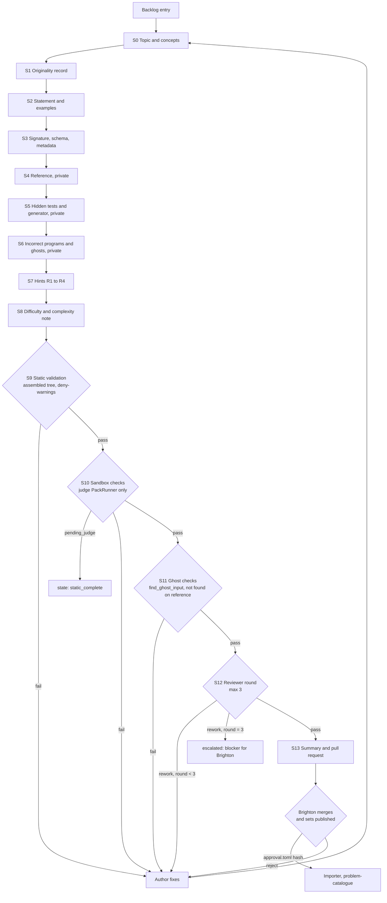
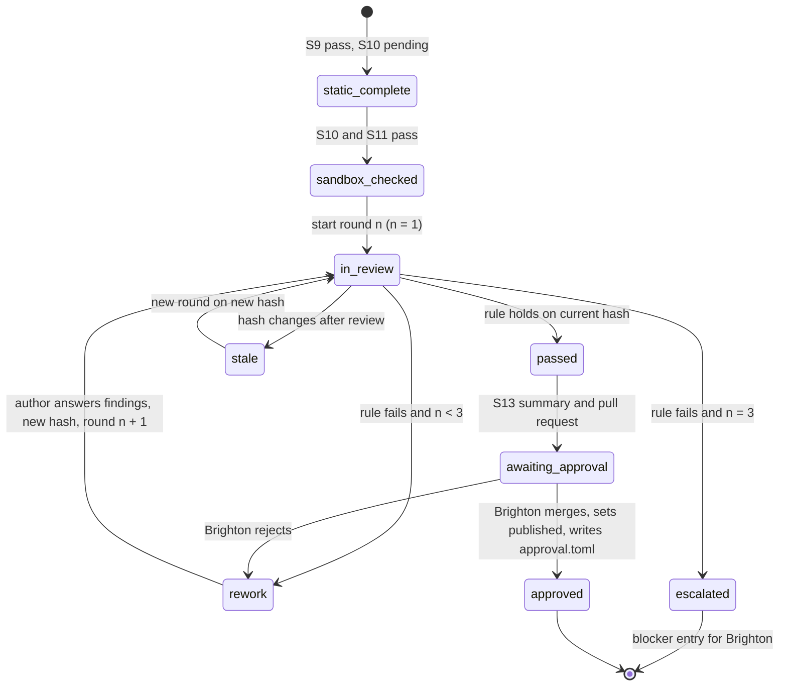
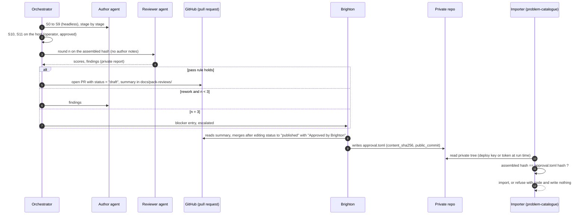

# Design: pack-authoring-pipeline

Status: spec only (see `requirements.md`). Requirement IDs `PIP-*` refer to `requirements.md`. Other specs are named by their own IDs (`GRM-*`, `SBX-*`, `CAT-*`, `MCP-*`, `HNT-*`). Decisions are numbered `D1`–`D12`, cross-spec changes `X1`–`X8`, and open questions 1–16 at the end. Each open question gives the assumed choice, so implementation can start if Brighton says nothing.

## 1. Approach and decisions

| ID | Decision | Why |
|---|---|---|
| D1 | Agents draft, a separate reviewer agent scores, Brighton approves. Nothing else can approve. | Brighton's standing decision. The reviewer must not share the author's reasoning, or it would just repeat it. |
| D2 | Two trees per pack. Public in `packs/<slug>/`, private in `counterspell-packs-private` under the same slug. | 14 Nov 23:06 decision. Hidden tests, references and ghost programs must not sit in the public repo. |
| D3 | Validation runs on an assembled copy of both trees, under `target/pack-assembly/`. | The validator and the sandbox need one directory with every file. The assembled copy is never committed and is deleted after the run. Grimoire then needs only an allow-list change, not a second loader. |
| D4 | Pure logic (state, scoring, loop cap, originality and leak checks, approval hash) lives in `counterspell-grimoire` as a `pipeline` module. Shell scripts only move files and call tools. | Keeps the rule "no new crate" (structure.md). The logic stays unit-testable without a model, a network or a database. |
| D5 | Every code-running step goes through the judge sandbox (`counterspell-mcp` code-running tools or the judge CLI). | PIP-37, PIP-38, MCP-1 to MCP-5. |
| D6 | Batch mode runs static stages and review headless. Sandbox stages are run by the operator on the host. | Code-running MCP tools need explicit approval (CONFIG-3). Batch mode must not auto-approve them. |
| D7 | Review passes on a rubric with seven categories, a 1 to 5 score, and a hard pass rule. Three rounds, then escalation. | Matches the categories Brighton asked for. The cap stops endless loops and cost. |
| D8 | The human gate is a merged pull request. Brighton sets `status = "published"` in that approval commit and writes `approval.toml` in the private repo. | PIP-28. Agents can't reach either step (hook and pre-push guard). |
| D9 | The approval record names the content hash. The importer refuses any mismatch. | A hidden file changed after approval must block import. Without the hash, approval covers only the public file. |
| D10 | Hidden values are checked against a private list of retired-value hashes. The list itself is never shown. | Rotation (PIP-35) must be checkable without storing the old values again. |
| D11 | The review summary for a non-expert is public-safe and stored in `docs/pack-reviews/`. The scored report stays private. | Brighton reads one page. The detailed report can point at hidden cases, so it stays in the private repo. |
| D12 | The dry-run topic is `lantern-streaks`, a new original problem. | It is a concrete, realistic problem to test the pipeline on, without copying anyone's statement. |

## 2. The pipeline in plain English

An agent takes one idea from the backlog. It writes the public part of the pack (statement, metadata, hints) and the private part (hidden tests, reference, incorrect programs, ghosts). Then the orchestrator builds one temporary copy of both parts, checks it with the validator, and runs the sandbox checks through the judge. A separate reviewer agent reads the finished pack and scores it. If the score is too low, the author fixes the findings, up to three rounds. Once the pack passes, the orchestrator opens a pull request and writes a one-page summary for Brighton. Brighton reads the summary, merges the pull request if he agrees, and sets `published` in that same change. The importer then loads the pack only when the approval hash matches.



## 3. Stages

Each stage lists its inputs, outputs, stop condition and the codes it can produce. "Runs in" says whether the stage can run headless (batch) or needs the operator's host.

| Stage | Inputs | Outputs | Stop condition | Codes | Runs in |
|---|---|---|---|---|---|
| S0 Topic and concepts | `docs/pack-backlog.md` entry, `packs/catalogue.toml`, existing `packs/` and private slugs | `.kiro/pipeline/state/<slug>.toml` (stage S0), brief section in state | Slug unused, track and concepts listed (CAT-T2), difficulty valid, backlog entry present | `SLUG-01` taken, `TAX-01` unknown track or concept, `BRF-01` no backlog entry | headless |
| S1 Originality | brief, the author's own wording | `originality.md` (public) | Record has the five sections and the checklist answers; no marker from the originality list in any public or private file | `ORG-01` marker found, `ORG-02` record missing or empty | headless |
| S2 Statement and examples | brief, S1 record | `problem.md` | GRM-19, GRM-20, STM-01 to STM-03 pass (STM-03: worked example from sample 1) | GRM-19, GRM-20, STM-03 | headless |
| S3 Signature, schema, metadata | brief, S2 | `meta.toml` (public, samples only, no `[generator]`) | GRM-8 to GRM-18 pass; `pack_version = 1` for new packs; no `reference_complexity` | GRM-8 to GRM-18, SBX-08 is expected here | headless |
| S4 Reference | brief, signature | `reference/solution.py` (private) | GRM-34 text check passes | GRM-34 | headless, written to the private tree |
| S5 Hidden and generator | brief, reference, sample inputs | `hidden.toml`, `generator.toml` (private) | At least 8 curated cases with `why`; no duplicate of a sample, a case, or a retired value; HID-01 to HID-04 pass | HID-01 to HID-04 (X2), `HID-03` also covers retired hashes | headless, private tree |
| S6 Incorrect programs and ghosts | reference, brief | `incorrect/*.py`, `known_ghosts.toml` (private) | At least two ghosts; GRM-28 to GRM-33 pass; each ghost's `got` hand-traced | GRM-28 to GRM-33, `GHC-01` fewer than two ghosts | headless, private tree |
| S7 Hints | statement, reference | `hints.toml` (public) | Exactly four rungs; GRM-26, GRM-27; HNT-03 finds no leaked value | GRM-26, GRM-27, `HNT-03` leak | headless |
| S8 Difficulty and complexity | reference, statement | `meta.toml` fields `difficulty`, `complexity_note` | `complexity_note` ≤ 240 chars, names time and extra space | GRM-18 | headless |
| S9 Static validation | assembled tree (D3) | validator report (codes, pointers, counts) | `counterspell-grimoire validate --deny-warnings` exit 0 on the assembled tree | any grimoire code | headless |
| S10 Sandbox validation | assembled tree, judge `PackRunner` | sandbox report and image digest | SBX-01 (samples), SBX-02 and SBX-09 (hidden, generated, curated), SBX-03 (ghosts) all pass with a recorded digest | SBX-01 to SBX-03, SBX-09, `RUN-01` runner unavailable | operator on host (D6) |
| S11 Ghost checks | assembled tree, MCP code-running tools | ghost report (kind, found/not-found, budget, shrink step count, no hidden values) | Every incorrect program yields a verified counterexample of the recorded kind within budget (GHC-02); the reference yields "not found" within budget (GHC-03) | `GHC-02`, `GHC-03`, GRM-43 | operator on host (D6) |
| S12 Review round | finished pack, checklist, S9 to S11 reports | scored report (private), round record in state | Pass rule of PIP-23 holds on the current content hash | `REV-01` below pass rule, `REV-02` stale round, `REV-03` escalated | reviewer, headless for the review itself; sandbox outputs are reviewed, never re-run by the reviewer |
| S13 Summary and pull request | passed S12 report | `docs/pack-reviews/<slug>.md` (public-safe), pull request | Summary has no hidden data (scan), pull request opened, state `awaiting_approval` | `SUM-01` hidden data found in the summary | headless, `gh` CLI |

Changes after S12 return the pack to the earliest stage they affect. A change to any file invalidates the sandbox report (S10), the ghost report (S11) and the review (S12).

## 4. Repository layout

### Public tree (`BrightonDube/counterspell`)

```text
packs/<slug>/
  problem.md        statement (GRM-19, GRM-20)
  meta.toml         metadata and [[samples]] only; no [generator], no hidden data
  hints.toml        four rungs
  originality.md    the S1 record (public-safe reasoning)
packs/catalogue.toml          tracks and concepts (already public)
docs/pack-backlog.md          backlog of ideas
docs/pack-reviews/<slug>.md   one-page summary for Brighton (no hidden data)
.kiro/pipeline/state/<slug>.toml   stage, status, codes, scores, timestamps (no hidden data)
```

### Private tree (`BrightonDube/counterspell-packs-private`, suggested name)

```text
packs/<slug>/
  hidden.toml            curated hidden cases with expected and why
  generator.toml         seed and hidden_count (moved out of public meta.toml)
  reference/solution.py  authoritative Python reference
  incorrect/*.py         deliberately wrong programs for known ghosts
  known_ghosts.toml      ghosts with got / exception_class / explanation
  approval.toml          written by Brighton at approval (PIP-28)
reviews/<slug>/report.md scored report (may point at hidden cases; never quotes them)
retired-values.toml      SHA-256 hashes of retired canonical inputs and expected values (PIP-35)
```

`approval.toml`:

```toml
slug = "count-pairs"
pack_version = 2
content_sha256 = "<64 hex characters: manifest hash of the assembled tree>"
public_commit = "<commit that set status = published>"
approved_by = "Brighton"
approved_at = "2026-11-26"
```

### Assembled tree (temporary)

`scripts/pack-assemble.sh <slug>` copies the public files and the private files into `target/pack-assembly/<slug>/` and writes a manifest. The manifest is the `problem-catalogue` manifest (C06). The validator runs on this directory. The directory is deleted at the end of the stage run, and it is git-ignored under `target/`. The script refuses to run when a private file exists in a public path, or when the private tree is missing (PIP-34).

### Grimoire allow-list change (X2)

The current grimoire-packs layout rules require `reference/solution.py` and a `[generator]` table in `meta.toml` (GRM-1, GRM-9). The split needs the rule to apply to the assembled tree, with `hidden.toml`, `generator.toml`, `incorrect/`, `known_ghosts.toml` and `approval.toml` allowed. A file from the wrong tree is an error (`LAY-05`, planned). This is the largest cross-spec change. It is listed in section 14.

## 5. Roles, agents and tools

| Role | Definition | May read | May write | Code-running tools | Notes |
|---|---|---|---|---|---|
| Author agent | `.kiro/agents/pack-author.json` (format confirmed in PA13) | public and private tree of the one slug; checklists; skill | the one slug's public and private files, `originality.md`, state file | `run_reference`, `find_ghost_input`, `shrink_input` only in an operator session with approval (D6) | Never writes `status`, `approval.toml`, `docs/pack-reviews/`, or any other pack |
| Reviewer agent | `.kiro/agents/pack-reviewer.json` | the assembled tree (or the public tree in a public-only session), the checklist, S9 to S11 reports | `reviews/<slug>/report.md` (private) and the round record in state, through the orchestrator only | none | No write to pack files. Runs in its own session, with no author notes (PIP-2) |
| Orchestrator | `scripts/pack-batch.sh` plus the Kiro session that runs it | state files, `target/pack-assembly/` | state, `docs/pack-reviews/`, `docs/kiro-log/pack-pipeline-blockers.md`, the pull request | none | Makes no quality judgement. Enforces stop conditions and the loop cap |
| Brighton | Manual | everything | the approval pull request commit, `approval.toml` | operator's own | The only path to `published` |

Agent definitions and skills are created with the Kiro tools (`custom-agent-creator` for agent JSON, `createHook` for hooks). Their exact fields are confirmed in PA13 and PA12 before use.

## 6. Reviewer checklist and scoring

The checklist lives in `.kiro/pipeline/checklists/reviewer.md`. The table below is the design. The file is the source of truth, and PA10 has a test that checks the file against this table.

| Category | Score question | Example items (IDs) |
|---|---|---|
| Correctness | Do the reference and tests agree with the statement, and with each other? | `RV-correctness-1` samples and reference agree (S10 report). `RV-correctness-2` every hidden expected value follows from the statement. `RV-correctness-3` the reference handles the empty and maximum inputs described. |
| Clarity | Can a beginner tell exactly what to return? | `RV-clarity-1` the call, arguments and return type are named in `## Task`. `RV-clarity-2` the worked example matches sample 1. `RV-clarity-3` edge cases are stated in words. |
| Originality | Is the wording and the idea original? | `RV-originality-1` the S1 record is complete. `RV-originality-2` no text marker hits (ORG-01). `RV-originality-3` no trade dress, no third-party title. |
| Difficulty calibration | Is the level right for its label, and is the hidden set neither trivial nor unfair? | `RV-difficulty-1` the concept count and reference length match `difficulty`. `RV-difficulty-2` at least one hidden case needs the key idea. |
| Hint quality | Do the four rungs lead without giving the answer? | `RV-hints-1` rung 1 is a nudge only. `RV-hints-2` rung 3 is pseudo-code of 3 lines at most. `RV-hints-3` no rung names a bug the learner may not have. HNT-03 passes. |
| Ghost coverage | Do the known ghosts reproduce, and do they teach a real mistake? | `RV-ghost-1` at least two ghosts, each a realistic beginner mistake. `RV-ghost-2` each explanation matches its program. `RV-ghost-3` the S11 report shows every ghost found and the reference not found. |
| Accessibility of wording | Is the text plain, short and readable for a non-native English reader? | `RV-access-1` sentences under about 25 words where possible. `RV-access-2` no idioms or jargon without a definition. `RV-access-3` no colour-only meaning in the statement (no "red" or "green" without a word). |

Pass rule (PIP-23), applied to the scores from one round:

- every category ≥ 3;
- the mean of seven categories ≥ 4;
- correctness = 5;
- originality ≥ 4, and no `ORG-*` finding;
- no finding of severity `blocker`.

Every finding carries `id` (`F<round>-<n>`), `category`, `severity` (`blocker`, `major`, `minor`), `pointer` (a file and a line or a `/case/n` pointer), and the message. The author answers each finding in the state file as `fixed` (with the content hash after the fix) or `rebutted` (with a reason). An empty answer is invalid (PIP-24).

The scoring logic is pure Rust in `counterspell-grimoire`'s `pipeline::review` module. It takes the scores and the finding list and returns `Pass` or `Fail` with the failing rule names. Its tests cover each rule at its boundary.

## 7. Review loop and cap



The round counter lives in the state file. It increases only on a new round, never on a re-run of the same hash. `escalated` is terminal for the automated pipeline. Only Brighton can move a pack out of it (by editing the state file himself, or by a new brief).

## 8. Human gate



Two points matter for safety. The agent never sets `published`, and the importer refuses on any hash mismatch. Both points have tests (section 12).

## 9. Guards and safety

| Risk | Guard | Test |
|---|---|---|
| Agent sets `status = "published"` | Publish-guard hook (PreToolUse, `fs_write` and `str_replace`), exit 2 with reason. The orchestrator also checks the state file. | PA16 shell fixture |
| Push publishes without approval | `scripts/pre-push.sh` extension (`PUB-01`): a commit that changes `status` to `published` must say "Approved by Brighton" | PA17 shell fixture |
| Hidden data in public files | Assembled-tree check: no private file in a public path. Summary scan (`SUM-01`). State file scan. | PA15, PA24 (dry run) |
| Pack code runs on host | Dangerous-shell guard extended for `python`, `python3`, `node` on `packs/` and `target/pack-assembly/`. Code only through MCP code-running tools or the judge CLI. | PA16 |
| Secrets in prompts or output | Prompt templates scanned for secret-like strings. Script output redacts the credential variable. Agents do not read `.env` (guard-read-secrets). | PA19 |
| Retired values reach an author prompt | Prompt builder takes only the public brief and the checklist. The retired-value file is never passed. | PA19 |
| Keyword blocklists as security | None. The sandbox is the boundary (PIP-40). | design review |
| Reviewer edits a pack | Reviewer has no write tool. Its report goes to `reviews/` through the orchestrator. | PA12 (tool list test) |

Credentials for the private repo follow PIP-33. The deploy key is read-only and is scoped to the private repository. The token, if used, is fine-grained and read-only. Neither is stored in the repository or passed to an agent.

## 10. Repository artefacts

| Path | Purpose | Task |
|---|---|---|
| `.kiro/agents/pack-author.json`, `.kiro/agents/pack-reviewer.json` | Agent definitions with tool lists | PA12, PA13 |
| `.kiro/skills/grimoire-pack-authoring/SKILL.md` | Authoring rules and the stage checklist. Original text. Listed in `.kiro/skills/SOURCES.md` as original and MIT. | PA11 |
| `.kiro/skills/pack-review/SKILL.md` | Reviewer procedure and rubric pointer | PA12 |
| `.kiro/pipeline/prompts/S0.md` to `S13.md` | One prompt template per stage, with the stop condition in each | PA09 |
| `.kiro/pipeline/checklists/author.md`, `reviewer.md` | Checklists with stable IDs | PA10, PA11 |
| `.kiro/pipeline/templates/review-summary.md` | One-page summary for a non-expert | PA14 |
| `.kiro/pipeline/state/<slug>.toml` | State (no hidden data) | PA01 |
| `.kiro/hooks/pack-publish-guard.json` | Publish guard | PA16, PA18 |
| `.kiro/hooks/pack-validate.json` | Existing hook, extended to the assembled tree | PA16 |
| `scripts/pack-assemble.sh` | Builds the assembled tree and manifest | PA07 |
| `scripts/pack-review-digest.sh` | Builds the review input for the reviewer (routes hidden-containing output to the private repo) | PA15 |
| `scripts/pack-batch.sh` | Batch orchestrator for the launch set | PA25 |
| `scripts/kiro-hooks/pack-publish-guard.sh` | Hook script | PA16 |
| `scripts/pre-push.sh` | Extended with `PUB-01` | PA17 |
| `docs/pack-backlog.md` | Seven new ideas plus the dry-run topic | PA21 |
| `docs/pack-reviews/<slug>.md` | One-page summary per pack (public-safe) | PA14, PA25 |
| `docs/kiro-log/pack-pipeline-blockers.md` | Escalations and blockers | PA25 |
| `crates/grimoire/src/pipeline/` | `state.rs`, `review.rs`, `loop_cap.rs`, `originality.rs`, `hint_leak.rs`, `ghost_cover.rs`, `approval.rs`, `mod.rs` | PA01 to PA06 |
| `crates/grimoire/tests/fixtures/pipeline/` | Negative fixture packs (section 12) | PA04 to PA06 |

### Pipeline module, in brief

- `state.rs`: `Stage` (S0 to S13 as an enum), `PackStatus` (`in_progress`, `static_complete`, `sandbox_checked`, `in_review`, `rework`, `stale`, `passed`, `escalated`, `awaiting_approval`, `approved`) and the transitions. Serialisation is serde with `deny_unknown_fields`.
- `review.rs`: the pass rule and the finding model (section 6).
- `loop_cap.rs`: the round counter and escalation (section 7).
- `originality.rs`: the marker list is passed in from the private repo (never embedded). The scan returns codes and pointers only.
- `hint_leak.rs`: receives hidden expected values and ghost `got` values in memory. It returns `HNT-03` with the rung pointer, never the value.
- `ghost_cover.rs`: counts ghosts, and checks that the S11 report has one verified entry per incorrect program.
- `approval.rs`: computes the assembled manifest hash, compares it with `approval.toml`, and returns the code `PUB-01` or `APR-01` on mismatch.

Every function is pure. The only I/O is in the scripts and the validator's existing file reads.

## 11. Batch mode

`scripts/pack-batch.sh <backlog-file> <slugs...>` runs the launch set. The orchestration rules:

1. For each slug, run S0 to S9 headless, in order, writing the state file after each stage.
2. Stop at S9 failure, or at S10 and S11, which need the operator. Mark the pack `static_complete` and write the reason to the batch log.
3. Run the reviewer on the static-complete pack only after S10 and S11 reports exist in state. Otherwise run the review on S9 output and mark its report `provisional`, so the pass cannot be used for S13.
4. On a pass, run S13 (summary and pull request). Never set `published`, never write `approval.toml`, never run the importer.
5. Log to `docs/kiro-log/pack-batch-<date>.md` with the slug, stages, codes, round, and the result. The log contains no hidden data.
6. Use the cap: at most 3 rounds per pack. After that, escalate.

The batch script's tests use a fake sandbox report and a fake reviewer report (PA26). They check that the script never sets `published`, never imports, and stops at the loop cap.

Starter packs (`count-pairs`, `diagonal-total`, `longest-run-length`) go through the same batch with one extra step, rotation (PIP-35). The rotation step writes new hidden cases, a new generator seed and a `pack_version` bump, then the normal stages S5 to S13 run again. The retired values are recorded before the new files are written.

## 12. Testing strategy

Tests are unit and integration tests only, following `tdd-and-quality` rule 7. There are no browser, E2E or model tests.

### Negative fixtures (must be rejected, each with its code)

Fixtures live in `crates/grimoire/tests/fixtures/pipeline/`. Each fixture is a complete small pack that fails in one way only.

| Fixture | Defect | Expected code |
|---|---|---|
| `copied-marker` | statement contains a phrase from the originality list (the test list is a synthetic marker, not third-party text) | `ORG-01` |
| `no-originality-record` | `originality.md` missing | `ORG-02` |
| `one-ghost` | `known_ghosts.toml` has one entry | `GHC-01` |
| `ghost-not-reproducing` | an incorrect program returns the expected value on the ghost input (model vector) | `GHC-02` |
| `reference-fails-sample` | reference differs from a sample | `SBX-01` (sandbox fake runner) |
| `reference-fails-hidden` | reference differs from one curated hidden case | `SBX-09` (sandbox fake runner) |
| `hint-leaks-expected` | rung 3 quotes a hidden expected value | `HNT-03` |
| `hint-leaks-ghost-got` | rung 2 quotes a ghost `got` value | `HNT-03` |
| `publish-without-approval` | `status = "published"` and no `approval.toml` | `PUB-01` (approval check) |
| `approval-hash-mismatch` | `approval.toml` names another hash | `APR-01` |
| `stale-review` | review report names an old content hash | `REV-02` |
| `summary-leaks-hidden` | `docs/pack-reviews` text contains a hidden case pointer | `SUM-01` |

Each fixture has one test that asserts exactly its code, and that the rest of the report is clean. A canary value in each hidden fixture asserts that the canary is absent from every output (PIP-32).

### Other tests

- **Checklist completeness (PIP-47):** parse `reviewer.md`; every category has an item; IDs are unique; every ID cited in a `S*.md` prompt exists.
- **Loop cap (PIP-25):** rounds 1 and 2 give `rework`; round 3 gives `escalated`; round 4 is refused; a stale hash starts a new round.
- **Rule boundaries (PIP-23):** a category at 2 fails; mean 3.9 fails; correctness 4 fails; a `blocker` finding fails.
- **Dry run (PIP-48):** run S0 to S9 for `lantern-streaks` in a temporary directory with a fake `PackRunner`. Assert S9 passes, S10 and S11 are `pending_judge`, and `git status` shows no change in the repository.
- **Publish guard (PIP-43):** shell fixtures for an agent write that sets `published` (blocked), a write that touches `approval.toml` (blocked), and a normal write (allowed).
- **Pre-push (PIP-44):** a commit that sets `published` without the approval phrase is refused. The same commit with the phrase is allowed.
- **Assembly (PIP-31):** a private file placed in a public path makes the assembly fail. A missing private tree makes the assembly fail (PIP-34).
- **Secret scan (PIP-41):** prompt and checklist files contain no secret-like string.
- **Importer contract (PIP-36):** tests in `problem-catalogue` (C14, C17) cover `APR-01` refusal, and the importer writes nothing for a refused pack.

### Tests not written

- No test asks a model to write a problem or grades prose. Quality is judged by the validators and the reviewer's report, and by Brighton's approval.
- No test calls GitHub. The pull request step is checked with the `gh` command in dry-run mode and a recorded fixture.

## 13. Correctness properties

These are the properties the tests and the review are meant to protect.

| ID | Property | Checked by |
|---|---|---|
| P1 | No pack reaches `published` without a merged approval commit and an `approval.toml` whose hash equals the assembled manifest hash. | PA16, PA17, `approval.rs` tests, importer test |
| P2 | Hidden data never appears in a public path, public doc, state file, log or digest. | PA15, PA24, fixture canaries |
| P3 | A pack passes the gate only if S9, S10, S11 and the review pass on the same content hash. | `review.rs` and `loop_cap.rs` tests, state transitions |
| P4 | The review loop never runs a fourth round on one pack. | PA06 loop-cap tests |
| P5 | Any change to a file makes earlier sandbox, ghost and review results stale. | `approval.rs` hash test, `REV-02` fixture |
| P6 | The originality scan has no false negative on the synthetic marker fixture. | `originality.rs` fixture tests |
| P7 | For the same brief and seed, the generated hidden inputs are the same. | GRM-24 test (existing), dry run |
| P8 | The batch orchestrator never sets `published`, writes `approval.toml`, or runs the importer. | PA26 |
| P9 | Code from a pack runs only in the judge sandbox. | PA16 guard test, MCP tests (TEST-4 of counterspell-mcp-power) |
| P10 | Every stage's stop condition is one of its listed codes or a pass. | state transition tests |

## 14. Requested amendments to other specs

These changes belong to other specs. This spec does not edit those files, as the run instructions require.

| ID | Spec | Change | Why |
|---|---|---|---|
| X1 | `grimoire-packs` | Add the two-tree layout: the assembled tree may contain `hidden.toml`, `generator.toml`, `known_ghosts.toml`, `incorrect/`, `reference/` and `approval.toml`. Move the `[generator]` requirement (GRM-9) to `generator.toml`. Make `reference/solution.py` valid in the assembled tree. | Split (D2). The current layout rules forbid these files in `meta.toml` and in the public tree. |
| X2 | `grimoire-packs` | Add the new codes: `HID-01` to `HID-04` (already in `33-starter-pack-hardening-v2.md`), `STM-03`, `HNT-03`, `ORG-01`, `ORG-02`, `GHC-01`, `LAY-05`, `PUB-01`, `APR-01`, `REV-01` to `REV-03`, `SUM-01`, `SLUG-01`, `TAX-01`, `BRF-01`. Each needs a negative fixture (GRM-51). | Stage codes in section 3. |
| X3 | `problem-catalogue` | Importer reads both trees, assembles the manifest, requires `approval.toml` with the same hash, and refuses otherwise (`APR-01`). Confirms that `status` and `approval.toml` are both checked before any write. The 14 Nov 23:06 amendment (`docs/kiro-prompts/38-private-pack-split.md`) is not visible in `.kiro/specs/problem-catalogue/` at spec time. Its requirements and design still describe a public-only importer, so that amendment is still needed. | PIP-36 and D9. |
| X4 | `judge-sandbox` | `PackRunner` (T20 to T22) and the batch-safe sandbox run. The operator path in S10 and S11 depends on T20 to T22 and the VPS checks (T02, T37). | PIP-17, D6. |
| X5 | `grimoire-packs` | T20 (`--sandbox` wiring) is a prerequisite for S10. T28 (starter packs review) is replaced by the rotation and the review in this spec. | PIP-35, PIP-17. |
| X6 | `counterspell-mcp-power` | Confirm that `find_ghost_input` and `shrink_input` return only sanitised output for pack files (TOOL-10), and document the batch approval rule (CONFIG-3) for this pipeline. | PIP-18, PIP-39. |
| X7 | `efficiency-familiar` | T40 (bench enablement) is a version bump of the pack, with its own review round. | PIP-15, D11 of `problem-catalogue`. |
| X8 | `hints` | `hints.toml` checks (G1, G2) must accept the rung-4 "near-solution step" wording from the starter hardening brief, and HNT-03 is a grimoire check, not a hints runtime check. | PIP-14. |

## 15. Failure matrix

| Situation | Behaviour | Stage state |
|---|---|---|
| Backlog slug already exists | Stop at S0, `SLUG-01` | `in_progress` |
| Private repo unreachable | Stop at S0, pipeline error code; no public-only run | `in_progress` |
| Judge runner missing (`RUN-01`) | S10 and S11 wait; S9 and review still run | `static_complete` |
| Sandbox infrastructure error | Stop the stage, record `RUN-01`. Never a pack failure. | unchanged |
| Reviewer times out | Retry the same round once; if it fails again, record the failure and do not count a round | unchanged |
| Pack fails three rounds | Escalate with a blocker entry | `escalated` |
| Brighton rejects in review | Back to the findings, a new round | `rework` |
| Content edited after approval | `status` back to `draft` in the same change (PIP-30) | `in_progress` |

## 16. Open questions

Each question affects cost, licensing, publishing or safety where marked. Brighton answers these before tasks start.

1. **Paid services (cost).** **Assumed:** none. The pipeline runs in Kiro, which Brighton already uses, with the repository's free tools. Any paid model API, review service or hosting needs his approval first.
2. **Model usage quota (cost).** **Assumed:** agent runs count against Brighton's existing Kiro usage. A batch of ten packs takes many runs. The cap in PIP-25 and the batch limits in section 11 are the only controls.
3. **Private repo name and access (publishing, security).** **Assumed:** `BrightonDube/counterspell-packs-private` (created by Brighton). Access by a read-only deploy key scoped to that repo, supplied at run time. The alternative is a fine-grained read-only token. Both stay outside the public repo.
4. **Who sets `published` (publishing).** **Assumed:** Brighton, in the approval commit on the pull request, with the phrase "Approved by Brighton". Agents are blocked by a hook and by `PUB-01`.
5. **Approval record (publishing).** **Assumed:** `approval.toml` in the private repo, written by Brighton, containing the content hash. Alternative: store it in the public repo. Rejected, because the hash would then be public next to the pack.
6. **Originality list (licensing).** **Assumed:** a list of synthetic markers and of phrases that the author must not reuse, kept in the private repo. The list must not contain third-party problem text. Brighton confirms the list's contents before the first run.
7. **Third-party reading (licensing).** **Assumed:** authoring agents do not open third-party problem statements. They may read `docs/licence-rules.md` and this spec. Brighton must confirm, because a reviewer who knows a third-party statement could still judge originality.
8. **Summary and report publication (publishing).** **Assumed:** the one-page summary (`docs/pack-reviews/`) is public and carries no hidden data. The scored report stays private. Brighton confirms before the first public summary.
9. **Reviewer's private access (safety).** **Assumed:** the reviewer sees the private tree only in a private session that Brighton configures. A public-only session can review the public parts but cannot check correctness against hidden cases, so it cannot pass a pack (S12 needs S10 and S11 reports).
10. **Batch code approval (safety).** **Assumed:** batch runs cannot approve `run_reference`, `find_ghost_input` or `shrink_input`. The operator runs S10 and S11 on the host with approval (D6). Alternative: a scripted judge CLI with no MCP. Brighton confirms.
11. **Version bump on approval (versioning).** **Assumed:** changing `status` alone to `published` on a draft that has never been published needs no bump. Any later content change needs a bump (D11 of `problem-catalogue`). Brighton confirms, since it affects published versions.
12. **Retired-value handling (safety).** **Assumed:** hashes of retired canonical values in the private repo, checked by HID-03. Alternative: keep the old values out of git history by rewriting history. Rewriting shared history is a destructive action, so it needs Brighton's explicit decision and is not assumed here.
13. **Review thresholds (quality).** **Assumed:** the pass rule in section 6 (every category ≥ 3, mean ≥ 4, correctness 5, originality ≥ 4). Brighton may raise or lower them after the first batch.
14. **Batch size and scope (cost, quality).** **Assumed:** the launch set of ten, run once per slug, with three rounds maximum. Seven new ideas come from `docs/pack-backlog.md`, and Brighton can strike any of them.
15. **`gh` CLI (tooling).** **Assumed:** the GitHub CLI, which is free, opens pull requests in dry-run mode for tests. Brighton confirms it is installed on the operator machine. No API token is stored in the repository.
16. **Import timing (publishing).** **Assumed:** the importer runs only when Brighton runs it (`problem-catalogue` CAT-I1). No scheduled import. Brighton confirms.

## 17. Definition of done for this spec

- Requirements, design and tasks exist under `.kiro/specs/pack-authoring-pipeline/`.
- Each stage has inputs, outputs and a stop condition (section 3).
- Each open question has an assumed choice and is marked where it touches cost, licensing, publishing or safety.
- Cross-spec changes X1 to X8 are listed for their owners.
- Tasks name their dependencies by task ID, and each task has a verification step.
