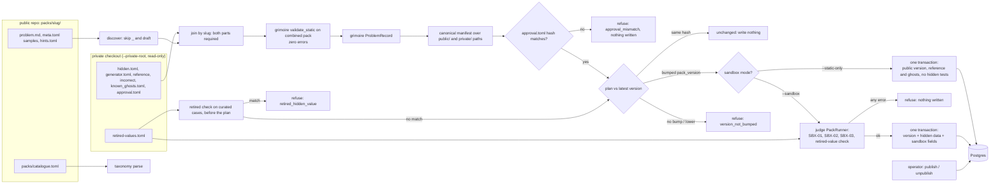
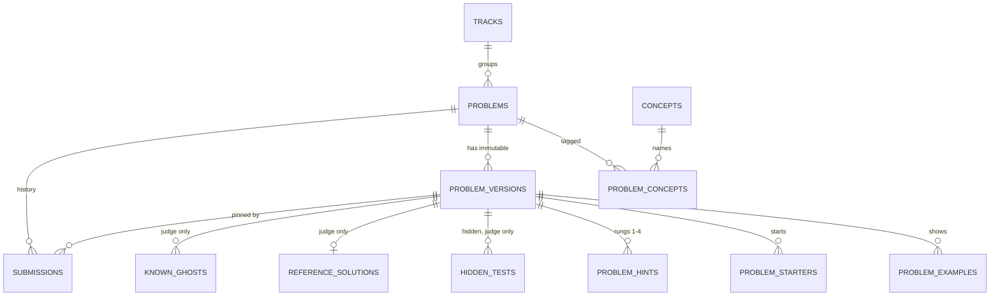

# Design: problem-catalogue

Status: spec only (see `requirements.md`). Requirement IDs `CAT-*` refer to `requirements.md`. Decisions are numbered `D1`–`D20` and cross-spec change requests `X1`–`X17`. Amendment 38 (14 Nov 2026 23:06) adds D17 to D20, X14 to X17 and open questions 18 to 24. Each open question lists the assumed choice, so the spec can run without a reply.

## Design approach

The architecture is fixed by `docs/system-design.md` §2, §4, §5 and §9. The rest of this document decides:

- the Postgres tables, triggers and privilege matrix (migrations sorted after `20261113110300`);
- where the importer lives and how it talks to the sandbox;
- how a pack becomes an immutable version;
- how the public API reads only public data;
- how the run-lifecycle and judge seams are replaced without breaking their tests.

No code is written by this step.

### Decision register

| ID | Decision | Where argued |
|---|---|---|
| D1 | Schema is three migrations: core tables and triggers, foreign keys, privileges. No new roles. | Data model, roles |
| D2 | The importer and operator CLI is a second binary, `counterspell-catalogue`, in the judge package. | Importer, Where the code lives |
| D3 | Hidden expected outputs are computed at import, by the reference, inside the judge's sandbox. | Importer, "Where hidden expected outputs are computed" |
| D4 | The operator CLI uses the database owner login (`CATALOGUE_DATABASE_URL`). Runtime services never get it. | Roles, open question 5 |
| D5 | Difficulty is `easy`, `medium` or `hard`. | Data model, X6 |
| D6 | `problem_hints` is keyed by `(slug, version, rung)` and is created here. | Child tables, X11 |
| D7 | `ProblemLookup` becomes async and returns the pinned version. | Seams, X4 |
| D8 | This spec serves `GET /api/languages` from the language catalogue. | Public API, X10 |
| D9 | Publication requires a sandbox-validated version, four hints and 2 to 5 examples, enforced by a trigger. | Data model, publish gate |
| D10 | A queued or running submission finishes against its pinned version. | Seams, P9 |
| D11 | `version` equals `meta.pack_version`. A content change needs a larger number. | Versions and the bump rule |
| D12 | Engine or generator version changes warn in dry run and never regenerate hidden data. | Versions and the bump rule |
| D13 | Tracks and concepts live in `packs/catalogue.toml`. | Importer, open question 13 |
| D14 | Starter code is generated from the signature by one template per language. | Importer, open question 14 |
| D15 | The list endpoint returns at most 200 items, with no cursor. | Public API, open question 15 |
| D16 | The `ghosts` table owner is unresolved, so `GhostLookup` is blocked. | Seams, open question 1 |
| D17 | Hidden parts (hidden tests, generator seeds, reference, known ghosts, private file hashes) live in the private repo `BrightonDube/counterspell-packs-private` (suggested). The public tree keeps `problem.md`, `meta.toml` samples, hints and `packs/catalogue.toml`. | Amendment 38, CAT-PT1, open question 18 |
| D18 | The importer reads only a local checkout passed as `--private-root`. It never fetches, runs git or holds a credential. A missing or unreadable checkout stops the whole run before any write. | CAT-PT2, CAT-PT4, open question 23 |
| D19 | `packs/<slug>/approval.toml` in the private tree must name the combined content hash. The importer refuses any mismatch before the sandbox runs. | CAT-PT7, pack-authoring-pipeline D9 |
| D20 | Hidden values are checked against `[[retired]]` hashes in `retired-values.toml` at the private root. A slug with retired hashes needs a `[[rotated]]` record before its sandbox import. | CAT-PT8, CAT-PT13, open question 21 |

Open questions are numbered 1 to 24 at the end. Each gives the assumed choice.

## The idea in plain English

A pack is a folder in git. The importer reads it, checks it, and writes one **version** of the problem into Postgres. A version never changes. A new version appears only when the pack's content changes and its `pack_version` goes up. Publishing picks one validated version and makes it visible. Runs remember the version they were judged against.

Hidden data (hidden test answers, the reference, known-ghost data) is written once, by the importer's sandbox step. The server role cannot read it. The judge role can.

As of amendment 38 (14 Nov 2026 23:06), hidden data lives in a private repo, not the public one. The importer reads a local checkout of that repo next to the public tree, joins the two by slug, and validates the combined pack. The public API never sees the private tree, and the importer never runs a pack without its private part.



## Scope and seams

### Built here

- Migrations `20261116100000_catalogue_core.sql`, `…100100_catalogue_foreign_keys.sql`, `…100200_catalogue_privileges.sql`.
- The importer and operator CLI `counterspell-catalogue` (second binary in `crates/judge`, decision D2).
- The judge's runtime `ProblemTests` implementation, `PgProblemTests` (read only).
- The server's `PgProblemLookup`, public read routes `GET /api/problems`, `GET /api/problems/{slug}`, and `GET /api/languages`.
- The `GhostLookup` seam (blocked, see D16).
- Dev and demo seeding commands.

### Seams to other specs (not built here)

| Seam | Owner | What this spec provides |
|---|---|---|
| `ProblemLookup` (`crates/server/src/seams.rs`) | run-lifecycle T21 | `PgProblemLookup` (D7) |
| `ProblemTests` (judge) | judge-sandbox T24 | `PgProblemTests` (X1) |
| `PackRunner` (grimoire) | judge-sandbox T20, grimoire T17 | importer's sandbox step uses it |
| language registry | language-drivers | read-only accessor for `GET /api/languages` (D8, X10) |
| hint ladder reveal | hints | the `problem_hints` table shape (D6) |

### Where the code lives

```text
migrations/
  20261116100000_catalogue_core.sql          tables, checks, triggers
  20261116100100_catalogue_foreign_keys.sql  submissions FKs, guarded FKs for later tables
  20261116100200_catalogue_privileges.sql    roles' grants (no new roles)
crates/judge/
  src/catalogue/                  importer library (operator only; uses grimoire and the PackRunner)
    mod.rs                        public entry points
    manifest.rs                   canonical manifest and content hash (pure)
    plan.rs                       import planner: create | unchanged | refuse (pure)
    taxonomy.rs                   packs/catalogue.toml parser (pure)
    starter.rs                    starter code per language from the signature (pure)
    discover.rs                   pack discovery, draft and _ filter (pure over a listing)
    private_tree.rs              public and private trees joined by slug; preflight (pure over listings)
    approval.rs                   approval.toml parse and combined-hash check (pure)
    retired.rs                    canonical hidden-case hash and retired-value check (pure)
    sandbox_fill.rs               SBX-01..03 through PackRunner, hidden expected values (sandbox only)
    write.rs                      one transaction per pack; row lock; events
    publish.rs                    publish and unpublish, with the gate reported to the operator
    report.rs                     text and JSON report, codes only, no hidden data
  src/problem_store.rs            runtime PgProblemTests (SELECT only)
  src/bin/counterspell-catalogue.rs   CLI: import, validate-sandbox, publish, unpublish, seed-dev, seed-demo, list
crates/server/
  src/catalogue/mod.rs            module wiring and router fragment
  src/catalogue/lookup.rs         PgProblemLookup (ProblemLookup impl)
  src/catalogue/read.rs           SQL for list and detail (public columns only)
  src/catalogue/dto.rs            explicit response structs (allow-listed keys)
  src/catalogue/handlers.rs       GET /api/problems, GET /api/problems/{slug}
  src/catalogue/languages.rs      GET /api/languages from the language seam
  src/catalogue/ghosts.rs         GhostLookup (blocked, D16)
packs/catalogue.toml              tracks and concepts (reviewed, outside pack dirs)
```

**Dependency rules.** `counterspell-judge` gains `counterspell-grimoire` (approved in grimoire-packs open question 7). `counterspell-server` does not depend on `counterspell-grimoire` or on the importer; it reads rows only. The server has no Docker or bollard dependency. `counterspell-grimoire` stays free of sqlx (GRM-54). The importer module never runs pack code itself. It calls only the `PackRunner` trait, and only in sandbox mode (CAT-Q4).

**Layout note.** `repo-skeleton` lists one `main.rs` for the judge. A second binary in the same package keeps the six canonical package names (`structure.md`) and needs no new crate (D2).

## Data model

Every table below is in `public`. The table names match the requirements.



### `problems` and `tracks`

```sql
CREATE TABLE tracks (
  slug       text PRIMARY KEY CHECK (slug ~ '^[a-z][a-z0-9-]{1,39}$'),
  name       text NOT NULL CHECK (char_length(name) BETWEEN 1 AND 80),
  sort_order int  NOT NULL DEFAULT 0
);

CREATE TABLE problems (
  slug              text PRIMARY KEY CHECK (slug ~ '^[a-z][a-z0-9-]{2,39}$'),
  title             text NOT NULL CHECK (char_length(title) BETWEEN 1 AND 80),
  track_slug        text NOT NULL REFERENCES tracks (slug) ON DELETE RESTRICT,
  difficulty        text NOT NULL CHECK (difficulty IN ('easy', 'medium', 'hard')),   -- D5
  publication_state text NOT NULL DEFAULT 'unpublished'
                      CHECK (publication_state IN ('unpublished', 'published')),
  published_version int,                       -- kept after unpublish (CAT-P3)
  published_at      timestamptz,
  unpublished_at    timestamptz,
  created_at        timestamptz NOT NULL DEFAULT now(),
  updated_at        timestamptz NOT NULL DEFAULT now(),
  CHECK (publication_state <> 'published' OR published_version IS NOT NULL)
);
```

`title`, `track_slug` and `difficulty` in `problems` are the current display copy. The authoritative copy is in `problem_versions`. The importer updates `problems` only when it writes a new version.

### `problem_versions` (immutable)

```sql
CREATE TABLE problem_versions (
  problem_slug        text NOT NULL REFERENCES problems (slug) ON DELETE RESTRICT,
  version             int  NOT NULL CHECK (version >= 1),        -- = meta.pack_version (D11)
  content_sha256      bytea NOT NULL CHECK (octet_length(content_sha256) = 32),
  manifest            jsonb NOT NULL,                             -- {public/<path>: sha256} only; private entries are in hidden_sources (CAT-PT9)
  title               text NOT NULL,
  track_slug          text NOT NULL REFERENCES tracks (slug) ON DELETE RESTRICT,
  difficulty          text NOT NULL CHECK (difficulty IN ('easy', 'medium', 'hard')),
  statement_markdown  text NOT NULL CHECK (char_length(statement_markdown) <= 8000),
  constraints         jsonb NOT NULL CHECK (jsonb_typeof(constraints) = 'array'),
  signature           jsonb NOT NULL,
  input_schema        jsonb NOT NULL,                             -- engine Schema, tagged
  comparator          text NOT NULL CHECK (comparator IN ('exact', 'unordered')),
  limits              jsonb NOT NULL,
  reference_complexity text,                                      -- efficiency-familiar (X8)
  bench               jsonb,
  complexity_note     text CHECK (char_length(complexity_note) <= 240),
  engine_version      text NOT NULL,
  generator_version   text NOT NULL,
  hidden_count        int NOT NULL CHECK (hidden_count BETWEEN 5 AND 80),         -- curated 1-30 plus generated 5-50 (amendment 38)
  statically_validated_at timestamptz NOT NULL DEFAULT now(),
  sandbox_validated_at    timestamptz,
  sandbox_image_digest    text CHECK (char_length(sandbox_image_digest) <= 200),
  created_at          timestamptz NOT NULL DEFAULT now(),
  PRIMARY KEY (problem_slug, version),
  UNIQUE (problem_slug, content_sha256),
  CHECK ((sandbox_validated_at IS NULL) = (sandbox_image_digest IS NULL))
);
```

**Immutability trigger on `problem_versions` (CAT-S2).**
- `BEFORE DELETE` raises.
- `BEFORE UPDATE` raises unless the only changed columns are `sandbox_validated_at` and `sandbox_image_digest`, both going from NULL to a value, and at least one `hidden_tests` row exists for this version. The check is `to_jsonb(NEW) - 'sandbox_validated_at' - 'sandbox_image_digest' = to_jsonb(OLD) - …`.

### Child tables

| Table | Key | Columns | Written at | Readable by |
|---|---|---|---|---|
| `problem_examples` | `(slug, version, ordinal)` | `input jsonb`, `expected jsonb`, 2–5 rows (checked by a trigger on publish) | import | server, judge |
| `problem_starters` | `(slug, version, lang)` | `lang IN ('python','javascript')`, `code text ≤ 8 KB` | import | server, judge |
| `problem_hints` | `(slug, version, rung)` | `rung 1..4`, `body 1..600 chars` | import | server (reveal path) |
| `hidden_tests` | `(slug, version, ordinal)` | `source IN ('curated', 'generated')`, `input jsonb`, `expected jsonb`. Ordinals: samples first, then curated, then generated | sandbox step only | **judge only** |
| `hidden_generation` | `(slug, version)` | `generator_seed bigint`, `generator_version text`. Moved out of `problem_versions` (CAT-PT9) | sandbox step only | **judge only** |
| `hidden_sources` | `(slug, version, path)` | `path` (private tree only, `private/` prefix), `sha256 bytea` (32 bytes) | sandbox step only | **judge only** |
| `reference_solutions` | `(slug, version, lang)` | `lang = 'python'`, `code`, `sha256` | import | **judge only** |
| `known_ghosts` | `(slug, version, ghost_id)` | `kind IN ('wrong','crash','timeout')`, `input`, `got`, `exception_class`, `explanation ≤ 400 bytes`, `concepts text[]` | import | **judge only** |
| `problem_concepts` | `(problem_slug, concept_id)` | FKs to `problems` and `concepts` | import (replace the set for the slug) | server, judge |
| `concepts` | `id` | `name` | taxonomy sync | server |
| `catalogue_events` | `id bigserial` | `problem_slug`, `action IN ('import','sandbox_validate','publish','unpublish')`, `version`, `operator text ≤ 60`, `detail jsonb` (codes and counts only) | every write action | nobody in runtime roles |

Rules for every child table: it is insert-only. Insert is allowed only while the parent version's `sandbox_validated_at` is NULL (CAT-S3). Update and delete raise. `problem_hints` has one extra rule: its body and rung are fixed at import, and publication requires exactly four rungs (a trigger checks this, CAT-S4).

`problem_concepts` is the one current-state mapping that changes. A re-import that changes concept tags replaces the set for that slug. This is a change of current metadata, not of a version, and the replacement happens in the same transaction as the version insert. The old tags stay recorded in `manifest` (D13, open question 13).

**Publish gate (CAT-S4).** A `BEFORE UPDATE OF publication_state, published_version ON problems` trigger raises when the new state is `published` and any of these fails:
- the referenced version's `sandbox_validated_at` is NULL;
- the version has fewer than 2 or more than 5 `problem_examples`;
- the version has other than 4 `problem_hints` rows;
- the problem's track or any concept is missing.

`published_version` must name an existing version: the composite foreign key (below) enforces this.

### `catalogue_events`

Append-only, like the other audit tables. The trigger raises on update and delete. Each row holds codes and counts only, for example `{"hidden_count": 12, "manifest_files": 7, "image_digest_prefix": "sha256:e48f59cd"}`. Pack contents, hidden data and program output are never stored here (CAT-S6, CAT-X1). The `import` event may carry the private tree commit identifier and the approval's `public_commit`, because neither is secret (CAT-PT5).

## Foreign keys (migration `…100100`)

| From | To | Rule |
|---|---|---|
| `submissions.problem_slug` | `problems(slug)` | `ON DELETE RESTRICT`, `NOT VALID` (CAT-F1, CAT-F3) |
| `submissions(problem_slug, problem_version)` | `problem_versions(problem_slug, version)` | `ON DELETE RESTRICT`, `NOT VALID`; `problem_version` is nullable for rows written before this spec (CAT-S8) |
| `problems.(slug, published_version)` | `problem_versions(problem_slug, version)` | added after both tables exist; not `NOT VALID` (no existing rows) |
| `problem_baselines.problem_slug` (efficiency-familiar) | `problems(slug)` | guarded: added only when the table exists (CAT-F2) |
| `concept_cards.concept_id` (dashboard-fsrs) | `concepts(id)` | guarded (CAT-F2). Dashboard creates the table later and references `concepts(id)` directly (X7) |
| `hints` (hints spec) | `submissions` only | no problem FK needed; the hint text comes from `problem_hints` by `(slug, published version)` (D6) |

The migration checks `to_regclass('public.<table>')` before each guarded statement. Later specs' migrations sort after this one and reference `problems(slug)` or `concepts(id)` directly, so the guard matters only for the case where a later table is created first.

The new column is `ALTER TABLE submissions ADD COLUMN IF NOT EXISTS problem_version int CHECK (problem_version >= 1)`. It is added here and filled by the enqueue transaction (X3).

## Roles and privilege matrix (migration `…100200`)

No role is created (CAT-R1). The migration uses the same `DO` pattern as run-lifecycle, so it runs alone. It revokes all privileges on catalogue tables from `PUBLIC`, then grants:

| Table | `counterspell_server` | `counterspell_judge` | Operator (owner login, D4) |
|---|---|---|---|
| `tracks`, `concepts`, `problems`, `problem_concepts`, `problem_versions`, `problem_examples`, `problem_starters`, `problem_hints` | `SELECT` | `SELECT` on `problems`, `problem_versions`, `problem_examples`, `problem_starters` only | all |
| `hidden_tests`, `hidden_generation`, `hidden_sources`, `reference_solutions`, `known_ghosts` | **none** | `SELECT` | all |
| `catalogue_events` | **none** | **none** | all |
| `submissions.problem_version` and new FKs | existing grants (run-lifecycle) | existing grants | all |

The server and judge get `UPDATE` on no catalogue table. Publication and imports need the operator login, so a compromised server cannot publish a version, change hidden data or read it. The `submissions` grants stay as run-lifecycle wrote them. `problem_hints` is readable by the server because the hint reveal path reads a single rung by the published version (hints H11).

Tests (`pg_catalogue_privileges`) call `has_table_privilege` for each role, each table and each privilege, and assert the matrix exactly (CAT-R6).

## Importer

### Command surface (D2)

```text
counterspell-catalogue import   [--packs <root>] --private-root <path> [--slug <slug>] [--dry-run]
                                [--static-only | --sandbox] [--deny-warnings] [--json]
counterspell-catalogue validate-sandbox <slug>
counterspell-catalogue publish <slug> [--version <n>]
counterspell-catalogue unpublish <slug>
counterspell-catalogue seed-dev   --static-only            (CAT-D1)
counterspell-catalogue seed-demo                           (CAT-D2, sandbox)
counterspell-catalogue list
```

Environment: `CATALOGUE_DATABASE_URL` (operator, D4), `SANDBOX_*` (judge-sandbox config) for the sandbox modes, `CATALOGUE_OPERATOR` (a label written to `catalogue_events`, default `$USER`). Every command that reads packs also takes `--private-root` (CAT-PT2). The importer holds no credential and runs no git. The operator supplies the checkout (runbook, task C34). No password appears in the repo or in logs.

### Pipeline per pack

1. **Preflight, discover and join (`private_tree.rs`, `discover.rs`).** Before any database connection, check `--private-root` (CAT-PT2). Then take directory names directly under the public root. Pair each with `<private-root>/packs/<slug>/`. A missing private part refuses that pack (`private_part_missing`). A private directory with no public pack is refused (`orphan_private_pack`). Skip any name starting with `_`, any file, and any directory without `meta.toml`. An explicit `--slug` for an `_` pack is refused (`underscore_pack`).
2. **Read the draft gate.** Parse only `meta.toml` `status`. A value other than `published` is refused with `draft_pack`, and nothing else for that pack is read or written (CAT-I3).
3. **Static validation.** Call `counterspell_grimoire::validate_static` on the combined pack (cross-spec X14). Any error refuses the pack (`static_errors`, with the grimoire codes). Warnings are reported, and `--deny-warnings` makes them errors.
4. **Taxonomy.** Every `track` and `concepts` entry must exist in `packs/catalogue.toml`, or the pack is refused (`unknown_taxonomy`).
5. **Record.** Build `ProblemRecord` (grimoire). Read the examples from `[[samples]]`, the reference, the ghost list and the hint list through the grimoire model. Build starter code (`starter.rs`) and constraints (`## Constraints` bullets, CAT-I18).
6. **Manifest (`manifest.rs`, pure).** For every allowed file (the grimoire allow-list, reused through a public helper, X9): relative path (prefixed `public/` or `private/`, CAT-PT6) and SHA-256, sorted by path. `approval.toml` is excluded, because it holds the hash. `content_sha256 = SHA-256(canonical manifest bytes)`. The canonical bytes are `path NUL hex-sha256 LF` per entry.
7. **Approval, then plan (`approval.rs`, `plan.rs`, pure).** First check `private/<slug>/approval.toml`: its `slug` and `pack_version` must match, and its `content_sha256` must equal the combined hash. Otherwise refuse (`approval_missing`, `approval_mismatch`, CAT-PT7) before any sandbox run or write. Then compare with the latest stored version (`ORDER BY version DESC LIMIT 1`, read under the row lock in write mode, or read-only in dry run):
   - no stored version → `Create { version: pack_version }`;
   - equal hash → `Unchanged` (no write, CAT-I7);
   - hash differs and `pack_version > latest` → `Create`;
   - hash differs and `pack_version <= latest` → `Refuse(VersionNotBumped { changed_files })` (CAT-I9) or `Refuse(VersionRegressed)`.
8. **Sandbox fill (`sandbox_fill.rs`, sandbox mode only).** Through the `PackRunner`:
   - Reconcile (`validate-sandbox` only, CAT-PT10): recompute the combined hash and refuse `private_tree_changed` if it differs from the stored `content_sha256`.
   - SBX-01: the reference on each example, compared with the comparator. A mismatch refuses the pack.
   - SBX-02: generate `hidden_count` unique candidates from `CandidateStream(seed, schema)`. Run the reference on each within `limits.time_ms`. Any crash, timeout or wrong shape refuses the pack. Expected values stay in memory until the write step.
   - SBX-03: run each known ghost's `program` on its input and classify. The kind and `got` or `exception_class` must match.
   - SBX-04 is a warning and is reported, not stored.
   - Retired-value check (CAT-PT8), for every curated and generated case: the canonical hash (SHA-256 of canonical JSON holding the input and expected value) is compared with `retired-values.toml`. A match refuses with `retired_hidden_value` and prints only a hash prefix.
   - Rotation check (CAT-PT13): a slug with a `[[retired]]` entry needs a matching `[[rotated]]` entry with the current `pack_version`, or the sandbox step refuses.
   - Infrastructure errors (`RunnerError`) exit 2 and write nothing (CAT-I21).
9. **Write (`write.rs`, one transaction).**
   - `SELECT … FROM problems WHERE slug = $1 FOR UPDATE` (CAT-I12). Insert the problem row if absent, and update its display copy.
   - Re-check the plan under the lock. If another run inserted the same version meanwhile, the unique key or the plan returns `unchanged`, and the transaction rolls back cleanly.
   - Insert `problem_versions`, examples, starters, hints, reference, known ghosts and the `problem_concepts` set. In sandbox mode also insert `hidden_tests`, `hidden_generation` (seed and generator version) and `hidden_sources` (private file hashes), and set `sandbox_validated_at` and `sandbox_image_digest` (the trigger checks that hidden tests exist).
   - Insert one `catalogue_events` row (`import` or `sandbox_validate`).
   - Commit. Any error rolls back the whole pack (CAT-I11, property P6).
10. **Report.** Text or JSON, one line per pack: outcome, version, codes, counts, the first 12 hex characters of the hash. Never contents (CAT-I20).

Sandbox import writes the version with its hidden data in the same transaction. Static-only import writes everything except hidden test data: no hidden tests, generator seed or private file hashes (CAT-PT9). It still writes reference and known-ghost rows, which the judge needs and which stay judge-only. It leaves the sandbox columns NULL. `validate-sandbox` later runs steps 8 and 9 for the latest version only, and only when its sandbox columns are NULL (CAT-I16).

### Where hidden expected outputs are computed (D3)

Expected outputs for hidden tests are computed **at import, by the reference, inside the judge's sandbox, through `PackRunner`**. Alternatives were considered:

| Option | Verdict | Reason |
|---|---|---|
| **Import-time, judge sandbox (chosen)** | Yes | `system-design.md` §5 point 5 makes the Python reference authoritative for expected outputs, and §0 makes the judge the owner of tests and verdicts. Only the judge can reach the rootless sandbox daemon. The values are fixed per version before any learner runs. The image digest is recorded. The judge does not have to write at run time. |
| Judge computes lazily on the first run of a version | No | The judge would need write access to catalogue tables, and a first-run race could store two different answers. A bug that changes expected values would surface during a learner's run. |
| Server computes | No | The server must not reach Docker (§2). |
| Grimoire computes statically | No | Static mode runs no code (GRM-35). |

The judge still decides every verdict at run time. The import only fixes the expected answers that the judge compares against.

### Versions and the bump rule (D11, D12)

- `version = meta.pack_version`. A content change needs a larger `pack_version`. Editing a comment is still a content change, so the reviewer bumps the number. This keeps ghost determinism and hidden data tied to a number a person can see.
- `engine_version` and `generator_version` are recorded per version. The engine can change without a pack change. In that case the dry run warns, and the import does not regenerate anything (D12). A new hidden-data set needs a new pack version.
- `bench` and `reference_complexity` are part of the content. Enabling bench for an existing problem (efficiency-familiar T40) therefore needs a version bump (X8).

## Publication (CAT-P1 to CAT-P6)

```mermaid
sequenceDiagram
  autonumber
  participant O as Operator CLI
  participant P as Postgres
  participant S as Server
  participant J as Judge
  O->>P: publish slug [--version n] (operator login)
  P-->>O: trigger checks CAT-S4 (sandbox, 4 hints, examples, taxonomy)
  O->>P: problems.publication_state = published, published_version = n, catalogue_events
  S->>P: GET /api/problems (published only)
  Note over S,P: enqueue INSERT … SELECT pins problem_version (X3)
  J->>P: PgProblemTests loads the pinned version (judge role, SELECT)
  O->>P: unpublish slug
  S->>P: list and detail hide it; existing submissions still readable
  J->>P: queued runs still load their pinned version (D10)
```

`unpublish` changes only `publication_state` and `unpublished_at`, plus one event row. `published_version` stays, so a later `publish` without a version reuses the same version by default. Old versions are never removed.

## Public read API

All responses are built from explicit structs in `dto.rs` (CAT-A8). They are never built from raw rows.

### `GET /api/problems`

Query: `track`, `concept`, `difficulty` (optional; unknown values give `400 invalid_filter`, CAT-A1).

```json
{
  "problems": [
    {
      "slug": "count-pairs",
      "title": "Count the Pairs",
      "track": { "slug": "arrays", "name": "Arrays" },
      "difficulty": "easy",
      "concepts": [{ "slug": "pairs", "name": "Pairs" }],
      "status": "unattempted"
    }
  ]
}
```

- `status` is `null` for anonymous callers. For a signed-in caller it is computed from the caller's own submissions only (CAT-A2).
- Sorted by track `sort_order`, then slug. Capped at 200 with no cursor (D15).

Query shape (illustrative):

```sql
SELECT p.slug, p.title, p.difficulty, t.slug AS track_slug, t.name AS track_name,
       COALESCE(c.concepts, '[]'::jsonb) AS concepts,
       CASE WHEN $1::uuid IS NULL THEN NULL
            WHEN bool_or(s.verdict = 'accepted') THEN 'solved'
            WHEN bool_or(s.id IS NOT NULL)       THEN 'attempted'
            ELSE 'unattempted' END AS status
FROM problems p
JOIN tracks t ON t.slug = p.track_slug
LEFT JOIN LATERAL (
  SELECT jsonb_agg(jsonb_build_object('slug', k.id, 'name', k.name) ORDER BY k.id) AS concepts
  FROM problem_concepts pc JOIN concepts k ON k.id = pc.concept_id
  WHERE pc.problem_slug = p.slug
) c ON true
LEFT JOIN submissions s ON s.problem_slug = p.slug AND s.user_id = $1 AND s.status = 'completed'
WHERE p.publication_state = 'published'
  AND ($2::text IS NULL OR t.slug = $2)
  AND ($3::text IS NULL OR p.difficulty = $3)
  AND ($4::text IS NULL OR EXISTS (SELECT 1 FROM problem_concepts f WHERE f.problem_slug = p.slug AND f.concept_id = $4))
GROUP BY p.slug, p.title, p.difficulty, t.slug, t.name, t.sort_order, c.concepts
ORDER BY t.sort_order, p.slug
LIMIT 200;
```

The `status` expression uses `bool_or` over a join that includes `s.user_id = $1`. The `s.status = 'completed'` filter keeps an unfinished run from counting as solved. The statement will be checked by a `pg_` test, not by eye.

### `GET /api/problems/{slug}`

```json
{
  "slug": "count-pairs",
  "title": "Count the Pairs",
  "track": { "slug": "arrays", "name": "Arrays" },
  "difficulty": "easy",
  "concepts": [{ "slug": "pairs", "name": "Pairs" }],
  "statement_markdown": "# Count the Pairs …",
  "constraints": ["0 ≤ length ≤ 30", "…"],
  "examples": [{ "input": [[1, 2, 3, 2], 4], "expected": 2 }],
  "signature": {
    "function_name": "count_pairs",
    "parameters": [{ "name": "values", "type": "list[int]" }, { "name": "target", "type": "int" }],
    "return_type": "int"
  },
  "starters": { "python": "def count_pairs(values, target):\n    …", "javascript": "function count_pairs(values, target) {\n    …" },
  "enabled_languages": ["python", "javascript"],
  "limits": { "time_ms": 2000, "mem_mb": 256 },
  "hint_count": 4
}
```

- `examples` are the public samples only (CAT-A4, CAT-X3). No hidden field exists in the struct.
- `enabled_languages` is the intersection of `starters` keys and the enabled languages from the language seam (X10).
- Hint bodies are absent (CAT-A5). `hint_count` is 4 for every published problem.
- Unknown and unpublished slugs return the same `404 not_found` body (CAT-A6).

### `GET /api/languages` (D8)

```json
{ "languages": [{ "id": "python", "display_name": "Python 3", "max_source_bytes": 65536 }, { "id": "javascript", "display_name": "JavaScript (Node)", "max_source_bytes": 65536 }] }
```

Only enabled languages are listed. The data comes from the language catalogue (`LanguageCatalog` seam, run-lifecycle T21), extended with a display name by language-drivers (X10).

### Errors

Every error uses the existing JSON envelope with a stable `code` (`not_found`, `invalid_filter`) and a safe `message`. No SQL text or file path is echoed (CAT-X4).

## Seams and run integration

### `ProblemLookup` (D7, CAT-L1, CAT-L2)

```rust
#[async_trait]
pub trait ProblemLookup: Send + Sync {
    /// Returns the published version of a problem, or `None`.
    async fn published(&self, slug: &str) -> Option<ProblemRef>;
}

pub struct ProblemRef { pub slug: String, pub version: u32 }   // version is new
```

`PgProblemLookup` runs `SELECT slug, published_version FROM problems WHERE slug = $1 AND publication_state = 'published'`. `EmptyCatalogue` stays for the database-free constructor. The in-memory test lookup gains the version field, and the existing assertions do not change.

### Enqueue pin (X3, CAT-L3)

The enqueue transaction inserts the submission and reads the version in one statement:

```sql
INSERT INTO submissions (id, user_id, problem_slug, problem_version, lang, mode, code, code_sha256, idempotency_key, …)
SELECT $1, $2, p.slug, p.published_version, $3, $4, $5, $6, $7, …
FROM problems p
WHERE p.slug = $8 AND p.publication_state = 'published'
RETURNING id;
```

If no row comes back, the handler answers `404 not_found` and nothing is queued. An unpublish that commits before this statement stops the run. One that commits after it does not affect the run (D10).

### Judge `ProblemTests` (X1, CAT-L4)

`ProblemTests::load(slug, version, mode)` (the version parameter is new, X1) returns:

- for `Run`: the public examples;
- for `Submit`: examples plus `hidden_tests`;
- always: the `reference_solutions` row for ghost hunts;
- known-ghost data for autopsy matching, read from `known_ghosts`.

`PgProblemTests` uses only the judge role's `SELECT` grants. It returns `Ok(None)` when no row exists for `(slug, version)`, and the executor reports `problem_unavailable` (judge-sandbox design). It never writes.

### `GhostLookup` (D16, CAT-L6)

`GhostLookup::stored_for(user, submission_id) -> Option<StoredGhost>` returns the input of a stored ghost only when the submission belongs to the caller. It is blocked until the owner of the `ghosts` table is known (open question 7). Until then, `ide-workspace` T02 must not depend on it.

## Dev and demo seeding (CAT-D1 to CAT-D3)

- `seed-dev --static-only` imports every eligible starter pack into a local database. It publishes nothing. It still needs `--private-root` (CAT-PT2), and without it exits 2 before reading any pack. Development uses a synthetic private fixture, never the real private repo, unless Brighton passes such a root. It is the only way to see catalogue rows without Docker.
- `seed-demo` runs sandbox import, validates the sandbox results and publishes the latest validated version of each eligible problem. It needs the rootless sandbox daemon, so it runs on the VPS or a development host that has one.
- Both commands skip draft packs. Until Brighton approves the starter packs (grimoire-packs T28), both print `no eligible packs` and exit 0. This is the intended state for now (D4 consequence, open question 4).
- Tests do not use either command. They use a fixture helper (`catalogue::testkit`) that inserts a published, sandbox-validated version with hidden data and canary values, through the same triggers.

## Correctness properties

Each property names the test that proves it.

| ID | Property | Proof |
|---|---|---|
| P1 | **Idempotence.** Planning the same manifest twice against the stored result gives `Unchanged` the second time, and the stored row set is byte-identical. | proptest on `plan`; `pg_catalogue_import_idempotent` |
| P2 | **Versioning.** For any accepted sequence of bumped content changes, the row count equals the number of distinct accepted hashes, and every earlier version row is unchanged. | proptest on `plan` with a model store; `pg_catalogue_versions_history` |
| P3 | **Canonical hash.** Reordering the file listing does not change the hash; changing one byte or one file name does. | proptest on `manifest` |
| P4 | **Refusals write nothing.** Drafts, `_` packs, unknown taxonomy, static errors, unbumped content and sandbox failures leave every table unchanged. | `pg_catalogue_refusals_write_nothing` and unit tests per refusal code |
| P5 | **Dry run is side-effect free.** Row counts and `catalogue_events` are unchanged after a dry run, with or without `--sandbox`. | `pg_catalogue_dry_run_no_writes` |
| P6 | **Atomicity.** A failure in the middle of a pack's writes leaves no partial version. | `pg_catalogue_rollback_on_failure` (inject a constraint violation after the first insert) |
| P7 | **Publish gate.** Publication fails for an unvalidated version, for three hints, for six examples, or for a missing taxonomy entry. | `pg_catalogue_publish_gate` |
| P8 | **Confidentiality.** No canary value appears in any API response, log, event or report. Server privileges on hidden tables are empty. | `api_no_leak`, `log_no_leak`, `pg_catalogue_privileges` |
| P9 | **Pinning.** A submission queued against version *v* is judged against *v* after publication moves to *v+1* or the problem is unpublished. | `pg_catalogue_pinned_version_survives_publish` |
| P10 | **Immutability.** Updating or deleting a version or child row, other than the one-time sandbox fill, raises. | `pg_catalogue_immutability` |
| P11 | **Private split.** A public-only run, a stale approval or a retired hidden value writes nothing and calls no sandbox. A changed private file cannot reach a validated version. | `pg_catalogue_private_tree_required`, `pg_catalogue_approval_gate`, `pg_catalogue_validate_sandbox` (reconcile) |

## Testing strategy

| Layer | What | Where |
|---|---|---|
| Pure unit | manifest, plan, taxonomy, discovery, starter templates, constraint extraction | `crates/judge/src/catalogue/*` `#[cfg(test)]` |
| Property | P1, P2, P3, plan refusal codes | `crates/judge/tests/catalogue_props.rs` |
| Database | schema, triggers, privileges, import, publish, pinning, rollback | `crates/judge/tests/pg_catalogue_*.rs` (`pg_` prefix, ignored) |
| Server API | list, detail, languages, 404s, key allow-list, canary absence | `crates/server/tests/catalogue_api.rs` and `pg_catalogue_api.rs` |
| Sandbox | import through the sandbox runner | **not in this spec's CI.** Real sandbox runs happen in judge-sandbox T37 on the host (HUMAN). Unit tests use the grimoire model runner, labelled as not sandbox evidence (the same convention as `grimoire-packs` T18) |
| Purity | importer static path has no process or network call | `crates/judge/tests/catalogue_purity.rs` (CAT-Q4) |
| Log hygiene | importer output and API logs contain no canary | `crates/judge/tests/catalogue_logs.rs` |
| Private-tree preflight and join (no database) | missing, unreadable or inside-public root; missing or orphan private parts | `crates/judge/tests/catalogue_private_preflight.rs` |
| Private-tree gates (database) | public-only run refused with zero rows; approval gate refuses before any sandbox call | `crates/judge/tests/pg_catalogue_private_tree_required.rs`, `pg_catalogue_approval_gate.rs` |

Database tests run with `DATABASE_URL` set. They are `#[ignore]` by default, as in the other specs.

## Failure matrix

| Failure | Result | Exit |
|---|---|---|
| Draft pack | refused, nothing read beyond `meta.toml` status | 1 |
| `_` pack or `--slug _x` | refused (`underscore_pack`) | 2 (usage) |
| Static grimoire error | refused, report lists codes | 1 |
| Taxonomy unknown | refused | 1 |
| Hash changed, `pack_version` not bumped | refused, changed files named | 1 |
| Sandbox runner missing with `--sandbox` | refused with `SBX-07` | 2 |
| Runner infrastructure error (`RunnerError`) | nothing written, `SBX-06` | 2 |
| Reference disagrees with an example | refused, nothing written | 1 |
| Database failure mid-pack | rollback for that pack, other packs continue | 2 |
| Two imports of one slug at once | row lock; second re-plans and reports `unchanged` | 0 or 1 |
| Publish of unvalidated version | DB trigger raises; CLI prints the failed check | 1 |
| Unpublish during a run | run finishes on its pinned version (P9) | n/a |
| Pack with a symlink or escaping path | grimoire LAY-03 refuses before any read | 1 |
| `--private-root` missing, unreadable, or inside the public tree | preflight stops the run before any database connection | 2 |
| Public pack with no private part, or private pack with no public pack | that pack refused; orphan reported | 1 |
| `approval.toml` missing, wrong `pack_version`, or hash mismatch | refused before the sandbox and before the plan | 1 |
| Hidden case matches a retired hash | refused; only a hash prefix reported | 1 |
| Retired slug with no matching `[[rotated]]` record | sandbox import refused | 1 |
| Private files changed after static import (`validate-sandbox`) | refused with `private_tree_changed` | 1 |

## Security notes

- Packs are reviewed text, but the importer treats them as hostile: grimoire allow-list, size limits, UTF-8 and path checks run first (grimoire GRM-1 to GRM-7).
- Pack code runs only through `PackRunner` in the sandbox, in sandbox mode (CAT-Q4). Static mode runs nothing.
- Hidden data never leaves the judge's database role or the operator's transaction.
- The operator URL (`CATALOGUE_DATABASE_URL`) is read by the CLI only. Compose and the runtime services never receive it.
- Responses use allow-listed structs, so a new database column cannot leak by accident (CAT-A8).
- The importer holds no credential and runs no git. The operator checks out the private repo with a read-only deploy key or a fine-grained read-only token, kept outside the repo, and deletes the checkout after import (CAT-PT4, CAT-PT14).
- Private data never enters public columns. `problem_versions` holds public paths only, `generator_seed` lives in `hidden_generation`, and private file hashes live in `hidden_sources`. The server role can read none of them (CAT-PT9, CAT-R3).

## Changes requested from other specs

These are requests to the owning specs. This spec does not edit those files. Each owner records the change in their own tasks file.

| ID | Owner and task | Change | Why |
|---|---|---|---|
| X1 | judge-sandbox T24 | `ProblemTests::load(slug, version, mode)`; production wiring uses `PgProblemTests` instead of `EmptyProblemTests` | pinned versions (CAT-L4, P9) |
| X2 | run-lifecycle T-tests, judge-sandbox test helpers | insert a problem through `catalogue::testkit` before inserting a submission | the new submission FK (CAT-L7) |
| X3 | run-lifecycle T24 | enqueue uses the `INSERT … SELECT` pin (CAT-L3) | publication race |
| X4 | run-lifecycle T21 | `ProblemLookup` async, `ProblemRef.version` (D7) | DB-backed lookup |
| X5 | run-lifecycle T26 / judge | `GET /api/runs/{id}` and history keep working for unpublished problems (CAT-P4) | no hiding of owners' history |
| X6 | ide-workspace DTO and T02 | difficulty `easy`/`medium`/`hard` (D5); T02 uses `GhostLookup` only when D16 is resolved | the design currently says `intro`/`standard`/`hard` |
| X7 | dashboard-fsrs T02, T13 | `concept_id text REFERENCES concepts(id)`; published-only joins | catalogue seam |
| X8 | efficiency-familiar T40 | enabling bench on a problem needs a new `pack_version` | bench is content (D11) |
| X9 | grimoire-packs (new helper, small) | public `pack::allowed_files(root)` helper for the manifest, reused by the importer | one allow-list (CAT-I6) |
| X10 | language-drivers | read-only accessor: enabled languages with display names and byte limits | `GET /api/languages` (D8) |
| X11 | hints H10 | do not create `problem_hints`; rely on this spec's table keyed by `(slug, version, rung)`; reveal reads the published version (D6) | one table, versioned |
| X12 | hints H11 | body cap 600 characters to match grimoire GRM-27 (hints design says 1200) | one rule for authored text |
| X13 | run-lifecycle tests | the server and judge test kits use `catalogue::testkit`'s published fixture | keeps every test on the same seam |
| X14 | grimoire-packs | `validate_static` and the layout allow-list accept a combined pack. The private tree allows `hidden.toml`, `generator.toml`, `reference/`, `incorrect/`, `known_ghosts.toml` and `approval.toml`. A file in the wrong tree is an error (`LAY-05`). A public helper per tree extends X9. This matches part 2 of the draft `33-starter-pack-hardening-v2` | CAT-I4, CAT-PT1, CAT-PT6, CAT-PT12 |
| X15 | pack-authoring-pipeline (its X3 and PIP-36) | The importer side of approval is CAT-PT7 here. Assembly uses the same manifest code (C06) and does not carry its own hash | pack-authoring D9 |
| X16 | draft `docs/kiro-prompts/33-starter-pack-hardening-v2.md` | The draft proposes a `counterspell_importer` role, and its table names `test_cases` and `problem_known_ghosts`. This spec keeps no new role (CAT-R1, D4) and its names (`hidden_tests`, `known_ghosts`). The draft is not edited here | open question 22 |
| X17 | judge-sandbox and run-lifecycle | none. Runtime hidden reads stay judge-role only (CAT-PT11) | confirms there is no seam change |

## Open questions

Each question states the assumed choice. Brighton can overrule any of them, and the spec still runs without a reply.

1. **Where the ghost table is owned (D16).** `ghosts` has no DDL in any spec. Hints and ide-workspace read it. **Assumed:** the run-lifecycle or ghost-engine task that persists ghosts owns its migration. `GhostLookup` (CAT-L6) waits for it, and ide-workspace T02 is not unblocked by this spec.
2. **Importer location (D2).** **Assumed:** second binary `counterspell-catalogue` in `crates/judge`. Alternative: a new `counterspell-catalogue` package (rejected: breaks the six-package layout in `structure.md`) or a subcommand of the server (rejected: the server must not need the sandbox).
3. **Expected outputs (D3).** Computed at import through the judge's sandbox `PackRunner`, as explained above. The alternative (lazy first-run computation) was rejected.
4. **Starter packs are still drafts.** The starter packs are `draft` until Brighton approves them (grimoire-packs T28). **Assumed:** the catalogue ships empty until then. The seed commands report `no eligible packs`.
5. **Operator database login (D4).** **Assumed:** the operator CLI uses the database owner login that runs migrations (`CATALOGUE_DATABASE_URL`), and no new role is created, as the brief requires. This is a security decision, so Brighton confirms it. The deploy spec must keep this login out of runtime services.
6. **Difficulty enum (D5).** **Assumed:** `easy`, `medium`, `hard`, from grimoire and the system design. The ide-workspace design uses `intro`, `standard`, `hard` (X6).
7. **Hint table ownership (D6).** **Assumed:** this spec creates `problem_hints` keyed by `(slug, version, rung)` (X11). The hints spec currently creates it without a version.
8. **`ProblemLookup` becomes async (D7).** **Assumed:** yes, matching `UserResolver`. The sync trait cannot query Postgres. The change is in run-lifecycle T21 (X4).
9. **Language route owner (D8).** No spec currently defines `GET /api/languages`. **Assumed:** this spec serves the route, reading the language catalogue through a read-only accessor that language-drivers provides (X10).
10. **Queued runs after unpublish (D10).** **Assumed:** they finish against their pinned version, so learners are not charged a `problem_unavailable` for a publication change. Alternative: fail them as `problem_unavailable`. This would need a run-lifecycle change.
11. **Pack version bump (D11).** **Assumed:** any content change requires a larger `pack_version`, including a comment-only edit. Changing only `status` from draft to published also needs a bump after the first publication.
12. **Engine version changes (D12).** **Assumed:** a warning in dry run only. Hidden data is not regenerated for an existing version.
13. **Taxonomy file (D13).** **Assumed:** `packs/catalogue.toml`, outside every pack directory. Grimoire stays unchanged. The current concept list in the grimoire design (open question 5) is the source of truth for slugs.
14. **Starter code (D14).** **Assumed:** generated from the signature by one template per language, not authored per pack. Reviewers see the output in dry run. If Brighton wants authored starters, a `starter/` file would have to join the grimoire allow-list (X9).
15. **Listing limit (D15).** **Assumed:** cap of 200, no cursor. The catalogue targets about 10 to 20 launch problems, so pagination can wait.
16. **Ghost table and submissions (D16).** Same owner question as item 1, for the custom ghost-run route.
17. **Retention of `catalogue_events`.** **Assumed:** kept indefinitely, since it holds codes and counts only.
18. **Hidden data and the public repo (decided, amendment 38, 14 Nov 2026 23:06).** Hidden tests, generator seeds, reference solutions and known-ghost data live in the private repo `BrightonDube/counterspell-packs-private` (suggested name; Brighton creates it). The public repo keeps the rest of the pack, and `packs/catalogue.toml` stays public. The earlier assumption that the repo stays public is withdrawn. The importer reads both trees, joins them by slug, and refuses a public-only import (D17, D18, CAT-PT1 to CAT-PT3). Postgres stays the runtime source, and hidden rows stay judge-only. Nothing here moves existing pack files. That waits for Brighton's approval (task C40).
19. **Operator label.** **Assumed:** `CATALOGUE_OPERATOR` or the OS user name, written to `catalogue_events`. No personal data beyond that.
20. **Sandbox validation age.** A version is valid for publication once validated, with no expiry. A sandbox image digest change needs a new validation, not a new version. **Assumed:** acceptable for launch; a re-validation command can come later.
21. **Rotation of values already in public history.** Hidden values from the public repo's history are retired by rotation: new hidden cases, a new generator seed, a version bump, `[[retired]]` hashes and a `[[rotated]]` record in `retired-values.toml` (CAT-PT13). **Assumed:** rotation only, with no rewrite of public git history. Brighton decides separately whether to rewrite history, which this spec never does. Sandbox import of a retired slug is blocked until the record exists.
22. **Conflicts with the draft `33-starter-pack-hardening-v2`.** The draft proposes a `counterspell_importer` role and the table names `test_cases` and `problem_known_ghosts`. **Assumed:** this spec wins: no new role (CAT-R1, D4), and the names `hidden_tests` and `known_ghosts`. Brighton confirms this before the draft is approved. The draft is not edited here.
23. **Credential form.** **Assumed:** a read-only deploy key scoped to the private repo, given to git by the operator's own checkout step (ssh-agent, or a key file outside the repo with owner-only permissions). Alternative: a fine-grained read-only token in the same place. The importer never sees either (D18). Brighton, or the operator on his behalf, provisions it. Agents do not create, read or store it.
24. **Static-only needs the private tree.** **Assumed:** yes. Every mode, including `--static-only` and both seed commands, requires `--private-root`. A public-only import does not exist, even in development. A synthetic fixture tree is the only development stand-in, and it never contains real hidden data.
