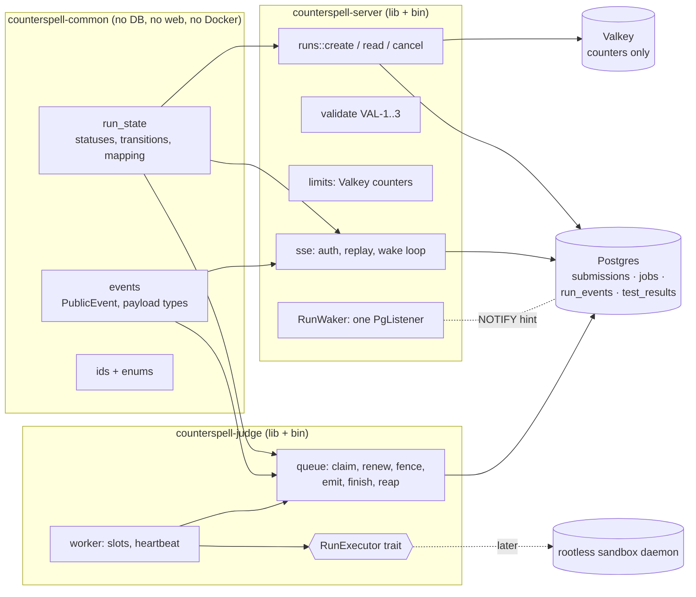
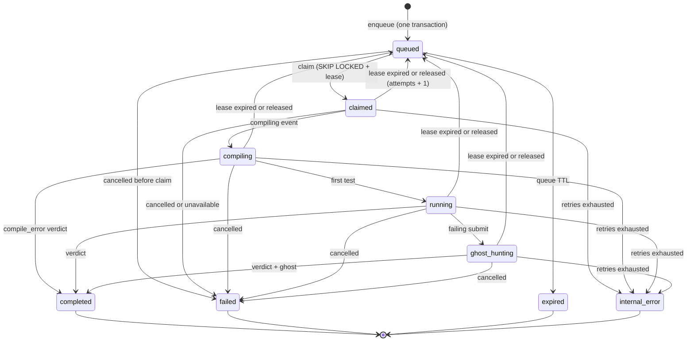

# Design: run-lifecycle

## Design approach

This is a Design-First, high-level feature design. The architecture is fixed by `docs/system-design.md` §2, §4, §5, §7.1 and §9. This document decides the state machine, the database contract, the order of operations on each path, the failure behaviour, and how every guarantee is tested. It adds **no** crate and no service. Sketches of SQL and Rust show intent and shape. They are not final code.

No task in `tasks.md` is run by this spec-generation step.

## The idea in plain English

A run is a row in Postgres that moves along a fixed track.

1. **Save.** The server checks the request, then saves the run and its queue ticket in one transaction. If either insert fails, neither exists.
2. **Claim.** A judge worker takes the oldest ticket with `FOR UPDATE SKIP LOCKED`. The ticket now carries that worker's name and a deadline (the **lease**). The worker keeps pushing the deadline forward while it works.
3. **Work.** Every step the worker reports is saved as a numbered row in `run_events` **first**. Only then does a `NOTIFY` tell listeners to look. The numbers (`seq`) never repeat and never skip.
4. **Recover.** If the worker dies, nobody pushes the deadline. A reaper notices, puts the ticket back (counting an attempt), and another worker starts again with a `restarted` event. After three attempts the run ends as an internal error. A run is never left "running".
5. **Finish once.** The worker writes the final answer in one transaction that first proves "I still hold this lease". A worker that lost its lease cannot write. Three separate barriers make a second final answer impossible.
6. **Watch.** The browser opens an SSE stream. The server proves you own the run, replays every saved event after your last number, then waits for a nudge (or 250 ms) and looks again. If the connection drops, you reconnect with your last number and lose nothing. After a reload, `GET /api/runs/{id}` returns the stored final result.

The server and the judge never talk to each other. They talk only through Postgres rows, which is why a restart of either one loses nothing.

## Scope and seams

### Built here

- The shared state machine, ids, verdicts and public event types (`counterspell-common`).
- The migration for `submissions`, `jobs`, `run_events`, `test_results`, their constraints, triggers and the two database roles.
- Judge: queue (claim, lease, fence, emit, finish, reap), worker loop, the `RunExecutor` trait and a scripted fake executor.
- Server: `POST /api/runs`, `GET /api/runs/{id}`, `POST /api/runs/{id}/cancel`, `GET /api/runs/{id}/events`, validation (VAL-1 to VAL-3), rate limits and caps (VAL-4), the `RunWaker`.
- Web: a pure event reducer and a stream client (logic only, no screens).
- Tests, CI services, and the measured definition-of-done report.

### Seams to other specs

| Seam | Defined here as | Provided by | Until then |
|---|---|---|---|
| Who is the user? | `UserResolver` trait → `UserId` | `auth` spec (cookie sessions) | Production wires `Unauthenticated` (always `401`). Tests use a bearer-token test resolver in the `testkit` feature. |
| Does the problem exist and is it published? | `ProblemLookup` trait | catalogue / grimoire import spec | Production wires an empty lookup (`404 unknown_problem`). Tests use an in-memory lookup. |
| Which languages and byte limits? | `LanguageCatalog` struct | `languages/languages.toml` loader (judge-sandbox / language-drivers) | Constants: `python`, `javascript`, 65 536 bytes. |
| Run the code | `RunExecutor` trait | judge-sandbox spec | Scripted fake executor (`testkit`). |
| Ghost, bench, familiar payloads | `PublicEvent` variants holding `BoundedJson` | ghost-engine, efficiency-familiar | Not emitted. |

**Consequence to know:** until the `auth` and catalogue specs land, the production binary rejects every run request. The behaviour is proven by tests, not by clicking. Open question 1 asks whether to avoid this.

> The `judge-sandbox` spec files do not exist yet (its generation run was throttled). The `RunExecutor` seam below is therefore defined here and must be reconciled with that spec when it is written.

## Where the code lives



### Crate and module layout

| Package | Kind after this spec | New modules |
|---|---|---|
| `counterspell-common` | lib | `ids.rs`, `status.rs` (enums), `run_state.rs` (transitions, status↔job mapping), `events.rs` (public event types, `BoundedJson`), `limits.rs` (shared constants such as the 16 KiB payload cap) |
| `counterspell-server` | **lib + bin** (`lib.rs` builds the router; `main.rs` stays thin) | `config.rs`, `error.rs` (JSON error envelope), `runs/{create,enqueue,read,cancel,sse,streams,wake}.rs`, `validate.rs`, `ratelimit.rs`, `seams.rs`, `testkit.rs` (feature `testkit`) |
| `counterspell-judge` | **lib + bin** | `config.rs`, `queue/{claim,lease,fence,emit,finish,reap}.rs`, `worker.rs`, `executor.rs`, `testkit.rs` (feature `testkit`) |

Why a library target on both binaries: integration tests under `crates/*/tests/` can only import a library. The binaries stay thin.

### Dependency rules

- `counterspell-common` gains `serde`, `serde_json`, `uuid`; dev: `proptest`. It still has **no** `sqlx`, `axum`, `tokio` or Docker dependency.
- `counterspell-server` gains `sqlx` (Postgres, no TLS features), `redis`, `tokio` extras, `tracing`, `uuid`, `sha2`, `tree-sitter` plus the Python and JavaScript grammars, `tower-http` limit/header layers, and a small async-stream helper. It **never** depends on `bollard`.
- `counterspell-judge` gains `sqlx`, `tokio` (`signal`, `sync`, `time`), `tracing`, `uuid`, `serde_json`. The `bollard` dependency is added later by judge-sandbox, behind a judge feature `sandbox` (on by default for the binary).
- The server's **dev**-dependencies include `counterspell-judge` with `default-features = false, features = ["testkit"]`, so the end-to-end tests run the real queue code without compiling Docker support. The server's **production** dependency tree has no judge and no `bollard`.
- Feature `testkit` is off by default in both crates. A CI step proves the release build does not enable it (task T37).
- Every new dependency must pass `cargo deny check licenses`. If it fails, the implementer stops and asks Brighton before editing `deny.toml`.

## The run state machine

### States

| Status | Kind | Meaning |
|---|---|---|
| `queued` | waiting | Saved, ticket waiting for a worker (or waiting out a retry backoff). |
| `claimed` | active | A worker holds the lease and is loading code and tests. |
| `compiling` | active | Preparing the program (a no-op step for Python and JavaScript, but still reported). |
| `running` | active | Running tests (and bench mode, which is part of `running`). |
| `ghost_hunting` | active | Searching and shrinking a failing input. |
| `completed` | **terminal** | The trusted judge produced a verdict. Carries `verdict`. |
| `failed` | **terminal** | Ended without a verdict for a deterministic reason: `cancelled`, `problem_unavailable`, `language_unavailable`. |
| `expired` | **terminal** | Waited in the queue past the TTL and was never executed. |
| `internal_error` | **terminal** | Infrastructure failed and retries ran out (`retries_exhausted`). Never a verdict on the code. |

`verdict` (only with `completed`): `accepted`, `wrong_answer`, `runtime_error`, `time_limit`, `memory_limit`, `output_limit`, `compile_error`.
Per-test verdict: `pass`, `wrong_answer`, `runtime_error`, `time_limit`, `memory_limit`, `output_limit`.

### Diagram



### Transition table (the single definition)

| From | Allowed to | Triggered by |
|---|---|---|
| `queued` | `claimed`, `expired`, `failed` | claim; reaper TTL; cancel finish |
| `claimed` | `compiling`, `queued`, `failed`, `internal_error` | `compiling` event; lease loss or release; cancel or unavailable; exhaustion |
| `compiling` | `running`, `completed`, `queued`, `failed`, `internal_error` | first `test` event; compile-error verdict; as above |
| `running` | `ghost_hunting`, `completed`, `queued`, `failed`, `internal_error` | `ghost_hunting` event; verdict; as above |
| `ghost_hunting` | `completed`, `queued`, `failed`, `internal_error` | verdict; as above |
| `completed`, `failed`, `expired`, `internal_error` | nothing | terminal |

A write that keeps the same status is not a transition and is allowed. The table lives in `counterspell_common::run_state::can_transition(from, to)` and is mirrored by the SQL function `cs_status_transition_allowed(from, to)`. A test compares all 81 pairs, so the two cannot drift (T09).

### Event → status

| Event appended | Status after |
|---|---|
| (claim) | `claimed` |
| `compiling` | `compiling` |
| first `test` | `running` |
| `ghost_hunting` | `ghost_hunting` |
| `restarted`, `shrink_step`, `ghost`, `bench_point`, `complexity`, `familiar` | unchanged |
| `done` | `completed` |
| `error` | `failed`, `expired` or `internal_error`, by `failure_reason` |

### `jobs.state` ↔ `submissions.status`

| `submissions.status` | `jobs.state` | Terminal event | Notes |
|---|---|---|---|
| `queued` | `queued` | none | |
| `claimed`, `compiling`, `running`, `ghost_hunting` | `claimed` | none | |
| `completed` | `succeeded` | `done` | |
| `failed` | `failed` | `error` (code = reason) | `jobs.last_error` holds the reason code |
| `expired` | `failed` | `error` (code `expired`) | the job was never run |
| `internal_error` | `dead` | `error` (code `retries_exhausted`) | `jobs.last_error` holds the last sanitised cause (never public) |

A `CHECK` ties the submission columns together:

```sql
CHECK (
  ((status IN ('completed','failed','expired','internal_error')) = (finished_at IS NOT NULL))
  AND ((status = 'completed') = (verdict IS NOT NULL))
  AND ((status IN ('failed','expired','internal_error')) = (failure_reason IS NOT NULL))
)
```

### Deviation from the system design table (§4), on purpose

§4 lists verdicts (`accepted`, `wrong_answer`, …) as values of `submissions.status`. This design stores **lifecycle** in `status` and the **verdict** in a separate `verdict` column. Reasons: the requested state machine has `completed (with verdict)`; a verdict is not a phase; and a single `CHECK` can then guarantee "verdict iff completed". Open question 2 records this.

## Data contract (one migration, plus the role migration)

Names follow `docs/system-design.md` §4. Migration file names use the SQLx timestamp style and must sort after `20261112020000_bootstrap.sql`. Columns owned by other specs (`measured_complexity`, `fit`, `familiar_mood`, …) are added by those specs with `ALTER TABLE`.

### `submissions`

| Column | Type | Notes |
|---|---|---|
| `id` | `uuid` pk | Generated by the server (UUID v4). Unguessable. |
| `user_id` | `uuid not null` | Foreign key to `users` is added by the auth spec. |
| `problem_slug` | `text not null` | Foreign key added by the catalogue spec. |
| `lang` | `text not null` | `CHECK` in the four known languages. |
| `mode` | `text not null` | `CHECK` in (`run`, `submit`). |
| `code` | `text not null` | `CHECK (octet_length(code) <= 262144)` as a hard backstop; the real limit is per language in the server. |
| `code_sha256` | `bytea not null` | |
| `idempotency_key` | `text null` | |
| `status` | `text not null default 'queued'` | `CHECK` in the nine states. |
| `verdict`, `failure_reason` | `text null` | `CHECK` value lists; the three-way `CHECK` above. |
| `passed`, `total`, `score`, `runtime_ms`, `memory_kb` | `int null` | Set only by the terminal write. |
| `last_event_seq` | `int not null default 0` | The per-run counter. **Added by this design** (see Events). |
| `created_at` | `timestamptz not null default now()` | |
| `started_at` | `timestamptz null` | First claim. **Added** for latency reporting. |
| `finished_at` | `timestamptz null` | Set only by a terminal write or the reaper. |

Indexes: `(user_id, created_at desc)` and `(user_id, problem_slug, created_at desc)` from §4; a unique partial index `(user_id, idempotency_key) WHERE idempotency_key IS NOT NULL`; a partial index `(user_id) WHERE finished_at IS NULL` for the active-run count.

### `jobs`

| Column | Type | Notes |
|---|---|---|
| `id` | `bigserial` pk | |
| `submission_id` | `uuid not null unique` | `REFERENCES submissions(id) ON DELETE CASCADE`. One job per run. |
| `state` | `text not null default 'queued'` | `CHECK` in (`queued`, `claimed`, `succeeded`, `failed`, `dead`). |
| `attempts`, `max_attempts` | `smallint` | Defaults 0 and 3. `CHECK (attempts >= 0 AND attempts <= max_attempts)`. |
| `lease_owner` | `text null` | The `worker_id`. |
| `lease_expires_at` | `timestamptz null` | Database clock. |
| `claimed_at` | `timestamptz null` | Set at each claim. **Added** for the maximum claim age. |
| `run_after` | `timestamptz not null default now()` | Retry backoff. |
| `cancel_requested_at` | `timestamptz null` | **Added**. Set by the server; read by the judge. |
| `last_error` | `text null` | Internal only, sanitised, at most 500 characters. |
| `created_at`, `updated_at` | `timestamptz` | |

Checks: `state <> 'claimed' OR (lease_owner IS NOT NULL AND lease_expires_at IS NOT NULL)`; `state <> 'queued' OR lease_owner IS NULL`.
Indexes: `(run_after, id) WHERE state = 'queued'` (claim); `(lease_expires_at) WHERE state = 'claimed'` (reaper); both as in §4.

### `run_events`

```sql
CREATE TABLE run_events (
  submission_id uuid NOT NULL REFERENCES submissions(id) ON DELETE CASCADE,
  seq        int      NOT NULL CHECK (seq >= 1),
  attempt    smallint NOT NULL CHECK (attempt >= 1),
  type       text     NOT NULL CHECK (type IN ('compiling','test','ghost_hunting','shrink_step',
                       'ghost','bench_point','complexity','familiar','restarted','done','error')),
  payload    jsonb    NOT NULL CHECK (jsonb_typeof(payload) = 'object' AND pg_column_size(payload) <= 16384),
  created_at timestamptz NOT NULL DEFAULT clock_timestamp(),
  PRIMARY KEY (submission_id, seq)
);
-- Barrier 3 of the exactly-once terminal write:
CREATE UNIQUE INDEX run_events_one_terminal ON run_events (submission_id) WHERE type IN ('done','error');
```

### `test_results`

```sql
CREATE TABLE test_results (
  submission_id uuid NOT NULL REFERENCES submissions(id) ON DELETE CASCADE,
  ordinal   int NOT NULL CHECK (ordinal >= 1),
  is_sample boolean NOT NULL,
  verdict   text NOT NULL CHECK (verdict IN ('pass','wrong_answer','runtime_error','time_limit','memory_limit','output_limit')),
  time_ms   int NOT NULL, memory_kb int,
  public_detail jsonb,            -- {input, expected, got}; samples only
  stdout_snip text, stderr_snip text,
  PRIMARY KEY (submission_id, ordinal),
  CHECK (is_sample OR (public_detail IS NULL AND stdout_snip IS NULL AND stderr_snip IS NULL))
);
```

`public_detail` and `is_sample` are **added** so `GET /api/runs/{id}` can show sample details after a reload without reading the (future) test tables. Hidden tests keep verdict and time only.

### Triggers (barrier 2, and the transition guard)

One `BEFORE UPDATE` trigger on `submissions`:

1. If `OLD.finished_at IS NOT NULL` and any of `status, verdict, failure_reason, passed, total, score, runtime_ms, memory_kb, started_at, finished_at, user_id, code_sha256, last_event_seq` changes, raise an error. **A terminal run is frozen.**
2. If `NEW.status <> OLD.status` and `cs_status_transition_allowed(OLD.status, NEW.status)` is false, raise an error.
3. If `NEW.last_event_seq < OLD.last_event_seq`, raise an error.

### Database roles and privilege matrix (R19)

Two `NOLOGIN` roles are created idempotently (`DO` block that ignores `duplicate_object`, because roles are cluster-wide and tests run in parallel). Deployment creates login users and grants membership. Passwords are never in migrations.

| Object | `counterspell_server` | `counterspell_judge` |
|---|---|---|
| `submissions` | `SELECT`, `INSERT` | `SELECT`, `UPDATE (status, verdict, failure_reason, passed, total, score, runtime_ms, memory_kb, last_event_seq, started_at, finished_at)` |
| `jobs` | `SELECT`, `INSERT`, `UPDATE (cancel_requested_at, updated_at)` | `SELECT`, `UPDATE (state, attempts, lease_owner, lease_expires_at, claimed_at, run_after, last_error, updated_at)` |
| `run_events` | `SELECT` | `SELECT`, `INSERT` |
| `test_results` | `SELECT` | `SELECT`, `INSERT` |
| `jobs_id_seq` | `USAGE` | none |
| `DELETE`, `TRUNCATE`, `ALTER` | none | none |

`NOTIFY` needs no privilege. The server therefore **cannot** forge an event, a result or a verdict, even if it is compromised. The judge cannot rewrite who owns a run or what code it contained.

## Paths in detail

### Path 1: `POST /api/runs` (enqueue)

Order of checks. Cheap and stateless first; anything that costs quota or touches the database later:

```text
1  body size limit (128 KiB), Content-Type must be application/json, parse with deny_unknown_fields   → 413 / 415 / 400
2  UserResolver                                                                                     → 401
3  Idempotency-Key syntax                                                                           → 400 invalid_idempotency_key
4  lang enabled, mode valid                                                                         → 400
5  VAL-1 size in bytes · VAL-3 UTF-8 and control characters · VAL-2 tree-sitter parse               → 413 / 400 (nothing queued, no quota used)
6  ProblemLookup.published(slug)                                                                    → 404 unknown_problem
7  replay pre-check (no lock): same user + key                                                      → 202 replay, or 422 idempotency_key_reuse
8  Valkey windows: user, then IP                                                                    → 429 rate_limited (+ Retry-After)
9  BEGIN
     SELECT pg_advisory_xact_lock(hashtextextended('runs:' || user_id, 0));   -- serialises this user's enqueues
     authoritative replay check (same query as step 7, now race-free)
     active count for user (jobs join submissions, state IN ('queued','claimed'), finished_at IS NULL) >= cap  → ROLLBACK, 429 queue_cap
     global queued count >= depth max                                                                  → ROLLBACK, 429 queue_full
     INSERT INTO submissions …; INSERT INTO jobs …;
     SELECT pg_notify('run_jobs', '');
   COMMIT
10 202 { run_id, status: "queued" }   Location: /api/runs/{id}
```

Notes:

- The advisory lock makes "count, then insert" safe against concurrent requests from the same user. It is released at commit or rollback. Other users are not blocked.
- A unique index on `(user_id, idempotency_key)` remains as the last backstop. A violation maps to a replay response, not a `500`.
- Replay means same `(problem_slug, lang, mode, code_sha256)`. Anything else with the same key is `422`.
- Steps 8 and 9 can over-count quota by one for two simultaneous identical requests. That is accepted; it errs on the strict side.
- CSRF baseline: state-changing endpoints require `Content-Type: application/json`, and the server sends no permissive CORS headers, so a cross-site form cannot reach them. The `auth` spec adds its own token check on top.

### Path 2: claim (judge)

One transaction. All time comes from the database clock.

```sql
WITH next AS (
  SELECT id FROM jobs
   WHERE state = 'queued' AND run_after <= now()
   ORDER BY cancel_requested_at NULLS LAST, run_after, id
   FOR UPDATE SKIP LOCKED
   LIMIT 1
)
UPDATE jobs j
   SET state = 'claimed', lease_owner = $1,
       lease_expires_at = now() + make_interval(secs => $2),
       claimed_at = now(), updated_at = now()
  FROM next WHERE j.id = next.id
RETURNING j.id, j.submission_id, j.attempts, j.max_attempts, j.cancel_requested_at, j.lease_expires_at;
```

Then, in the same transaction:

```sql
UPDATE submissions SET status = 'claimed', started_at = COALESCE(started_at, now())
 WHERE id = $run AND status = 'queued'
RETURNING user_id, problem_slug, lang, mode, code;
-- if attempts > 0:  append_event(restarted {attempt: attempts + 1})   (same transaction)
```

- `ORDER BY cancel_requested_at NULLS LAST` finishes cancelled queued jobs first. The queue is capped at 200 rows, so the sort is trivial.
- `SKIP LOCKED` means two workers never wait on each other and never pick the same row.
- The returned `ClaimedRun` holds the **fence**: `ClaimToken { job_id, run_id, lease_owner, attempts }`.
- Lock order everywhere is `jobs` row first, then `submissions` row, then inserts. One order means no deadlocks.

### Path 3: lease renewal and the heartbeat

```sql
UPDATE jobs SET lease_expires_at = now() + make_interval(secs => $lease), updated_at = now()
 WHERE id = $job AND state = 'claimed' AND lease_owner = $me AND attempts = $a
RETURNING cancel_requested_at IS NOT NULL AS cancel_requested;
```

- No row → `LeaseLost`. The heartbeat sets the stop signal and the worker writes nothing more for that claim.
- A renewal after the lease time has passed but before the reaper acts still succeeds. Ownership, not the clock, is the rule; the reaper takes ownership away atomically.
- The heartbeat also records the local monotonic time of the last successful renewal. If the database is unreachable for a full lease period, the worker treats the lease as lost on its own and stops the executor (R8.3). This uses a monotonic timer only to bound the worker's own behaviour, never to decide ownership.
- Each heartbeat also wakes on `NOTIFY run_cancel`, so a cancel reaches a running worker faster than one renewal interval.
- **Maximum claim age.** A heartbeat alive does not prove progress. The worker stops renewing, and the reaper treats the lease as expired, once `now() - claimed_at` passes `MAX_CLAIM_AGE` (default 120 s **[E]**; the sandbox's own hard cap is 20 s). This guarantees that a live-but-stuck executor cannot hold a run in `running` forever.

### Path 4: emit an event (fenced)

```sql
-- inside one transaction
SELECT 1 FROM jobs
 WHERE id = $job AND state = 'claimed' AND lease_owner = $me AND attempts = $a
 FOR UPDATE;                                   -- no row => LeaseLost, nothing is written

UPDATE submissions
   SET last_event_seq = last_event_seq + 1,
       status = $new_status                    -- from the event→status table; trigger validates it
 WHERE id = $run AND finished_at IS NULL
RETURNING last_event_seq;                      -- this is seq

INSERT INTO run_events (submission_id, seq, attempt, type, payload) VALUES ($run, $seq, $a + 1, $type, $payload);
SELECT pg_notify('run_events', $run::text);    -- delivered at commit; payload is only the run id
```

Why a counter on the submission row and not `max(seq) + 1` or a database sequence:

- `UPDATE … last_event_seq + 1` takes a row lock held until commit. Two writers for the same run cannot interleave, so **`seq` order equals commit order**. A reader can never see `seq = 5` while `seq = 4` is still uncommitted and then skip it by remembering "5".
- A database `SEQUENCE` would hand out numbers outside the transaction. A rolled-back transaction would leave gaps, and out-of-order commits would break the replay cursor.
- The reaper uses the same helper with a different guard: it holds the lock on the expired job row instead of presenting a lease.

### Path 5: terminal write (fenced, exactly once)

`finish(token, FinalResult)` is one transaction:

```text
BEGIN
  fence: SELECT 1 FROM jobs WHERE id/state='claimed'/lease_owner/attempts FOR UPDATE   → none => ROLLBACK, LeaseLost
  UPDATE submissions SET last_event_seq = last_event_seq + 1, status = 'completed', verdict = …,
         passed = …, total = …, score = …, runtime_ms = …, memory_kb = …, finished_at = now()
   WHERE id = $run AND finished_at IS NULL RETURNING last_event_seq                      → 0 rows => ROLLBACK
  INSERT INTO test_results … (all rows, one statement)
  INSERT INTO run_events (… seq, 'done', payload built from the SAME FinalResult)
  UPDATE jobs SET state = 'succeeded', updated_at = now() WHERE id = $job AND <fence>    → exactly 1 row
  SELECT pg_notify('run_events', $run::text)
COMMIT
```

`finish_failed(token, reason)` is the same shape: `failed`, an `error` event, job `failed`, no test rows.

The three independent barriers against a second terminal result:

1. **Fence.** The transaction is rejected unless the caller still owns the claim.
2. **Frozen row.** The trigger rejects any change to a terminal submission; `finished_at IS NULL` is also in the `WHERE`.
3. **One terminal event.** The unique partial index rejects a second `done`/`error` row.

The `done` event payload and the stored final columns come from one Rust value in one transaction, so a reload shows what the stream showed (R16.4).

### Path 6: the reaper

Every judge process runs it at start-up and every `REAPER_INTERVAL` (5 s). Several can run at once.

```sql
SELECT id, submission_id, attempts, max_attempts, cancel_requested_at
  FROM jobs
 WHERE state = 'claimed'
   AND (lease_expires_at < now() OR claimed_at < now() - make_interval(secs => $max_claim_age))
 ORDER BY lease_expires_at
 FOR UPDATE SKIP LOCKED
 LIMIT 20;
```

Per job, in its own transaction, while holding the row lock:

| Condition | Result |
|---|---|
| `cancel_requested_at IS NOT NULL` | job `failed`, submission `failed`/`cancelled`, `error` event. Not retried. |
| `attempts + 1 >= max_attempts` | `attempts = attempts + 1`, job `dead`, submission `internal_error`/`retries_exhausted`, `finished_at`, one `error` event. |
| otherwise | job `queued`, `attempts = attempts + 1`, `run_after = now() + backoff`, lease cleared; submission `queued`. |

Backoff **[E]**: `2 s × 2^(attempts_after − 1)`, capped at 30 s. The next claim appends `restarted {attempt: attempts + 1}` as its first event.

A second query expires waiting jobs: `state = 'queued' AND created_at < now() - QUEUE_TTL` (600 s **[E]**) → job `failed` (`last_error = 'expired'`), submission `expired`, one `error` event with code `expired`. These runs are never executed.

`attempts` never exceeds `max_attempts`, because the exhaustion branch is taken exactly when the next value would reach it.

### Path 7: the worker and the executor seam

```rust
// counterspell-judge: executor.rs (sketch)
pub struct ClaimedRun {
    pub run_id: RunId, pub problem_slug: String, pub lang: String,
    pub mode: RunMode, pub code: String, pub attempt: u16,   // attempt is 1-based
}

pub enum RunOutcome { Completed(FinalResult), Failed(FailureReason) }   // Failed = cancelled | problem_unavailable | language_unavailable

pub enum ExecError {
    Infrastructure(String),   // retryable: sandbox daemon down, image missing, event write failed
    Stopped,                  // the stop signal fired (cancel, lease lost, shutdown, hard deadline)
}

pub trait RunExecutor: Send + Sync + 'static {
    fn execute(&self, run: ClaimedRun, ctx: RunContext)
        -> impl std::future::Future<Output = Result<RunOutcome, ExecError>> + Send;
}
```

`RunContext` is what the executor may do:

- `emit(PublicEvent)` — a fenced append. A lost lease comes back as `ExecError::Stopped`.
- `stop_requested()` / `stopped().await` — true when cancel, lease loss, shutdown or the hard deadline fired. The executor must kill its sandbox from outside when this fires (the sandbox rules are unchanged).
- It has **no** way to write a verdict, a status or a job state. Only the worker's `finish` functions do, after the executor returns.
- Contract: an executor that returns `Completed` must have emitted `compiling` first (even for Python and JavaScript, where there is nothing to compile), because `claimed → completed` is not an allowed transition. A violation makes the terminal write fail on the transition guard; the worker treats that as an infrastructure error, so a buggy executor can never record a result by skipping phases.

`Worker<E: RunExecutor>` uses a generic parameter, not `dyn`, which keeps the code simple and avoids boxing futures.

```text
loop until shutdown:
    wait for a free slot (Semaphore of JUDGE_CONCURRENCY permits)
    claim_next()
      none  → release the slot; wait for NOTIFY run_jobs or CLAIM_POLL (1 s)
      error → release the slot; short sleep; log
      some  → spawn run_one(claimed, permit)

run_one(claimed):
    if claimed.cancel_requested → finish_failed(Cancelled); return        // executor never called
    spawn heartbeat(token) → watch channel carrying the stop signal
    spawn the executor in its OWN Tokio task                               // a panic becomes a JoinError
    with a hard deadline (MAX_CLAIM_AGE minus margin)
    match result:
      Ok(Ok(Completed(r)))                    → finish(token, r)
      Ok(Ok(Failed(reason)))                  → finish_failed(token, reason)
      Ok(Err(Infrastructure(m))) | panic | deadline → release_for_retry(token, m)
      Ok(Err(Stopped)) + cancel requested     → finish_failed(token, Cancelled)
      Ok(Err(Stopped)) + shutdown             → release_for_retry(token, "shutdown")
      Ok(Err(Stopped)) + lease lost           → write nothing
    stop the heartbeat; free the slot
```

- `release_for_retry` uses the same transaction as the reaper's requeue/exhaust branch, but with the fence as its guard.
- **Graceful shutdown.** On SIGTERM the worker stops claiming, waits `SHUTDOWN_GRACE` (20 s **[E]**), signals executors to stop, and releases what is left. A deploy therefore uses up an attempt (open question 11).
- **Cancel versus completion.** If an executor has already produced a full verdict, the terminal write keeps it, even when a cancel is pending. The cancel flag only matters before that point. Exactly one terminal result is written either way.
- A deterministic executor produces the same `FinalResult` on every attempt, and `test_results` is written only in the terminal transaction, so a retry cannot leave duplicates or mixed results (R10.4, R10.6).

### Path 8: cancel

`POST /api/runs/{id}/cancel` (new endpoint; open question 4):

```sql
UPDATE jobs j SET cancel_requested_at = COALESCE(j.cancel_requested_at, now()), updated_at = now()
  FROM submissions s
 WHERE j.submission_id = s.id AND s.id = $run AND s.user_id = $user
   AND j.state IN ('queued','claimed')
RETURNING j.state;
```

- A row → `NOTIFY run_cancel` and `NOTIFY run_jobs`, then `202 {status}`.
- No row → a second owner-checked read decides: terminal → `200` with the terminal status and no change; not found or not owner → the common `404`.
- The server never changes `status`. The judge does, which keeps the server unable to write results.

### Path 9: SSE stream

```text
GET /api/runs/{id}/events        Last-Event-ID: n   (or ?last_event_id=n)

1  UserResolver                                    → 401
2  parse cursor                                    → 400 invalid_last_event_id
3  SELECT last_event_seq, finished_at FROM submissions WHERE id = $run AND user_id = $user
      no row                                       → 404 not_found   (identical for missing and foreign)
      finished and cursor >= last_event_seq        → 204 No Content  (browser stops reconnecting)
4  take a stream slot for this user                → 429 too_many_streams
5  subscribe to RunWaker                           (BEFORE the first event query)
6  loop:
      rows = SELECT e.seq, e.attempt, e.type, e.payload
               FROM run_events e JOIN submissions s ON s.id = e.submission_id
              WHERE e.submission_id = $run AND s.user_id = $user AND e.seq > $cursor
              ORDER BY e.seq LIMIT 200
      send each row as  id: seq / event: type / data: {"seq","attempt","payload"};  cursor = seq
      if a sent event was done or error → end the stream
      if rows was full → loop again immediately
      otherwise wait for: a wake-up for this run id | POLL (250 ms) | heartbeat timer (15 s comment) | max age
```

Design points:

- **Subscribe before you read.** A wake-up that arrives between "last query" and "start waiting" would otherwise be lost. Since every wake-up simply triggers a query from the cursor, no event can be skipped.
- **Wake-ups carry only a run id.** Event data can never travel through `NOTIFY`. If every notification is dropped, the 250 ms poll still delivers within the 1 s target.
- **No connection is held while waiting.** Each query borrows a pooled connection and returns it.
- **Every query contains the owner predicate**, so even a future bug in the handler cannot return another user's rows.
- The headers are `Content-Type: text/event-stream`, `Cache-Control: no-store`, `X-Accel-Buffering: no`, `X-Content-Type-Options: nosniff`. The terminal event closes the stream, so the browser's automatic reconnect only happens after real network loss.
- The server keeps no authoritative run state in memory. A server restart drops streams; clients reconnect and replay.
- The per-user stream limit and the `RunWaker` are per process. This is fine for the single-VPS deployment (open question 13).

`RunWaker` is one `PgListener` task for the whole server, listening on `run_events`. It forwards `RunId`s into a `tokio::sync::broadcast` channel. On reconnect after a lost listener connection it sends a "wake everyone" marker. A lagging receiver simply queries again. Streams filter by their own run id.

### Path 10: `GET /api/runs/{id}`

Owner-checked read of the submission and its `test_results`. Terminal runs are built only from final columns and are identical every time. Non-terminal runs show the current `status`. Absent sections (ghost, complexity, familiar) stay absent until their specs add them.

```json
{
  "run_id": "…", "problem": "two-sum", "lang": "python", "mode": "submit",
  "status": "completed", "terminal": true, "verdict": "wrong_answer", "failure_reason": null,
  "attempt": 1, "passed": 11, "total": 12, "score": 92, "runtime_ms": 41, "memory_kb": 9210,
  "created_at": "…", "started_at": "…", "finished_at": "…", "last_seq": 17,
  "tests": [ { "ordinal": 1, "sample": true, "verdict": "pass", "time_ms": 3,
               "detail": { "input": "…", "expected": "…", "got": "…" } },
             { "ordinal": 4, "sample": false, "verdict": "wrong_answer", "time_ms": 5 } ]
}
```

### Path 11: the browser client

`web/src/lib/runs/reducer.ts` is a pure function `apply(state, event) → state`:

```text
state = { lastSeq, attempt, status, tests: Map<ordinal, row>, terminal: null | {…}, gap: boolean }
apply:
  event.seq <= lastSeq                → state unchanged            (duplicate)
  event.seq >  lastSeq + 1            → state with gap = true      (caller reconnects with lastSeq)
  type == restarted                   → clear tests (and ghost, bench, familiar), attempt = payload.attempt, lastSeq = seq
  type == test                        → tests[ordinal] = row
  type == done | error                → terminal = payload
```

`web/src/lib/runs/stream.ts` wraps `EventSource`: it passes no cursor on the first connect, relies on the browser's `Last-Event-ID` for reconnects, closes on the terminal event or on a gap and reopens with `?last_event_id=`, and then calls `GET /api/runs/{id}` to show the authoritative result. All server text is stored as strings and rendered as text nodes only. The reducer has no UI dependency.

## Public payloads and hidden data (R15)

The goal is that a leak is **hard to write**, not merely tested for.

```rust
// counterspell-common: events.rs (sketch)
pub enum PublicTest {
    Hidden { ordinal: u32, verdict: TestVerdict, time_ms: u32 },
    Sample { ordinal: u32, verdict: TestVerdict, time_ms: u32, detail: SampleDetail },
}
pub struct SampleDetail { pub input: String, pub expected: String, pub got: String }

pub enum PublicEvent {
    Restarted { attempt: u16 },
    Compiling,
    Test(PublicTest),
    GhostHunting,
    ShrinkStep(BoundedJson), Ghost(BoundedJson), BenchPoint(BoundedJson),
    Complexity(BoundedJson), Familiar(BoundedJson),     // payload structs belong to their own specs
    Done(DonePayload),
    Error(ErrorPayload),                                // { code: FailureReason, message: &'static str }
}
```

- `Hidden` has no field that could hold an input or an expected value. There is no `emit(raw_json)` function. `BoundedJson` can only be built from a `Serialize` value and rejects non-objects and values over 16 KiB.
- `ErrorPayload.message` comes from a fixed table, never from an exception, a path, SQL or a worker id.
- The database `CHECK` on `test_results` repeats the rule for stored rows.
- Hidden tests carry no `stdout_snip` or `stderr_snip` at all, because the user's program receives the hidden input and could echo it to stderr.
- The ghost is generated by the engine, not a hidden test, so it may appear in `ghost` events (ghost-engine spec).

## API summary (additions and clarifications to §9)

| Method and path | Auth | Success | Errors |
|---|---|---|---|
| `POST /api/runs` | session | `202 {run_id, status}`, `Location`, `Idempotent-Replayed` on replay | `400 invalid_request`, `invalid_idempotency_key`, `invalid_source`, `source_does_not_parse`; `404 unknown_problem`; `413 source_too_large`; `415`; `422 idempotency_key_reuse`; `429 rate_limited`, `queue_cap`, `queue_full`; `401`; `503 unavailable` |
| `GET /api/runs/{id}` | session + owner | `200` run read model | `401`, `404 not_found` |
| `GET /api/runs/{id}/events` | session + owner | `200 text/event-stream`, or `204` when already caught up to a terminal run | `400 invalid_last_event_id`, `401`, `404`, `429 too_many_streams` |
| `POST /api/runs/{id}/cancel` | session + owner | `202 {status}` (flag set) or `200` (already terminal) | `401`, `404` |

All errors use `{"code": "...", "message": "..."}` per `api-conventions.md`. Rate-limit errors add `retry_after_seconds` and a `Retry-After` header. No error contains a stack trace, SQL, a file path, hidden data or a secret.

## Configuration

Non-secret settings come from environment variables with these defaults. Secrets (database and Valkey URLs) also come only from the environment.

| Variable | Default | Used by |
|---|---|---|
| `JUDGE_CONCURRENCY` | 2 | judge |
| `LEASE_SECS` / `RENEW_SECS` | 30 / 10 | judge |
| `MAX_CLAIM_AGE_SECS` | 120 | judge |
| `REAPER_INTERVAL_SECS` | 5 | judge |
| `CLAIM_POLL_MS` | 1000 | judge |
| `RETRY_BACKOFF_BASE_SECS` / cap | 2 / 30 | judge |
| `SHUTDOWN_GRACE_SECS` | 20 | judge |
| `QUEUE_TTL_SECS` | 600 | judge (reaper) |
| `RUN_RATE_USER` / `RUN_RATE_IP` per 600 s | 30 / 100 | server |
| `RUN_ACTIVE_CAP_PER_USER` | 3 | server |
| `RUN_QUEUE_DEPTH_MAX` | 200 | server |
| `MAX_SOURCE_BYTES` | 65 536 | server |
| `REQUEST_BODY_LIMIT_BYTES` | 131 072 | server |
| `SSE_POLL_MS` | 250 | server |
| `SSE_HEARTBEAT_SECS` | 15 | server |
| `SSE_MAX_AGE_SECS` | 900 | server |
| `SSE_MAX_STREAMS_PER_USER` | 5 | server |
| `TRUSTED_PROXIES` | `127.0.0.1/32,10.0.0.0/8,172.16.0.0/12` | server (per-IP key) |
| `DATABASE_URL`, `VALKEY_URL` | none (required) | server (`VALKEY_URL` not used by the judge) |

`max_attempts` (3) is a database default, not an environment variable.

## Failure matrix

| What fails | What happens | How it recovers |
|---|---|---|
| Server dies after commit, before the `202` reaches the client | The run exists and will be judged. | The client retries with the same `Idempotency-Key` and gets the same `run_id`. |
| Server dies mid-stream | The stream drops. | `EventSource` reconnects with `Last-Event-ID`; the new process replays from Postgres. |
| Postgres is down | `POST` returns `503`. Streams end. Workers cannot renew. | Workers stop their executors after one lease period. After recovery the reaper requeues those jobs. |
| Valkey is down | Window limits are skipped and logged. Postgres caps still apply. | Automatic. |
| Worker killed (SIGKILL) | Renewals stop. | Reaper requeues after the lease expires; next claim appends `restarted`. |
| Executor hangs while the heartbeat stays alive | Would hold the run forever. | Maximum claim age: the worker stops renewing and the reaper takes the job. |
| Executor panics | `JoinError` in the worker. | Treated as infrastructure error: release for retry. Other slots keep running. |
| Event insert fails (database error) | `emit` returns an error to the executor. | Infrastructure error; release for retry. |
| Old worker wakes after losing its lease | Its next write finds no matching fence. | Nothing is written. Its executor is told to stop. |
| `NOTIFY` lost or listener reconnecting | A wake-up is missed. | The 250 ms poll delivers the event. |
| Poison job that crashes every worker | Each crash burns an attempt. | After 3, the run ends as `internal_error`. |
| Sandbox daemon down | Executor reports infrastructure error. | Retries with backoff, then `internal_error`. Never a wrong answer. |
| No judge running at all | Jobs wait. | After the queue TTL they become `expired` when any judge next runs. |

## Correctness properties

Each property has a reference number for the tests, and maps to requirements. "PBT" means a `proptest` generator drives it.

| # | Property | Requirements | How it is tested |
|---|---|---|---|
| P1 | **Atomic enqueue.** For every submission there is exactly one job, and for every job exactly one submission. A fault injected between the two inserts leaves neither. | R2 | integration with fault injection; invariant check after every other test |
| P2 | **Idempotent enqueue.** For any number of requests (sequential or concurrent) with the same user and key and the same body, there is one submission and one job and one `run_id`. A different body is `422`. Different users never collide. | R3 | integration, concurrent barrier test; PBT over request multisets |
| P3 | **Exclusive claim.** For any number of concurrent claimers and any queue, a job has at most one live holder per attempt, and every queued job is eventually claimed. | R7 | integration (8 claimers, 50 jobs); model-based test (below) |
| P4 | **Fencing.** After a lease is lost, every write by the old holder (event, phase, auxiliary, terminal, renewal) changes nothing and reports `LeaseLost`, even when the same worker later reclaims the job under a new attempt. | R8, R10 | integration; PBT model |
| P5 | **Liveness.** Any run that has a holder whose renewals stop (or whose claim age exceeds the maximum) reaches `queued` or a terminal state within lease + reaper interval + ε. `attempts <= max_attempts` always. | R9 | integration with aged leases; PBT model |
| P6 | **Terminal exactly once.** Every run has at most one terminal write, exactly one terminal event, it has the highest `seq`, and nothing is appended after it. Terminal rows never change. | R6, R10, R11 | integration (two racing writers); SQL tests against the trigger and index; PBT model |
| P7 | **Consistency.** `jobs.state`, `submissions.status`, `verdict`, `failure_reason` and `finished_at` always satisfy the mapping table and the `CHECK`. | R6 | invariant checker run after every step of the PBT model and the integration tests |
| P8 | **Event order.** For each run, `seq` is exactly `1..n` with no gaps and no duplicates, and `seq` order equals commit order, even with concurrent writers (old and new holder, reaper). | R11 | PBT model; concurrent-append integration test |
| P9 | **Replay completeness.** For any disconnect point and any `Last-Event-ID = L`, the events delivered after reconnecting are exactly those with `seq > L`, in order. The client's de-duplicated view equals the stored log. This holds with notifications disabled. | R13, R14 | integration: drop at every position; poll-only mode |
| P10 | **Client reducer.** Applying any sequence made of the log with arbitrary duplicates and replays inserted gives the same state as applying the log once. A gap is detected. `restarted` clears only per-attempt state. | R14 | `vitest` with a seeded shuffle and duplicate generator |
| P11 | **Ownership.** A user other than the owner (or an anonymous client) never obtains any event, result or cancel effect for a run, whatever the id, cursor or header. Missing and foreign runs give identical responses. | R12, R16, R17 | integration matrix over every run endpoint |
| P12 | **Public only.** No canary placed in hidden inputs, expected outputs or hidden-test program output appears in any `run_events` row, `test_results` row, `GET` response or SSE byte. A hidden `test` payload has exactly the keys `ordinal`, `verdict`, `time_ms`, `sample`. | R15 | canary pipeline test; unit test on payload keys; SQL `CHECK` test |
| P13 | **Caps hold.** Active jobs per user never exceed the cap under concurrent requests. Valkey holds only counters. | R5 | concurrent integration test; key-scan test |
| P14 | **State machine.** Random sequences of operations never produce a transition outside the table, and the Rust and SQL tables agree on all 81 pairs. Terminal states have no exits. | R6 | PBT on the pure function; SQL agreement test |
| P15 | **Retry equivalence.** With a deterministic executor, the persisted final result after any number of abandoned attempts equals the result of an uninterrupted run, and `test_results` has no duplicates. | R10.6 | integration: kill after each event index; PBT model |
| P16 | **Cancellation.** A run cancelled while queued never invokes the executor. A cancelled active run ends `failed`/`cancelled` unless a complete verdict was already produced. A run never gets both `done` and `error`. Non-owners have no effect. | R17 | integration |
| P17 | **Expiry.** A job queued past the TTL becomes `expired` and is never executed. | R9.6 | integration with aged `created_at` |
| P18 | **Infrastructure is not a verdict.** Any executor infrastructure error, panic or deadline never produces `completed` with a failing verdict. | R18 | integration with scripted failures |

### Model-based test (the most valuable single test)

`pg_model_interleavings` uses `proptest` to generate sequences of operations over 2 to 3 workers and 1 to 4 runs: `enqueue`, `claim(w)`, `renew(w)`, `emit(w)`, `finish(w)`, `expire_lease(run)` (an SQL update that moves `lease_expires_at` into the past, so there is no sleeping), `reap`, `cancel`. After **every** operation it runs the invariant checker (P3 to P8, P14). Stale-holder operations are generated on purpose. Each case resets the tables, runs on a small Tokio runtime, and uses a modest case count (32) to stay fast. Failing cases are shrunk by `proptest` and the regression file is committed.

## Integration test plan

### Conventions

- Database tests use `#[sqlx::test(migrations = "../../migrations")]`, which gives each test its own database. They are named with a `pg_` prefix and marked `#[ignore = "needs DATABASE_URL"]`, so `cargo test --workspace` still passes on a laptop with no Postgres (as the repo-skeleton CI requires). CI runs them with `cargo test --workspace -- --ignored pg_ valkey_`.
- Valkey-backed tests use a `valkey_` prefix, the same ignore marker and `VALKEY_URL`.
- Tests that need a superuser (SQL setup, aging leases) use the admin pool. Tests that prove permissions use `SET ROLE counterspell_server` / `counterspell_judge`.
- Time-based behaviour is driven by SQL (`UPDATE jobs SET lease_expires_at = now() - interval '1 second'`), not by sleeping, except in the dedicated real-time crash test.
- The HTTP side runs on a real loopback TCP listener, so hyper, axum and SSE framing are included. The test SSE client is a small hand-written parser that records `id`, `event`, `data` and comment lines and the receive time of each.

### Scenarios

| # | Test (names are indicative) | Proves |
|---|---|---|
| 1 | `pg_enqueue_is_atomic` | P1: injected failure after the submission insert leaves no rows. |
| 2 | `pg_idempotency_sequential`, `pg_idempotency_concurrent`, `pg_idempotency_reuse_is_422` | P2. |
| 3 | `pg_claim_exclusive_under_contention` | P3: 8 claimers, 50 jobs, each job claimed exactly once, none lost. |
| 4 | `pg_duplicate_claim_attempts` | P3, P4: a second claim finds nothing; a renewal, emit or finish by the wrong owner, or the right owner with a stale `attempts`, writes nothing. |
| 5 | `pg_lease_renewal_extends_and_reports_cancel` | R8. |
| 6 | `pg_lost_lease_stops_writes` | P4: the old holder's executor is told to stop, and its late finish is rejected. |
| 7 | `pg_crash_recovery_real_time` | P5, P15: a worker task is aborted mid-run with a short real lease; the reaper requeues; a second worker finishes; the stream shows `restarted`; one terminal result. |
| 8 | `pg_retries_exhausted_becomes_internal_error` | P5, P6, P18. |
| 9 | `pg_max_claim_age_reclaims_stuck_run` | P5: heartbeat alive, executor stuck. |
| 10 | `pg_terminal_write_exactly_once` | P6: two writers race to finish; exactly one wins. |
| 11 | `pg_terminal_row_is_frozen`, `pg_second_terminal_event_rejected` | P6: direct SQL attempts hit the trigger and the unique index. |
| 12 | `pg_event_seq_gapless_under_concurrency` | P8. |
| 13 | `pg_status_transition_agreement` | P14: Rust table equals SQL table. |
| 14 | `pg_model_interleavings` | P3 to P8, P14 (above). |
| 15 | `pg_expiry_of_stale_queue` | P17. |
| 16 | `pg_executor_infrastructure_error_retries`, `pg_executor_panic_is_contained` | P18, R18.4. |
| 17 | `pg_cancel_queued`, `pg_cancel_running`, `pg_cancel_after_done`, `pg_cancel_foreign`, `pg_cancel_vs_complete_race` | P16. |
| 18 | `pg_role_privileges` | R19: each role can do what it must and cannot do anything else. |
| 19 | `sse_requires_session_and_ownership` | P11: anonymous, other user, missing id, malformed id. |
| 20 | `sse_replay_after_drop_at_every_position` | P9: for a run with *n* events, drop after *k* = 0..n, reconnect with `Last-Event-ID`, compare with the stored log. |
| 21 | `sse_poll_only_without_notify` | P9, R13.4, R13.8: the listener is disabled and events still arrive within 1 s. |
| 22 | `sse_last_event_id_forms` | Header, query parameter, invalid value (`400`), cursor beyond the end (`204` when terminal). |
| 23 | `sse_heartbeat_headers_and_close` | R13.6, R13.7: comment heartbeat, headers, close after the terminal event, max age. |
| 24 | `sse_stream_limit_per_user` | R12.6. |
| 25 | `get_run_after_reload_matches_stream` | R16.4: terminal `GET` equals the `done` payload; second `GET` is identical. |
| 26 | `pg_canary_not_in_any_public_surface` | P12: canary strings in hidden data and in a hostile executor's free text; scan tables, `GET`, and raw SSE bytes. |
| 27 | `pg_active_cap_under_concurrent_posts`, `valkey_window_limits`, `valkey_outage_fails_open`, `valkey_keys_hold_only_counters` | P13, R5. |
| 28 | `validation_rejects_without_side_effects` | R4: oversize, NUL, bad UTF-8, control characters, syntax error, wrong language, unknown field; no rows, no quota used. |
| 29 | `restart_server_mid_stream`, `restart_judge_fleet_mid_run` | R13.9, R9: a fresh server instance replays; a fresh judge fleet recovers claimed runs. |
| 30 | `dod_twenty_concurrent_runs` | R21 (below). |
| 31 | `reducer.test.ts`, `stream.test.ts` | P10, R14. |

## Definition of done: twenty concurrent runs and the latency report

`crates/server/tests/dod_twenty_runs.rs` (name `pg_dod_twenty_concurrent_runs`):

1. Migrate a fresh database. Start the real router on `127.0.0.1:0`. Start **three** judge workers with separate pools and `JUDGE_CONCURRENCY = 2`, running the scripted "lightweight" executor (compiling, three tests of about 40 ms each, `completed`). Hidden tests carry canary markers.
2. Create 20 user ids for the test resolver, plus 5 "other" users. Release a barrier so all 20 `POST /api/runs` requests fire at the same instant, each with its own `Idempotency-Key`.
3. Each client records `t_send`, then `t_202`, opens the SSE stream, and reads to the terminal event. Five of the twenty clients deliberately drop their connection after two events and resume with `Last-Event-ID`. Each client then calls `GET /api/runs/{id}`.
4. While that runs, the 5 other users and an anonymous client try the events, `GET` and `cancel` endpoints for every run id.
5. Assert:
   - **No lost jobs:** 20 submissions, 20 jobs, 20 runs `completed`, 20 jobs `succeeded`, no job `queued` or `claimed`.
   - **No duplicate terminal results:** each run has exactly one `done`, no `error`, `seq` exactly `1..n`, exactly three `test_results` rows.
   - **No unauthorized access:** every probe returned `401` or `404` with no run data; no cancel took effect.
   - **No leak:** no canary anywhere.
   - **Streams are correct:** each client's de-duplicated sequence equals the stored log; the five resumers received no gaps and no unfiltered duplicates beyond the replay.
   - Enqueue p95 ≤ 300 ms (R2.6). All runs terminal within 60 s.
6. Write the report.

### Measurements (reported separately)

| Metric | Definition | Clock |
|---|---|---|
| `enqueue_ms` | client sends `POST` until the `202` arrives | client monotonic |
| `first_event_ms` | `202` until the first SSE event is received | client monotonic |
| `completion_ms` | client sends `POST` until the terminal SSE event is received | client monotonic |
| `queue_wait_ms` | `started_at − created_at` | database |
| `execution_ms` | `finished_at − started_at` | database |
| `delivery_ms` | terminal event receipt time minus its `run_events.created_at` | wall clock vs database (same host) |

For each: count, mean, p50, p95, max. The test writes `target/run-lifecycle/dod-report.json` and prints a Markdown table. CI uploads the JSON as an artifact. The final task records one run's numbers in `docs/kiro-log/run-lifecycle-dod.md` from that file; numbers are never typed from memory.

## CI changes

- The `rust` job gains Postgres 17 and Valkey 8 service containers, and `DATABASE_URL` and `VALKEY_URL` for the tests. The existing step stays: `cargo test --workspace`. A new step: `cargo test --workspace -- --ignored pg_ valkey_`.
- A step builds the release server and judge and fails if `cargo tree -e features` shows the `testkit` feature in either.
- The `web` job gains `npm test` (vitest).
- A step uploads the DoD report as an artifact.

## Trade-offs in plain English

- **Why Postgres for the queue and not Valkey.** The run, its ticket, its events and its result must succeed or fail together. Only one database transaction can promise that. A second store would add the failure case "saved in one, missing in the other".
- **Why only the judge writes events.** One writer per run keeps `seq` simple and keeps a compromised web server unable to invent results. The cost is that a cancel of a queued run is finished by the judge, not the server, so cancelling does nothing while no judge runs. That matches reality: nothing progresses without a judge.
- **Why a counter column and not a sequence.** See Path 4. The counter costs one row lock per event and buys gap-free order that matches commit order.
- **Why a fence of three values.** An id alone cannot tell the old claim from the new one when the same worker reclaims a job. `attempts` makes every claim unique.
- **Why `204` for a caught-up terminal run.** The browser's `EventSource` reconnects forever after a closed stream unless told to stop. `204` is the standard way to say "do not come back".
- **Why a 250 ms poll as well as `NOTIFY`.** `NOTIFY` is fast but can be missed during a reconnect. The poll costs a primary-key lookup. Together they are fast when healthy and correct when not.
- **Why fail open for Valkey windows.** Valkey being down should not stop every learner. The Postgres cap still limits abuse to three jobs per user.
- **Why the extra maximum claim age.** Lease renewal proves a worker is alive, not that it is making progress.
- **Why seams instead of a fake `users` table.** Fake tables would have to be undone by the auth spec. A trait costs a few lines and disappears cleanly.

## Rust vocabulary used here (for Brighton)

- **`Result` and `?`.** Every database call can fail. `?` passes the error up instead of crashing. Errors get context at the edges (HTTP replies and log lines) and never contain secrets.
- **Newtypes (`RunId`, `UserId`).** A `RunId` is not a `UserId` even though both wrap a UUID, so the compiler stops you mixing them up.
- **Enums with data and exhaustive `match`.** `PublicEvent` and `RunStatus` are enums. If a new state is added, every `match` that forgets it fails to compile. That is how the state machine stays complete.
- **Transactions and drop.** In `sqlx`, a transaction that goes out of scope without `commit()` rolls back. An early `?` therefore undoes the work. This is why the enqueue and finish paths are safe against errors.
- **`async fn` in traits and generics.** `Worker<E: RunExecutor>` is checked at compile time. `dyn` would need boxed futures; generics avoid that.
- **`tokio::spawn` and `JoinError`.** A task that panics returns an error to whoever waits for it instead of killing the process. The worker uses this to contain an executor panic.
- **`Arc`.** Shared, reference-counted ownership, used for the pool and executor shared by several tasks.
- **`watch` and `broadcast` channels.** A `watch` carries "the latest value" (the stop signal). A `broadcast` sends one message to many receivers (the wake-ups). Neither carries events.
- **Drop guards.** A small struct whose `Drop` frees a stream slot, so a slot is released even if the connection ends abruptly.

## Verification

1. `cargo fmt --all -- --check` and `cargo clippy --workspace --all-targets --all-features -- -D warnings`.
2. `cargo test --workspace` passes with no Postgres (database tests are ignored).
3. With `DATABASE_URL` and `VALKEY_URL`: `cargo test --workspace -- --ignored pg_ valkey_` passes, including `pg_dod_twenty_concurrent_runs`.
4. `cd web && npm run check && npm test && npm run build`.
5. `cargo deny check licenses`.
6. `cargo tree -p counterspell-server -e normal` contains neither `bollard` nor `counterspell-judge`.
7. `docker compose config` shows the judge with no published ports, no main-daemon socket, and the restart policy from T19.

## Open questions

1. **No `users` or `problems` tables yet.** The auth and catalogue specs come later, but `submissions` refers to both. **Assumed:** `user_id` and `problem_slug` are plain columns without foreign keys now; those specs add the constraints. The code uses `UserResolver` and `ProblemLookup` traits, and the production binary rejects every run until they are wired. The alternative is minimal stand-in tables here, which those specs would then have to rewrite.
2. **`status` holds lifecycle, `verdict` is its own column.** This differs from the flattened list in `docs/system-design.md` §4. **Assumed:** the split. If you agree, §4 should be edited to match (this run may not edit files outside the spec).
3. **What `failed` means.** The request lists `failed` without defining it. **Assumed:** a deterministic end without a verdict: `cancelled`, `problem_unavailable`, `language_unavailable`. Cancellation maps to `failed`, not a new `cancelled` state.
4. **`POST /api/runs/{id}/cancel` is not in §9.** The brief asks for cancellation tests, so an endpoint is needed. **Assumed:** this path, owner-only, idempotent.
5. **VAL-2 (tree-sitter parse) is built here.** `POST /api/runs` is the only place it can be enforced and the security rules require it server-side. **Assumed:** tree-sitter plus the Python and JavaScript grammars are added to the server in T22. If it belongs to the language-drivers spec instead, drop T22's parse part and leave a `SourceParser` stub that accepts everything (and note this is unsafe to ship).
6. **Valkey outage behaviour.** **Assumed:** fail open for the window limits (log it), fail closed for the Postgres caps.
7. **Limit defaults.** **Assumed:** 30 runs per 10 minutes per user, 100 per 10 minutes per IP, 3 active jobs per user, 200 queued jobs overall. The 20-run test uses 20 different users because of the per-user cap. Judges sharing one NAT may hit the per-IP limit; raise it before the demo if needed.
8. **How database tests run.** **Assumed:** `#[sqlx::test]` with ignored `pg_`-named tests and CI service containers. `testcontainers` was considered; it needs the main Docker daemon from tests and adds dependencies.
9. **Library targets and the `testkit` feature.** **Assumed:** server and judge each gain a library target; the server's dev-dependencies use the judge library with `testkit` and without `sandbox`; a CI step guards against `testkit` in release builds.
10. **The `judge-sandbox` spec is missing.** Its run was throttled and left no spec files. **Assumed:** the `RunExecutor` and `RunContext` shapes above; reconcile them when that spec is written. Whichever spec lands second adjusts.
11. **Graceful shutdown uses up an attempt.** A deploy during a run releases the job with `attempts + 1`, so a run can survive two deploys. **Assumed:** acceptable and simpler than a separate counter.
12. **Maximum claim age 120 s and the hard deadline.** Not in the system design. **Assumed:** needed so that a stuck executor with a live heartbeat cannot hold a run forever.
13. **Single server process.** Stream limits and the `RunWaker` are per process. **Assumed:** one server container on the VPS, as in the deployment plan. Scaling out would move the stream limit to Valkey counters; correctness is unaffected.
14. **`204` for a reconnect after the terminal event.** **Assumed:** yes, to stop `EventSource` reconnect loops. A client without a cursor on a terminal run still gets the full replay followed by a close.
15. **No new SSE event names.** `.kiro/steering/api-conventions.md` fixes the eleven names, so there is no `queued` or `running` event. **Assumed:** phases are visible through `GET /api/runs/{id}` and implied by `compiling`, `test` and `ghost_hunting` events.
16. **Cancel versus completion.** **Assumed:** if the verdict is already complete when the cancel is seen, the verdict wins.
17. **Compose changes.** The judge service currently has `restart: "no"`, which defeats restart recovery. **Assumed:** T19 and T38 change it to `unless-stopped` and give the server and judge different database URLs for their roles.
18. **Run ids.** **Assumed:** random UUID v4 generated by the server.
19. **Event retention.** **Assumed:** `run_events` rows are kept as long as the submission, so history can replay them. Pruning is a later decision.
20. **Client IP for per-IP limits.** **Assumed:** trust `X-Forwarded-For` only from `TRUSTED_PROXIES` (Caddy on the Compose network); otherwise use the socket address.
