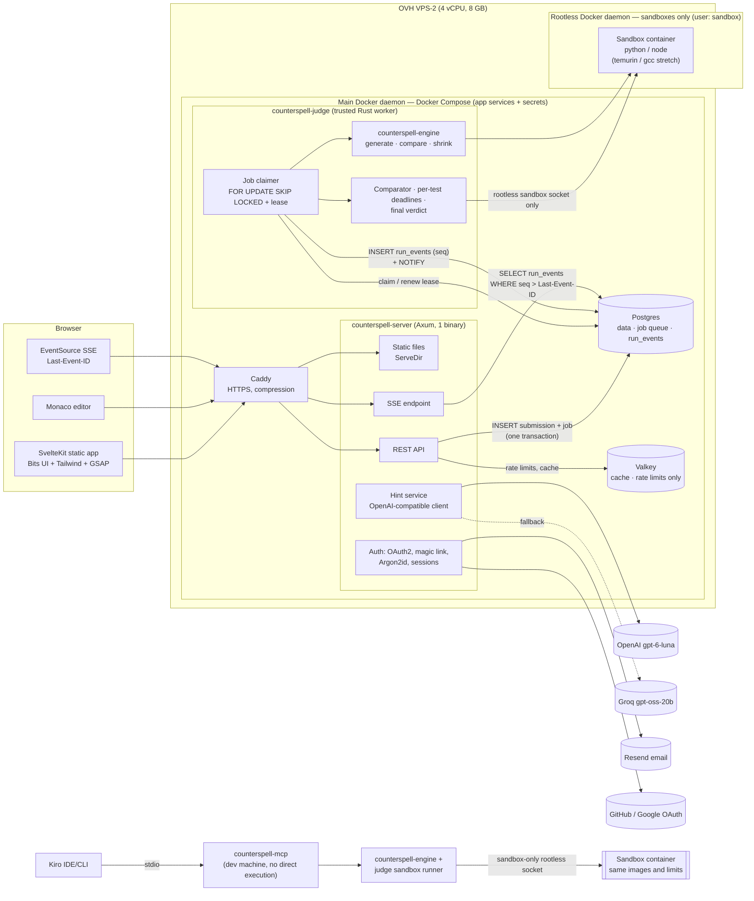
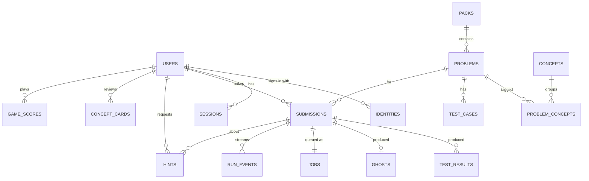
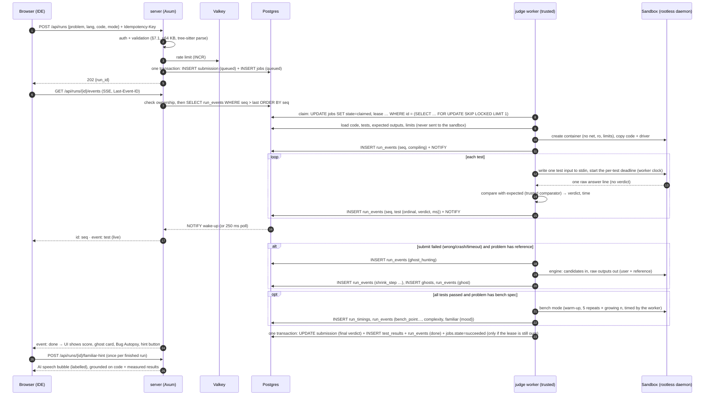

# Counterspell: system design v2 (Rust + Svelte, server-judged)
*Brief for Kiro. Source: research system design v2 (11 Nov 2026). Decisions marked [D] were made by Brighton and must not be changed without asking. [U] = unverified, [E] = estimate. Detailed token values: `docs/palette.md`. Licence rules: `docs/licence-rules.md`.*

*Updated Thu 12 Nov 2026, 01:45 SAST: applied Brighton's grill-me decisions on the ChatGPT critique (the research review of 12 Nov). Summary in the **Decision log 2026-11-12** at the end. Decisions from that round are marked **[D 12 Nov]**.*

**Labels:** [V] = verified today on the primary source (see `docs/licence-rules.md` for licence and LLM evidence). [U] = unverified, so test it before relying on it. [E] = my estimate, with assumptions stated. **[D]** = a decision Brighton made in the multiple-choice rounds on 11 Nov.

**Deadline:** Fri 4 Dec 2026 14:00 PT, which is **Sat 5 Dec 00:00 SAST**. Feature freeze is **Wed 2 Dec**. The app must stay free and online for judges until **Fri 29 Jan 2027 23:00 SAST** (rules, [V]).

---

## 0. The answer in one screen
- **One Rust binary (`counterspell-server`, Axum)** serves the static SvelteKit build *and* the JSON/SSE API. [D]
- **Separate Rust binary (`counterspell-judge`)**: a trusted worker that claims runs from a **Postgres job queue** (`SELECT … FOR UPDATE SKIP LOCKED` with leases) and executes each run in a **throwaway, locked-down Docker container** on a **separate rootless Docker daemon used only for sandboxes**. [D 12 Nov] The container has no network, a read-only root filesystem, CPU, memory, PID and wall-time limits, the default seccomp profile, a non-root user and all capabilities dropped. **All scoring happens on the server.** [D] **The worker owns the test cases, expected outputs, comparator, per-test time limits (killed from outside) and the final verdict; the user's program only reads input and prints answers.** [D 12 Nov]
- **Languages are config, not code.** `languages.toml` lists the image, file name, compile command and run command for each language, plus a small per-language test driver template. Launch languages: **Python and JavaScript** (Must). **Java and C++ are stretch** goals, added only after the core is freeze-safe. [D 12 Nov]
- **Live results:** the worker writes one event per test to a Postgres `run_events` table with a per-run sequence number, and the browser receives them via **Server-Sent Events** with `Last-Event-ID` replay. [D] [D 12 Nov]
- **Ghost-input engine (`counterspell-engine`, Rust library)**: seeded generation, then the reference solution versus the user's code, then shrinking to a **minimized counterexample** (the smallest failing input *found* within the budget, not a proven global minimum). It runs **server-side only** and executes code only through the judge's sandbox. [D] [D 12 Nov] The same crate powers **`counterspell-mcp`** (Rust MCP server, `rmcp`) for Kiro; its code-running tools go through the same sandbox and judge, never directly on the developer's machine. [D 12 Nov]
- **Data:** **Postgres** (truth, job queue and run events) and **Valkey** (cache and rate limits only), on one **OVH VPS-2 (4 vCPU, 8 GB, 75 GB NVMe, €8.49/month ex. VAT)**. [D] [D 12 Nov]
- **Auth built into Axum:** GitHub and Google OAuth, plus email (magic link, or password with Argon2id). Mail goes through **Resend**. [D] **No automatic account linking by matching email**; a signed-in user links a provider themselves, with verification. A judge demo account is provided. [D 12 Nov]
- **Frontend:** SvelteKit (static adapter), **Bits UI**, **Tailwind**, **GSAP** and **Monaco** (custom "Crypt" theme). Chess uses **chess.js** with **cm-chessboard** (MIT). [D]
- **Look:** "Steel Night". Steel-blue base, subtle moss grey-green accent, candle amber second accent, bright green only for pass and red only for failures. Geist and JetBrains Mono. A cinematic landing page and a calm IDE. Dark mode only at launch, with tokens ready for light mode (§16). [D]
- **Efficiency Familiar (§8b):** a jack-o'-lantern docked in the IDE with 5 moods (furious → laughing). **Its mood is set only by measured facts** on Run/Submit: correctness plus observed scaling against `reference_complexity`, with a confidence level. It says "looks quadratic", never "optimal". An LLM writes its speech-bubble hint, labelled as an AI hint, and can't change the verdict or mood. A live typing guess is a stretch goal and never changes the mood. [D 12 Nov]
- **AI hints:** one OpenAI-compatible client. **Primary OpenAI `gpt-6-luna`** ($0.10/$0.50 per 1M tokens), **backup Groq `openai/gpt-oss-20b`** ($0.075/$0.30). Gemini 3.1 Flash-Lite is an optional third. About **$0.027 per active user per month** at 3 hints/day [E].
- **Deploy:** Docker Compose behind Caddy (automatic HTTPS). The licence is **MIT**. [D]
- **Who builds it:** Kiro writes it from specs, and Brighton reviews. A `rust-learning.md` steering file makes Kiro explain the Rust it writes. [D]
- **Biggest risk:** sandbox safety and scope in 23 days, made sharper by the visuals-first build order. The mitigation is Python end to end first, then JS; Java and C++ only after the core is freeze-safe; and a **hard checkpoint on Wed 25 Nov**: a real fail → ghost flow working on the VPS, or visual work pauses (§14). [D 12 Nov]

---

## 1. Requirements
### 1.1 Functional (MVP = submitted on Dec 4)
| # | Requirement | MVP | Later |
|---|---|---|---|
| F1 | Sign up / log in: GitHub, Google, email (magic link + password). No automatic linking by email; user-initiated linking only. Judge demo account [D 12 Nov] | ✅ | org SSO |
| F2 | Problem catalogue: tracks ("Crypts") → concepts → problems, filters | ✅ 10 polished problems [D 12 Nov] | 150+, community packs |
| F3 | VS Code-style IDE: Monaco, language picker, Run (samples), Submit (hidden), console, test panel with per-test pass/fail streamed live | ✅ Python + JS; Java + C++ stretch [D 12 Nov] | more languages via config |
| F4 | **Ghost input**: on a wrong submit, find a failing input and shrink it to a **minimized counterexample**, then show input / expected / got | ✅ hero | trees/graphs |
| F4a | **Visible shrink animation**: the ghost card replays the recorded shrink steps, from the first failing input down to the minimized counterexample [D 12 Nov] | ✅ Should | — |
| F4b | **Bug Autopsy card**: failing input, expected vs actual diff, and the conceptual mistake or hint [D 12 Nov] | ✅ Should | — |
| F5 | Hints: authored ladder R1–R4 plus an AI hint grounded in the ghost | ✅ | quotas per tier |
| F6 | Recorded submissions and history | ✅ | diff/replay |
| F7 | Dashboard: scores, streak, solved by concept and difficulty, weak concepts, next activity, suggested challenges | ✅ | readiness score |
| F8 | FSRS concept review queue (serves a sibling problem) | stretch, after the freeze-safe core [D 12 Nov] | ✅ |
| F9 | Night Shift timed assessment (2 problems / 90 min) | stretch | ✅ |
| F10 | Break room: daily chess puzzle (Lichess CC0) + chess vs a simple bot; one brain game | stretch, **last** [D] [D 12 Nov] | duels |
| F11 | `counterspell-mcp` for Kiro (find_ghost_input, shrink_input, explain_ghost, validate_grimoire_pack). Tools that run code go through the same sandbox and judge as production [D 12 Nov] | ✅ | Kiro Power |
| F11a | **Kiro dogfooding demo**: Kiro uses `counterspell-mcp` to find a counterexample in a deliberately buggy reference or implementation, fixes it and re-verifies (for the video and the Kiro write-up) [D 12 Nov] | ✅ Should | — |
| F13 | **Efficiency Familiar**: a jack-o'-lantern mascot in the IDE whose 5 moods reflect measured efficiency on Run/Submit, plus an LLM speech-bubble hint labelled as AI (§8b). Live typing guess is stretch [D 12 Nov] | ✅ (jack-o'-lantern; measured mood) | ghost/skeleton skins |
| F12 | Payments | ❌ (judges must test free) | ✅ |

### 1.2 Non-functional
- **Security first:** untrusted code runs only in sandboxes (§7). Secrets stay server-side. Cookies are HttpOnly, Secure and SameSite=Lax, with CSRF protection on state-changing forms.
- **Latency targets [E]:**
  - Python/JS Run: under 1.5 s p95, warm image.
  - C++ Submit (stretch language): under 3 s, because it includes compiling.
  - Java Submit (stretch language): under 3.5 s, because of JVM start-up [U, measure].
  - Ghost hunt: hard cap of 8 s.
- **Capacity on an 8 GB VPS [E]:** **2 concurrent sandbox runs by default** (`JUDGE_CONCURRENCY=2`) until benchmarked on the VPS, with the rest queued in the Postgres job queue. Raise to 3–4 only if the freeze-day load test shows stable p95 and stable bench timings. [D 12 Nov]
- **Cost:** the VPS is the only fixed cost (§11). LLM hints are about $0.03 per active user per month.
- **Accessibility:** WCAG AA contrast (palette v2 was checked), `prefers-reduced-motion` turns GSAP scenes off, and the IDE is fully usable by keyboard.
- **Theming:** dark only at launch. Every colour is a semantic CSS variable, so light mode needs no component changes.
- **Determinism:** the ghost seed is `hash(problem, code_sha256, lang, engine_version)` and is stored with the result, together with the generator version, problem version, runtime image digest and shrink steps. [D 12 Nov]

### 1.3 Out of scope
Proctoring, plagiarism detection, company hiring tools, mobile apps, and copying HackerRank content or trade dress (patterns only).

---

## 2. Architecture


**Why two binaries and two Docker daemons [D 12 Nov]:** the web server never touches Docker. Sandbox containers run on a **separate rootless Docker daemon** owned by an unprivileged `sandbox` user and used for nothing else. The Axum app, Postgres, Valkey, Caddy and all secrets run on the main daemon via Compose, and are not on the sandbox daemon. The judge worker mounts **only** the rootless sandbox socket and has **no access to the main daemon socket**, so control of the sandbox daemon is not root on the VPS. The worker has **no inbound ports**, holds only a limited Postgres role (no OAuth, Resend or LLM keys), and talks only to Postgres and the sandbox daemon. gVisor `runsc` on the sandbox daemon is optional and later. This is the most important security boundary in the system.

**Workspace layout (Cargo + npm). This is the one canonical layout; every package is named `counterspell-<dir>` [D 12 Nov]:**
```
counterspell/
├─ LICENSE (MIT)  THIRD-PARTY-NOTICES.md  README.md  docker-compose.yml  Caddyfile
├─ .kiro/ (steering, specs, hooks, settings/mcp.json)
├─ Cargo.toml (workspace)
├─ crates/
│  ├─ server/   counterspell-server   (Axum: API, auth, SSE, static)
│  ├─ judge/    counterspell-judge    (trusted worker: job claimer, sandbox runner, comparator, verdicts)
│  ├─ engine/   counterspell-engine   (ghost engine: schema, generators, comparators, shrinkers)
│  ├─ grimoire/ counterspell-grimoire (pack format parser + `validate` CLI)
│  ├─ mcp/      counterspell-mcp      (rmcp stdio server; executes only via the judge's sandbox runner)
│  └─ common/   counterspell-common   (types shared by server/judge: RunRequest, RunEvent, ids)
├─ languages/   languages.toml + drivers/{python,javascript}/ (java/, cpp/ stretch)
├─ packs/       (Grimoire problem packs: statement, schema, reference, tests, hints)
├─ web/         (SvelteKit app, adapter-static → build/ served by server)
├─ migrations/  (sqlx migrations)
└─ deploy/      (rootless sandbox daemon setup, seccomp notes, hardening, backup script)
```

---

## 3. Components
| Component | Tech | Responsibility |
|---|---|---|
| `server` | Axum 0.8, Tokio, tower-http (`ServeDir`, compression, trace), sqlx (Postgres), redis-rs/fred (Valkey: cache and rate limits), oauth2, argon2, tower-sessions (Postgres store), reqwest | Static site, REST, SSE (replayed from `run_events`), auth, hints, dashboard queries, rate limits, atomic submission + job insert |
| `judge` | Tokio, bollard (Docker API on the rootless sandbox daemon only), sqlx (job queue, run events) | Claim jobs with leases, compile and run in the sandbox, feed inputs, enforce per-test deadlines from outside, compare outputs with expected answers, decide verdicts, write run events, persist results, trigger ghost hunts |
| `engine` | pure Rust, own seeded PRNG (PCG/xorshift), serde_json | Input schema → generators (edge-biased), comparators, ddmin + numeric/structural shrinking, budget control |
| `grimoire` | serde + toml/yaml | Pack format, validation (reference passes all tests, schema covers samples, hints present) |
| `mcp` | rmcp (official Rust MCP SDK, Apache-2.0) | Tools: `find_ghost_input`, `shrink_input`, `explain_ghost`, `validate_grimoire_pack` (plus `run_reference`). stdio transport. Code-running tools use the judge crate's sandbox runner on a sandbox-only rootless daemon [D 12 Nov] |
| `web` | SvelteKit (adapter-static), Svelte 5, Bits UI, Tailwind 4 (semantic tokens), GSAP, Monaco (`monaco-editor` + loader, "Crypt" theme), Geist + JetBrains Mono (self-hosted, OFL-1.1), chess.js + cm-chessboard | Landing, auth screens, dashboard, IDE, break room |
| Postgres | official `postgres` image | Users, problems, submissions, ghosts, hints, reviews, **job queue** (`jobs`) and **run events** (`run_events`) [D 12 Nov] |
| Valkey | official `valkey` image | Rate limits and caches (hint cache, catalogue cache) **only**. Not the queue, not the event bus [D 12 Nov] |
| Caddy | official `caddy` image | TLS (Let's Encrypt), HTTP/2/3, reverse proxy to `server:8080` |

**Rust crate choices (all MIT and/or Apache-2.0, or BSD [V]):** axum, tokio, tower, tower-http, sqlx, serde, serde_json, oauth2, argon2, tower-sessions, axum-login (optional), tower_governor (optional), redis or fred, bollard, reqwest, async-openai (optional), resend-rs (or plain reqwest), rmcp, proptest (tests), uuid, time, tracing. For FSRS, use the `fsrs` crate (BSD-3-Clause [V]) or a small hand-written FSRS scheduler. **Avoid `rs-fsrs`**: crates.io shows a "non-standard" licence [V].

---

## 4. Data model (Postgres)


| Table | Key columns |
|---|---|
| `users` | `id uuid pk`, `email citext unique`, `email_verified_at`, `password_hash text null` (Argon2id PHC string), `handle citext unique`, `display_name`, `country`, `xp int`, `streak_days int`, `last_active date`, `familiar_prefs jsonb`, `created_at` |
| `identities` | `user_id fk`, `provider text` (github, google), `provider_user_id text`, `unique(provider, provider_user_id)`, `linked_at`. A row is only added at sign-up or by a signed-in user's own link flow, never by matching email [D 12 Nov] |
| `email_tokens` | `token_hash bytea pk`, `user_id/email`, `purpose` (magic_link, verify, reset, link_email), `expires_at`, `used_at` |
| `sessions` | `id text pk`, `user_id`, `data jsonb`, `expires_at` (tower-sessions Postgres store) |
| `packs` | `id text pk`, `name`, `version`, `license`, `source_url` |
| `problems` | `slug pk`, `pack_id fk`, `title`, `difficulty`, `statement_md`, `signature jsonb` (function name, typed params, return type), `input_schema jsonb` (engine schema), `comparator text`, `limits jsonb` (time_ms, mem_mb), `reference_complexity text`, `bench jsonb`, `complexity_note text`, `version int` |
| `concepts`, `problem_concepts` | concept graph for tracks and recommendations |
| `test_cases` | `id`, `problem_slug fk`, `ordinal`, `is_sample bool`, `input jsonb`, `expected jsonb`. Hidden ones are never sent to the client |
| `reference_solutions` | `problem_slug`, `lang`, `code text`. Server-only, used by the ghost engine. The Python reference is authoritative for expected outputs in every language |
| `submissions` | `id uuid pk`, `user_id`, `problem_slug`, `lang`, `mode` (run, submit), `code text`, `code_sha256`, `idempotency_key text null` (unique per user), `status` (queued, claimed, compiling, running, ghost_hunting, accepted, wrong_answer, runtime_error, time_limit, memory_limit, output_limit, compile_error, expired, internal_error), `passed int`, `total int`, `score int`, `runtime_ms`, `memory_kb`, `measured_complexity`, `complexity_confidence`, `fit jsonb`, `familiar_mood smallint`, `created_at`, `finished_at` |
| `test_results` | `submission_id fk`, `ordinal`, `verdict`, `time_ms`, `memory_kb`, `stdout_snip`, `stderr_snip` (truncated, hidden-test details redacted) |
| `ghosts` | `submission_id pk`, `input jsonb`, `expected jsonb`, `got jsonb`, `kind` (wrong, crash, timeout), `seed bigint`, `size_metric jsonb`, `shrink_trace jsonb` (successive accepted reductions, capped, for the shrink animation), `shrink_steps int`, `budget_exhausted bool`, `generator_version`, `problem_version int`, `image_digest text`, `engine_version`, `autopsy jsonb` (concept, mistake text, its source: authored or AI). There is no `minimal` flag: the result is a *minimized* counterexample, not a proven minimum [D 12 Nov] |
| `jobs` | `id bigserial pk`, `submission_id fk unique` (one job per submission, idempotent), `state` (queued, claimed, succeeded, failed, dead), `attempts smallint`, `max_attempts smallint` (default 3), `lease_owner text`, `lease_expires_at timestamptz`, `run_after timestamptz`, `last_error text`, `created_at`, `updated_at` [D 12 Nov] |
| `run_events` | `submission_id fk`, `seq int` (monotonic per run, from 1), `attempt smallint`, `type text`, `payload jsonb` (public fields only; never hidden inputs or expected outputs), `created_at`, `primary key (submission_id, seq)` [D 12 Nov] |
| `hints` | `id`, `user_id`, `submission_id`, `rung smallint`, `source` (ladder, ai, familiar), `provider`, `model`, `body`, `tokens_in`, `tokens_out`, `cost_usd numeric(10,6)`, `cache_key`, `created_at` |
| `concept_cards` | `user_id`, `concept_id`, FSRS fields (`stability`, `difficulty`, `reps`, `lapses`, `state`, `due`, `last_review`) |
| `game_scores` | `user_id`, `game` (chess_puzzle, chess_bot, brain), `score`, `meta jsonb`, `created_at` |
| `problem_baselines` | `problem_slug`, `lang`, `n`, `median_ns`, `measured_at`, `engine_version` (§8b) |
| `run_timings` | `submission_id fk`, `n`, `repeat`, `ns`: the raw bench samples (§8b) |
| `puzzles` | `id text pk` (Lichess id), `fen`, `moves`, `rating`, `themes text[]`. Imported from the CC0 CSV |

**Indexes:**
- `submissions(user_id, created_at desc)`
- `submissions(user_id, problem_slug, created_at desc)`
- `jobs(run_after) where state = 'queued'` (partial index for claiming)
- `jobs(lease_expires_at) where state = 'claimed'` (lease reaper)
- `concept_cards(user_id, due)`
- `hints(cache_key)`
- `puzzles(rating)`

**Dashboard:** one SQL view or function returns solved counts by difficulty, the streak, the last 10 submissions, weak concepts (most failures and ghosts), the next due review and 3 suggestions, in one round trip.

---

## 5. Run lifecycle


**Details:**
- **The trusted worker decides every verdict [D 12 Nov].** Like DMOJ or Codeforces, the user's program only reads input and prints answers. The worker holds the test cases, the expected outputs and the comparator, measures time with its own clock, and kills the container from outside when a per-test deadline passes. The driver harness calls the user's function and prints the **raw return value** only. Anything the program prints, including text that looks like a verdict (`{"verdict":"pass"}`), is at most a candidate answer that the worker compares; it can never declare a verdict.
- **One container per run where possible, not per test.** The worker sends one test input at a time and waits for its answer. On a per-test timeout it kills the container, records TLE for that test, and starts a fresh container for the remaining tests, within the run's total wall-time cap. That keeps one compile (and one JVM start, for stretch Java) per run in the common case.
- **Hidden tests:** for hidden tests, public events carry only the verdict and time. Expected and actual values are shown only for samples and for the ghost, which is generated, so it isn't a hidden test.
- **Reliability (Postgres job queue) [D 12 Nov]:**
  - **Atomic enqueue:** the submission row and its job row are inserted in one transaction, so a saved submission can't be left without a job. `jobs.submission_id` is unique, and `Idempotency-Key` stops a client retry from creating a second submission.
  - **Exclusive claim with a lease:** `SELECT … FOR UPDATE SKIP LOCKED LIMIT 1`, then `state=claimed`, `lease_owner`, `lease_expires_at = now() + 30 s` [E]. The worker renews the lease every 10 s while it runs.
  - **Recovery:** a reaper returns jobs with expired leases to `queued` with `attempts + 1`. After `max_attempts` the job becomes `dead` and the submission `internal_error` with a clear message, so nothing stays "running" forever. On start-up, the worker removes stale sandbox containers.
  - **Idempotent terminal write:** the final verdict, test results, `done` event and `jobs.state = succeeded` are written in one transaction guarded by `WHERE state = 'claimed' AND lease_owner = $me`. A worker that lost its lease can't write a second terminal result.
  - **Infrastructure failure ≠ wrong answer:** if the sandbox daemon or image fails, the run ends as `internal_error`, never as a user's wrong answer.
  - **Run events:** every public event is a row in `run_events` with a monotonic per-run `seq`. A retried attempt first appends a `restarted {attempt}` event, and the UI clears its per-test rows on it.
  - **SSE replay:** the SSE `id:` is the `seq`. After checking ownership, the server sends every event with `seq > Last-Event-ID` from Postgres, then waits on `LISTEN`/`NOTIFY` (a wake-up hint only) with a short poll fallback. The client deduplicates by `seq`. The final result is always fetchable with `GET /api/runs/{id}` after a reload.
- **Ghost hunt protocol:**
  1. The worker starts the user program and the reference program in **interactive mode**: the driver reads one input per line and writes one raw output per line, inside the same sandbox limits, with an 8 s total budget. The worker compares the outputs.
  2. The engine streams candidate inputs, in this order: known-ghost seeds from the pack, samples, a tiny exhaustive enumeration, then random inputs of growing size.
  3. It compares outputs using the pack's comparator, then shrinks with ddmin, integer halving and per-element shrinking.
  4. It keeps a candidate only if it reproduces the same failure predicate: the same verdict kind and the same exception class. Every accepted step strictly reduces a deterministic size metric and is recorded in the shrink trace (for the shrink animation).
  5. Reference solutions are authored in Python for every pack, so there's one reference language and it is authoritative for expected outputs. The *user's* language can be any launch language.
  6. The result is a **minimized counterexample**: the smallest failing input found within the budget, with the seed, generator version, problem version, image digest and shrink steps recorded. It is never described as the smallest possible input. [D 12 Nov]

---

## 6. Languages as config
`languages/languages.toml` (illustrative; Kiro implements it in the `judge-sandbox` and `language-drivers` specs). **Python and JavaScript are the launch languages; the Java and C++ blocks are stretch, added only after the core is freeze-safe [D 12 Nov]:**
```toml
[python]
image   = "python:3.13-slim"          # pin by digest in prod
file    = "solution.py"
compile = []                           # none
run     = ["python3", "-I", "-S", "driver.py"]
mem_mb  = 256
time_ms_per_test = 2000

[javascript]
image   = "node:22-slim"
file    = "solution.js"
compile = []
run     = ["node", "--max-old-space-size=192", "driver.js"]

[java]                                 # stretch
image   = "eclipse-temurin:21-jdk"     # `openjdk` image is deprecated [V]
file    = "Solution.java"
compile = ["javac", "-d", "/box/out", "Solution.java", "Driver.java"]
run     = ["java", "-Xss16m", "-Xmx256m", "-XX:+UseSerialGC", "-cp", "/box/out", "Driver"]  # -Xss: 8–16m [U], pick the smallest that passes deep-recursion tests
mem_mb  = 512

[cpp]                                  # stretch
image   = "gcc:14"
file    = "solution.cpp"
compile = ["g++", "-O2", "-std=c++20", "-o", "/box/out/main", "driver.cpp"]
run     = ["/box/out/main"]
```
- Image tags are examples. **[U] pin current tags and digests when building.**
- **Drivers:** `languages/drivers/<lang>/` holds a template that parses JSON lines, converts them to typed arguments using the problem `signature` (int, float, bool, string, list<T>, list<list<T>>, plus `TreeNode`/`ListNode` later), calls the user's function, serialises the result and prints only `{"t":i,"out":...}`. It never sees expected outputs and never prints a verdict or a timing; the worker compares and times [D 12 Nov].
- **Adding a language** means one TOML block plus one driver (about 80–150 lines). The worker, queue, SSE, engine and UI don't change.
- **Images** are pre-pulled at deploy and refreshed weekly. Containers never pull at run time.

---

## 7. Sandbox security
Treat every submission as hostile: fork bombs, memory bombs, infinite loops, filesystem writes, network probes, container-escape attempts and huge output.

| Control | Setting (Docker API via bollard; CLI equivalent shown) |
|---|---|
| No network | `--network none` |
| Read-only root FS | `--read-only`, plus `--tmpfs /box:rw,size=64m,mode=1777` (exec allowed only where compiled binaries live) and `--tmpfs /tmp:rw,noexec,size=16m` |
| Non-root | `--user 65534:65534` (nobody), image files root-owned and read-only |
| Capabilities | `--cap-drop ALL`, `--security-opt no-new-privileges` |
| Syscalls | Docker default seccomp profile (on by default; **never** `seccomp=unconfined`). Optionally a tighter custom profile later |
| CPU | `--cpus 1` (NanoCpus). This is a CPU **quota** (one CPU's worth of time, spread across cores), not pinning. Pin with `--cpuset-cpus` only if benchmarks show it's needed [U]. Per-test deadlines are enforced by the worker from outside (kill), not by the driver [D 12 Nov] |
| Memory | `--memory 256m --memory-swap 256m` (512m for Java, stretch), OOM → `memory_limit` verdict |
| Processes | `--pids-limit 64` (fork bombs die) |
| Wall time | the worker kills the container at `tests × time_ms + compile budget + 2 s`, hard cap 20 s |
| Output | the worker reads at most 1 MB of stdout and 64 KB of stderr, then kills (`output_limit`) |
| Verdict authority [D 12 Nov] | the trusted worker owns test cases, expected outputs, the comparator, per-test time limits and the final verdict. The user program only reads stdin and prints answers (or the driver harness returns raw answers). Nothing printed by user code can declare a verdict; fake verdict JSON is just a wrong answer |
| Files | `--ulimit fsize=…`, `nofile=64`, `nproc` (belt and braces with pids-limit) |
| Isolation upgrade | **gVisor `runsc` runtime** (Apache-2.0 [V]) on the sandbox daemon. Optional and later [D 12 Nov]: selectable by config, but not claimed until tested on the VPS (rootless + gVisor compatibility is [U]) |
| Cleanup | `AutoRemove`; a reaper deletes any container labelled `counterspell.run` older than 60 s |
| Host | Docker Engine on Ubuntu LTS, unattended upgrades, UFW allows only 22/80/443, SSH keys only, the worker has no inbound port |
| Docker API exposure [D 12 Nov] | sandbox containers run on a **separate rootless Docker daemon** (systemd user service of an unprivileged `sandbox` user, own socket), used only for sandboxes. The Axum app, Postgres, Valkey, Caddy and secrets are not on that daemon. The `judge` mounts only that rootless socket and has no access to the main daemon socket. Rootless Docker needs cgroup v2 with delegation for the memory, CPU and PID limits to apply [U: verify on the OVH image on day 1] |
| Abuse | per-user limits (for example 30 runs per 10 min, 10 ghost hunts per hour) in Valkey, code size ≤64 KB, queue depth cap with a 429 |

### 7.1 Submission input validation (pre-sandbox)
Browser checks are UX only and can be skipped (for example with curl). The server repeats every check before a run is queued. These checks are a first filter; the sandbox above is the real security boundary. Do **not** use keyword or API blocklists (`os`, `system` and the like): they are easy to bypass, and valid code can still be hostile.

- **Size:** a maximum source size in **bytes**, configurable per language (e.g. `max_source_bytes` in `languages.toml`), default **64 KB**. Rejected client-side and server-side with a clear message that states the limit and the actual size. Do not use a line-count cap.
- **Language:** the server parses the source with tree-sitter for the selected language and rejects unparseable code with an error **before** queuing. The browser runs the same check for instant feedback.
- **Plain text only:** valid UTF-8; no NUL or control characters except tab, newline and CR; a single source file in the request body; no file uploads.
- **Rate limits:** per-user and per-IP limits on Run/Submit in Valkey, plus a maximum number of queued jobs per user (counted from the Postgres `jobs` table); excess requests get 429 with the wait time.
- **Output:** program stdout/stderr and test output are rendered as plain text, never HTML, and truncated to a display cap (e.g. 64 KB). The worker still kills the run at 1 MB stdout / 64 KB stderr (table above).

---

## 8. Ghost engine (Rust, server-only)
- **Input:** problem `input_schema` (int range, float, string with alphabet and length, list with length, sorted and unique flags, matrix, tuple; graph and tree later), comparator (exact, unordered, float 1e-6, or custom checker in the pack), and two programs (user and reference) exposed as `trait Oracle { fn eval(&mut self, input: &Value) -> Outcome }`.
- **Generation:** edge-biased (empty, single item, all equal, min/max, negatives, duplicates, sorted/reverse), cheapest first, with a budget of 500 candidates or 4 s.
- **Shrinking:** ddmin on sequences and strings, integers toward 0 by halving and then binary search, element-wise shrinking, and structure removal. It keeps a candidate only if it reproduces the same failure predicate and strictly reduces a deterministic **size metric** (for example: total element count, then sum of absolute values, then lexicographic order), with a budget of 300 evaluations or 3 s.
- **Output:** a **minimized counterexample** [D 12 Nov]: `{input, expected, got, kind, seed, generator_version, problem_version, image_digest, size_metric, shrink_trace[], shrink_steps, budget_exhausted, engine_version}` plus a one-line explanation ("You returned 3; expected 2 for `[0, 0]`"). It is the smallest failing input *found* within the budget. It is never called the smallest possible input, because a bounded shrinker can't prove a global minimum.
- **Shrink trace (for the shrink animation) [D 12 Nov]:** every accepted reduction is recorded in order, capped (e.g. 20 steps shown, the rest summarised). The ghost card replays it from the first failing input down to the minimized counterexample. Only real recorded steps are shown, never invented ones.
- **Bug Autopsy data [D 12 Nov]:** the failing input, the expected vs actual diff, the problem's concept tags, and the conceptual mistake. The mistake comes from an authored explanation when the ghost matches a pack's known-ghost seed; otherwise from the AI hint, labelled as AI.
- **Testing:** `proptest` checks the engine itself. Every returned ghost must reproduce its claimed failure, every accepted shrink step must strictly reduce the size metric, the same seed must give the same output, and the search must stop within its budgets.
- **Reuse [D 12 Nov]:** the `mcp` crate reuses the engine, and its code-running tools (`run_reference`, `find_ghost_input`, `shrink_input`) execute through the same sandbox runner and trusted judge as production (same images, limits and comparator), on a sandbox-only rootless Docker daemon. They never spawn an interpreter directly on the developer's machine.

---

## 8b. The Efficiency Familiar (mascot that reacts to how efficient your solution is). Added 11 Nov 22:52 SAST at Brighton's request
**What it is:** a Duolingo-style mascot docked in the IDE's bottom-right corner. The default is a **jack-o'-lantern**; ghost and skeleton skins come later. Its mood reflects how efficient the user's solution is.

**Five moods. The mood is set only by measured facts [D 12 Nov]:** correctness and observed scaling against the reference complexity, with a confidence level. Wording says what was observed ("looks quadratic, medium confidence"), never "optimal".

| Mood | When (authoritative, on Run/Submit) | Look |
|---|---|---|
| 1 Furious | no solution, compile error, wrong answer, crash, timeout, or the worst complexity tier | blood-red inner glow, jagged carved scowl. On a failure or timeout it **cracks and bursts into crimson particles**, then re-forms |
| 2 Angry | passes, but observed scaling looks ≥2 classes worse than the reference (for example looks O(n²) where the reference is O(n)) | deep ember glow, furrowed eyes |
| 3 Uneasy | passes, observed scaling looks 1 class worse (for example looks O(n log n) against O(n)) | dim, flickering candle glow, wavering mouth |
| 4 Pleased | passes in the same class as the reference, but slower by a constant factor (>2× the same-language reference baseline), or with low confidence | steady warm candle glow, smile |
| 5 Laughing | passes, observed scaling **matches the reference complexity** (medium or high confidence) and within 2× of the baseline. Label: "Matches reference complexity" (never "Optimal") | bright candle glow and a **laugh burst** (one short shake and a ring of embers, plus a small success-green spark, since green means success) |

**Three layers, never mixed up:**
1. **Live estimate while typing (a hint only; stretch, Could, not before the freeze-safe core [D 12 Nov]).** It **never changes the mood**; it shows as a small labelled guess bubble.
   - Static or AST heuristics run **client-side** in a Web Worker using `web-tree-sitter` with the Python, JavaScript, Java and C++ grammars (all MIT [V]). It is debounced at about 700 ms after the last keystroke.
   - It detects:
     - loop nesting depth over input-dependent ranges;
     - a sort, linear search (`in` on a list, `indexOf`, `contains`, `find`) or `list.remove/insert(0)` inside a loop;
     - recursion with more than one self-call and no memoisation (`@cache`/`lru_cache`, a memo dict or map passed or captured);
     - halving loops, which suggest log n;
     - an early `sort` followed by a single pass, which suggests n log n.
   - **Output:** `{guess_class, confidence: low|med, reasons[]}`, shown as a labelled guess only. The mood stays at its last measured value [D 12 Nov].
   - The tooltip says plainly: *"Guess from reading your code. Run it for the real verdict."*
   - The optional fallback is a light server endpoint `POST /api/complexity/estimate`, rate limited, running the same heuristics in Rust with tree-sitter crates. Client-side is the default, so there's zero server cost.
2. **Authoritative mood on Run/Submit (measured).**
   - After the correctness tests pass, the same sandbox container switches the driver into **bench mode**:
     1. Generate inputs at growing sizes n from the problem's `bench` spec. Sizes are geometric, for example n = 2⁸…2¹⁶, and capped per problem.
     2. Warm up (2 untimed calls, which matters for the JIT in Java and JS).
     3. Time **5 repeats per size** with the language's monotonic clock and keep the **median**.
     4. Stop early if a size exceeds the time budget. The total bench budget is 1.5 s on Run (3 sizes) and 4 s on Submit (5–6 sizes).
   - **Fit:** take the medians t(n) and compute:
     - (a) a log-log least-squares slope;
     - (b) size ratios t(2n)/t(n);
     - (c) the best-fitting model among {1, log n, n, n log n, n², n³, 2ⁿ}, chosen by normalised residual.
   - The class is accepted only when (a), (b) and (c) agree within tolerance. Otherwise confidence is `low`, and the mood never drops more than 1 step on low confidence.
   - **Compare:**
     - The class is compared with `problems.reference_complexity`, which the author declares and the validator checks by benchmarking the reference.
     - Constant factors are compared only against a **same-language baseline** (`problem_baselines`), measured when the pack is imported, because cross-language timing isn't fair.
   - **Noise controls:**
     - medians of repeats;
     - size *ratios* rather than absolute times;
     - a minimum measurable time per point (inputs are repeated until a point takes ≥2 ms);
     - a CPU quota of `--cpus 1` (a quota, not pinning; add `--cpuset-cpus` only if benchmarks are too noisy [U]);
     - judge concurrency 2 by default, so fewer benches compete for CPU;
     - benches are discarded if the host load average is above 3 [E, tune];
     - the raw samples are stored so a verdict can be re-fitted later.
   - **Run versus Submit:** Run gives a quick 3-point mood (low or medium confidence). Submit gives the full fit, and only Submit can trigger the laugh burst. Failure or timeout on either triggers the crack-and-burst.
3. **Speech bubble from an LLM (words only) [D 12 Nov].**
   - Uses the existing hint client: primary `gpt-6-luna`, backup Groq `openai/gpt-oss-20b`.
   - Called **once per finished Run/Submit** (`POST /api/runs/{id}/familiar-hint`), never on keystrokes. Cached per submission and counted against the daily AI cap.
   - Grounded only on the user's code, the measured results (verdicts, ghost, per-size medians, fitted class, confidence) and the reference complexity. The prompt tells it to explain those facts and not to state a complexity that wasn't measured.
   - Labelled "AI hint" in the UI. It **can't change the verdict or the mood**, which are set before it is called.
   - If both providers fail, the bubble shows a templated line built from the measured facts ("Looks quadratic (medium confidence); the reference is linear.").

**Honest limits (shown in the UI's "How does it judge me?" popover):**
- Static complexity detection is unreliable. Its problems include aliasing, library calls with unknown cost, and input-independent loops that look nested.
- Timing is noisy on a shared VPS, and small n hides asymptotics, so medians, ratios and confidence are used.
- Some problems have no meaningful growth curve, such as constant-size inputs. For those `bench` is omitted and the familiar only reacts to pass or fail.
- Big-O can't separate O(n) with a huge constant from O(n log n) at small n. That's why low confidence never crushes the mood.

**Animation and UX:**
- It's built with SVG and GSAP only, with no Lottie.
- The body uses the realistic jack-o'-lantern art from `assets/pack-realistic/creatures/` (`jack-o-lantern-orange.svg`/`.png`; the source cut-out is in `src/cut/jack-o-lantern.png`). Carved eyes and mouth are separate **SVG path layers per mood**, so expressions can morph (GSAP `attr` tweens on path `d` with matching point counts, or crossfade fallback). The inner glow is an SVG radial gradient and filter driven by a CSS variable (blood → ember → candle).
- Crack-and-burst: crack paths draw on with stroke-dashoffset, then about 40 crimson (`#c4453a`/`#e0675a`) particle circles fly out with gravity in a GSAP timeline lasting about 900 ms, then the pumpkin re-forms.
- While typing it stays calm: only a 300 ms glow and expression crossfade, at most one mood change per 2 s, and no shaking.
- **`prefers-reduced-motion`:** no bursts or shakes, just an instant expression swap plus a text badge ("Matches reference!", "Timeout").
- **Controls:** a small menu offers **Mute** (silences animation and the optional sound, keeping a static face), **Hide** (collapses to a 16 px dot in the status bar) and **Skin** (later). The settings are saved per user (`users.familiar_prefs jsonb`).
- **Accessibility:** an `aria-live="polite"` text equivalent ("Familiar: pleased, O(n log n), reference O(n)"), and it never covers the editor's text (docked over the panel corner, draggable to the other corner).

**Data, API and events (additions):**
- `problems.reference_complexity text` (for example `"n"`, `"n log n"`), `problems.bench jsonb` (size param, sizes, generator overrides, per-point cap), `problems.complexity_note text`.
- `problem_baselines(problem_slug, lang, n int, median_ns bigint, measured_at, engine_version)`: the reference timings per language.
- `run_timings(submission_id fk, n int, repeat smallint, ns bigint)`: the raw samples.
- `submissions` gains `measured_complexity text`, `complexity_confidence text`, `fit jsonb` (slope, ratios, residuals), `familiar_mood smallint` (1–5).
- `users.familiar_prefs jsonb` (`{muted, hidden, skin}`).
- Run events (rows in `run_events`, streamed over SSE):
  - `bench_start {sizes}`;
  - `bench_point {n, median_ns}` (live mini-chart in the Tests panel);
  - `complexity {class, confidence, reference, ratio_vs_baseline}`;
  - `familiar {mood, reason, layer:"measured"}`.
- REST: `PATCH /api/me/familiar` (prefs), `POST /api/runs/{id}/familiar-hint` (LLM speech bubble, once per run), optional `POST /api/complexity/estimate` (heuristic, rate limited; stretch).

## 9. API outline (all JSON; cookies for session)
| Method & path | Purpose |
|---|---|
| `GET /api/auth/oauth/{github,google}/start` → `/callback` | OAuth2 auth-code + PKCE + `state`. Signs in by provider identity only. **No automatic linking by matching email** [D 12 Nov]: if the provider email belongs to another account, the user is told to sign in with the original method and link from settings |
| `POST /api/auth/link/{github,google}/start` → `/callback`, `POST /api/auth/link/email` | User-initiated linking while signed in: OAuth with a link-intent `state` bound to the session, or a verification email (`link_email` token). Links only after verification succeeds [D 12 Nov] |
| `POST /api/auth/email/magic` / `GET /api/auth/email/verify?token=` | Magic link: a single-use token valid for 15 minutes, stored hashed |
| `POST /api/auth/register` / `POST /api/auth/login` / `POST /api/auth/password/reset` | Email and password (Argon2id), verification email via Resend |
| `POST /api/auth/logout`, `GET /api/me` | session |
| Judge demo account [D 12 Nov] | a seeded demo user signs in through `POST /api/auth/login`; credentials go in the Devpost private field, and the sign-in page has a "Judging? Use the demo account" link. The demo user can't link providers, change credentials or delete the account; its data resets daily [E]. Normal rate limits apply |
| `GET /api/languages` | from languages.toml (name, version, limits) for the IDE picker and the `/environment` page |
| `GET /api/problems?track=&difficulty=&concept=`, `GET /api/problems/{slug}` | catalogue. Detail includes samples, signature and per-language starter code |
| `POST /api/runs` `{problem, lang, code, mode}` + `Idempotency-Key` header → `202 {run_id}` | validate, then insert submission + job in one transaction |
| `GET /api/runs/{id}/events` (SSE) | ownership-checked. `compiling`, `test`, `ghost_hunting`, `shrink_step`, `ghost`, `bench_point`, `complexity`, `familiar`, `restarted`, `done`, `error`, each with `id: <seq>`. Replays `seq > Last-Event-ID` from Postgres. Heartbeat comments every 15 s |
| `GET /api/runs/{id}` | final result (for reloads and history) |
| `POST /api/runs/{id}/familiar-hint` | the familiar's AI speech bubble, once per finished run, cached (§8b) |
| `GET /api/submissions?problem=` | history |
| `POST /api/hints` `{submission_id, rung}` | ladder rung, or AI hint (rung ≥2, quota-checked, cached) |
| `GET /api/dashboard` | aggregates for the dashboard |
| `GET /api/reviews/due`, `POST /api/reviews/{concept}` | FSRS (stretch) |
| `GET /api/breakroom/puzzle/daily`, `POST /api/breakroom/scores` | break room (stretch) |
| `PATCH /api/me/familiar` | mascot prefs (muted, hidden, skin) |
| `POST /api/complexity/estimate` (optional) | heuristic estimate if the client worker is unavailable, rate limited |
| `GET /healthz`, `GET /readyz` | ops |

**AI hint client:**
- One trait, `HintProvider::complete(prompt) -> HintResult`, implemented once over the OpenAI Chat Completions wire format with `base_url`, `api_key`, `model` and `timeout` from config.
- A provider list is tried in order: `HINT_PROVIDERS=openai:gpt-6-luna,groq:openai/gpt-oss-20b` (optionally `,gemini:gemini-3.1-flash-lite`).
- **[U]** Confirm that gpt-6-luna is served on Chat Completions. If it's Responses-only, add a second wire format behind the same trait.
- **Guards:**
  - Requests are sent only after the user clicks.
  - The prompt includes the ghost and the user's code (≤8 KB). The user is told their code goes to an AI provider.
  - The rule is "no full solutions". Any code block longer than 3 lines is removed.
  - The cache key is `sha256(problem, rung, code_ast_hash, ghost.input)`.
  - Quota: free users get 10 AI hints a day.
  - A global daily spend cap is tracked in Valkey.

---

## 10. Deployment
- **Host:** **OVH VPS-2 2027** (4 vCore, 8 GB, 75 GB NVMe), month-to-month, in an EU datacentre (DE or GRA/RBX), per the VPS research of 11 Nov [D 12 Nov]. Ubuntu LTS (or OVH's Debian 12 image), Docker Engine and the Compose plugin for the main daemon, plus a **rootless Docker daemon for sandboxes only**, run as a systemd user service of an unprivileged `sandbox` user. Sandbox images are pre-pulled into that daemon.
- **`docker-compose.yml` services:**
  - `caddy` on ports 80/443, with volumes `caddy_data` and `caddy_config`;
  - `server`, built from a multi-stage Dockerfile (`cargo build --release` plus `npm run build`), with the SvelteKit `build/` copied into the image and served by `ServeDir` and an SPA fallback;
  - `judge`, which mounts **only the rootless sandbox daemon's socket** (never the main Docker socket), is on an internal network only, has no published ports and gets only its own DB URL (limited Postgres role) [D 12 Nov];
  - `postgres:17` with the `pgdata` volume, on an internal network only;
  - `valkey/valkey:8` for cache and rate limits only (no persistence needed), on an internal network only;
  - `migrate`, a one-shot `sqlx migrate run`.
- **Configuration:** a `.env` on the server (never committed) holds the DB URL, Valkey URL, OAuth client IDs and secrets, `RESEND_API_KEY`, the provider keys, the session secret and `PUBLIC_BASE_URL`.
- **Domain:** OAuth callbacks and Resend need a real domain with HTTPS.
  - Any cheap domain works [U on price].
  - A free subdomain only works if Resend can verify DNS on it [U].
  - Caddy obtains certificates automatically.
- **Backups:** a nightly `pg_dump` with 7 dumps kept locally and copied off-box. OVH's backup option or any off-box storage is an **extra cost on top of the €8.49** [U price, not checked].
- **CI:** GitHub Actions on push runs `cargo fmt --check`, `clippy -D warnings`, `cargo test` (engine, grimoire, server with testcontainers or a service Postgres), `npm run check && npm run build`, and `cargo deny check licenses`. Deploys are manual (`ssh` + `docker compose pull && up -d`) to keep it simple.
- **Judges:** a public demo account (credentials in the Devpost private field), plus GitHub and Google sign-in. Uptime must hold until **29 Jan 2027 23:00 SAST**.

**Memory budget on 8 GB [E]:**

| Item | Allocation |
|---|---|
| OS + Docker | 0.6 GB |
| Postgres | 1 GB (`shared_buffers` 256 MB) |
| Valkey | 0.15 GB (`maxmemory` 100 MB; cache and rate limits only) |
| server | 0.1 GB |
| judge | 0.1 GB |
| Rootless sandbox daemon | 0.15 GB [E] |
| Caddy | 0.05 GB |
| **Sandbox pool** | about 5.5 GB: 2 concurrent runs at ≤512 MB by default, with headroom for compiles and for raising concurrency later |

The worker concurrency defaults to **`JUDGE_CONCURRENCY=2`** until benchmarked on the VPS [D 12 Nov]. Raise it to 3–4 only if the freeze-day load test (20 concurrent submits) shows stable p95 and stable bench timings.

---

## 11. Cost estimate (OVH prices from the VPS research of 11 Nov, opened 11 Nov 2026, all excl. VAT) [D 12 Nov]
| Option | Specs | Price | Status |
|---|---|---|---|
| **OVH VPS-2 2027** (chosen) | 4 vCore, 8 GB, 75 GB NVMe, KVM, root | **€8.49/mo ex. VAT**, month-to-month, no setup fee [V 11 Nov]. 6-month prepaid €8.06; 12-month prepaid €7.21 (the website "from" price) | Primary plan. EU datacentres only (no South Africa) |
| OVH VPS-1 2027 | 2 vCore, 4 GB, 40 GB NVMe | €4.49/mo ex. VAT [V 11 Nov] | Fallback if money is tighter; run 1–2 concurrent sandboxes and watch disk |
| Hetzner CPX32 | 4 vCPU, 8 GB | €30.49/mo | Rejected: over budget |
| Hetzner CX33 | 4 vCPU, 8 GB | €8.99/mo | Marked "not available" on 11 Nov; comparison only |

**Extras not in the €8.49:** VAT (often 0% for a South African customer, but **confirm the tax line at checkout** [U]), the backup option or off-box storage [U], and the domain.

| Line item | Monthly [E] |
|---|---|
| VPS: OVH VPS-2 | €8.49 ex. VAT (plus VAT if charged [U]) |
| Backups / off-box storage | extra [U, not priced] |
| Domain | about €1 per month amortised [U] |
| Resend | €0 (Free plan: 3,000 per month, 100 per day [V]) |
| LLM hints + familiar speech bubbles | $0.027 × active users at 3 hints/day (100 users ≈ $2.70; 1,000 ≈ $27) [E]; the once-per-run familiar bubble adds to this and shares the daily cap [E] |
| OAuth (GitHub/Google), Let's Encrypt, all software | €0 |
| **Through judging (order Thu 12 Nov → 29 Jan 2027: three monthly periods)** | **about €25.47 ex. VAT** for the VPS (3 × €8.49) [E], plus VAT, backups and domain |

---

## 12. Licence summary (details and quotes in `docs/licence-rules.md`)
**Rule:** the repo needs a detectable open-source licence in the About section. There's no rule on dependencies beyond complying with their licences [V].

| Component | Licence | Status |
|---|---|---|
| Rust, sqlx, serde, oauth2, argon2, reqwest, proptest, tower_governor | MIT OR Apache-2.0 | ✅ |
| Axum, Tokio, tower, tower-http, tower-sessions, axum-login, fred, resend-rs, async-openai | MIT | ✅ |
| rmcp, bollard, Docker Engine/Compose, runc, gVisor, Caddy, Eclipse Temurin images | Apache-2.0 | ✅ (keep NOTICE) |
| PostgreSQL | PostgreSQL Licence | ✅ |
| Valkey, redis-rs | BSD-3-Clause | ✅ |
| Svelte, SvelteKit, Bits UI, Tailwind, Monaco, cm-chessboard, web-tree-sitter + tree-sitter-python/javascript/java/cpp grammars (familiar heuristics) | MIT | ✅ |
| Geist, JetBrains Mono, Pirata One (optional, logo only) | OFL-1.1 | ✅ (fonts may be bundled; keep OFL text; don't rename modified Pirata) |
| chess.js | BSD-2-Clause | ✅ |
| **GSAP** | Proprietary "Standard No Charge" (commercial use allowed; no visual-animation-builder competing with Webflow) | ⚠ OK to use as a dependency. Fallback: Motion (MIT) |
| Lichess puzzle DB | CC0 | ✅. **Not** the AGPL `lichess-org/database` code |
| CPython / Node.js / OpenJDK / GCC (run inside sandboxes only) | PSF / MIT / GPL-2.0+CPE / GPL-3.0+Runtime Exception | ✅ only executed, never distributed or linked |
| **Excluded:** Stockfish, chessground, Judge0, `rs-fsrs` (non-standard licence) | GPL / AGPL / non-standard | ❌ keep out |

Run `cargo deny check licenses` in CI with an allow-list of MIT, Apache-2.0, BSD-2/3, ISC, Unicode-3.0, Zlib, MPL-2.0 (file-level copyleft, fine as a dependency) and CC0-1.0. The allow-list is my proposal; adjust it when the first `cargo deny` run reports.

---

## 13. Risks
| Risk | Likelihood / impact | Mitigation |
|---|---|---|
| Sandbox escape via the Docker socket or a kernel bug | Low / critical | Two-binary split; sandboxes on a separate rootless daemon used only for sandboxes, with the judge unable to reach the main daemon [D 12 Nov]; patched host; no secrets on the sandbox daemon; gVisor optional later; nightly off-box backups |
| User code forges a verdict or fakes timing | Med / high | The trusted worker owns tests, expected outputs, comparator, per-test deadlines and the verdict; the program only prints answers; a fake-verdict-JSON hostile test [D 12 Nov] |
| Lost or duplicated jobs | Med / high | Postgres job queue: atomic submission + job insert, SKIP LOCKED claims with leases, a lease reaper, max attempts, a lease-guarded terminal write; run events with sequence numbers for SSE replay [D 12 Nov] |
| Language drivers take longer than planned | Med / high | Launch with Python and JavaScript only [D 12 Nov]. Java and C++ are stretch, started only after the core is freeze-safe |
| Visuals-first build order delays the core [D 12 Nov] | High / high | Brighton chose landing and visuals first. **Hard checkpoint Wed 25 Nov 22:00 SAST:** a real wrong submission → queue → sandbox → minimized counterexample → ghost card over SSE on the VPS. If it isn't working by then, all visual work pauses until it is (§14) |
| Brighton is new to Rust; review bottleneck | High / med | `rust-learning.md` steering: Kiro explains ownership, `Result`/`?`, async and traits in each task summary. Small tasks. Clippy plus tests as the safety net |
| Java cold start makes Submit slow (stretch language) | Med / low | `-XX:+UseSerialGC`, CDS archive [U], warm container pool later |
| Ghost engine is unreliable on some problem shapes | Med / high | Only ship problems whose schema the engine supports. Use proptest on the engine. Pack validator checks that the reference passes |
| OVH VPS-2 unavailable or price change | Low / med | OVH VPS-1 (4 GB) with concurrency 1–2, or Contabo Cloud VPS 4 on a 1-month term (see the VPS research of 11 Nov). Any 8 GB VPS works because it's all Compose |
| LLM cost abuse | Low / med | Quotas, cache, global cap, provider dashboard spend limits |
| Email deliverability (magic links) | Med / med | Verified domain in Resend (SPF/DKIM). Password login as a fallback |
| Kiro credits run out | Med / high | About 1,700 credits left (grant already redeemed). Pick models by credit multiplier, keep tasks small, command hooks only, track the checkpoints in the playbook; overflow UI polish to other coding tools (disclosed). |
| Familiar gives a wrong or noisy efficiency verdict | Med / med | mood from measured facts only, "looks quadratic" wording and no "optimal" claim [D 12 Nov], medians, size ratios, 3-way fit agreement, confidence gating (low confidence never drops more than 1 mood), same-language baselines, stored samples, and an honest "how it judges" popover |
| Familiar's LLM speech bubble hallucinates | Med / low | Grounded only on code + measured results + reference complexity, labelled "AI hint", can't change verdict or mood, templated fallback [D 12 Nov] |
| GSAP licence changes | Low / low | Pin the version. Motion as fallback |

---

## 14. Milestones (to Sat 5 Dec 00:00 SAST; freeze Wed 2 Dec)
**Build order [D 12 Nov]:** Brighton chose **landing and visuals first**, then the core. The risk is that the core starts late, so there is a **hard checkpoint on Wed 25 Nov**. Visual prototypes before the core works use clearly labelled design fixtures, never fake results presented as real runs.

| Dates (SAST) | Milestone | Done means |
|---|---|---|
| Thu 12 – Fri 13 Nov | Order the VPS (OVH VPS-2). Create the repo (MIT LICENSE, `docs/` brief, Kiro-generated steering, THIRD-PARTY-NOTICES). `repo-skeleton`: Cargo workspace (canonical layout §2), Axum hello, SvelteKit static served by Axum, Compose with Postgres and Valkey, CI. Set up the rootless sandbox daemon | `https://<domain>` serves the Svelte page from the Rust binary |
| Sat 14 – Mon 16 Nov | **Visuals first:** `landing-steel-night` (moon/graveyard hero, cinematic GSAP, palette v2 "Steel Night"), Monaco "Crypt" theme, the `ide-workspace` shell, the familiar's SVG art and 5 mood animations, and prototypes of the ghost card, shrink animation and Bug Autopsy on labelled fixtures. Kiro writes the `ghost-engine` spec in parallel | landing live on the VPS; IDE shell renders |
| Tue 17 – Sun 22 Nov | `ghost-engine` (generators, comparators, shrinkers, shrink trace, proptest). `grimoire-packs` with the first packs. `judge-sandbox`: Python only, rootless sandbox daemon, worker-owned verdicts, hostile-program tests. `run-lifecycle`: Postgres job queue, `run_events`, SSE replay. **Soft check Sun 22:** a wrong Python solution gives a minimized counterexample through the sandbox, locally | ghost under 8 s on 3 problem shapes |
| Mon 23 – Wed 25 Nov | Deploy the core to the VPS. IDE wired to the real API (SSE client, ghost card). `auth` (GitHub, Google, email; no automatic linking; judge demo account). **HARD CHECKPOINT Wed 25 Nov 22:00 SAST:** on the VPS, a real wrong Python submission goes through the queue and sandbox and shows a real minimized counterexample on the ghost card over SSE. **If not, all visual work pauses until it does** | fail → ghost works on the VPS |
| Thu 26 – Sun 29 Nov | `language-drivers` (JavaScript). 10 polished problems. `hints`. `efficiency-familiar` (measured mood + LLM speech bubble). Shrink animation and Bug Autopsy wired to real shrink traces. `counterspell-mcp-power` (sandboxed execution) and the recorded **Kiro dogfooding demo**. `dashboard-fsrs` (basic dashboard; FSRS stretch) | full loop: fail → ghost → autopsy → hint → retry → dashboard updates |
| Mon 30 Nov – Tue 1 Dec | **Stretch only if the core is freeze-safe:** Java and C++ drivers, FSRS reviews, the live typing guess, Night Shift, `break-room`. Hardening and deploy | core stable; stretch playable, or cut |
| **Wed 2 Dec** | **Feature freeze.** Security pass (§7 checklist), accessibility, load test (20 concurrent submits; decide whether `JUDGE_CONCURRENCY` can rise above 2), demo account | no P0 bugs |
| Thu 3 Dec | Record the YouTube video (<3 min). Write `README`, `docs/KIRO_USAGE.md` and the Devpost text, and update screenshots | video public |
| Fri 4 Dec by 20:00 SAST | Final Devpost submit (4 h buffer) | submitted |

**Cut order if behind:** brain game → chess bot → puzzle → Night Shift → FSRS (keep the dashboard) → live-typing guess → Java/C++ (all stretch) → familiar speech bubble (keep the measured mood) → familiar entirely. **Never cut:** ghost loop, login, IDE with live results, dashboard, landing polish.

---

## 15. How Kiro is used
See `docs/kiro-playbook.md` (hackathon process doc). This file is the product/architecture brief only.

---

## 16. Look and feel ("Steel Night", palette v2, decided by Brighton 11 Nov 22:48 SAST)
Full tokens, contrast checks and the Monaco theme are in `docs/palette.md`.
- **Base:** a steel-blue night, keeping Option A's backgrounds: bg `#080d0e`, surface `#0f1719`, raised `#162226`, border `#23353a`/`#33494f`. Text is bone `#e6e1d3`, fog `#9aa9a6` and ash `#7d8d8b`.
- **Accents:**
  - **Moss** (very subtle grey-green) is the general accent: `#8a9e8f` / `#9db3a2` / `#5d7265` / `#26332c`.
  - **Candle amber** is the second accent, for CTAs and focus: `#d9a25b` / `#e8b978`.
  - **Steel** `#8fb3c0` is for info.
- **Semantic-only colours:**
  - **bright green is only for pass and success**: `#7cc458` / `#5fae3e` / bg `#1f3a1c`;
  - **red is only for failures and errors**: `#e0675a` / `#c4453a` / bg `#3a1714`;
  - no purple.
- **Fonts:** **Geist** for UI and headings, **JetBrains Mono** for code. Both are OFL-1.1 [V]. There are no serif headings, and Cormorant Garamond is dropped. **Pirata One is optional**, only for the logo wordmark (OFL-1.1 [V]), and preferably shipped as an outlined SVG.
- **Motion:** cinematic GSAP on the landing page (moon, rising grave smoke, bats, parallax). The IDE and dashboard stay calm, with 120–200 ms fades only. Reduced motion turns GSAP off.
- **Themes:** dark mode only at launch. Tokens are semantic CSS variables under `:root[data-theme="dark"]`, so light mode is a new variable block later.
- **Monaco:** a custom **"Crypt"** theme (`web/src/lib/editor/crypt-theme.ts`): background `#0f1719`, keywords in candle, strings in moss, types in steel, comments in ash italic, a candle cursor, and blood for errors only.
- **Ghost card:** moss and steel frame. "got" is shown in danger red and "expected" in success green.

## Sources
See `docs/licence-rules.md` for the full list. Added here:
- OVHcloud VPS: https://www.ovhcloud.com/en-ie/vps/ and the public catalog API https://eu.api.ovh.com/1.0/order/catalog/public/vps?ovhSubsidiary=IE (11 Nov 2026, via the VPS research of 11 Nov)
- Hetzner Regular Performance (comparison only): https://www.hetzner.com/cloud/regular-performance/ (11 Nov 2026)
- Hetzner Cost-Optimized (comparison only): https://www.hetzner.com/cloud/cost-optimized/ (11 Nov 2026)
- Kiro hooks: https://kiro.dev/docs/hooks/ ; hook types: https://kiro.dev/docs/hooks/types/ ; hook actions: https://kiro.dev/docs/hooks/actions/ (11 Nov 2026)
- Kiro steering: https://kiro.dev/docs/steering/ ; MCP configuration: https://kiro.dev/docs/mcp/configuration/ ; specs: https://kiro.dev/docs/specs/ (11 Nov 2026)
- Kiroween rules: https://kiroween.devpost.com/rules (11 Nov 2026)

---

## Decision log 2026-11-12
Brighton's answers in the grill-me review of ChatGPT's critique (research review, 12 Nov), Thu 12 Nov 2026 SAST.

| # | Decision | Where applied |
|---|---|---|
| 1 | Sandboxes run on a **separate rootless Docker daemon used only for sandboxes**. The Axum app, Postgres and secrets aren't on it; the judge can't reach the main daemon. gVisor optional, later | §0, §2, §7, §10, §13 |
| 2 | The **trusted Rust judge owns** test cases, expected outputs, comparator, per-test time limits (killed from outside) and the final verdict. User code only reads stdin and prints answers (like DMOJ/Codeforces) | §0, §5, §6, §7 |
| 3 | `counterspell-mcp` code-running tools (`run_reference`, `find_ghost_input`, …) go through the same sandbox and judge, never directly on the dev machine | §0, §1.1, §2, §3, §8 |
| 4 | Ghost engine returns a **minimized counterexample** (smallest found within budget; seed, problem version and shrink steps recorded). Familiar mood comes **only from measured facts** ("looks quadratic"; top mood = "matches reference complexity"). An LLM (gpt-6-luna, Groq backup) writes the labelled speech-bubble hint on Run/Submit only and can't change verdict or mood | §0, §4, §5, §8, §8b, §9 |
| 5 | **Python and JavaScript at launch**; Java and C++ are stretch after the core is freeze-safe | §0, §1.1, §6, §13, §14 |
| 6 | Keep GitHub, Google and email sign-in; **no automatic linking by email**; user-initiated linking with verification; judge demo account | §0, §1.1, §4, §9 |
| 7 | **10 polished problems** at launch | §1.1, §14 |
| 8 | Extras (chess, brain games, FSRS, live typing guess, timed assessments) are **stretch goals after the freeze-safe core** | §1.1, §8b, §9, §14 |
| 9 | **Postgres job queue** (SKIP LOCKED, leases, retries, terminal states, idempotency) and persisted `run_events` with sequence numbers for SSE replay. **Valkey only for cache and rate limits** | §0, §2, §3, §4, §5, §7.1, §10, §13 |
| 10 | Keep 14 Kiro specs and 17 hooks, but fix the hook defects; one Cargo workspace layout; Python reference authoritative; Java `-Xss16m` [U]; `--cpus 1` is a quota; judge concurrency 2 until benchmarked | §1.2, §2, §6, §7, §8b, §10 (hooks: playbook A.4) |
| 11 | New features: **visible shrink animation**, **Bug Autopsy card**, **Kiro dogfooding demo** | §1.1, §4, §8, §14 |
| 12 | Build order: **landing and visuals first**, with a **hard checkpoint Wed 25 Nov** (real fail → ghost on the VPS, or visual work pauses). Freeze Wed 2 Dec; submit by Fri 4 Dec 20:00 SAST | §0, §13, §14 |
| — | VPS is **OVH VPS-2 at €8.49/month ex. VAT**; VAT and backups extra | §0, §2, §10, §11, §13 |

**Not adopted from the critique (Brighton kept his choices):** cutting to one sign-in method, five specs and four hooks, dropping Java/C++ entirely, dropping Valkey entirely, and building the core before the landing page.
